# 每日 AI 图片反推学习 · 2026-10-29

## 选图说明与缺口

- 选图时间：2026-10-29 上午（北京时间），Civitai 接口排序：最多反应、近一周、非成人内容。
- 本期 15 张构成：Civitai 10 张 + SeaArt 5 张。
- **OpenArt 缺口**：OpenArt 原定的 `openart.ai/discover` 文本抓取返回 404；实时浏览器核对时，其 Inspire 热门区以视频分镜提示帖为主，未能按“静态图片热门榜 + 可见点赞数”选出合格静态图。按任务规则，缺额由另外两站补足，**不硬编 OpenArt 热度**，本期无 OpenArt 入选图。
- Civitai 热度为 2026-10-29 09:29（北京时间）前后接口快照，点赞/爱心/评论数之后仍会变动；SeaArt 页面显示的数字序列未标注字段对应关系，报告里只写页面显示的数字顺序，不硬编为“点赞数”或“收藏数”。
- 本报告的 v1 均为反推重写，不是照抄原帖提示词；个别原帖页面提示词仅用于核对拆解方向。
- 重生成图片保存在本任务目标工作区 `hidden_files/2026-10-29/images/` 下，报告内以图片文件名对应。
- **生成缺口（重要）**：第 9、10 张的 v1 重生成未完成，且按规则不再重复尝试，因此这两张没有 v2，也没有用无关图片代替。详见第 9、10 节。

## 一览表

| # | 平台 | 作者 | 原链接 | 热度（快照） |
|---|---|---|---|---|
| 1 | Civitai | MidoriyaDetroitSmash | https://civitai.com/images/146487785 | 点赞 1254，爱心 459，评论 15 |
| 2 | Civitai | FUNLUCKY | https://civitai.com/images/146475853 | 点赞 1015，爱心 346，评论 31 |
| 3 | Civitai | Bone_Of_Moon | https://civitai.com/images/146432934 | 点赞 973，爱心 359，评论 11 |
| 4 | Civitai | Stolentime | https://civitai.com/images/146447650 | 点赞 866，爱心 307，评论 11 |
| 5 | Civitai | Sheat13 | https://civitai.com/images/146623400 | 点赞 988，爱心 329，评论 7 |
| 6 | Civitai | Lady_Luminous | https://civitai.com/images/146442749 | 点赞 1195，爱心 382，评论 6 |
| 7 | Civitai | Smorafina | https://civitai.com/images/146478485 | 点赞 964，爱心 354，评论 12 |
| 8 | Civitai | vesperia_ai | https://civitai.com/images/146540968 | 点赞 984，爱心 338，评论 7 |
| 9 | Civitai | Zlia | https://civitai.com/images/146492000 | 点赞 1000，爱心 357，评论 20 |
| 10 | Civitai | SynesthesiaSoul | https://civitai.com/images/146540752 | 点赞 1127，爱心 384，评论 4 |
| 11 | SeaArt | Vatvorius | https://www.seaart.ai/postDetail/db9bu95e878c73f1enag?pt=lg-cluster-43 | 页面显示数字：200 / 124 / 17（字段未标注） |
| 12 | SeaArt | 未来永遠 | https://www.seaart.ai/postDetail/db0pf5de878c73ae8bk0?pt=lg-cluster-43 | 页面显示数字：620 / 172 / 61（字段未标注） |
| 13 | SeaArt | 作者页面文本未显示 | https://www.seaart.ai/postDetail/dbcl55le878c73d1fcf0?pt=lg-cluster-47 | 页面文本未显示热度数字 |
| 14 | SeaArt | I'm a beginner | https://www.seaart.ai/postDetail/dbe190le878c739t4idg?pt=post_bubble_s | 页面显示数字：60 / 10 / 12（字段未标注） |
| 15 | SeaArt | 作者页面文本未显示 | https://www.seaart.ai/postDetail/d7k15i5e878c7390rt50?pt=lg-cluster-10 | 页面文本未显示热度数字 |

---

## 1 · Civitai · 铠甲女战士特写

- 原链接：https://civitai.com/images/146487785
- 热度：点赞 1254，爱心 459，评论 15
- 原图拆解：主体为直视镜头的女战士；构图为胸上特写；光影为暖色轮廓光 + 暗背景；色彩为黑、银、火橙；材质为划痕金属铠甲、乱发；风格为油画感奇幻插画。原帖文字点出“激烈的凝视讲了一个战斗故事，精致面孔与沉重铠甲的反差”。
- v1 提示词原文：`Cinematic fantasy portrait of a fierce female warrior in ornate scratched dark metal armor, intense direct stare, delicate face contrasting with heavy armor, fiery painterly texture, warm rim light, dark moody background, highly detailed, dramatic composition`
  - 中文解析：电影感奇幻肖像 + 划痕深色华丽铠甲 + 强烈直视 + 精致面孔对照重甲 + 火焰般绘画质感 + 暖轮廓光 + 暗情绪背景。
- v1 对比：像在凝视、划痕铠甲、火光氛围；偏在面部偏干净、缺少“久经战斗”的痕迹叙事；丢了铠甲雕花细节的层次。
- v1 图：

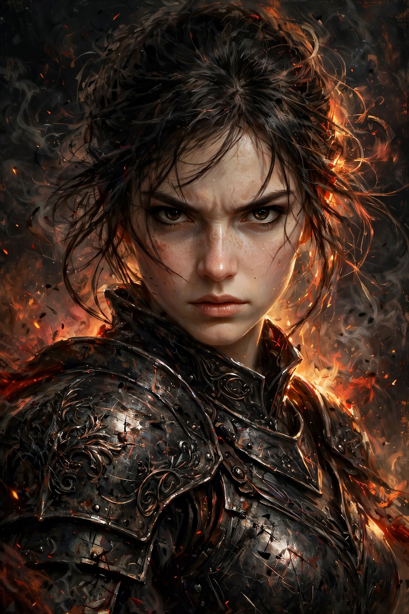
- v2 提示词原文：`Cinematic fantasy portrait, close-up of a fierce female warrior in ornate scratched dark metal armor with intricate engraved details, intense direct stare telling a story of battles fought, delicate face with subtle skin texture contrasting with heavy armor, fiery painterly brushwork texture, embers and smoke, warm rim light against a dark moody background, vulnerable yet unstoppable mood, highly detailed`
- v2 对比：面部增加了战斗痕迹与污迹、铠甲雕刻更突出，更接近“战斗故事”；代价是精致面孔被削弱了一点，v1 的干净感反而更贴近原帖“精致与沉重反差”的表述。
- v2 图：

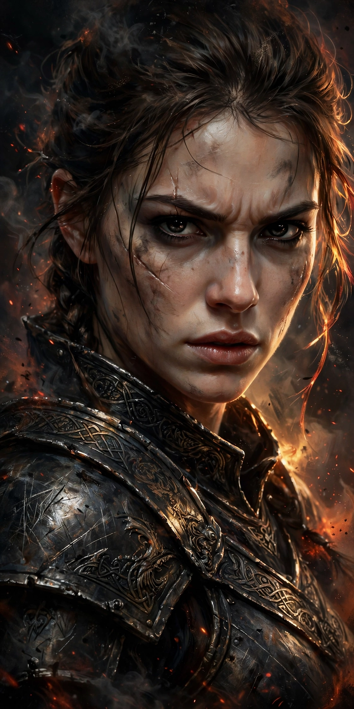
- 可复用规律：人物肖像要先定“眼神的叙事”，再定材质；只写“强烈凝视”不够，要写凝视背后的经历（battles fought），否则生成器只给一个漂亮的愤怒表情。

## 2 · Civitai · 月夜古刹双武士

- 原链接：https://civitai.com/images/146475853
- 热度：点赞 1015，爱心 346，评论 31
- 原图拆解：主体为前景背影武士 + 屋脊上的白衣老武士；构图为左前景、右中景的纵深对峙；光影为冷月光、雾；色彩为午夜蓝、石板蓝、炭黑；材质为竹编斗笠、破旧斗篷、叠层甲片、瓦片；风格为电影感东方武侠。
- v1 提示词原文：`Cinematic night scene, a Chinese warrior seen from behind in the left foreground wearing a broad woven bamboo conical hat and tattered dark indigo cloak, a straight sword on his back, facing a traditional Chinese temple roof in misty forest, a second older warrior with white hair and beard sitting on the roof ridge, cold moonlight, midnight navy and slate blue palette, atmospheric haze`
  - 中文解析：电影夜景 + 左前景背影 + 竹斗笠 + 破旧深靛斗篷 + 背剑 + 雾林古刹 + 屋脊白发老武士 + 冷月光 + 午夜蓝调。
- v1 对比：像在背影斗笠、破斗篷、月夜雾林、屋脊人物；偏在老武士偏小偏暗、前景铠甲层次弱；丢了剑鞘云纹护手、叠层甲片等近景材质。
- v1 图：

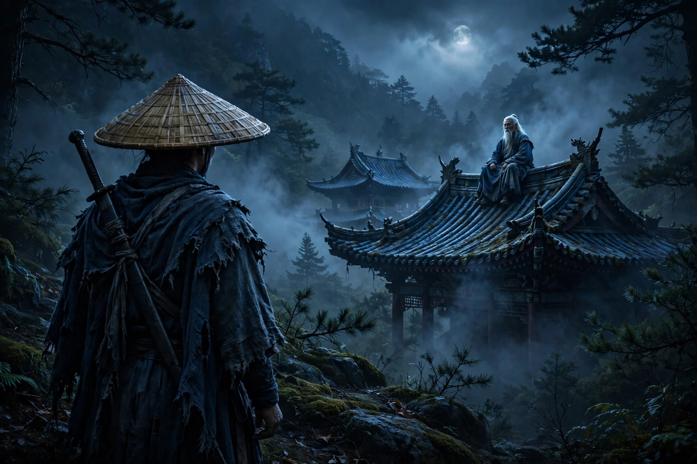
- v2 提示词原文：`Cinematic night scene, low slightly upward rear three-quarter view, a Chinese warrior in the left foreground seen from behind wearing a broad dark woven bamboo conical hat with undulating brim, long dark hair in a low knot, tattered dark indigo-gray cloak with frayed edges and torn strips, layered black leather and iron lamellar armor, a straight sword diagonally across his back with ornate silver-black cloud-pattern guard, facing a traditional Chinese temple with layered dark eaves and upturned corners in a misty forest, a rugged older warrior with short white hair and full white beard in flowing white robes sitting on the roof ridge with one hand on his sword hilt, realistic skin wrinkles, cold moonlight from upper right, midnight navy and slate blue palette, layered atmospheric perspective`
- v2 对比：白衣老武士明显变大变清晰、叠层甲与云纹护手出现，更接近原图；代价是斗笠边缘起伏被夸大、月亮被云遮住，冷光方向感弱于 v1。
- v2 图：

- 可复用规律：双人纵深画面必须给两个人各自的“尺寸权重词”（foreground / smaller / sitting on ridge），否则次要人物会被生成器缩成背景点缀。

## 3 · Civitai · 血月哥特巨城女巫

- 原链接：https://civitai.com/images/146432934
- 热度：点赞 973，爱心 359，评论 11
- 原图拆解：主体为石桥上的银黑长发女巫；构图为人物前景、巨城纵深；光影为血月红光 + 琥珀窗光 + 冷蓝雾；色彩为暗蓝、血红、暖黄；材质为维多利亚黑裙、披风、石桥；风格为电影感暗黑奇幻概念画。
- v1 提示词原文：`Dark fantasy cinematic concept art, a young witch with long silver-black hair standing alone on a stone skybridge in a gothic megacity under a blood-red lunar eclipse, black Victorian dress and long cape, holding a small glowing jack-o-lantern, thousands of tiny amber windows, cold blue mist below, ravens circling the moon, painterly matte painting`
  - 中文解析：暗黑奇幻电影概念画 + 石桥孤立女巫 + 血月月食 + 黑色维多利亚裙与披风 + 发光南瓜灯 + 成千琥珀小窗 + 冷蓝雾 + 绕月乌鸦。
- v1 对比：像在血月、巨城、石桥、南瓜灯、乌鸦群；偏在乌鸦过多、城市偏“夜景明信片”；丢了发条机械结构、幽灵光丝等原图的“被遗忘文明”细节。
- v1 图：

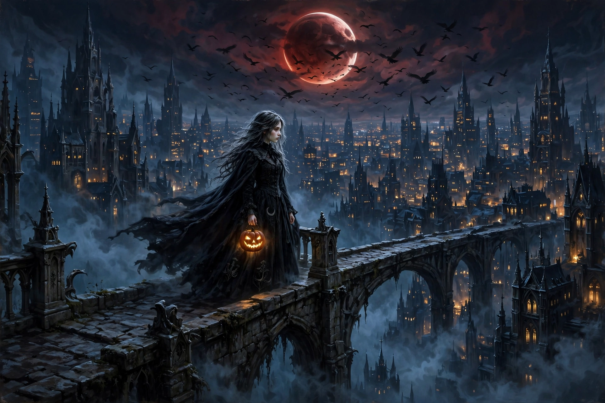
- v2 提示词原文：`Dark fantasy cinematic concept art, an immense gothic megacity beneath a blood-red lunar eclipse, colossal cathedral towers, layered elevated walkways, ancient mechanical bridges and narrow balconies stretching to the horizon, thousands of tiny amber windows, a mysterious young witch with long silver-black hair standing alone on a weathered stone skybridge in the foreground, elegant black Victorian dress with ornate details and long flowing cape, holding a small glowing jack-o-lantern lantern whose warm light touches her hands and clothing, far below abandoned streets in cold blue mist, enormous clockwork structures slowly turning, wisps of spectral light, a few ravens circling the eclipsed moon, haunting melancholic and quietly majestic mood, strong contrast of cold cyan moonlight and warm amber lights, delicate volumetric fog, painterly matte painting, no text, no watermark`
- v2 对比：发条齿轮结构出现、乌鸦减少，更接近原图的机械文明感；代价是女巫被推到左下、主体权重下降，v1 的人物中心感更好。
- v2 图：

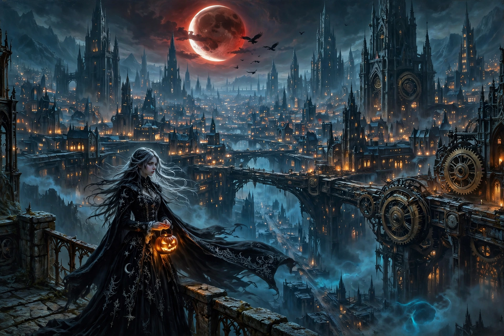
- 可复用规律：环境叙事词（clockwork、abandoned streets、spectral light）比单纯堆“巨大城市”更能定住画面气质；但每加一个环境元素，就要同时重申人物位置，否则人物会被环境吞掉。

## 4 · Civitai · 新艺术风雾中歪屋

- 原链接：https://civitai.com/images/146447650
- 热度：点赞 866，爱心 307，评论 11
- 原图拆解：主体为山丘上的歪斜木屋；构图为前景小屋、背景石塔；光影为灰天漫射光、高对比；色彩为灰、黑、暗木色；材质为破木板、雾；风格为新艺术风绘画 + 强墨线 + 褪色胶片感。
- v1 提示词原文：`Art Nouveau eerie landscape painting, a crooked dilapidated wooden house with a steep roof on a hill, massive ghostly stone towers rising into thick swirling fog behind it, strong ink outlines, high contrast dark house against grey sky, gritty atmospheric mood, detailed wood texture and fog, no border, no frame`
  - 中文解析：新艺术风诡异风景画 + 陡顶歪斜破木屋 + 雾中巨大幽灵石塔 + 强墨线 + 深屋对灰天高对比 + 粗粝氛围。
- v1 对比：像在歪屋、石塔、旋涡雾、墨线；偏在木屋占画面过大、石塔偏多；丢了原图的“小屋渺小、石塔压迫”的层级关系。
- v1 图：

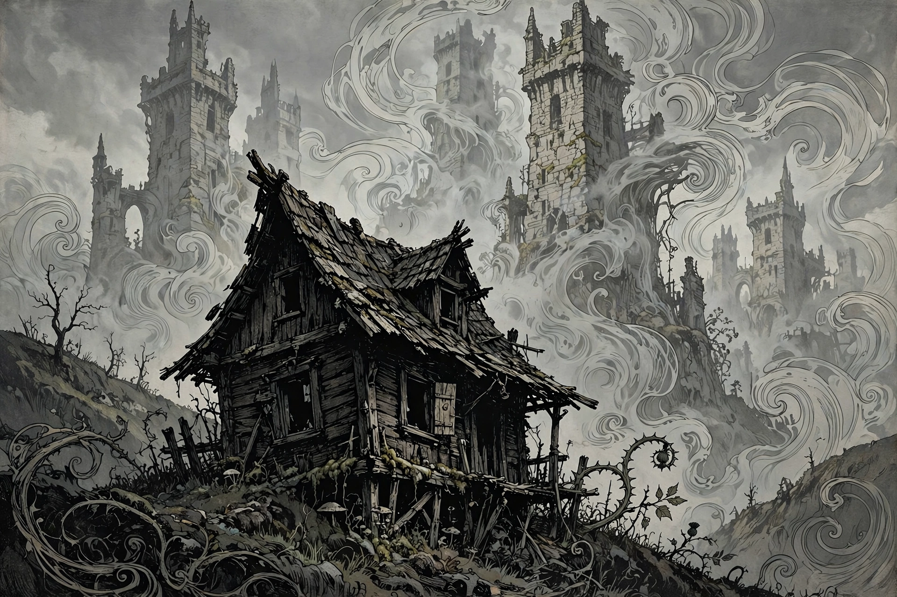
- v2 提示词原文：`Art Nouveau eerie landscape, ektachrome fade film look, a single crooked dilapidated wooden house with a steep roof on a hill, smaller in the frame with generous atmospheric space, behind it massive ghostly stone towers rising into thick swirling fog with dynamic organic curves, painterly style with strong ink outlines, high contrast between the dark house and grey sky, gritty atmospheric ominous surreal mood, ultra detailed wood texture and fog, no decorative border, no frame`
- v2 对比：木屋明显变小并退到右下、石塔的有机曲线更突出，层级更接近原图；代价是石塔过于庞大，画面重心从“屋”转到了“塔”，需要再收一点塔的体量。
- v2 图：

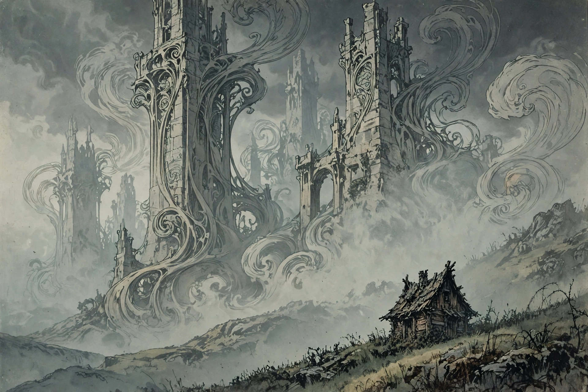
- 可复用规律：风景画里“主体的相对大小”必须写进提示词（smaller in the frame），只写“有一间屋子”时，生成器默认会把主体放大居中。

## 5 · Civitai · 绯红草原与气态巨行星

- 原链接：https://civitai.com/images/146623400
- 热度：点赞 988，爱心 329，评论 7
- 原图拆解：主体为背影坐姿女子；构图为下部草原、上部巨行星；光影为柔和大气光、粉红高光；色彩为绯红、品红、古铜、青绿；材质为草叶笔触、行星条带；风格为印象派倾向的绘画科幻。
- v1 提示词原文：`Surreal painterly science-fiction landscape, a young woman seen from behind at a distance sitting small and off-center in a field of dense waist-high crimson and magenta grass, muted earth-toned clothing, shoulders slightly hunched, gazing at the horizon, a massive banded gas giant dominating the sky in pale turquoise, cream and ochre, low viewpoint just above the grass, vertical composition, soft dusty pink light, visible brushstrokes`
  - 中文解析：超现实绘画科幻风景 + 远处背影小人物 + 腰高绯红品红草原 + 大地色衣 + 微驼肩 + 远眺 + 占据天空的带状气态巨行星 + 草上低视角 + 竖构图。
- v1 对比：像在绯红草原、小人物、巨行星条带、笔触；偏在行星过大过满、草原前景层次弱；丢了远处青色地平线、雾化平原的纵深。
- v1 图：

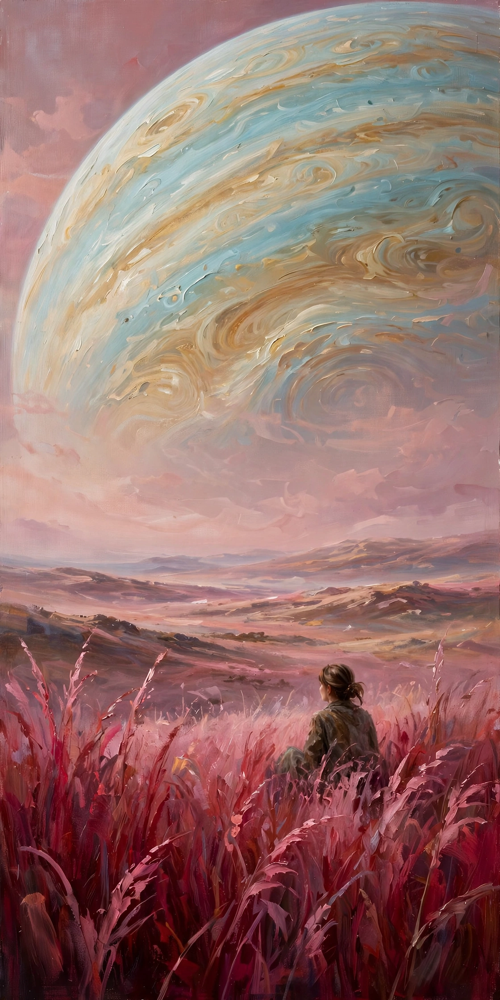
- v2 提示词原文：`Surreal painterly science-fiction concept art, vertical composition, low viewpoint just above the grass, a young woman seen from behind at a distance sitting off to one side and small against a vast landscape in a field of dense waist-high crimson and magenta grass with textured detailed blades, muted earth-toned clothing, shoulders slightly hunched, gazing toward the horizon, in the background only a large portion of a massive gas giant half-hidden beyond the frame edge, banded pale turquoise, cream and ochre atmosphere with swirling vortices, a thin glowing teal line at the distant horizon, low mountains and hazy plains fading behind the grass, soft atmospheric light with dusty pink highlights fading into dark burgundy shadows, cool blue-green contrast against warm red terrain, visible loose energetic brushstrokes, impressionistic abstract realism`
- v2 对比：行星退到左上边缘、青色地平线出现，构图更接近“只露一部分巨行星”；代价是天空变暗、草原前景笔触密度下降。
- v2 图：

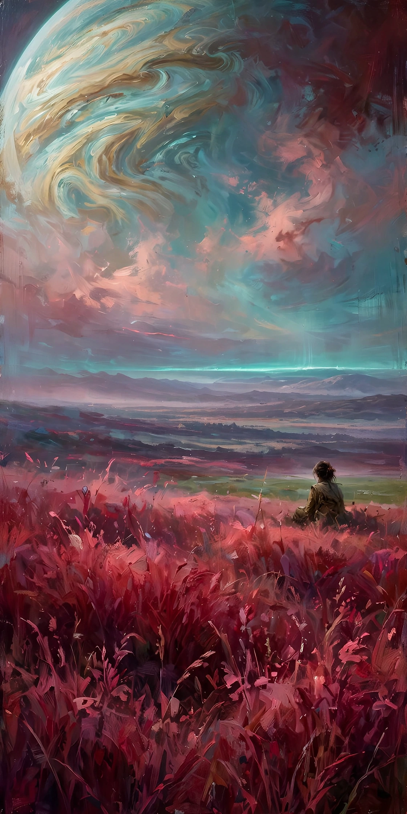
- 可复用规律：写“巨大天体”时要同时写“只露一部分、超出画框”，否则生成器会把天体当成完整主角塞满画面。

## 6 · Civitai · 月夜湖上孤舟女子

- 原链接：https://civitai.com/images/146442749
- 热度：点赞 1195，爱心 382，评论 6
- 原图拆解：主体为侧面低头的蓝衣女子；构图为竖构图、留白大气；光影为柔和漫射月光；色彩为雾青、灰蓝、炭、银白；材质为旧木船、水面倒影、干笔触；风格为日式水墨 + 电影概念画。
- v1 提示词原文：`Cinematic fantasy painting of a solitary young woman with short dark hair standing in a narrow weathered wooden boat on a perfectly still lake, side profile, long flowing midnight blue coat, head gently bowed, enormous luminous ivory full moon above, ancient stone monoliths in mist, pale turquoise water reflecting the moon, monochromatic misty cyan and slate blue palette, Japanese ink wash blended with cinematic concept art, dry brush texture, vertical composition`
  - 中文解析：电影奇幻画 + 孤舟侧面女子 + 深夜蓝长衣 + 低头 + 巨大象牙满月 + 雾中石柱 + 湖面倒影 + 雾青单色调 + 水墨与概念画结合。
- v1 对比：像在孤舟、满月、蓝衣、雾青调；偏在月亮过大居中、背景变成悬崖而非石柱、人物偏大；丢了“月亮被石柱半遮、画面留白”的克制感。
- v1 图：

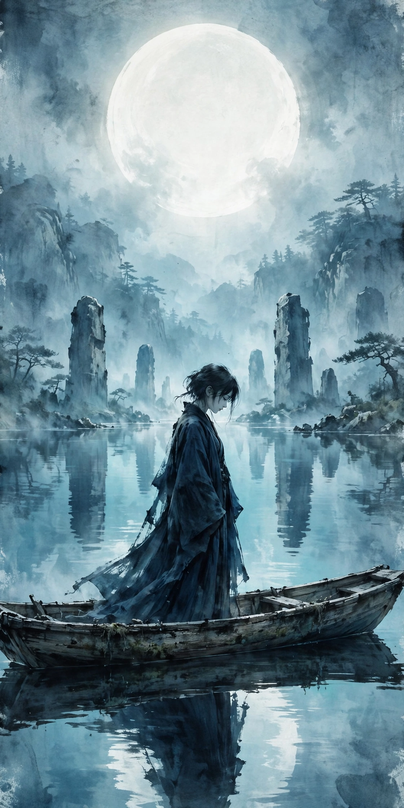
- v2 提示词原文：`Cinematic fantasy painting, minimalist vertical composition with generous atmospheric space, a solitary young woman with short dark hair in side profile standing in a narrow weathered wooden boat with slender curved ends on a perfectly still lake, long flowing midnight blue coat, head gently bowed in quiet contemplation, an enormous luminous ivory full moon high above partially obscured by towering ancient stone monoliths disappearing into mist, distant dark trees in layers of dense blue-gray fog, glasslike water reflecting the woman, boat and moon in delicate fragmented brushstrokes, restrained monochromatic palette of misty cyan, dusty teal, slate blue, charcoal and pale silver, dreamlike Japanese ink wash blended with cinematic concept art, expressive dry brush textures, subtle grain, soft diffused moonlight`
- v2 对比：船变细长翘首、月亮被石柱半遮、水面倒影更碎，明显更接近原图；代价是人物变得更小更远，孤独感增强但面部信息减少。
- v2 图：

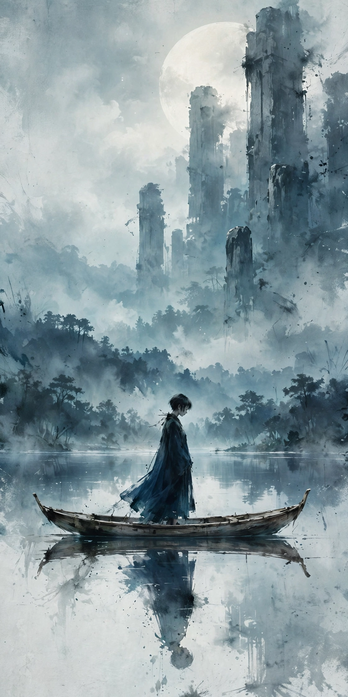
- 可复用规律：水墨类画面要写“留白、克制、半遮”，而不是只堆“巨大、明亮”；克制词本身就是构图指令。

## 7 · Civitai · 战败的带翼女战士（写实油画肖像）

- 原链接：https://civitai.com/images/146478485
- 热度：点赞 964，爱心 354，评论 12
- 原图拆解：主体为中近景疲惫女战士；构图为面部居中、双翼框住；光影为冷侧光 + 面部暖光；色彩为深黑、淡金、纯白；材质为羽毛、裂纹金属、油彩肌理；风格为电影写实油画。写实要素：疲惫表情、乱发、颈部金色裂纹铠甲、光环与双翼的对照。
- v1 提示词原文：`Photorealistic oil painting portrait, medium close-up of a defeated female warrior with wild pale blonde hair sweeping across her tired face, slumped shoulders, massive white feathered wings framing her from behind, glowing gold cracks in metallic armor plates on her neck, a delicate glowing white halo outline behind her head, deep dark background with smoke and vertical light streaks, cold side light and warm glow on her face, palette of black, pale blonde, gold and white`
  - 中文解析：写实油画肖像 + 战败女战士 + 乱金发扫过疲惫面孔 + 塌肩 + 白羽翼框住 + 颈甲金色裂纹 + 细白光环 + 暗背景烟与竖光 + 冷暖对照。
- v1 对比：像在双翼、光环、金裂纹、疲惫感；偏在面部多了划痕、肩膀不够塌；丢了“战败后的松弛”而非“战斗中的紧张”。
- v1 图：

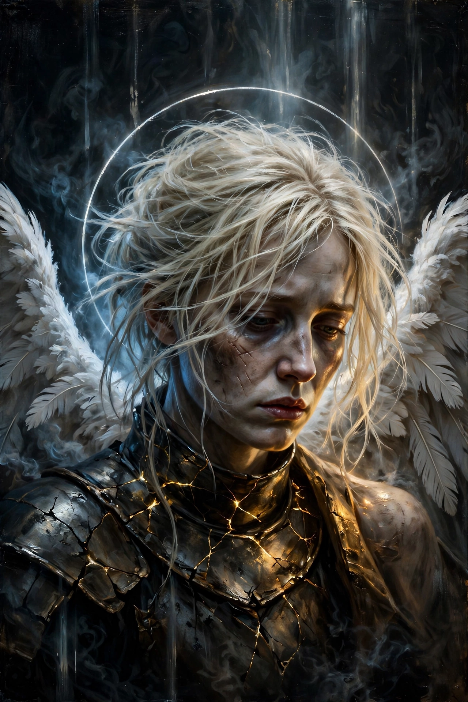
- v2 提示词原文：`Photorealistic oil painting, medium close-up portrait of a mysterious defeated female warrior, sitting slightly hunched over with shoulders slumped in exhaustion, like a fallen warrior who has lost her final battle, long wild pale blonde hair sweeping across her tired expressive face, weary melancholic expression with sharp features, no scars on her face, glowing gold cracks running through metallic armor plates on her neck, massive white feathered wings framing her from behind, delicate glowing white circular halo outlining the back of her head, deep dark atmospheric background with smoke and vertical light streaks, dramatic cinematic lighting with strong cold side light on armor and feathers and a warm soft glow on her hair and face, palette of deep black, pale blonde, brilliant gold and stark white, visible brushwork and tactile oil-paint texture`
- v2 对比：面部划痕消失、头更低、身体更松弛，更接近原图的“战败”而非“应战”；金裂纹与光环保持完好。
- v2 图：

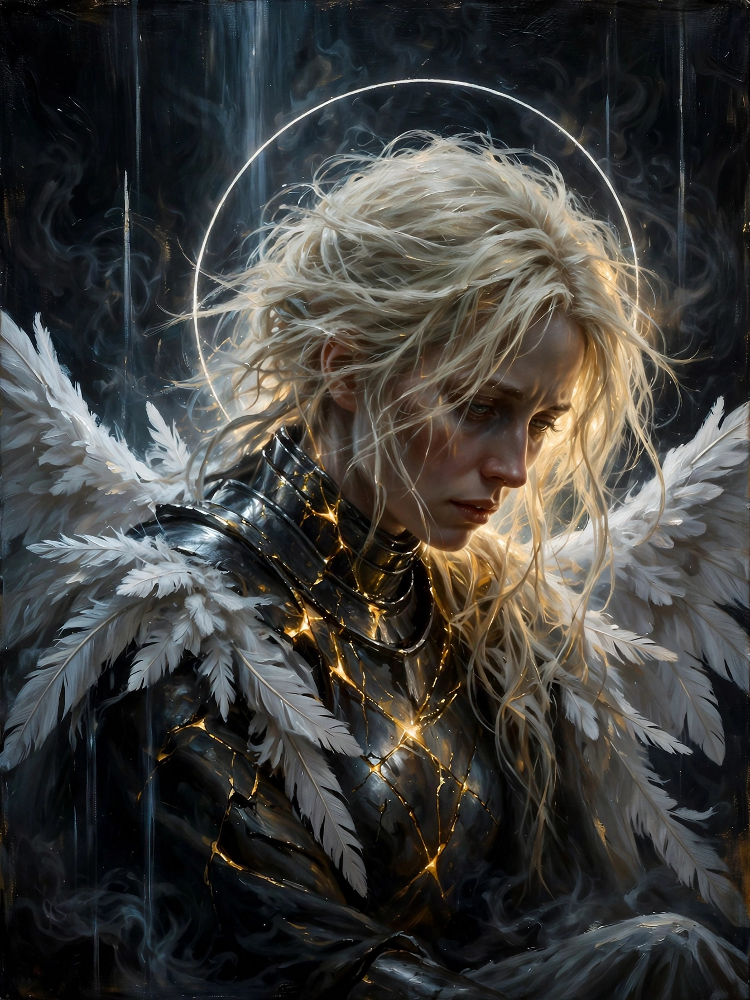
- 可复用规律：写实人物要写“身体状态动词”（slumped、hunched）而不是只写情绪词（sad、tired）；姿态比表情更能卖出真实感。

## 8 · Civitai · 橙色羽绒服手指取景

- 原链接：https://civitai.com/images/146540968
- 热度：点赞 984，爱心 338，评论 7
- 原图拆解：主体为下蹲的街头风女子；构图为极低机位仰拍、偏心不对称；光影为均匀明亮棚拍光；色彩为霓虹橘、炭、黑、纯白；材质为尼龙羽绒、罗纹针织、工装裤；风格为平面插画 + 细赛璐璐阴影。
- v1 提示词原文：`Crisp graphic digital illustration, extreme low-angle floor skim looking up at a young adult woman in a deep athletic fashion crouch on a stark clean white background, one knee on the floor, other knee up to chest, both hands forming a square camera frame around one wide amber eye, intense charismatic grin, short tousled raven-black bob, oversized neon-tangerine nylon puffer bomber jacket slipping off shoulders, charcoal ribbed mock-neck sleeveless top, wide-leg dark cargo trousers, high-top boots, bright even studio light, flat color blocking with subtle cel shading`
  - 中文解析：清晰平面插画 + 极低地面仰拍 + 深蹲 + 双手框住一只琥珀眼 + 魅力笑 + 黑色短波波头 + 霓虹橘羽绒 + 炭色无袖高领 + 阔腿工装裤。
- v1 对比：像在橘色羽绒、下蹲、笑容、纯白背景；偏在只用一只手取景、机位不够低；丢了“双手框眼”这个核心手势。
- v1 图：

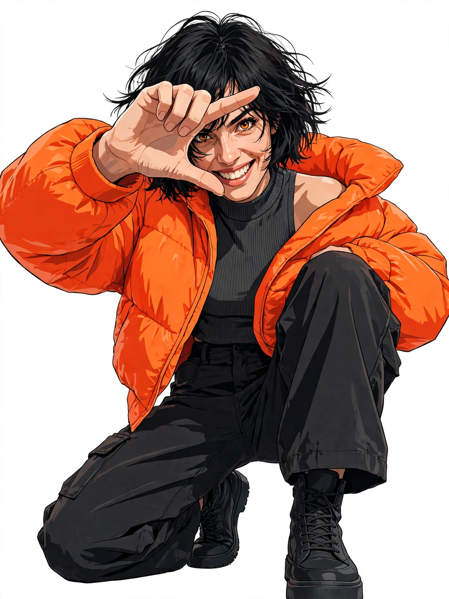
- v2 提示词原文：`Crisp graphic digital illustration, a young adult woman against a stark clean white background, shot from an extreme low-angle floor skim looking upward at an off-center asymmetrical angle, deep athletic fashion crouch with one knee pressed flat to the floor and the other drawn up high to chest level, BOTH hands raised in front of her face with fingers playfully forming a square camera frame around ONE wide amber eye, looking through the gap with an intense charismatic grin, short tousled raven-black bob framing her cheeks, oversized neon-tangerine nylon puffer bomber jacket slipping loosely off both shoulders exposing a fitted charcoal ribbed mock-neck sleeveless top, relaxed wide-leg dark cargo trousers puddling around high-top boots, even bright commercial studio illumination, crisp black ink contours, flat color blocking with subtle cel shading, restrained palette of neon tangerine, charcoal, black and pure white`
- v2 对比：双手框眼终于出现、一只琥珀眼清晰，更接近原图核心手势；代价是机位仍不够“贴地仰拍”，靴子前景被放大。
- v2 图：

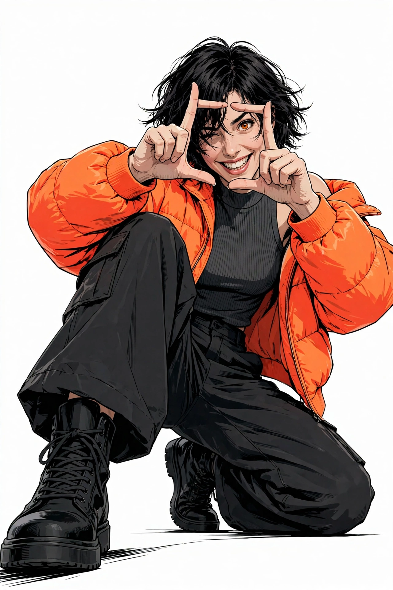
- 可复用规律：手势类画面要把手的数量和手指动作写成大写强调式短句（BOTH hands / ONE eye），否则生成器会按最省力的方式只画一只手。

## 9 · Civitai · 动漫风火焰喷射（未完成）

- 原链接：https://civitai.com/images/146492000
- 热度：点赞 1000，爱心 357，评论 20
- 原图拆解：主体为穿动力甲的动漫少女；构图为宽幅动态镜头；光影为火焰暖光 + 隧道暗调；色彩为火焰橙、暗洞灰；材质为动力甲、火焰轨迹；风格为幽默 CGI 动漫插画。原图要点：人物在左上、火焰向右下横扫、怪物群在底部与右侧、表情为夸张的惊慌哭喊。
- 尝试过的 v1 提示词原文：`Humorous CGI anime illustration, wide dynamic shot of a blue-haired anime girl dressed as a futuristic power-armored sister warrior firing a heavy flamethrower in a sweeping arc at an endless wave of alien monsters in dark scary tunnels and catacombs, exaggerated panicking crying screaming expression, burning monsters at the bottom of the frame, more monsters coming from the right`
  - 中文解析：幽默 CGI 动漫插画 + 宽动态镜头 + 蓝发少女动力甲 + 重型喷火器横扫 + 无尽异形怪群 + 隧道墓穴 + 夸张惊慌哭喊表情。
- **生成状态：v1 未生成成功，v2 未尝试，不用无关图片代替。** 本节只有拆解与提示词，无对比、无规律验证。
- 可复用规律：未验证，不写。

## 10 · Civitai · 丝网印粉笔轮廓（未完成）

- 原链接：https://civitai.com/images/146540752
- 热度：点赞 1127，爱心 384，评论 4
- 原图拆解：主体为地面白色粉笔人形轮廓；构图为轮廓居中、夜城在外；光影为夜间灰调 + 星空；色彩为灰、白、少量彩色斑点墨；材质为粗糙灰纸、半调圆点、撕边；风格为丝网印（risograph）实验版画。原图要点：轮廓内不是尸体细节，而是黑色星空；画面由不同密度的半调圆点构成；边缘为油墨未到的撕纸。
- 尝试过的 v1 提示词原文：`Risograph print on rough grey paper, a man-shaped white chalk outline of a crime scene sprawled asymmetrically on a sidewalk at night, outside the outline a grey grimy city street, inside the outline only the black void of space dotted with stars, tiny halftone dots in white, black and colorful spot inks, torn rough paper border where ink does not reach the edges, heartbreaking, atomized halftone texture, no linework detail`
  - 中文解析：粗糙灰纸丝网印 + 不对称 sprawl 的粉笔人形 + 夜城在外 + 轮廓内只有星空黑洞 + 白黑彩色半调圆点 + 撕纸边缘 + 令人心碎的雾化质感 + 无线条细节。
- **生成状态：v1 未生成成功，v2 未尝试，不用无关图片代替。** 本节只有拆解与提示词，无对比、无规律验证。
- 可复用规律：未验证，不写。

## 11 · SeaArt · 1895 年写信女子（写实人物）

- 原链接：https://www.seaart.ai/postDetail/db9bu95e878c73f1enag?pt=lg-cluster-43
- 热度：页面显示数字：200 / 124 / 17（字段未标注）
- 原图拆解：主体为写信的年轻女子；构图为隔桌微高四分之三视角；光影为暖油灯光 + 窗外冷暮光；色彩为奶油白、深酒红、木褐；材质为蕾丝、纸纤维、旧木、墨水；风格为历史剧情片剧照感写实照片。
- 写实要素拆解：皮肤纹理与毛孔、雀斑等瑕疵；自然放松的沉思表情而非僵笑；右手握笔姿态（拇指食指引导、中指支撑、其余手指弯曲）；左手轻按信纸；眼神光来自油灯而非均匀打光；背景虚化但书架、蕾丝窗帘仍可辨；颗粒感克制。
- AI 破绽对照：本类最容易破绽是手指数量与握笔角度、信纸文字变成可读的现代乱码、油灯与窗光方向打架；原图用“文字保持模糊但合理”规避了文字破绽。
- v1 提示词原文：`Photorealistic historical photograph, around 1895, a young adult German woman with chestnut-brown hair in a practical pinned-up style sitting at a freestanding writing desk in a modest town house, high-necked cream blouse with lace cuffs, dark burgundy skirt, thoughtful expression, writing a letter by warm oil-lamp light, cool evening light at a window, dip pen in her right hand with natural grip, five distinct fingers, realistic skin texture with pores and slight imperfections, no retouching look, candid, 85mm lens, shallow depth of field, blotter, ink bottle, wax seal and stationery on the desk, tall bookcase and lace curtain in the room`
  - 中文解析：写实历史照片 + 1895 + 栗色盘发 + 高领奶油衬衫蕾丝袖口 + 深酒红裙 + 沉思 + 油灯写信 + 窗外冷光 + 自然握笔 + 五指分明 + 带毛孔与小瑕疵的真实皮肤 + 无修图感 + 抓拍 + 85mm + 浅景深。
- v1 对比：像在盘发、蕾丝、书架、窗外冷光、握笔与五指、皮肤雀斑；偏在油灯在背景而非桌面、相机角度偏侧面；丢了独立书桌居中、写字盒、系绳信件等桌面叙事。
- v1 图：

- v2 提示词原文：`Photorealistic historical photograph, around 1895, camera facing a young adult German woman from across a freestanding writing desk at a slightly elevated three-quarter angle, desk standing away from the walls in the middle of a quiet room, chestnut-brown hair in a practical pinned-up style, high-necked cream blouse with subtle lace at the cuffs, dark burgundy skirt, thoughtful expression composing a letter, a shaded oil lamp and a small period writing box on the tabletop, right hand holding a dip pen with natural grip, thumb and index guiding the shaft, middle finger supporting, remaining fingers curved toward the paper, left hand resting beside the letter with relaxed fingertips, five distinct fingers, natural nails and wrist alignment, realistic skin texture with pores and slight imperfections, no retouching look, candid, 85mm lens, blotter, ink bottle, brass letter opener, cream stationery, wax seal, folded letter tied with string, tall bookcase, lace curtain, window overlooking a quiet cobbled street, warm oil-lamp light on paper and hands, cool evening light at the window, no modern equipment, handwritten text indistinct`
- v2 对比：油灯回到桌面、写字盒与系绳信件出现、石板街窗景更明确，更接近原图；相机角度仍偏侧面，未完全做到“隔桌正对”，但桌面叙事已补齐。
- v2 图：

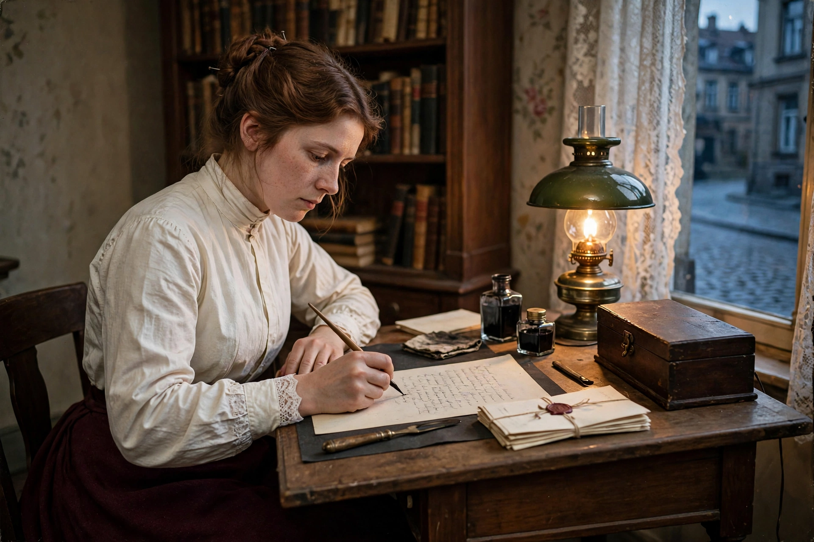
- 可复用规律：写实人物要先写“手在做什么、手指怎么放”，再写脸；手是写实照片的第一破绽点，脸反而最容易被生成器美化过头。

## 12 · SeaArt · 书堆代桌腿的女子（写实人物）

- 原链接：https://www.seaart.ai/postDetail/db0pf5de878c73ae8bk0?pt=lg-cluster-43
- 热度：页面显示数字：620 / 172 / 61（字段未标注）
- 原图拆解：主体为端茶杯的年轻女子；构图为竖幅、书堆为视觉焦点；光影为明亮晨光 + 硬阴影；色彩为米白、木褐、书脊杂色；材质为旧纸、抛光木、陶杯；风格为超写实纪录摄影。
- 写实要素拆解：凌乱马尾与碎发飞散；自然放松的侧脸与视线放空；皮肤毛孔与小瑕疵；晨光硬阴影揭示书堆的倾斜与受压；书页边缘弯曲、纸张磨损；背景虚化但仍有生活气息。
- AI 破绽对照：书脊文字容易乱码、书堆结构容易“物理上站不住”、茶杯手指容易多指或穿杯；原图用“焦点放在书堆、人物假装一切正常”的反差来转移对完美的期待。
- v1 提示词原文：`Hyperrealistic documentary photograph, vertical shot, a woman in her 20s with a casual messy ponytail wearing neat loungewear, sitting composed on a chair and casually holding a delicate teacup, pretending everything is normal, in a sunlit cozy apartment living room, one leg of an elegant wooden dining table missing and replaced by an unstable towering stack of mismatched thick books and vintage encyclopedias crushed under the table corner, bright morning sunlight casting hard shadows, sharp focus on the book stack, authentic distressed paper and polished wood textures, realistic skin texture with pores and slight imperfections, no retouching look, candid, 85mm lens, realistic depth of field`
  - 中文解析：超写实纪录摄影 + 竖幅 + 20 多岁女子凌乱马尾 + 居家服 + 端茶杯假装正常 + 阳光公寓 + 桌腿缺失、书堆代腿 + 晨光硬阴影 + 书堆锐焦点 + 旧纸与抛光木质感 + 真实皮肤 + 无修图感 + 抓拍 + 85mm。
- v1 对比：像在马尾、茶杯、书堆、晨光硬阴影；偏在书堆过于整齐高大、人物偏侧面；丢了书堆的“摇摇欲坠、不匹配、纸边受压弯曲”。
- v1 图：

- v2 提示词原文：`Hyperrealistic documentary photograph, vertical shot, sharp focus on an absurd makeshift book support, a woman in her 20s with a casual messy ponytail wearing neat loungewear sitting composed on a chair casually holding a delicate teacup pretending everything is completely normal, sunlit cozy apartment living room, bright morning sunlight casting hard shadows revealing a precarious tilted book stack, one leg of an elegant wooden dining table missing and replaced by an unstable towering stack of mismatched thick books, heavy colorful vintage encyclopedias and bent dictionaries crushed awkwardly under the table corner, visible bending paper edges under heavy weight, authentic textures of distressed paper and polished wood, realistic depth of field, realistic skin texture with pores and slight imperfections, no retouching look, candid, 85mm lens`
- v2 对比：书堆更杂乱、磨损、纸边弯曲，焦点更明确地落在书堆上；代价是书堆更高更抢眼，人物退为配角，但这正是原图的“荒诞焦点”逻辑。
- v2 图：

- 可复用规律：写实荒诞感要靠“一个物理上不合理的支点 + 一个完全正常的表情”来制造；只写荒诞，生成器会把人物也画得很夸张。

## 13 · SeaArt · 白色空间中的水彩女子

- 原链接：https://www.seaart.ai/postDetail/dbcl55le878c73d1fcf0?pt=lg-cluster-47
- 热度：页面文本未显示热度数字
- 原图拆解：主体为中景站立女子；构图为低机位、无限白空间；光影为柔和漫射、脚下淡影；色彩为白、淡灰、淡金发；材质为水彩晕染、墨线；风格为水彩 + 墨水极简插画。
- v1 提示词原文：`Artistic watercolor and ink illustration, wide infinite white space, floor fading seamlessly into background, low angle view of a single young woman viewed from a low angle standing in the mid-ground, feet shoulder-width apart, both arms raised diagonally upwards with open hands, long oversized white T-shirt past her knees, slightly messy long blonde hair, subtle soft shadows beneath her feet, soft textures, soft colors, minimalist, emotional and liberating vibe, airy spacious composition, no text`
  - 中文解析：水彩墨水插画 + 无限白空间 + 地面无缝融入背景 + 低机位中景女子 + 双脚与肩同宽 + 双臂斜上张开 + 过膝白 T + 微乱金发 + 脚下淡影 + 柔和极简。
- v1 对比：像在白空间、水彩质感、双臂上扬、过膝白衣；偏在人物偏大偏居中、脚下阴影弱；丢了“中景、低机位、留白压倒人物”的空间感。
- v1 图：

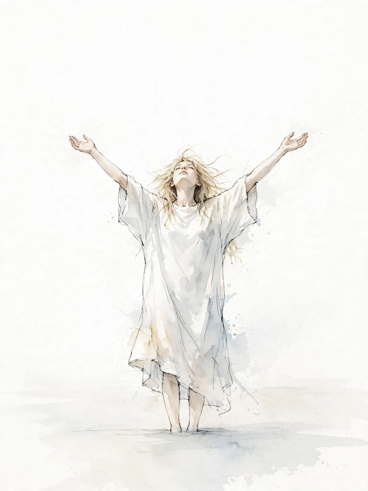
- v2 提示词原文：`Artistic watercolor and ink illustration, wide infinite white space, infinite flat white floor seamlessly fading into the vast background, from a low angle view, a single young woman viewed from a low angle standing in the mid-ground, smaller in the frame, feet shoulder-width apart, both arms raised diagonally upwards with open hands, long oversized white T-shirt past her knees, slightly messy long blonde hair, subtle soft shadows beneath her feet on the floor, soft textures, soft colors, minimalist, emotional and liberating vibe, highly airy and spacious composition, no text`
- v2 对比：人物变小、地面分界线与脚下阴影更明确，留白感更接近原图；低机位感仍不强，但空间关系已改善。
- v2 图：

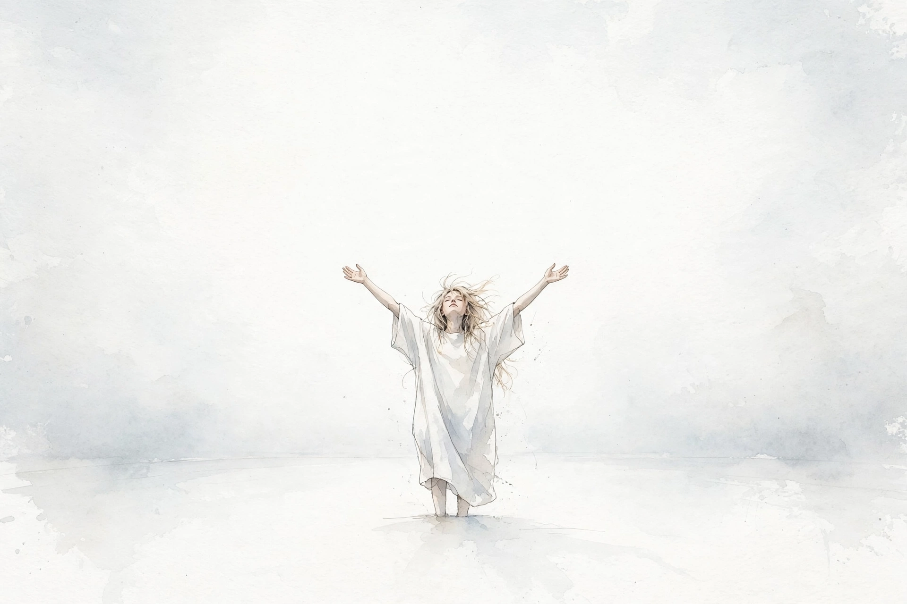
- 可复用规律：极简画面要写“人物在画面中的占比”（smaller in the frame），否则生成器会默认把人物放大填满留白。

## 14 · SeaArt · 夕阳老街的动漫女子

- 原链接：https://www.seaart.ai/postDetail/dbe190le878c739t4idg?pt=post_bubble_s
- 热度：页面显示数字：60 / 10 / 12（字段未标注）
- 原图拆解：主体为全身动漫女子；构图为低机位动态透视；光影为夕阳逆光、长影、镜头光晕；色彩为橙、灰、牛仔蓝；材质为针织、牛仔布、木栅栏；风格为半写实动漫插画。
- v1 提示词原文：`2D anime illustration, full body, a young woman with short black hair in a low ponytail and glasses, grey tube top and blue denim tight pants, standing with hand on hip and confident smile, low angle dynamic perspective, old Japanese nagaya street with wooden fence, distant castle keep, sunset sky with orange clouds, backlight, long shadow, lens flare, dramatic lighting`
  - 中文解析：2D 动漫插画 + 全身 + 黑色低马尾眼镜女子 + 灰色抹胸 + 蓝色紧身牛仔裤 + 手叉腰自信笑 + 低机位动态透视 + 老街木栅栏 + 远处天守 + 夕阳橙云 + 逆光长影光晕。
- v1 对比：像在全身、老街、天守、夕阳光晕；偏在机位不够低、影子不够长；丢了“逆光把人物剪影化、影子拉向镜头”的动态感。
- v1 图：

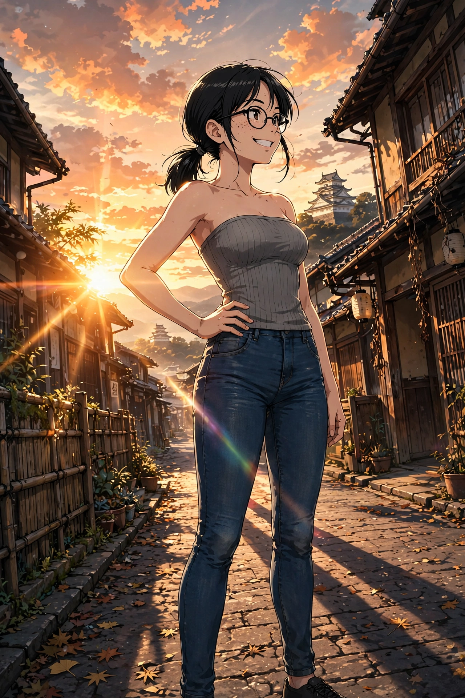
- v2 提示词原文：`2D anime illustration, full body, low angle dynamic perspective, a young woman with short black hair in a low ponytail and glasses, grey tube top, blue denim tight pants, standing with hand on hip and confident smile, backlit by a sunset, long shadow stretching behind her across the street, lens flare, dramatic lighting, old Japanese nagaya street with wooden fence, distant castle keep tenshu, sunset sky with orange clouds, anime illustration`
- v2 对比：低机位更明显、长影拉向镜头、夕阳逆光更强，更接近原图；手叉腰姿态略有变化，但整体动态感提升。
- v2 图：

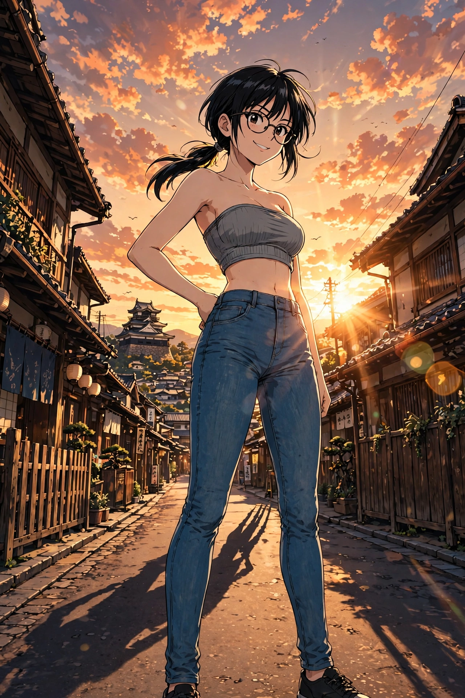
- 可复用规律：逆光画面要写“影子的方向和长度”（long shadow stretching behind her），只写 backlight 时，生成器常常只给一个漂亮的金色背景。

## 15 · SeaArt · 雾中庄园的民宿女主人（写实人物）

- 原链接：https://www.seaart.ai/postDetail/d7k15i5e878c7390rt50?pt=lg-cluster-10
- 热度：页面文本未显示热度数字
- 原图拆解：主体为翠绿天鹅绒套装的女主人；构图为大堂中景、棋盘格地面；光影为壁炉暖光 + 漂浮蜡烛；色彩为翠绿、金、黑白格、星光蓝；材质为天鹅绒、金线、银盘、大理石；风格为奇幻写实。
- 写实要素拆解：皮肤雀斑与毛孔、自然发丝、放松但专业的表情；手部动作明确（递钥匙、托盘）；眼神光来自壁炉与烛光；背景虚化但仍保留半透明客人与蒸汽朋克客人的轮廓；颗粒与暖调让“奇幻”不显得塑料。
- AI 破绽对照：半透明人物容易变成“重影错误”、漂浮行李容易失去重力方向、银盘反光容易与背景混淆；原图用“主人镇定、客人奇异”的对照来稳住画面逻辑。
- v1 提示词原文：`Fantasy realism photograph, a beautiful woman with a sleek athletic silhouette as host of a luxurious boutique bed and breakfast in a surreal fog-wrapped Victorian manor on a floating cliff, magnificent custom-tailored emerald velvet evening suit with golden filigree buttons, grand foyer with checkered marble floor, holding a massive silver tray with glowing levitating crystal carafes, calmly handing an ornate brass key to a translucent guest, enchanted suitcases floating behind, warm cinematic light from a giant fireplace and floating candles, realistic skin texture with pores and slight imperfections, no retouching look, candid, 85mm lens, detailed fabric and marble reflections`
  - 中文解析：奇幻写实照片 + 民宿女主人 + 翠绿天鹅绒定制套装金线纽扣 + 棋盘格大理石大堂 + 银盘发光水晶瓶 + 递黄铜钥匙给半透明客人 + 漂浮行李 + 壁炉与漂浮蜡烛暖光 + 真实皮肤 + 无修图感 + 抓拍 + 85mm。
- v1 对比：像在翠绿天鹅绒、棋盘格、银盘、发光水晶瓶、半透明客人、漂浮行李；偏在背景客人缺失、画面只有一对主客；丢了“登记中的奇异客人团体”这一叙事层。
- v1 图：

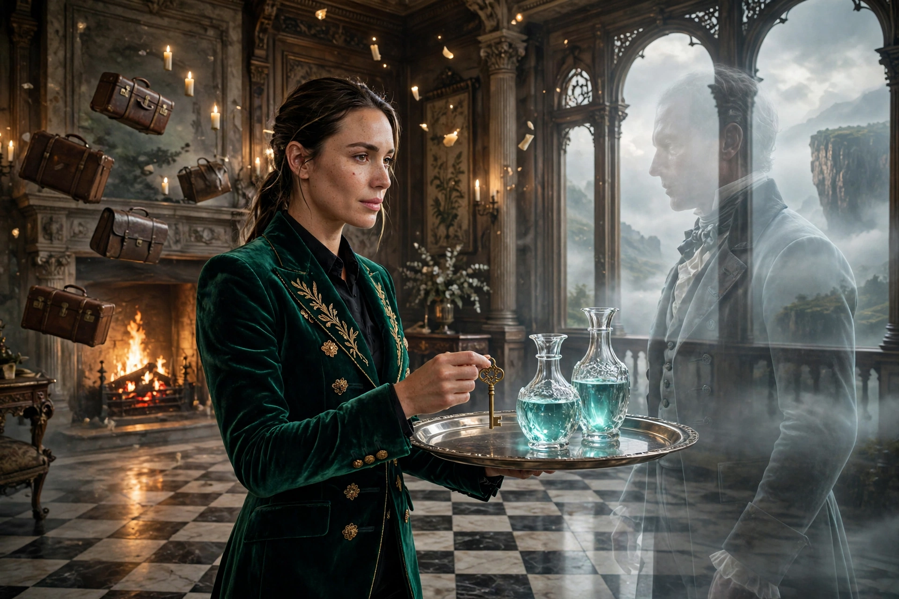
- v2 提示词原文：`Fantasy realism photograph, a stunningly beautiful woman with a sleek athletic silhouette as host of a luxurious high-end boutique bed and breakfast in a surreal fog-wrapped Victorian manor perched on a floating cliff, magnificent custom-tailored emerald velvet evening suit fitting like a second skin with golden filigree buttons, standing in a grand foyer with a checkered marble floor, holding a massive silver tray with glowing levitating crystal carafes of starlight tea, calmly handing an ornate pulsating brass key to a translucent guest, beside her a group of extraordinary guests, shadowy figures with glowing eyes and travelers in steampunk exoskeletons checking in, enchanted suitcases floating behind them, warm cinematic lighting from a giant fireplace and floating candles, incredible detail on fabric, reflections on marble, realistic skin texture with pores and slight imperfections, no retouching look, candid, 85mm lens`
- v2 对比：发光眼黑影客人、蒸汽朋克登记客人、递钥匙的半透明客人全部出现，叙事层补齐，更接近原图；代价是画面元素增多，女主人不再是唯一视觉中心，但这正是原图的“日常奇幻”逻辑。
- v2 图：

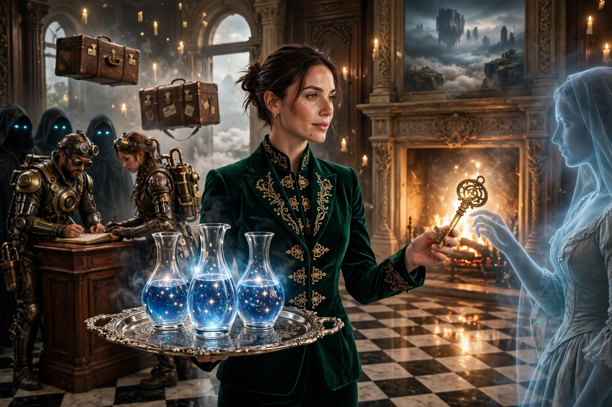
- 可复用规律：奇幻写实要给“奇异元素一个日常动作”（checking in、handing a key），否则奇异元素会变成无逻辑的装饰堆砌。

---

## 15 张共性结论

1. **先定关系，再定细节**：高热度图大多先有一个清晰关系——凝视与铠甲、背影与屋脊、人物与巨城、人物与书堆、小人物与大天体。v1 丢的往往不是细节，而是这个关系。
2. **大小与位置是提示词，不是构图运气**：smaller in the frame、off to one side、foreground / background、half-hidden beyond the frame，这些词直接决定了 v2 是否更接近。
3. **材质词要成对出现**：光 + 材质（冷月光 + 瓦片、油灯 + 纸纤维、壁炉 + 天鹅绒）比单独写“精致”更有效。
4. **手势与姿态优先于情绪词**：双手框眼、塌肩、递钥匙、端茶杯假装正常，这些动作比 sad、confident 更能让画面成立。
5. **克制词是风格词**：留白、半遮、单色、雾化、模糊文字，这些“减法”往往比“更多细节”更接近原图。
6. **v2 的常见代价**：补一个元素常常会放大另一个元素（斗笠边缘、书堆高度、石塔体量），所以 v2 之后仍需再收一次权重，而不是默认 v2 一定全胜。

## 写实人物小结（第 2、7、11、12、15 张，及第 1 张的面部对照）

- **为什么看起来逼真**：不是因为“更清晰”，而是因为“有瑕疵、有重量、有不一致的光”。第 11 张的雀斑与盘发碎发、第 12 张的凌乱马尾与硬阴影、第 15 张的皮肤纹理与壁炉光，都是“不完美但自洽”的证据。
- **皮肤**：`realistic skin texture with pores and slight imperfections` + `no retouching look` 是最有效的去塑料感组合；只写 beautiful skin 反而会滑向塑料。
- **手与解剖**：先写手的动作与手指分工，再写脸；第 11、12 张的 v2 都证明，手指词（thumb / index / middle finger、holding a teacup）比面部词更能决定写实成败。
- **光与镜头**：`candid` + `85mm lens` + 浅景深 + 一个主光源（油灯、晨光、壁炉）是写实组的通用骨架；多光源、无方向光是塑料感的常见来源。
- **表情**：抓拍感来自“正在做事的表情”（写信沉思、端茶放空、递钥匙镇定），而不是对镜头摆出的僵笑、假笑。
- **常见 AI 破绽自查表**：皮肤过滑、五官过对称、手部变形、牙齿不自然、光影不一致、文字乱码、漂浮物无重力方向。写实提示词里要逐项给反制词：毛孔与瑕疵、五指分明、自然不对称、文字模糊但合理、光源单一、动作日常。

## 附：重生成图片文件清单

- v1 已生成：1、2、3、4、5、6、7、8、11、12、13、14、15（共 13 张）
- v2 已生成：1、2、3、4、5、6、7、8、11、12、13、14、15（共 13 张）
- 未生成：9 v1、9 v2、10 v1、10 v2（共 4 张次），原因见第 9、10 节，不用无关图片代替。
- 图片目录：`~/workspace/goals/ai-2/hidden_files/2026-10-29/images/`

---

## 补记：浏览器复核（2026-10-29 09:23 完成）

- 浏览器任务独立核实：Civitai 最多反应 / 近一周排序页可正常打开；OpenArt 原地址返回 404，其新版灵感页以视频模板帖为主，无合格静态图，OpenArt 0 张的结论与本报告一致；SeaArt 探索页实际经首页“Explore More”到达 https://www.seaart.ai/post ，并排除了带视频标记的帖子。
- SeaArt 热度字段经浏览器截图确认图标顺序为点赞 / 收藏 / 浏览 / 评论，据此补记：Last Letter 200 / 124 / 16 / 0；謎めいた時間（书堆）620 / 172 / 60 / 4；Goodbye, Stress 62 / 7 / 8 / 0，作者为修一；夕阳动漫女子 60 / 10 / 11 / 0；B&B Host 381 / 67 / 81 / 2，作者为💫共生💫。其中个别浏览数与本报告正文的页面数字序列相差 1，以本次图标顺序核实为准，正文“字段未标注”的谨慎表述仍然成立。
- 浏览器另核实一张未列入本期主选的写实人物候选：Civitai 6vidit9 橙发肖像，https://civitai.com/images/146477076 ，点赞 1003、爱心 380，竖幅电影摄影风，橙发飘散、面部居中、鼻颊有细小雀斑、背景近乎纯黑。因本期 15 张的对比已全部完成，不再临时替换，留作后续选图参考。
- Civitai 详情页反应数与本报告接口快照相差 1–2（如 Midoriya 详情页点赞 1253、FUNLUCKY 1014），属不同时间点的正常变动，报告正文以 09:29 接口快照为准。
