# 每日 AI 图片反推学习 · 2026-10-30

## 选图说明与缺口

- 选图时间：2026-10-30 上午（北京时间），浏览器调研 08:58–09:24 完成。
- Civitai：可正常打开，排序为最多反应、近一周、非成人内容；写实人物候选另经站内 REALISTIC 标签在同一排序下筛选。
- **OpenArt 缺口**：旧版 `openart.ai/discover` 与 `openart.ai/inspire` 当天均返回 404，并提示旧版将于 2026-11-01 PST 停用；新版 `openart.ai/suite/inspire/feed` 可以打开，但抽查的 3 帖均为视频（24 秒时尚广告视频、0:04 视频、Seedance 视频），按规则排除，不把视频截图当作静态热门图。缺额由另外两站补足，**不硬编 OpenArt 热度**，本期无 OpenArt 入选图。
- **SeaArt 呈现缺口**：`seaart.ai/explore` 当天先显示 Loading，随后重定向到首页；本期 SeaArt 候选均取自首页“Explore Creations from the SeaArt Community”社区展示区。SeaArt 详情页主图当天多为黑屏/未完全渲染，SeaArt 部分的视觉描述以首页缩略图、标题、标签和提示词为准，近景细节凡缩略图分辨率下无法确认者一律写“未显示”，不作推断。
- Civitai 热度为详情页所见数字；SeaArt 详情页数字旁只有图标、页面未标注字段含义，报告里只写页面显示的数字顺序，不硬编为“点赞数”或“收藏数”。
- **与昨日重合说明**：第 1、6、7 张也出现在 2026-10-29 报告中（分别为当时的第 10、5、8 张），但它们仍在今日热门榜上，故按今日榜单入选；本期三张均使用新写的反推提示词并重新生成，不照搬昨日提示词与成图。第 1 张昨日 v1 未生成成功，今日重新尝试一次后仍未成功，见第 1 节。
- 本报告的 v1 均为反推重写，不是照抄原帖提示词。
- 重生成图片保存在本任务目标工作区 `hidden_files/2026-10-30/images/` 下，报告内以图片文件名对应。
- **生成缺口（重要）**：第 1 张的 v1 未生成成功，按规则不再重复尝试，因此该张没有 v2，也没有用无关图片代替。详见第 1 节。

## 一览表

| # | 平台 | 作者 | 原链接 | 热度（快照） |
|---|---|---|---|---|
| 1 | Civitai | SynesthesiaSoul | https://civitai.com/images/146540752 | 点赞 1263，爱心 427，笑 157，哭 57，评论按钮显示 200 |
| 2 | Civitai | Geragl | https://civitai.com/images/146437488 | 点赞 961，爱心 363，笑 71，哭 28，评论按钮显示 40 |
| 3 | Civitai | aireally | https://civitai.com/images/146370222 | 点赞 796，爱心 322，笑 166，哭 32，评论按钮显示 225 |
| 4 | Civitai | uz_hani | https://civitai.com/images/146756760 | 点赞 838，爱心 315，笑 71，哭 32，评论按钮显示 1K |
| 5 | Civitai | dkuroinu923 | https://civitai.com/images/146645745 | 点赞 1055，爱心 393，笑 212，哭 38，评论按钮显示 70 |
| 6 | Civitai | Sheat13 | https://civitai.com/images/146623400 | 点赞 1131，爱心 395，笑 92，哭 40，评论按钮显示 70 |
| 7 | Civitai | vesperia_ai | https://civitai.com/images/146540968 | 点赞 1106，爱心 380，笑 87，哭 39，评论按钮显示 130 |
| 8 | Civitai | Corcoronel | https://civitai.com/images/146746555 | 点赞 246，爱心 76，笑 12，哭 2，评论按钮显示 50 |
| 9 | Civitai | VelvetS | https://civitai.com/images/146854816 | 点赞 151，爱心 58，笑 7，哭 2，评论按钮显示 0 |
| 10 | SeaArt | 𝕊𝖍1𝖐𝖘 | https://www.seaart.ai/postDetail/d11h10de878c7390n9p0 | 页面显示数字：1.7K / 316 / 2.7K / 0（字段未标注），评论 0 条 |
| 11 | SeaArt | kicooo | https://www.seaart.ai/postDetail/d7oqn3de878c73bfac20 | 页面显示数字：2 / 2 / 371 / 0（字段未标注），评论 0 条 |
| 12 | SeaArt | ダン | https://www.seaart.ai/postDetail/d8q8iq5e878c73ckj9pg | 页面显示数字：323 / 71 / 1.9K / 0（字段未标注），评论 0 条 |
| 13 | SeaArt | Fei Du BlackBerry | https://www.seaart.ai/postDetail/d79fgtte878c7382766g | 页面显示数字：227 / 74 / 196 / 0（字段未标注），评论 0 条 |
| 14 | SeaArt | SoSo | https://www.seaart.ai/postDetail/d964365e878c73b4jgo0 | 页面显示数字：622 / 223 / 558 / 0（字段未标注），评论 0 条 |
| 15 | SeaArt | Sohai | https://www.seaart.ai/postDetail/d964bj5e878c73953uvg | 页面显示数字：657 / 151 / 420 / 0（字段未标注），评论 0 条 |

类别分布：Civitai 9 张，SeaArt 6 张，OpenArt 0 张；写实人物 4 张（第 8、9、10、11 张），动漫 5 张，插画 1 张，风景插画 2 张，概念画 2 张，动物漫画 1 张。第 11 张首页热度数字明显低于本名单中多数帖子，入选是为补足写实人物类别，而非按热度排序前列，特此说明。

---

## 1 · Civitai · 粉笔人形轮廓与星空（未完成）

- 原链接：https://civitai.com/images/146540752
- 热度：点赞 1263，爱心 427，笑 157，哭 57，评论按钮显示 200
- 原图拆解：竖幅极简插画。前景为白色粉笔勾勒的人形轮廓斜躺在灰色人行道地砖上，双臂张开，轮廓内为带细小星点的黑色剪影，边缘有白色描边和少量彩色噪点；背景为夜晚街道，左侧黑色建筑与亮窗、右侧远处建筑、中间一条空旷马路，远处有彩色光斑；整体黑、白、灰主调，点缀红、黄、蓝杂色，夜间街灯冷色，粗颗粒感与撕纸边缘质感。
- 尝试过的 v1 提示词原文：`Risograph-style night street illustration, vertical composition: a white chalk outline of a person lying sprawled on a grey sidewalk at night, arms spread, the inside of the outline filled with black starry space dotted with tiny stars, halftone dots in white, black and small colorful spot inks, torn rough paper border where ink does not reach the edges, dark buildings with lit windows on the left, an empty road in the middle, distant colorful light spots, muted grey palette with small red, yellow and blue accents, cold night street-lamp light, grainy texture, no text, no watermark`
  - 中文解析：丝网印风夜街插画 + 竖构图 + 人行道上 sprawl 的白色粉笔人形 + 轮廓内星空黑洞 + 白黑彩色半调圆点 + 撕纸边缘 + 左侧亮窗建筑 + 中间空路 + 远处彩色光斑 + 灰调点缀红黄蓝 + 冷色街灯 + 颗粒质感。
- **生成状态：v1 未生成成功，v2 未尝试，不用无关图片代替。** 本节只有拆解与提示词，无对比、无规律验证。注：该题材在昨日报告中同样未能生成，连续两日未成功。
- 可复用规律：未验证，不写。

## 2 · Civitai · 秋日田野并肩漫步

- 原链接：https://civitai.com/images/146437488
- 热度：点赞 961，爱心 363，笑 71，哭 28，评论按钮显示 40
- 原图拆解：竖幅油画感田野风景。画面中部偏右有一男一女背影，并肩走在泥土小径上，均穿深色十九世纪风格长外套、戴圆顶帽，面部未显示；前景为高草、白色野花和左侧一簇红花，小径向远处收拢；中景几棵秋色树木，远景雾气中的丘陵与树林，天空阴云密布的灰白；色彩暗绿、枯黄、土黄与灰白，偏冷、偏雾，笔触柔和、略带颗粒与旧画质感；机位为人物身后稍高的跟随视角，景深由前景野花到远山逐渐虚化。
- v1 提示词原文：`Painterly autumn landscape, vertical composition: a man and a woman seen from behind walking together along a dirt path, both in dark 19th-century long coats and bowler hats, faces not visible, tall grass and white wildflowers in the foreground with a cluster of red flowers on the left, a few autumn trees in the midground, misty hills and forest in the far distance, overcast grey-white sky, muted palette of dark green, ochre and grey, soft brushstrokes, slight film grain, follow shot from slightly above behind the figures, depth fading from foreground flowers to distant hills`
  - 中文解析：绘画感秋景 + 竖构图 + 背影男女 + 深色十九世纪长外套与圆顶帽 + 面部不显示 + 前景高草白野花与左侧红花 + 中景秋树 + 远景雾中山林 + 阴云灰白天 + 暗绿枯黄灰白 + 柔和笔触 + 轻颗粒 + 身后稍高跟随机位。
- v1 对比：像在背影双人、圆顶帽、左侧红花、白色野花、雾中山林、旧画质感；偏在人物偏大偏近、占据画面下半部过多；丢了原图“人物中景偏小、景深拉开”的纵深感。
- v1 图：

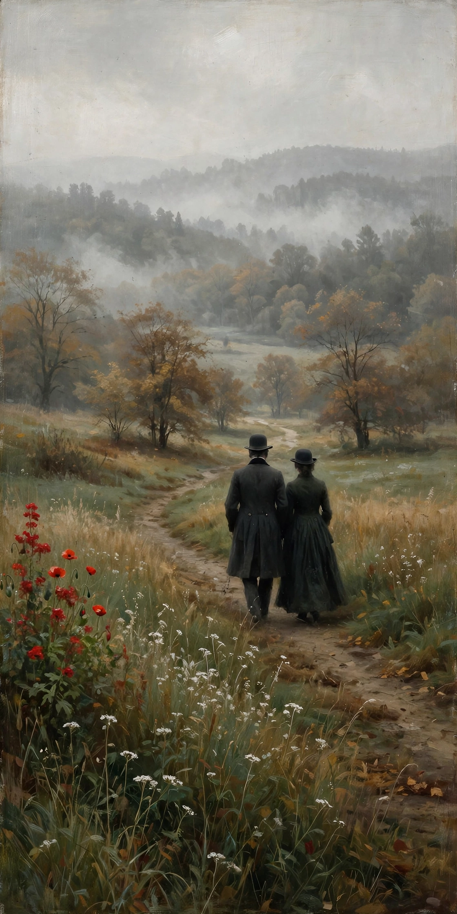
- v2 提示词原文：`Painterly autumn landscape, vertical composition: a man and a woman seen from behind walking together along a narrow dirt path, both in dark 19th-century long coats and bowler hats, faces not visible, the two figures SMALL in the frame and positioned in the middle-right, the path converging toward misty hills and forest in the far distance, tall grass framing the foreground with white wildflowers and a cluster of red flowers on the left, a few autumn trees in the midground, overcast grey-white sky, muted palette of dark green, ochre and grey, soft brushstrokes, slight film grain, view from slightly above behind the figures`
- v2 对比：人物明显变小并退到中右部、小径向雾中山林收拢、前景高草与红花框住画面，更接近原图的纵深关系；代价是人物与前景草叶的衔接略显分离，v1 的“跟随感”稍强。
- v2 图：

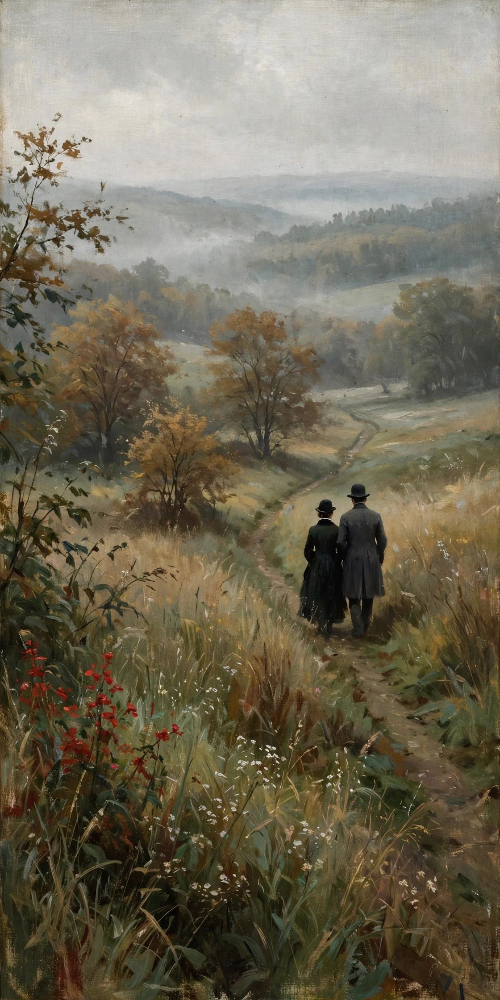
- 可复用规律：风景中的人物比例必须写进提示词（SMALL in the frame + middle-right），只写“两人在路上走”，生成器默认会把人物拉近放大。

## 3 · Civitai · 打哈欠的虎斑猫六格漫画

- 原链接：https://civitai.com/images/146370222
- 热度：点赞 796，爱心 322，笑 166，哭 32，评论按钮显示 225
- 原图拆解：六格漫画，标题格为“One of those days”。主角为灰色虎斑猫，白色胸口与白爪，室内暖色木地板、绿植、落地窗与猫窝为背景；六格分别为趴在毛毯上半闭眼、张大嘴打哈欠露出牙齿与舌头、沿落地窗边走边打哈欠、窗外花园前的面部特写眼神疲惫、室内走向猫窝方向、最后回到毛毯上闭眼休息；画风细腻写实感漫画，线条柔和、色彩暖黄；机位在各格中切换为特写与中景，时间线索由时钟 10:47、10:49 暗示。
- v1 提示词原文：`Cozy six-panel comic strip about a lazy day: a grey tabby cat with a white chest and white paws in a warm home interior with wooden floors, plants, a glass door and a cat bed. Panel 1: lying half-asleep on a blanket. Panel 2: yawning wide, showing teeth and tongue. Panel 3: walking and yawning beside the glass door. Panel 4: tired close-up face in front of a garden. Panel 5: walking indoors toward the cat bed. Panel 6: curled up asleep on the blanket again. Soft gentle linework, warm yellow palette, fine detailed comic art, small clock details suggesting late morning`
  - 中文解析：温馨六格懒日漫画 + 灰虎斑猫白胸白爪 + 暖色室内木地板绿植落地窗猫窝 + 六格依次为半睡、打哈欠、窗边走边哈欠、花园前疲惫特写、走向猫窝、回毛毯再睡 + 柔和线条 + 暖黄调 + 上午时钟细节。
- v1 对比：像在六格结构、打哈欠露齿露舌、窗边行走、走向猫窝、回毛毯再睡、暖黄室内；偏在标题被生成器改写为“A LAZY DAY”、各格加了英文小标题；丢了原标题文字与 10:47 / 10:49 的时钟时间线索。
- v1 图：

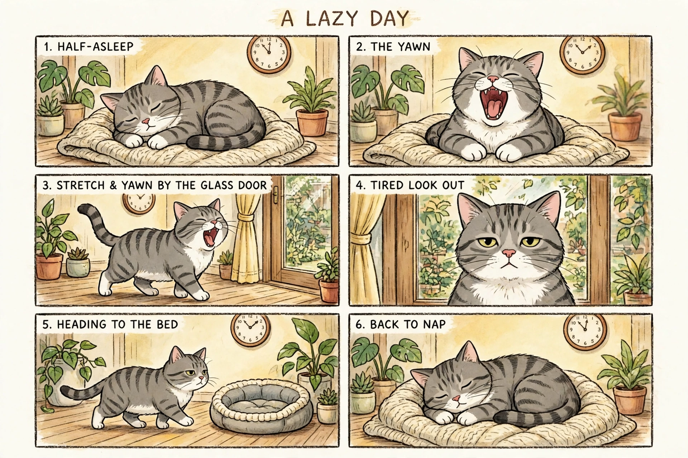
- v2 提示词原文：`Cozy six-panel comic strip titled 'One of those days': a grey tabby cat with a white chest and white paws in a warm home interior with wooden floors, plants, a glass door and a cat bed. Panel 1: lying half-asleep on a blanket, clock showing 10:47. Panel 2: yawning wide, showing teeth and tongue. Panel 3: walking along the glass door while yawning. Panel 4: tired close-up face in front of the garden window. Panel 5: walking indoors toward the cat bed. Panel 6: curled up asleep on the blanket again, clock showing 10:49. Soft gentle linework, warm yellow palette, fine detailed comic art, consistent cat design across all six panels`
- v2 对比：标题纠正为“One of those days”、每格加了文字说明、第一格时钟 10:47 与末格 10:49 的时间线索出现、花园窗前疲惫特写到位，更接近原图；代价是版式变成 3 列 × 2 行、末格时钟盘面读数与说明文字不完全一致，v1 的 2 列 × 3 行版式更接近常见条漫。
- v2 图：

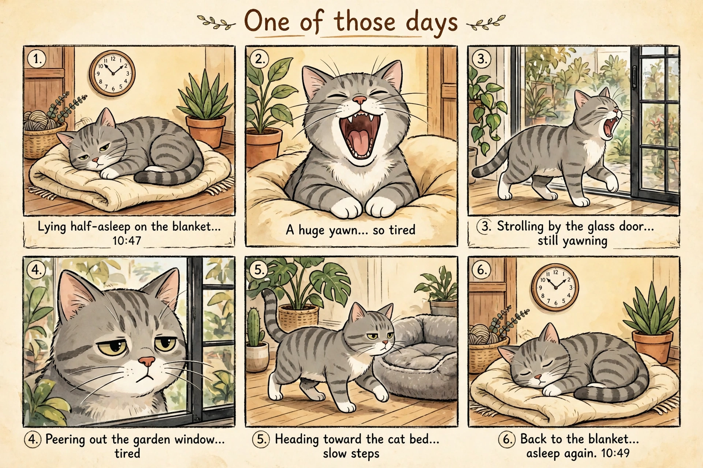
- 可复用规律：多格漫画要把“标题原文、每格动作、时钟读数”逐格写清，生成器才会按格执行；只写“六格懒猫”，它会自己编标题和格数。

## 4 · Civitai · 棱镜彩虹光下的粉发少女

- 原链接：https://civitai.com/images/146756760
- 热度：点赞 838，爱心 315，笑 71，哭 32，评论按钮显示 1K
- 原图拆解：竖幅动漫少女面部与上半身特写。粉色长发、刘海遮住一侧额头，头顶黑色缎带与白色蕾丝头饰，白色蕾丝领衬衫与深色裙装，胸前黑色蝴蝶结；视线向下偏侧，琥珀色眼睛半闭、神情安静；面部与衣服上有一道彩虹色光斑折射，像阳光穿过棱镜或玻璃洒落，光色包括红、橙、黄、绿、蓝、紫；背景深色，主体受强对比光照；发丝细腻分缕，蕾丝镂空纹理清晰；整体为高饱和光影动漫插画，不是照片感。
- v1 提示词原文：`Anime illustration, vertical close-up portrait of a girl with long pink hair and bangs shading one side of her forehead, black ribbon and white lace headdress, white lace-collar blouse and dark dress with a black bow at the chest, amber eyes half-closed looking down to the side, quiet calm expression, a diagonal rainbow prism light refraction falling across her face and clothes in red, orange, yellow, green, blue and violet, like sunlight through glass, dark background, strong contrast lighting, fine separated hair strands, detailed openwork lace texture, high saturation`
  - 中文解析：动漫插画 + 竖幅面部特写 + 粉长发刘海遮额 + 黑缎带白蕾丝头饰 + 白蕾丝领衬衫深色裙黑蝴蝶结 + 琥珀眼半闭向下偏侧 + 安静神情 + 斜向彩虹棱镜光带 + 深背景强对比 + 细腻分缕发丝 + 镂空蕾丝 + 高饱和。
- v1 对比：像在粉发、蕾丝头饰、黑蝴蝶结、琥珀半闭眼、彩虹折射、深背景；偏在面部接近全侧面、彩虹光带铺满整个画面（发丝、背景都有）；丢了原图“面部朝向观众更多、彩虹只是一道斜带”的克制感。
- v1 图：

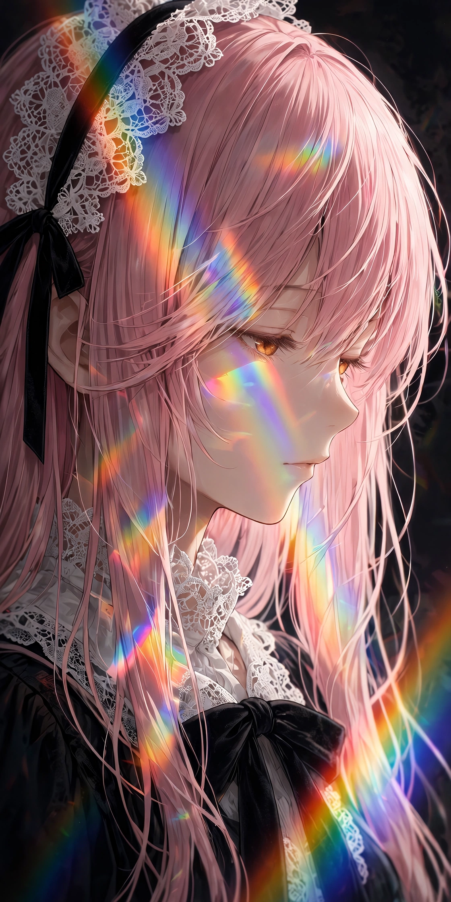
- v2 提示词原文：`Anime illustration, vertical portrait in three-quarter view, face turned slightly toward the viewer: a girl with long pink hair and bangs shading one side of her forehead, black ribbon and white lace headdress, white lace-collar blouse and dark dress with a black bow at the chest, amber eyes half-closed looking down to the side, quiet calm expression, ONE single diagonal rainbow prism light band falling across her face and clothes in red, orange, yellow, green, blue and violet, like sunlight through glass, restrained rainbow light on the hair only, dark background, strong contrast lighting, fine separated hair strands, detailed openwork lace texture, high saturation`
- v2 对比：面部转为四分之三朝向观众、主彩虹带斜贯面部与胸前蝴蝶结，更接近原图；代价是发丝与裙摆边缘仍有几道分叉的彩虹余光，面部也比原图更正面，侧向下视线的味道弱了一点。
- v2 图：

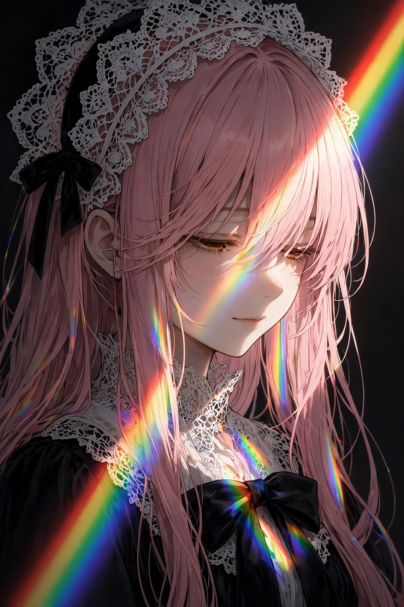
- 可复用规律：光斑类画面要写“ONE single band + restrained”，否则生成器会把一道光复制成满屏彩虹；同时用 three-quarter view 定住面部角度，而不是只写“特写”。

## 5 · Civitai · 头顶黑猫的写字少女

- 原链接：https://civitai.com/images/146645745
- 热度：点赞 1055，爱心 393，笑 212，哭 38，评论按钮显示 70
- 原图拆解：室内动漫场景。白发少女穿白衬衫、系深蓝领带，坐在书桌前低头握笔写字，桌上有纸张与文具；她头顶趴着一只黑猫，黑猫黄眼睛、神情严肃，前爪垂在少女额前，尾巴翘向一侧，猫耳与少女的白色兽耳并列；左侧有窗光，暖黄光线从左侧打入；背景为书桌、椅子与室内阴影，色彩为白、深蓝、黑与暖黄；画风为抛光感动漫插画，线条干净、色块平滑；机位为正面略俯的中景。
- v1 提示词原文：`Polished anime illustration, slightly high-angle medium shot: a white-haired girl with animal ears wearing a white shirt and dark blue tie, sitting at a desk writing with a pen, a black cat with yellow eyes lying on top of her head with its front paws hanging over her forehead and tail raised to one side, warm yellow window light from the left, desk with papers and stationery, soft indoor shadows, clean lines, smooth color blocks`
  - 中文解析：抛光动漫插画 + 略俯中景 + 白发兽耳少女白衬衫深蓝领带 + 坐桌前握笔写字 + 头顶黑猫黄眼 + 前爪垂额前 + 尾巴翘向一侧 + 左侧暖黄窗光 + 纸张文具 + 柔和室内阴影。
- v1 对比：像在白发兽耳、黑猫头顶、前爪垂额前、翘尾、左侧暖窗光、写字姿态；偏在少女面部抬起直视感较强、桌面杂物过多；丢了原图“低头写字、猫是头顶的配角”的主次关系。
- v1 图：

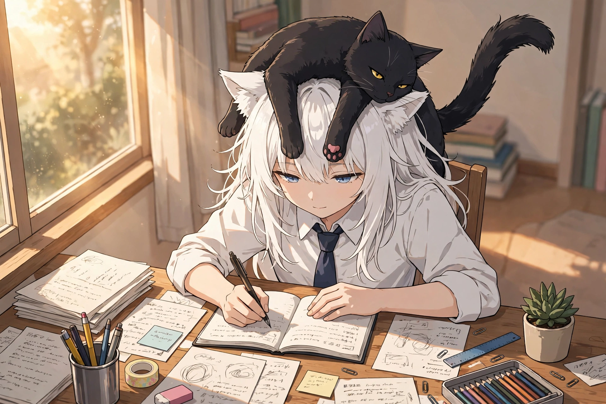
- v2 提示词原文：`Polished anime illustration, slightly high-angle medium shot: a white-haired girl with animal ears wearing a white shirt and dark blue tie, head bowed low over a notebook as she writes with a pen, a SMALL black cat with yellow eyes lying on top of her head with its front paws hanging over her forehead and tail raised to one side, the cat's ears beside the girl's white animal ears, warm yellow window light from the left, a tidy desk with a few papers and stationery, soft indoor shadows, clean lines, smooth color blocks, calm quiet mood`
- v2 对比：头低下去认真写字、桌面收拾干净、黑猫变小，更接近原图的安静主次；代价是猫爪不再垂到额前、面部被发丝遮住，v1 的“猫爪垂额前”细节反而更好。
- v2 图：

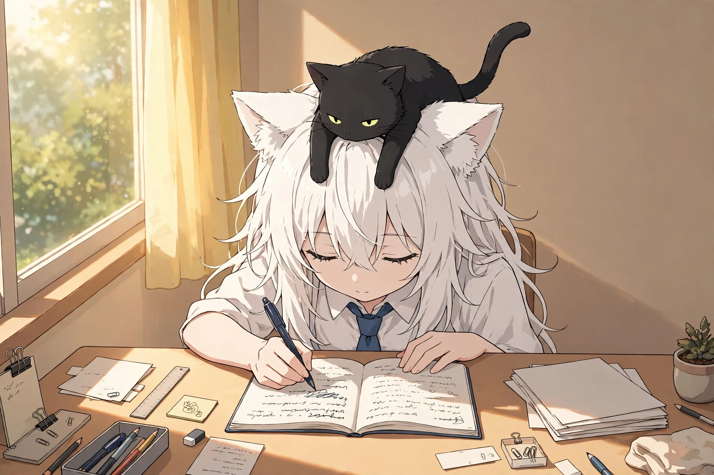
- 可复用规律：同一画面里两个主体（人与猫）要各写“大小权重”（SMALL cat）与“头的角度”（bowed low），否则生成器会把两个主体都画成正面主角。

## 6 · Civitai · 绯红草原与气态巨行星

- 原链接：https://civitai.com/images/146623400
- 热度：点赞 1131，爱心 395，笑 92，哭 40，评论按钮显示 70
- 原图拆解：竖幅奇幻田野。画面主体为一名少女背影，坐在齐腰高的深红与品红草地中，面向远方木星般的巨大行星与淡色天空；人物只占中景偏小比例，草地占据下半幅；光线柔和偏暖，草色浓烈，天空为淡蓝与米色渐变；整体为梦幻插画质感，草叶细节细密、边缘柔和；机位为人物身后远景，强调人与巨大天体的尺度对比。
- v1 提示词原文：`Dreamy painterly science-fiction illustration, vertical composition: a young woman seen from behind sitting small and off-center in waist-high crimson and magenta grass, gazing at a huge banded gas giant planet dominating a pale blue and cream sky, soft warm light, dense detailed grass blades filling the lower half, loose visible brushstrokes, strong sense of scale between the tiny figure and the giant planet`
  - 中文解析：梦幻绘画科幻插画 + 竖构图 + 背影小人物偏置 + 腰高绯红品红草 + 占据天空的带状气态巨行星 + 淡蓝米色天空 + 柔和暖光 + 下半幅细密草叶 + 松散笔触 + 人与天体尺度对比。
- v1 对比：像在绯红草原、巨大带状行星、背影人物、笔触；偏在行星被加上了土星式的光环、人物为右侧面而非纯背影、人物偏大偏近；丢了原图“纯背影小人物 + 无环木星”的干净设定。
- v1 图：

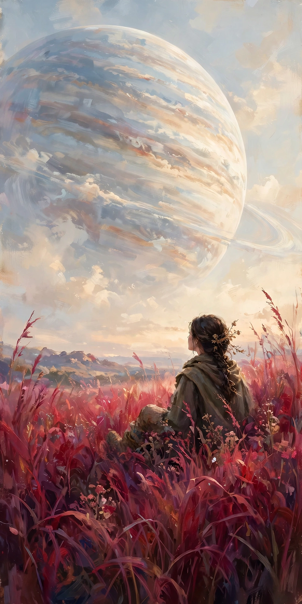
- v2 提示词原文：`Dreamy painterly science-fiction illustration, vertical composition: a young woman seen fully from behind, SMALL in the frame and sitting in the lower third, in dense waist-high crimson and magenta grass, gazing at a huge banded gas giant planet with NO ring dominating a pale blue and cream sky, soft warm light, distant low hills on the horizon, loose visible brushstrokes, strong sense of scale between the tiny figure and the giant planet, quiet contemplative mood`
- v2 对比：光环消失、只剩带状行星，人物变回纯背影并退到画面下部，草地与远山地平线齐全，更接近原图；代价是人物居中偏下而非偏置，草色混入较多粉紫，v1 的深红浓度反而更贴近原图。
- v2 图：

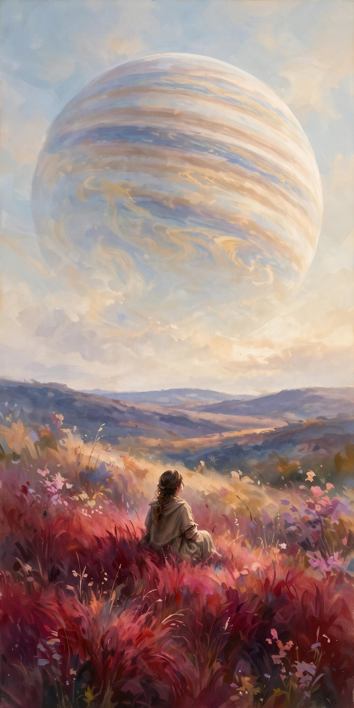
- 可复用规律：写“巨大天体”要同时写反向排除词（NO ring），否则生成器会按“最像行星的模板”自加光环；人物背影要写 fully from behind，否则它会转成侧面。

## 7 · Civitai · 橙色羽绒服手指取景

- 原链接：https://civitai.com/images/146540968
- 热度：点赞 1106，爱心 380，笑 87，哭 39，评论按钮显示 130
- 原图拆解：竖幅平面感插画，背景为纯白。年轻女性蹲姿居中：穿亮橙色蓬松夹克、灰色短上衣、黑色宽松长裤与白色运动鞋，一手在脸前比出取景框手势，另一手撑在膝部附近；面部被手势部分遮挡，表情未完全显示；色彩对比强烈：橙色夹克、黑色裤子、白色背景与灰色上衣；光影扁平、无明显写实阴影，布料褶皱以色块表现；机位为低角度正面全身，构图简洁、时尚海报感。
- v1 提示词原文：`Crisp graphic digital illustration, extreme low-angle view looking up at a young adult woman in a deep crouch on a pure white background, oversized neon-orange puffer jacket slipping off her shoulders, grey cropped top, wide-leg black cargo trousers, white sneakers, both hands raised forming a square camera frame around one eye, flat color blocking with subtle cel shading, bold fashion-poster composition`
  - 中文解析：清晰平面数字插画 + 极低仰拍 + 纯白背景深蹲 + 霓虹橘羽绒滑落肩头 + 灰色短上衣 + 黑色阔腿工装裤 + 白运动鞋 + 双手框住一只眼 + 平面色块细赛璐璐阴影。
- v1 对比：像在橘色羽绒、双手框眼、纯白背景、低机位、白色运动鞋前景；偏在头发为棕色凌乱马尾而非黑色短波波头、夹克敞开露出灰色短上衣而非滑落肩头露出无袖高领；丢了原图“黑短发 + 无袖高领 + 夹克滑落肩头”的造型组合。
- v1 图：

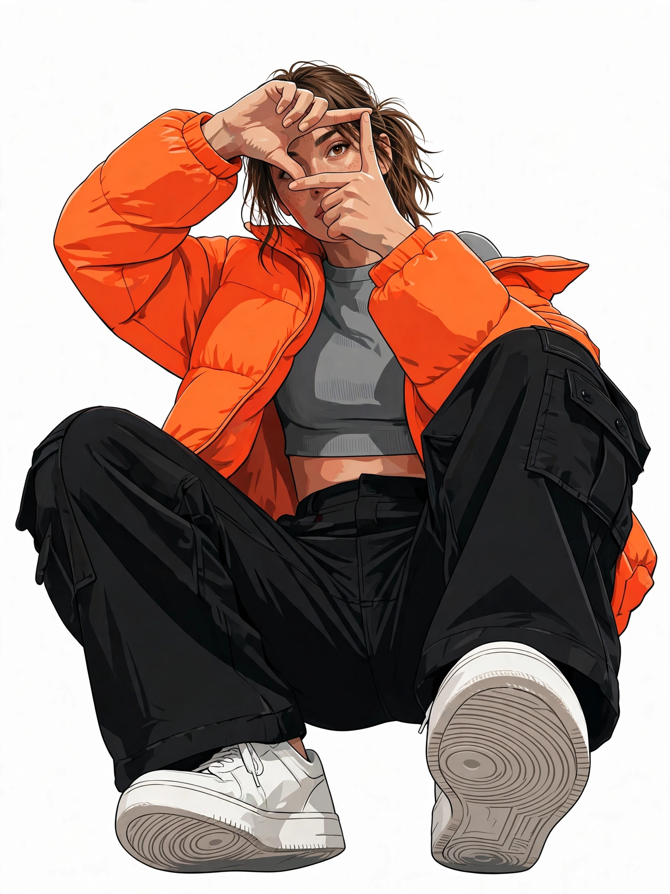
- v2 提示词原文：`Crisp graphic digital illustration, shot from an extreme low floor-level angle looking upward: a young adult woman in a deep athletic crouch on a pure white background, one knee pressed to the floor and the other drawn up to chest level, short tousled raven-black bob framing her cheeks, oversized neon-orange puffer jacket slipping loosely off both shoulders exposing a fitted charcoal ribbed sleeveless mock-neck top, relaxed wide-leg black cargo trousers, white sneakers, BOTH hands raised in front of her face with fingers forming a square camera frame around ONE wide amber eye, intense charismatic grin, flat color blocking with subtle cel shading, bold fashion-poster composition`
- v2 对比：黑色短波波头、无袖炭色高领、夹克滑落双肩、双手框住一只琥珀眼、贴地仰拍的运动鞋前景全部到位，更接近原图；代价是笑容露齿比原图的“魅力笑”更开，姿态也更像坐姿而非深蹲。
- v2 图：

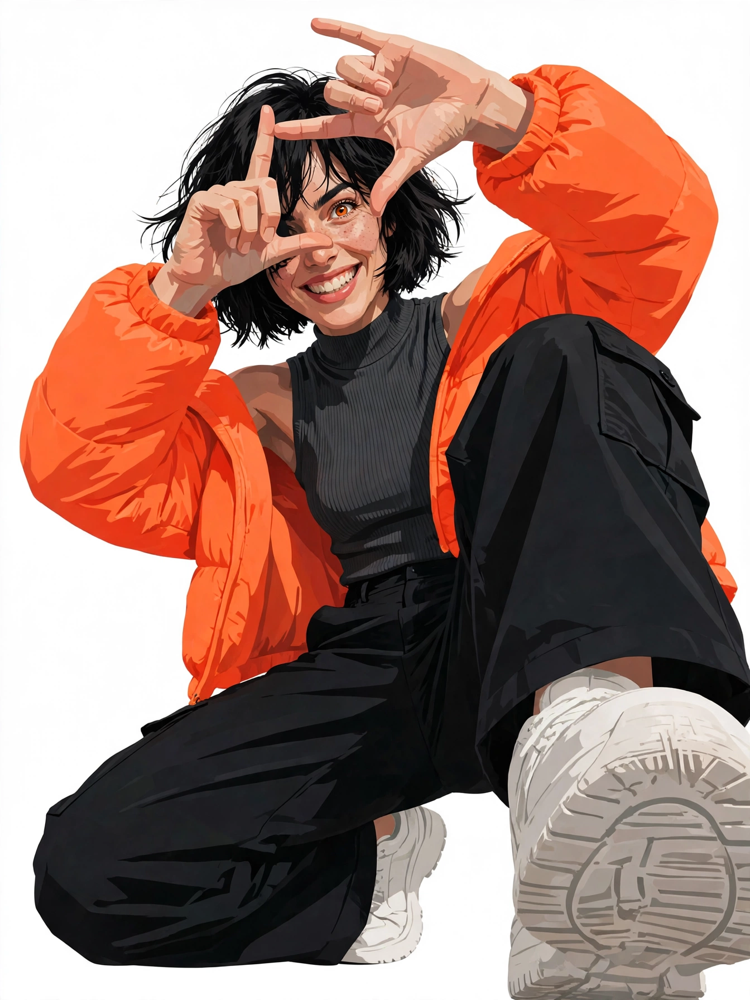
- 可复用规律：造型类画面要把发型、内搭、夹克穿法写成三件套（bob + sleeveless mock-neck + slipping off shoulders），缺一件，生成器就会用最常见的搭配补齐。

## 8 · Civitai · 抱猫的雀斑女子（写实人物）

- 原链接：https://civitai.com/images/146746555
- 热度：点赞 246，爱心 76，笑 12，哭 2，评论按钮显示 50
- 原图拆解：竖幅写实感人像。二十岁出头的年轻女性，面部朝向镜头、身体略侧，穿灰色粗针织高领毛衣，怀中抱一只黑白猫；猫在画面右下方，绿眼睛直视镜头，胡须与毛发层次清晰；女性为深棕带红调的乱发，大量飞散发丝被画面右侧逆光勾出亮边；面部有密集雀斑，主要分布在鼻梁与两颊，左右分布不对称；眼睛为蓝绿色，眼中有明显眼神光，视线直视镜头；嘴唇微张、不露牙齿，表情平静放松；耳朵大部被头发遮挡；手部未入画；光线为右侧偏后的逆光加正面柔光，色温偏冷，背景为深色虚化并带白色光斑；景深浅，面部与猫清晰、背景虚化；颗粒感轻微，毛衣针织纹理、猫毛与发丝细节清晰。
- 写实要素拆解：雀斑不对称分布是第一逼真证据；逆光勾出的飞散发丝是第二证据；针织纹理与猫毛的触感是第三证据；平静放松的微张唇表情（不是对镜头的僵笑）是第四证据。毛孔在截图分辨率下不甚清晰，未见明显皱纹。
- AI 破绽对照：本类最容易破绽是雀斑画得过于均匀对称、猫眼左右不一致、手部穿帮；原图用“手部不出画、猫只露上半身”规避了手部破绽，雀斑的不对称反而成了防伪标记。
- v1 提示词原文：`Photorealistic portrait, vertical: a young woman in her early twenties with messy dark reddish-brown hair and flyaway strands rim-lit from the right, dense freckles asymmetrically across her nose and cheeks, blue-green eyes with clear catchlights looking at the camera, lips slightly parted, calm relaxed expression, wearing a chunky grey knitted turtleneck sweater, holding a black-and-white cat with green eyes in the lower right of the frame, cool color temperature, soft frontal fill light plus backlight from the right, dark blurred background with white bokeh spots, shallow depth of field, realistic skin texture with pores and slight imperfections, no retouching look, candid, 85mm lens, subtle grain`
  - 中文解析：写实肖像 + 竖幅 + 20 出头女子 + 深棕带红乱发 + 右侧逆光飞散发丝 + 鼻颊不对称密集雀斑 + 蓝绿眼眼神光直视镜头 + 微张唇平静放松 + 灰色粗针织高领 + 右下黑白猫绿眼 + 冷色温 + 正面柔光加右侧逆光 + 深色虚化白光斑背景 + 浅景深 + 带毛孔与小瑕疵的真实皮肤 + 无修图感 + 抓拍 + 85mm + 轻颗粒。
- v1 对比：像在不对称雀斑、逆光飞散发丝、蓝绿眼神光、粗针织纹理、黑白猫绿眼、深色虚化光斑背景；偏在雀斑比原图更密、唇部微露齿尖；丢了原图“雀斑适中、唇完全闭合感”的克制度。
- v1 图：

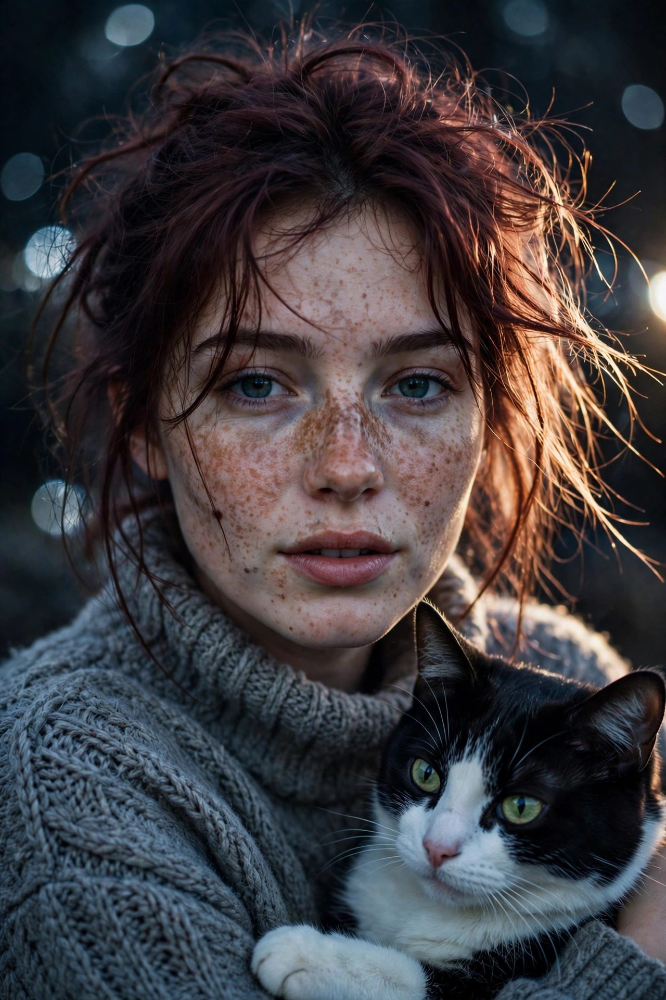
- v2 提示词原文：`Photorealistic portrait, vertical: a young woman in her early twenties with messy dark reddish-brown hair and flyaway strands rim-lit from the right, moderate freckles concentrated on her nose and cheeks with slightly asymmetric distribution, blue-green eyes with clear catchlights looking at the camera, lips slightly parted without showing teeth, calm relaxed expression, wearing a chunky grey knitted turtleneck sweater, holding a black-and-white cat with green eyes in the lower right, the cat's head slightly turned but its eyes toward the lens, cool color temperature, soft frontal fill light plus backlight from the right, dark blurred background with white bokeh spots, shallow depth of field, realistic skin texture with pores and slight imperfections, no retouching look, candid, 85mm lens, subtle grain`
- v2 对比：雀斑密度收回、唇部不再露齿、猫头微侧但眼神仍朝镜头，更接近原图；代价是背景带了一点绿色、猫的体量变大，v1 的纯深色光斑背景反而更贴近原图。
- v2 图：

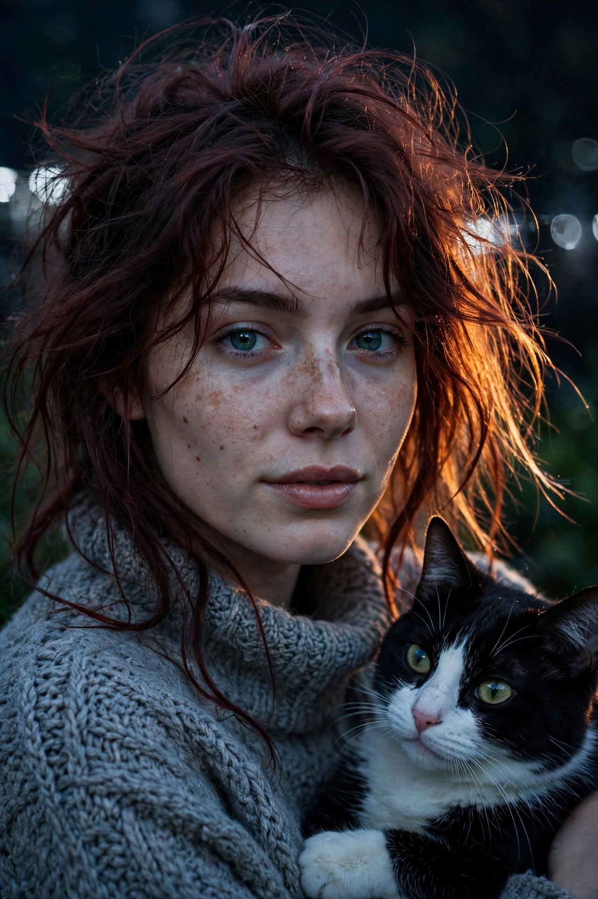
- 可复用规律：写实雀斑要写“moderate + concentrated + slightly asymmetric”，只写 dense freckles 时，生成器会把整张脸铺满雀斑；“不露齿”也要明写，否则微张唇很容易滑向露齿。

## 9 · Civitai · 学院风持杖女子（写实人物）

- 原链接：https://civitai.com/images/146854816
- 热度：点赞 151，爱心 58，笑 7，哭 2，评论按钮显示 0
- 原图拆解：竖幅写实感半身人像。年轻女性穿学院风制服：白衬衫、绿白条纹领带、灰色 V 领毛衣与黑色带校徽长袍，左手在画面左侧举着一根细长魔杖，手指自然环握，指节与指甲形态正常；金色长直发中分，垂过肩部，少量发丝飞散；面部朝向镜头，灰蓝色眼睛带小而清晰的眼神光，嘴角微扬、闭唇微笑、不露牙齿，表情自信而放松；皮肤偏白、表面较光滑，毛孔与瑕疵在截图中不明显，未见明显皱纹；两耳可见小圆环耳饰，左右耳饰与发型基本对称；背景为室内：左侧书架虚化，右侧深绿色旗帜虚化；光线为柔和正面光加左侧窗光，色温中性偏暖；景深浅，人物清晰、背景明显虚化；颗粒感未显示。
- 写实要素拆解：魔杖手的指节与指甲形态正常是第一逼真证据；中分长直发的少量飞散是第二证据；灰蓝眼的小而清晰的眼神光是第三证据；闭唇微笑的自信放松表情（不是大笑）是第四证据。皮肤在截图中偏光滑，是本张相对较弱的一环。
- AI 破绽对照：本类最容易破绽是魔杖被画成弯曲或穿手、校徽文字乱码、左右耳饰不对称；原图用“魔杖细长竖直、校徽小而模糊”规避了文字破绽。
- v1 提示词原文：`Photorealistic half-body portrait, vertical: a young woman with long straight golden blonde hair parted in the middle and a few flyaway strands, wearing a school-style outfit of a white shirt, green-and-white striped tie, grey V-neck sweater and black robe with a crest, holding a thin wand in her raised left hand with a natural finger grip, grey-blue eyes with small clear catchlights, closed-lip slight smile, confident relaxed expression, realistic skin texture with pores and slight imperfections, no retouching look, candid, blurred bookshelf on the left and dark green banner on the right, soft frontal light with window light from the left, shallow depth of field, 85mm lens`
  - 中文解析：写实半身肖像 + 竖幅 + 金色长直发中分 + 少量飞散发丝 + 白衬衫绿白条纹领带灰 V 领毛衣黑袍校徽 + 左手举细长魔杖自然握持 + 灰蓝眼小眼神光 + 闭唇微笑自信放松 + 真实皮肤毛孔瑕疵 + 无修图感 + 抓拍 + 左侧虚化书架右侧深绿旗帜 + 正面柔光加左侧窗光 + 浅景深 + 85mm。
- v1 对比：像在中分金发、绿白条纹领带、灰 V 领毛衣、黑袍校徽、左侧书架、右侧深绿旗帜、闭唇微笑；偏在持杖手被裁到画面左边缘、手部不完整；丢了原图“手完整入画、皮肤可见纹理”的两点。
- v1 图：

- v2 提示词原文：`Photorealistic half-body portrait, vertical: a young woman with long straight golden blonde hair parted in the middle and many fine flyaway strands catching the light, wearing a school-style outfit of a white shirt, green-and-white striped tie, grey V-neck sweater and black robe with a crest, her left hand FULLY in frame at shoulder height holding a thin wand with a natural relaxed finger grip, grey-blue eyes with small clear catchlights, closed-lip slight smile, confident relaxed expression, clearly visible realistic skin texture with pores and slight imperfections, no retouching look, candid, blurred bookshelf on the left and dark green banner on the right, soft frontal light with window light from the left, shallow depth of field, 85mm lens`
- v2 对比：持杖手完整入画、指节指甲自然、皮肤毛孔与小痣可见、飞散发丝更明显，更接近原图；代价是魔杖换到了画面右侧（原图为左侧手），校徽图案略有变化，但手部完整性的收益更大。
- v2 图：

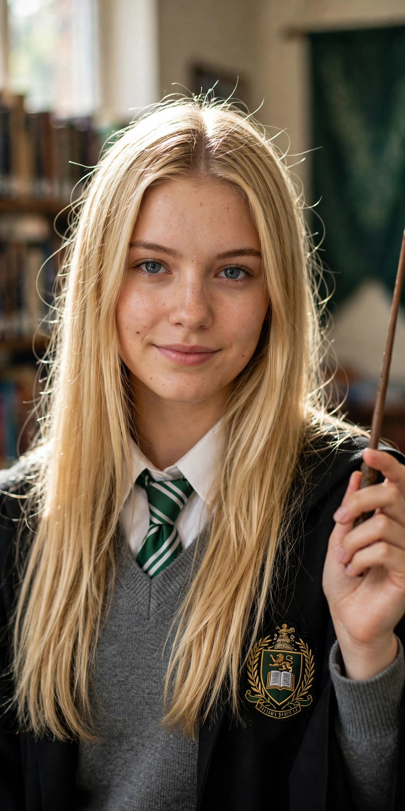
- 可复用规律：写实人像的手要写“FULLY in frame + at shoulder height”，只写“举着魔杖”，生成器常常把手裁出画框；皮肤纹理要写 clearly visible，否则它会被柔光磨平。

## 10 · SeaArt · 铁塔前的复古巧克力女子（写实人物）

- 原链接：https://www.seaart.ai/postDetail/d11h10de878c7390n9p0
- 热度：页面显示数字：1.7K / 316 / 2.7K / 0（字段未标注），评论 0 条；标签含 #FLUX、#Photography、#Portraits & People、#realism；分类 Realism、Western Beauty Atelier；发布时间 2025-06-06
- 原图拆解：以首页缩略图与页面文字为准，详情页主图当天未正常渲染。画面为复古着装女性站在埃菲尔铁塔前、黄昏光线下，手持一块巧克力；着装与姿态为复古肖像风格，背景为铁塔与黄昏天空。皮肤纹理、毛孔、发丝飞散、手耳牙齿等近景解剖细节在缩略图分辨率下未显示，不作推断。页面英文描述为：一位复古着装女性在黄昏的埃菲尔铁塔前手持巧克力。
- 写实要素拆解（基于可确认信息）：黄昏暖光与铁塔剪影的组合是“地点 + 时间”双证据；复古着装与巧克力道具构成生活化叙事；其余皮肤、发丝、手部细节未显示，不编。
- AI 破绽对照：本类在缩略图层面无法核查手部与皮肤，报告不作“无破绽”结论；重生成时按写实通用规则补齐毛孔、飞散发丝与自然手部。
- v1 提示词原文：`Photorealistic vintage-style portrait at sunset: a woman in a vintage dress standing before the Eiffel Tower holding a chocolate bar, warm golden-hour light, soft sky tones, candid relaxed pose, 85mm lens, shallow depth of field, realistic skin texture with pores and slight imperfections, no retouching look, subtle film grain`
  - 中文解析：写实复古肖像 + 黄昏 + 复古裙装女子 + 铁塔前 + 手持巧克力 + 暖金色时刻光 + 柔和天空色调 + 抓拍放松姿态 + 85mm + 浅景深 + 真实皮肤毛孔瑕疵 + 无修图感 + 轻胶片颗粒。
- v1 对比：像在卷发复古裙、铁塔背景、黄昏暖光、手持巧克力、皮肤小痣与纹理；偏在面部为侧面远眺而非朝向镜头、巧克力位置偏高；丢了“人物面部朝向观众”的肖像感（原图面部朝向在缩略图下无法确认，此处仅记 v1 自身的取向）。
- v1 图：

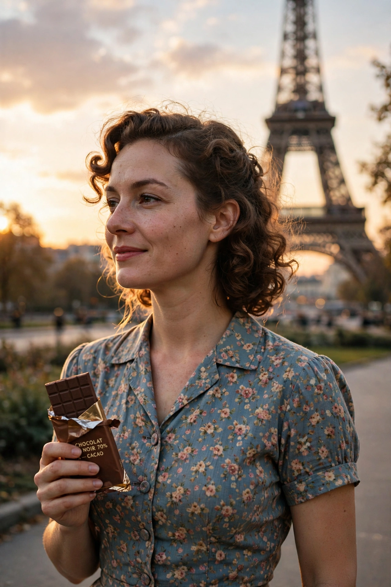
- v2 提示词原文：`Photorealistic vintage-style portrait at sunset: a woman with curly brown hair in a vintage floral dress, face in three-quarter view turned mostly toward the camera with a soft relaxed smile, standing before the Eiffel Tower, the tower softly blurred in the background, holding a chocolate bar low in one hand, warm golden-hour light, soft sky tones, candid, 85mm lens, shallow depth of field, realistic skin texture with pores and slight imperfections, no retouching look, subtle film grain`
- v2 对比：面部转为四分之三朝向镜头、铁塔虚化退后、巧克力放低到腰部，肖像感与层次感更好；代价是裙装花色变浅、铁塔被裁得更碎，v1 的深蓝花裙与完整铁塔反而更有复古明信片感。
- v2 图：

- 可复用规律：地标肖像要写“地标 softly blurred + 人物 turned toward the camera”，否则生成器会把人物拍成地标前的游客侧影。

## 11 · SeaArt · 情侣大头贴四连拍（写实人物）

- 原链接：https://www.seaart.ai/postDetail/d7oqn3de878c73bfac20
- 热度：页面显示数字：2 / 2 / 371 / 0（字段未标注），评论 0 条；标签含 #Realistic、#advertisement、#情侣的大头贴约会日常；发布时间 2026-04-29；作品信息为 AI Elevator Photo
- 原图拆解：以首页缩略图与页面文字为准，详情页主图当天未正常渲染。四连拍大头贴布局：红色背景前，一对年轻男女穿白上衣，多格中分别做贴脸、比心、指镜头等亲密姿势，画面四周带小爱心贴纸装饰；整体为生活照/证件照亭风格，表情轻松自然。皮肤毛孔、牙齿、手部等近景细节在缩略图分辨率下未显示。标题原文为“情侣大头贴四连拍好甜呀”。
- 写实要素拆解（基于可确认信息）：证件照亭的直闪光与红底是“场合”证据；贴脸、比心、指镜头三种不同姿势是“连续抓拍”证据；轻松自然的表情是“非摆拍”证据。其余皮肤与手部细节未显示，不编。
- AI 破绽对照：多格连拍最容易破绽是同一人四格长得不一样、手指在比心时多指或粘连；重生成时要逐格写清姿势，并接受“四格面部微差”这一生成器固有弱点。
- v1 提示词原文：`Photorealistic photo-booth strip, four-panel layout on a red background: a young couple in white tops posing cheek to cheek, making a heart shape with their hands, pointing at the camera, small heart stickers decorating the borders, relaxed natural smiles, candid snapshot feel, slight direct flash look, realistic skin texture with pores and slight imperfections, no retouching look`
  - 中文解析：写实大头贴长条 + 四格 + 红背景 + 年轻情侣白上衣 + 贴脸 + 比心 + 指镜头 + 四周小爱心贴纸 + 轻松自然笑 + 抓拍感 + 轻直闪光 + 真实皮肤 + 无修图感。
- v1 对比：像在四格长条、红底、爱心贴纸、白上衣、直闪光感；偏在四格姿势几乎重复（均为比心 + 指镜头）；丢了原图“贴脸、比心、指镜头各不相同”的多格变化。
- v1 图：

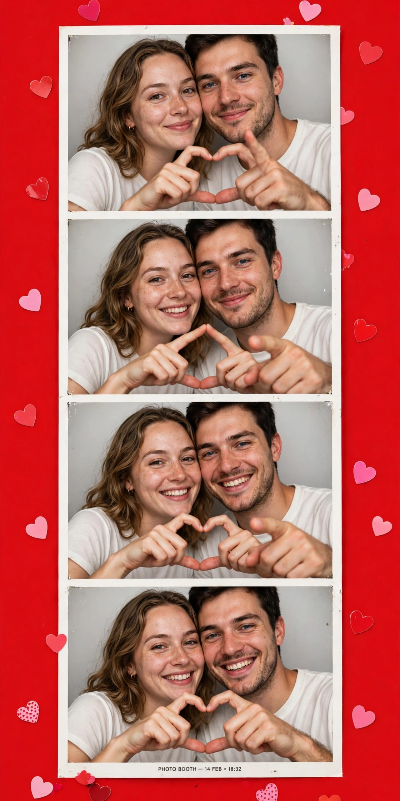
- v2 提示词原文：`Photorealistic photo-booth strip, four vertical panels on a red background with small heart stickers around the borders, a young couple in white tops, EACH panel a DIFFERENT pose: panel 1 cheek pressed to cheek, both smiling softly; panel 2 making a heart shape with their hands together; panel 3 pointing at the camera and laughing; panel 4 foreheads gently together with eyes closed and relaxed smiles, candid snapshot feel, slight direct flash look, realistic skin texture with pores and slight imperfections, no retouching look`
- v2 对比：四格姿势终于各不相同（贴脸、比心、指镜头大笑、额头相抵闭眼），更接近原图的多格叙事；代价是四格中两人的面部仍有微差（第二格男方卷发更明显），这是多格连拍的固有弱点，v2 未能完全消除。
- v2 图：

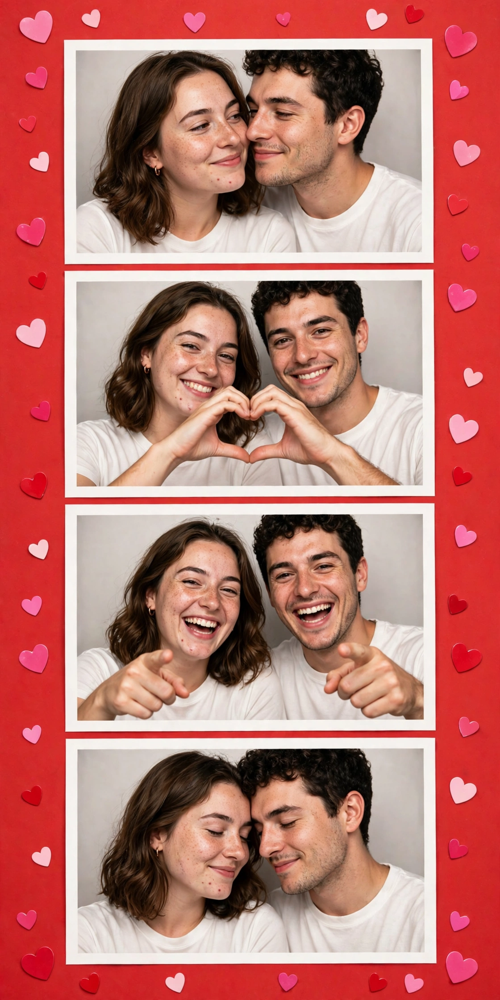
- 可复用规律：多格连拍要写“EACH panel a DIFFERENT pose”并逐格列出动作，否则生成器会把第一格的姿势复制四遍；面部一致性要靠“同一对情侣”之外的重复描述来压，仍难完全消除。

## 12 · SeaArt · 纸箱手工铠甲少女

- 原链接：https://www.seaart.ai/postDetail/d8q8iq5e878c73ckj9pg
- 热度：页面显示数字：323 / 71 / 1.9K / 0（字段未标注），评论 0 条；标签含 #アニメ、#アニメ美少女、#Armor Design Challenge；发布时间 2026-06-19；模型/检查点显示 GPT image 2
- 原图拆解：以首页缩略图与页面文字为准，详情页主图当天未正常渲染。粉发双马尾动漫少女穿着用印有橘子标志的纸箱裁剪制作的手工“蜜柑箱铠甲”，旁边有同样用小纸箱碎片制作的物件与一只举牌的微笑小猫；整体为明亮、搞笑的动漫海报感，纸箱边缘、胶带与手写字样为主要材质细节。标题原文为“预算为零？勇者部引以为豪的手工铠甲”“铠甲设计大赛”。
- v1 提示词原文：`Bright humorous anime poster: a girl with pink twin-tails wearing handmade armor cut from cardboard boxes printed with an orange logo, tape seams and handwritten marks visible on the cardboard, a small smiling cat holding a sign beside her, small cardboard props, vivid cheerful colors, clean anime linework, energetic composition`
  - 中文解析：明亮搞笑动漫海报 + 粉发双马尾 + 印有橘色标志的纸箱手工铠甲 + 胶带接缝与手写痕迹 + 旁边举牌微笑小猫 + 小纸箱道具 + 鲜明欢快色彩 + 干净动漫线条 + 有力构图。
- v1 对比：像在粉发双马尾、纸箱铠甲、胶带接缝、举牌小猫、明亮搞笑感；偏在生成器自加了大量文字标语（顶部大标题、胸甲多处文字、底部口号）与宝剑、宝箱等道具；丢了原图“纸箱本身是主角、文字只是点缀”的克制感。
- v1 图：

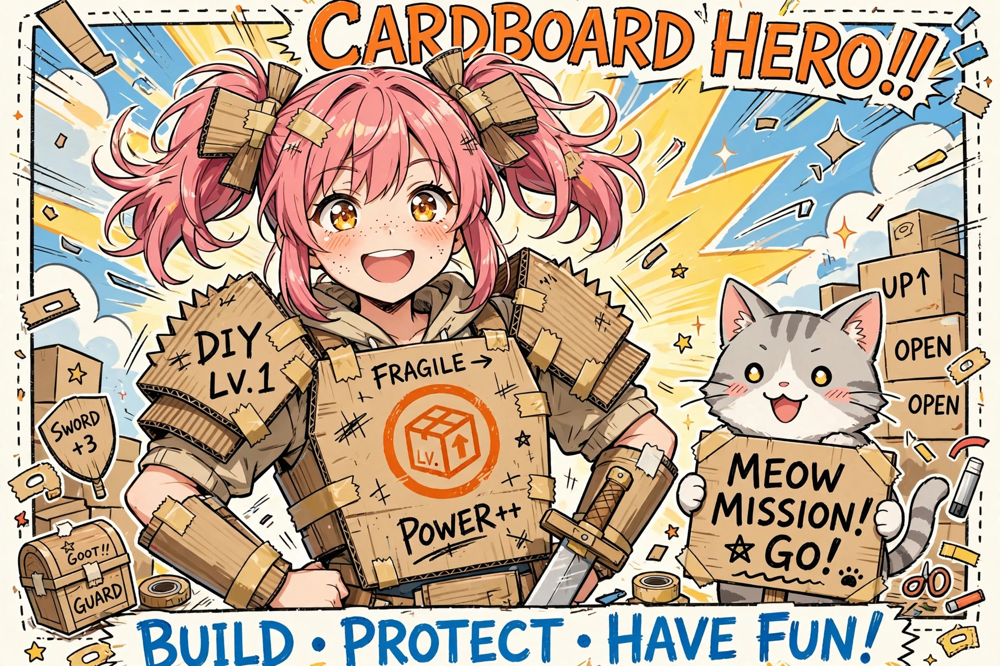
- v2 提示词原文：`Bright humorous anime poster, no title text, no words anywhere: a girl with pink twin-tails wearing handmade armor cut from cardboard boxes, tape seams and torn edges visible, ONE single small orange circle logo printed on the chest plate, a small smiling cat beside her holding a small BLANK cardboard sign, plain bright cheerful background, very few props, vivid colors, clean anime linework, energetic composition`
- v2 对比：文字全部清干净、胸甲只剩一个橘色圆圈标志、猫举着空白牌子、背景为干净亮黄，更接近原图的材质主角逻辑；代价是少女画风更偏 Q 版、猫的体量变小，海报的冲击力弱于 v1。
- v2 图：

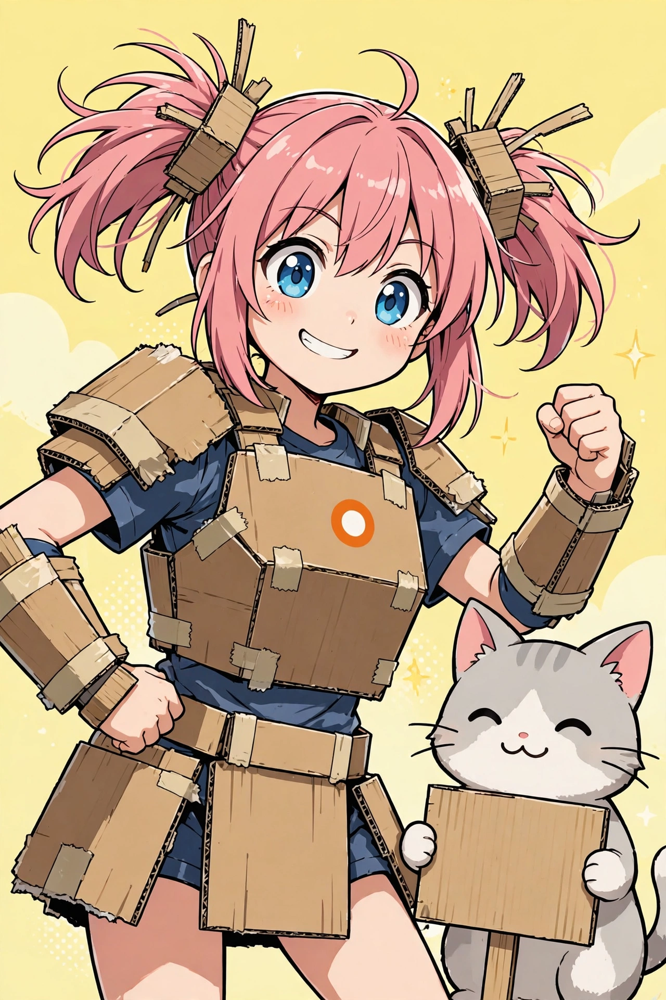
- 可复用规律：海报类画面要写“no words anywhere + ONE single logo + BLANK sign”，否则生成器会把“海报感”理解成“多加文字”；材质主角要靠“very few props”来保。

## 13 · SeaArt · 头盔星空海洋（超现实概念画）

- 原链接：https://www.seaart.ai/postDetail/d79fgtte878c7382766g
- 热度：页面显示数字：227 / 74 / 196 / 0（字段未标注），评论 0 条；标签含 #Mythology、#Epic Characters、#abstract、#moonwalker、#Creative Styles、#Scene Design、#Daily-Challenge、#Feature；分类 Creative Styles；发布时间 2026-04-06；检查点 SeaArt Film
- 原图拆解：以首页缩略图与页面文字为准，详情页主图当天未正常渲染。黑白超现实概念画：宇航员头盔像一个通向神秘星空海洋的入口，头盔周围漂浮着鱼群与星点；画面为黑白单色，星光与鱼形为亮点，构图以头盔为中心、鱼群向外扩散。提示词片段为：黑白单色的超现实概念画，宇航员头盔是通向神秘星空海洋的入口。
- v1 提示词原文：`Surreal monochrome concept art: an astronaut helmet as a portal opening onto a mysterious starry ocean, schools of fish and star points floating around the helmet, black-and-white palette with bright starlight accents, helmet centered, fish radiating outward, dreamlike mood, detailed ink texture`
  - 中文解析：超现实黑白概念画 + 宇航员头盔为通向神秘星空海洋的入口 + 头盔周围鱼群与星点漂浮 + 黑白单色加星光亮点 + 头盔居中 + 鱼群向外扩散 + 梦幻感 + 细腻墨水质感。
- v1 对比：像在黑白单色、头盔居中、面罩内星空海洋、鱼群向外扩散、墨水质感；偏在面罩内是旋涡星系加海浪、鱼群密密麻麻铺满背景；丢了原图“面罩内是平静的星空海面、鱼群为点缀”的克制感。
- v1 图：

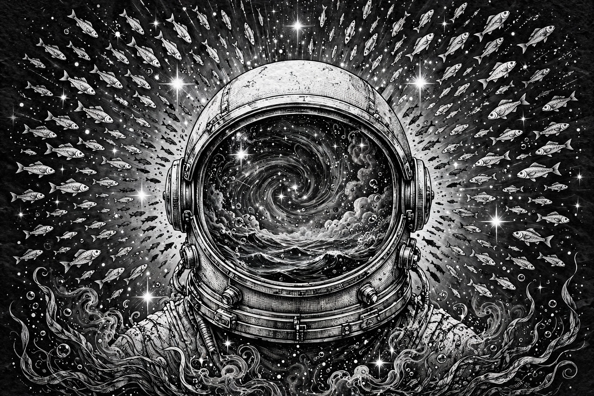
- v2 提示词原文：`Surreal monochrome concept art: an astronaut helmet, slightly smaller in the frame with generous dark space around it, the visor opening onto a CALM starry ocean surface dotted with stars, not a vortex, a smaller number of larger fish swimming around the helmet, black-and-white palette with bright starlight accents, dreamlike mood, detailed ink texture`
- v2 对比：面罩内变为平静的星空海面、鱼只剩 3 条较大的、头盔周围留出大面积暗色空间，更接近原图；代价是鱼的品种感变了（更像鲶鱼）、“入口感”弱于 v1 的旋涡，画面从“穿越”变成了“陈列”。
- v2 图：

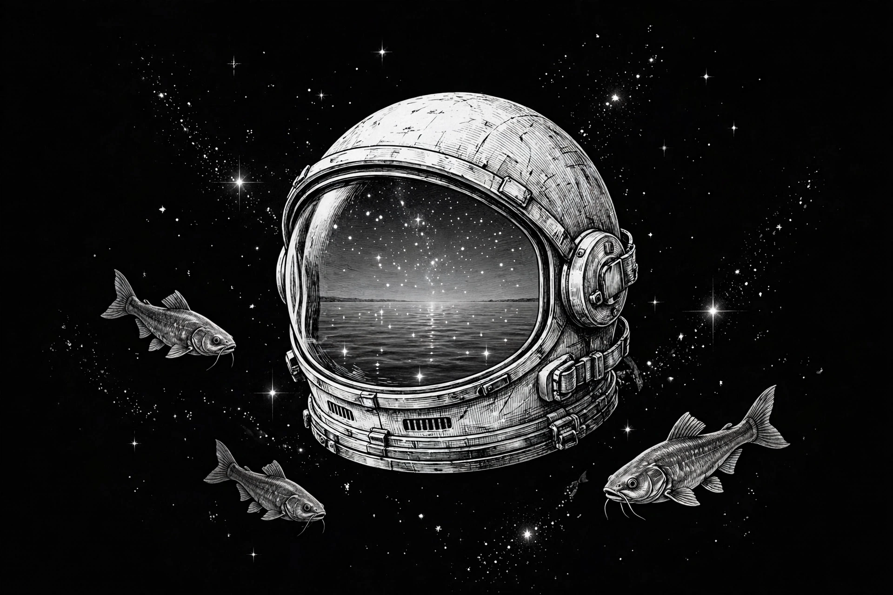
- 可复用规律：超现实概念要写“CALM + not a vortex”这类反向定性词，否则生成器会把“神秘”画成“剧烈旋涡”；数量词要写“a smaller number of larger fish”，只写“鱼群”它就会铺满。

## 14 · SeaArt · 破墙直拳英雄

- 原链接：https://www.seaart.ai/postDetail/d964365e878c73b4jgo0
- 热度：页面显示数字：622 / 223 / 558 / 0（字段未标注），评论 0 条；标题为 Brick Breaker Hero；标签含 #Character、#Anime、#GTA、#Daily-Challenge、#Wall-Passing Technique；发布时间 2026-07-07；提示词开头为动漫风、新城市风、英雄以毁灭性直拳击穿巨墙。
- 原图拆解：以首页缩略图与页面文字为准，详情页主图当天未正常渲染。动漫风城市动作场面：主角以直拳击穿一面砖墙，砖块与碎片向四周飞溅，身体前倾、动作张力强；背景为城市街道与建筑，色彩对比鲜明、线条硬朗，风格接近 JoJo 式夸张动作插画；机位为正面中景，主体居中、冲击方向朝向镜头。
- v1 提示词原文：`Dynamic anime action illustration: a hero bursting through a massive brick wall with a devastating straight punch toward the camera, bricks and debris flying outward in all directions, body leaning forward with strong motion tension, city street and buildings in the background, bold hard lines, vivid contrasting colors, front medium shot, hero centered`
  - 中文解析：动态动漫动作插画 + 英雄以毁灭性直拳朝镜头击穿巨墙 + 砖块碎片四散 + 身体前倾张力强 + 背景城市街道建筑 + 硬朗线条 + 鲜明对比色 + 正面中景 + 主体居中。
- v1 对比：像在破墙直拳、砖块飞溅、城市街道、速度线、红围巾、正面冲击；偏在拳头巨大占据画面中心、人物上半身被拳头遮住；丢了原图“人物全身动作可见、拳是动作的一部分而非全部”的比例。
- v1 图：

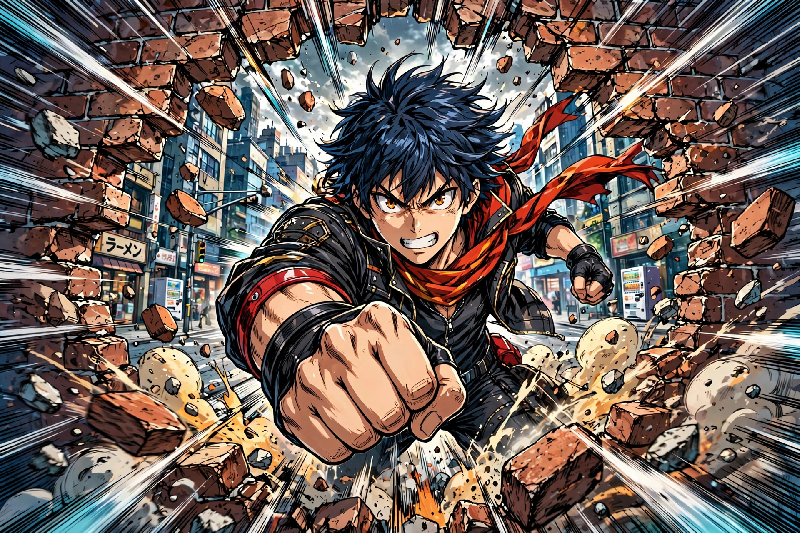
- v2 提示词原文：`Dynamic anime action illustration, front medium shot: a hero with spiky dark hair and a red scarf bursting through a LARGE hole in a massive brick wall, full upper body visible, one fist punching forward toward the camera but NOT covering the chest, the other arm back, bricks and debris flying outward, city street and buildings in the background, bold hard lines, vivid contrasting colors, speed lines, exaggerated energetic manga style`
- v2 对比：墙洞变大、上半身完整可见、另一只手臂向后拉开、城市街道两侧齐全，更接近原图的动作全貌；代价是拳头依然巨大、发色由深蓝变为纯黑，v1 的深蓝发色与红围巾对比反而更鲜明。
- v2 图：

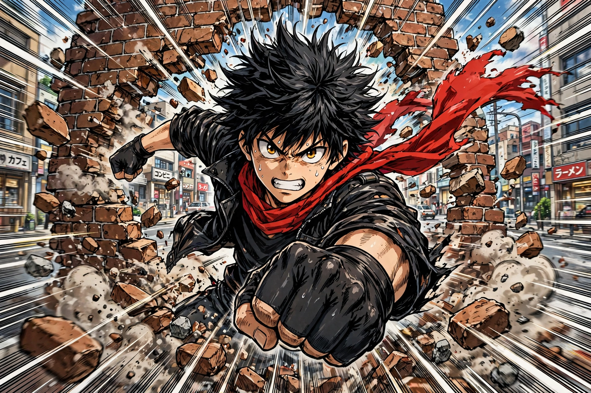
- 可复用规律：冲击类画面要写“full upper body visible + fist NOT covering the chest”，否则生成器会把拳头当成主角越画越大；同时要写“other arm back”给身体一个反向支点。

## 15 · SeaArt · 穿墙进厨房的少女与受惊猫

- 原链接：https://www.seaart.ai/postDetail/d964bj5e878c73953uvg
- 热度：页面显示数字：657 / 151 / 420 / 0（字段未标注），评论 0 条；标题原文为“O Portal Mágico Soltou Esse Gato Assustado!”；标签含 #Personagem、#Ilustração、#desafio diário、#A Técnica de Atravessar Paredes、#featuremyoc；发布时间 2026-07-07；检查点 GPT image 2
- 原图拆解：以首页缩略图与页面文字为准，详情页主图当天未正常渲染。动漫风厨房穿墙场面：粉发少女与一只受惊的猫一起从墙洞中冲出，少女表情惊讶/兴奋、嘴张开，猫眼睛圆睁；墙体碎片与杂物飞溅，背景为杂乱厨房，带橱柜与餐具轮廓；画面带蓝紫色传送门光晕，色彩明亮、动感强；机位为正面中景，人物与猫居中偏右。
- v1 提示词原文：`Bright anime illustration: a pink-haired girl and a startled cat bursting together through a hole in a wall into a messy kitchen, the girl's mouth open in surprised excitement, the cat's eyes wide and round, wall fragments and kitchen items flying, cabinets and tableware outlines in the background, blue-violet portal glow, vivid colors, strong motion, front medium shot, characters slightly right of center`
  - 中文解析：明亮动漫插画 + 粉发少女与受惊猫一起穿墙进杂乱厨房 + 少女张嘴惊讶兴奋 + 猫眼圆睁 + 墙体碎片与厨房杂物飞溅 + 背景橱柜餐具轮廓 + 蓝紫传送门光晕 + 鲜明色彩 + 强动感 + 正面中景 + 人物居中偏右。
- v1 对比：像在粉发少女、受惊灰猫、蓝紫传送门、杂乱厨房、飞溅杂物、张嘴惊讶；偏在传送门是巨大的旋涡、猫在前景被放大到与少女同等体量；丢了原图“墙洞 + 传送门光晕、猫是配角”的层级关系。
- v1 图：

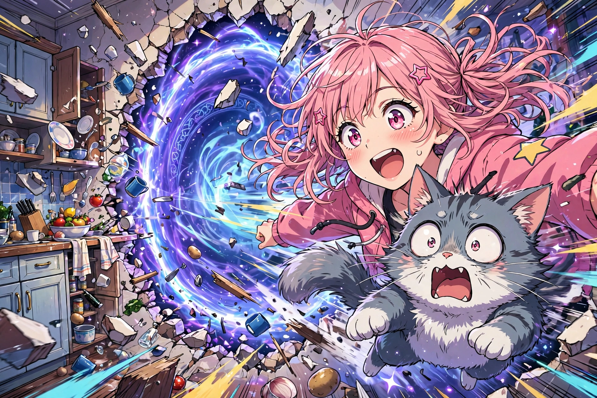
- v2 提示词原文：`Bright anime illustration: a pink-haired girl and a startled grey cat bursting together through a hole in a kitchen wall, the glowing blue-violet portal set INTO the wall behind them, girl and cat at similar sizes with the cat slightly behind the girl, the girl's mouth open in surprised excitement, the cat's eyes wide and round, wall fragments and kitchen items flying, kitchen cabinets and tableware on the left, vivid colors, strong motion, front medium shot`
- v2 对比：传送门变为嵌进墙洞的圆环、猫退到少女身后右侧、左侧厨房橱柜与飞溅餐具齐全，更接近原图的层级；代价是少女服装变为水手服（v1 的粉色连帽衫更接近原图的日常感），猫的体量仍然偏大。
- v2 图：

- 可复用规律：穿墙类画面要写“portal set INTO the wall behind them + cat slightly behind the girl”，否则生成器会把传送门画成全屏旋涡、把配角猫放大成双主角。

---

## 15 张共性结论

1. **先定关系，再定细节**：高热度图大多先有一个清晰关系——背影与小径、人物与巨行星、人物与墙洞、猫与少女、头盔与海洋。v1 丢的往往不是细节，而是这个关系（第 2 张的人物比例、第 6 张的纯背影、第 15 张的猫的层级）。
2. **大小与位置是提示词，不是构图运气**：SMALL in the frame、lower third、FULLY in frame、slightly behind，这些词直接决定了 v2 是否更接近；第 2、6、9、15 张都证明了这一点。
3. **反向排除词和正向描述词一样重要**：NO ring、not a vortex、no words anywhere、NOT covering the chest——生成器的“默认模板”（光环、旋涡、标语、巨拳）必须靠排除词压住。
4. **多主体画面要逐个写权重**：人与猫、少女与猫、英雄与拳头，每加一个主体就要写它的大小与位置，否则次要主体会被放大成双主角（第 5、12、15 张）。
5. **文字是生成器的自由发挥区**：漫画标题、海报标语、巧克力包装字，v1 常常自编文字；要么逐字写清标题原文（第 3 张 v2 成功纠正），要么明写 no words anywhere（第 12 张 v2 成功清干净）。
6. **v2 的常见代价**：补一个元素常常会改变另一个元素（第 4 张面部更正面、第 7 张笑容更开、第 10 张裙色变浅、第 15 张服装变水手服），所以 v2 之后仍需再收一次权重，而不是默认 v2 一定全胜。

## 写实人物小结（第 8、9、10、11 张）

- **为什么看起来逼真**：不是因为“更清晰”，而是因为“有瑕疵、有重量、有不一致的光”。第 8 张的不对称雀斑与逆光飞散发丝、第 9 张的自然握杖手指与飞散发丝、第 10 张的黄昏暖光与卷发碎发、第 11 张的直闪光与连续抓拍姿势，都是“不完美但自洽”的证据。
- **皮肤**：`realistic skin texture with pores and slight imperfections` + `no retouching look` 是最有效的去塑料感组合；只写 beautiful skin 反而会滑向塑料。第 9 张 v2 证明，前面再加 clearly visible，纹理才不会被柔光磨平。
- **雀斑与瑕疵要写“量”**：moderate + concentrated + slightly asymmetric 比 dense 更接近真实；第 8 张 v1 的教训是，dense 会让生成器铺满整张脸。
- **手与解剖**：先写手的动作与手指分工，再写脸；第 9 张 v2 证明，FULLY in frame + at shoulder height 比“举着魔杖”更能保证手完整入画。第 11 张证明，多格连拍的手势必须逐格写，否则四格会复制同一姿势。
- **光与镜头**：`candid` + `85mm lens` + 浅景深 + 一个主光源（右侧逆光、左侧窗光、黄昏暖光、直闪光）是写实组的通用骨架；多光源、无方向光是塑料感的常见来源。
- **表情**：抓拍感来自“正在做事的表情”（直视镜头的平静、闭唇微笑、贴脸大笑、额头相抵闭眼），而不是对镜头摆出的僵笑、假笑；第 11 张 v2 的第四格（额头相抵闭眼）是本期最自然的表情。
- **常见 AI 破绽自查表**：皮肤过滑、雀斑过均匀对称、五官过对称、手部变形或出画、牙齿不自然、光影不一致、文字乱码、多格面部不一致、漂浮物无重力方向。写实提示词里要逐项给反制词：毛孔与瑕疵、雀斑量词与不对称、五指分明与手完整入画、自然不对称、文字模糊但合理或直接禁文字、光源单一、动作日常、逐格写清姿势。

## 附：重生成图片文件清单

- v1 已生成：2、3、4、5、6、7、8、9、10、11、12、13、14、15（共 14 张）
- v2 已生成：2、3、4、5、6、7、8、9、10、11、12、13、14、15（共 14 张）
- 未生成：1 v1、1 v2（共 2 张次），原因见第 1 节，不用无关图片代替。
- 图片目录：`~/workspace/goals/ai-2/hidden_files/2026-10-30/images/`
