# 每日 AI 图片反推学习 · 2026-10-31

## 选图说明与缺口

- 选图时间：2026-10-31 上午（北京时间），浏览器实测任务 08:58–09:19 完成，全程未登录、未注册、未下载原图文件。
- 本期 15 张构成：SeaArt 3 张 + NightCafe 2 张 + PixAI 2 张 + Reddit 2 张 + Civitai 6 张，共 5 个渠道；写实人物照片 4 张（第 10、11、12、13 张）。
- **去重说明：当天未遇到重复图。** 选图前已核对以往全部报告（2026-10-29、2026-10-30）的平台加图片 ID / 原链接：Civitai 146487785、146475853、146432934、146447650、146623400、146442749、146478485、146540968、146492000、146540752、146437488、146370222、146756760、146645745、146746555、146854816，以及 SeaArt db9bu95e878c73f1enag、db0pf5de878c73ae8bk0、dbcl55le878c73d1fcf0、dbe190le878c739t4idg、d7k15i5e878c7390rt50、d11h10de878c7390n9p0、d7oqn3de878c73bfac20、d8q8iq5e878c73ckj9pg、d79fgtte878c7382766g、d964365e878c73b4jgo0、d964bj5e878c73953uvg。浏览器在已打开的热门作品中未遇到上述任一 ID；特别核对：第 15 号 Civitai 146760485 与禁选 146756760 数字相近但不同，不是重复项。跨平台视觉转载重复亦未发现。因此本期 15 张均为全新图片，无需顺延补位。
- **其他缺口（按实测，不硬编）**：SeaArt 首页顶部 Creative Picks 多为带播放标识的视频，已跳过；NightCafe《R.I.P. Sir Patrick Stewart》详情页出现视频提示词与进度图，疑似视频作品，已跳过；Reddit r/midjourney 前排多为视频帖，已跳过；Reddit r/StableDiffusion 打开时首屏多为新闻/资源类帖子，无可用艺术作品，记为该子版块首屏缺口，未编造作品；LiblibAI、PromptHero、ArtStation、Midjourney Explore 因 Civitai 已补足 15 张，未再展开。Reddit 当天未被封锁，可无登录浏览。
- SeaArt 详情页数字旁字段未逐一标注，报告里只写页面显示的数字顺序，不硬编为“点赞数”或“收藏数”；NightCafe、PixAI、Reddit、Civitai 的热度按详情页字段原文记录，同一作品在列表页与详情页、不同时间点可能略有波动，以详情页为准。
- 本报告的 v1、v2 均为反推重写，不是照抄原帖提示词；个别原帖提示词要点仅用于核对拆解方向。
- 重生成图片保存在本任务目标工作区 `hidden_files/2026-10-31/images/` 下，报告内以图片文件名对应；GitHub 版见 ai-image-learning/2026-10-31.md，图片在 ai-image-learning/images/ 下。
- **生成缺口：无。** 本期 15 张的 v1、v2 共 30 张次全部生成成功并逐张看过对比，无未完成项，无无关图片代替。

## 一览表

| # | 平台 | 作者 | 原链接 | 热度（快照） |
|---|---|---|---|---|
| 1 | SeaArt | サトゥリア | https://www.seaart.ai/postDetail/db6n96le878c73c0hsdg | 页面显示：976 / 359 / 131，评论 2（字段未逐一标注） |
| 2 | SeaArt | YO- | https://www.seaart.ai/postDetail/d7t8a55e878c738klapg | 页面显示：1.6K / 518 / 476，评论 12（字段未逐一标注） |
| 3 | SeaArt | shimemomo | https://www.seaart.ai/postDetail/dagv6ute878c73fru7og | 页面显示：284 / 154 / 36，评论 4（字段未逐一标注） |
| 4 | NightCafe | Nikko P（@Nikko_P） | https://creator.nightcafe.studio/creation/XbuGrm6xlWywBfhsb8fo/a-conversation-without-words | 187 likes，24 comments（详情页；列表页曾显示 184） |
| 5 | NightCafe | Artificial Artistry（@Artificial_Artistry） | https://creator.nightcafe.studio/creation/09yUgfil19nPcnFxBeDh/moonlight-bloom | 133 likes，40 comments（详情页；列表页曾显示 132、32） |
| 6 | PixAI | AURA✨️💡 | https://pixai.art/artwork/2072110449325551103 | 666 likes，58 comments（PixAI Trending 榜） |
| 7 | PixAI | リオ | https://pixai.art/artwork/2070892366596255652 | 1.16k likes，31 comments（PixAI Trending 榜） |
| 8 | Reddit r/midjourney | u/Zenchilada | https://www.reddit.com/r/midjourney/comments/1xjnhlc/edgar/ | 62 upvotes，0 comments |
| 9 | Reddit r/aiArt | u/Shadowstein | https://www.reddit.com/r/aiArt/comments/1xjogyl/portrait_of_the_queen_and_the_young_prince/ | 61 upvotes，16 comments |
| 10 | Civitai | agent_hara_smith74479 | https://civitai.com/images/147187815 | 👍 79，❤️ 22，😂 1，😢 2 |
| 11 | Civitai | agent_hara_smith74479 | https://civitai.com/images/147187814 | 👍 75，❤️ 12，😂 2，😢 2 |
| 12 | Civitai | AmurisGen | https://civitai.com/images/147344108 | 👍 26，❤️ 10，😂 2，😢 4 |
| 13 | Civitai | TheP3NGU1N | https://civitai.com/images/147291558 | 👍 25，❤️ 8，😂 2，😢 2 |
| 14 | Civitai | KandiKissies | https://civitai.com/images/147286824 | 👍 101，❤️ 24，😂 3，😢 2 |
| 15 | Civitai | Vladaa | https://civitai.com/images/146760485 | 👍 152，❤️ 26，😂 4，😢 11 |

类别分布：动漫/插画 7 张（1、2、3、6、7 及 4、5 的绘画风景），绘画肖像/概念画 3 张（8、9、15），写实人物照片 4 张（10、11、12、13），动物奇幻插画 1 张（14）。

---

## 1 · SeaArt · 白发狙击少女

- 原链接：https://www.seaart.ai/postDetail/db6n96le878c73c0hsdg
- 热度：页面显示 976 / 359 / 131，评论 2（字段未逐一标注）
- 原图拆解：主体为白发动漫少女手持狙击枪，姿态干练、视线集中；构图为人物中近景；光影为蓝色夜色与彩绘玻璃质感的光影；色彩为冷蓝与苍白发色对照；材质为战术服、金属枪身；风格为精致动漫插画。
- v1 提示词原文：`Anime illustration, a cool white-haired girl sniper holding a sniper rifle, focused gaze, dry confident pose, deep blue night background with stained-glass-like light patterns, cold blue palette contrasting with her pale hair and skin, sharp clean anime linework, cinematic lighting`
  - 中文解析：动漫插画 + 白发狙击少女 + 专注眼神 + 干练姿态 + 深蓝夜色 + 彩绘玻璃感光影 + 冷蓝调对照苍白发色 + 干净线条 + 电影光。
- v1 对比：像在白发、狙击枪、彩绘玻璃蓝调、战术服、专注眼神；偏在背景画成了具象教堂彩窗、人物为举枪瞄准姿态；丢了“夜色光影质感而非建筑本身”的克制感。
- v1 图：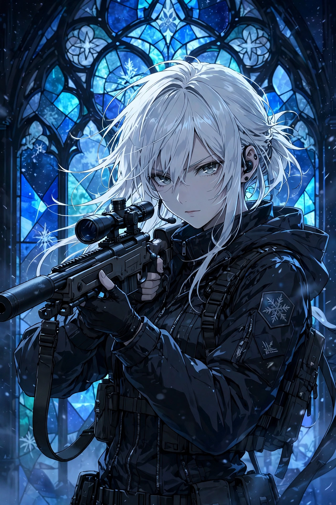
- v2 提示词原文：`Anime illustration, a cool white-haired girl sniper in dark tactical clothing holding a sniper rifle at chest level, focused calm gaze toward the viewer, deep blue night background with stained-glass light texture, NOT a church interior, cold blue palette, sharp clean anime linework, cinematic night lighting`
- v2 对比：枪放低到胸前、面部更正面、耳机细节清晰，更接近“持枪肖像”而非“瞄准动作”；代价是彩窗背景仍具象，未完全摆脱教堂感，v1 的举枪姿态反而更有狙击手味道。
- v2 图：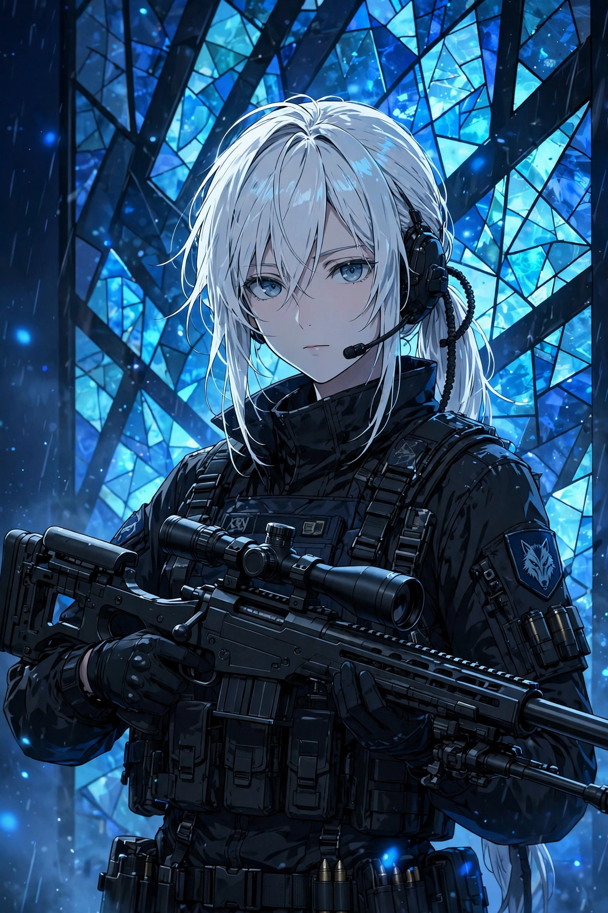
- 可复用规律：写“彩绘玻璃感”要同时写反向排除词（NOT a church interior），否则生成器会把“质感”画成“建筑”；持枪姿态要写枪的位置（at chest level），只写“手持”它默认举枪瞄准。

## 2 · SeaArt · 妖都夜记者

- 原链接：https://www.seaart.ai/postDetail/d7t8a55e878c738klapg
- 热度：页面显示 1.6K / 518 / 476，评论 12（字段未逐一标注）
- 原图拆解：主体为手持相机的年轻女性记者；构图为人物右侧、霓虹街道纵深；光影为灯笼暖光 + 蓝粉霓虹；色彩为蓝、粉、暖黄；材质为纸灯笼、雨夜街道反光、阴影怪物；风格为电影感动漫夜景。
- v1 提示词原文：`Anime illustration, a young woman journalist holding a camera, standing in a neon-lit Japanese yokai night city, paper lanterns, shadow monsters in the streets, cinematic composition, blue and pink neon contrasting with warm lantern light, detailed street lighting and atmosphere`
  - 中文解析：动漫插画 + 女记者持相机 + 霓虹妖都夜街 + 纸灯笼 + 街道阴影怪物 + 电影构图 + 蓝粉霓虹对照暖灯光。
- v1 对比：像在记者、相机、灯笼、妖怪、霓虹雨街；偏在招牌文字过多过密、妖怪铺满画面；丢了“记者是主角、妖怪是背景”的主次克制。
- v1 图：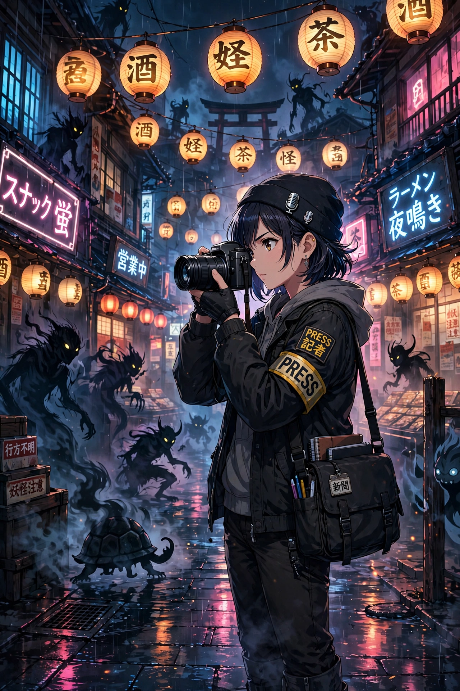
- v2 提示词原文：`Anime illustration, a young woman journalist holding a camera to her eye, standing in a neon-lit Japanese yokai night street, warm paper lanterns overhead, a FEW shadow monsters in the background only, blue and pink neon with warm lantern light, no legible text on signs, cinematic composition, detailed street atmosphere`
- v2 对比：招牌文字消失、妖怪退到远处小剪影、记者与灯笼街道更干净，更接近原图的克制感；代价是妖怪存在感大幅下降，v1 的“妖都”氛围反而更浓。
- v2 图：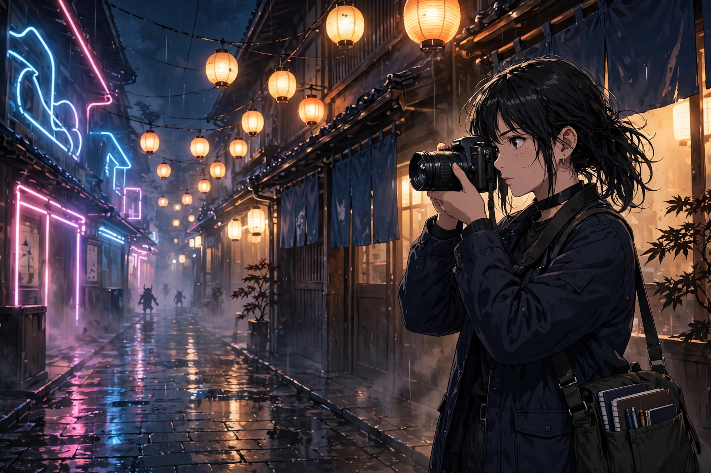
- 可复用规律：夜景群像要写“a FEW + in the background only”给配角定量定位置，否则生成器会把背景生物画成第二主角；招牌文字要明写 no legible text，否则它会自己编字。

## 3 · SeaArt · 光暗双子镜像

- 原链接：https://www.seaart.ai/postDetail/dagv6ute878c73fru7og
- 热度：页面显示 284 / 154 / 36，评论 4（字段未逐一标注）
- 原图拆解：主体为光暗双子；构图为上下镜像；光影为上暗下亮的对照；色彩为黑、白粉、金、蓝玫瑰；材质为华丽金框、蕾丝、羽毛；风格为精致插画。
- v1 提示词原文：`Exquisite anime illustration, vertically mirrored twin girls, light and dark twins: upper girl in black dress, lower girl as a white and pink angel, ornate golden frame, blue roses, symmetrical composition, delicate painterly details, soft luminous light`
  - 中文解析：精致动漫插画 + 竖直镜像双子 + 上黑裙下白粉天使 + 华丽金框 + 蓝玫瑰 + 对称构图 + 细腻绘画细节。
- v1 对比：像在上黑下白粉、金框、蓝玫瑰、对称；偏在两个人被横置、头部朝左并排而非上下正对；丢了“竖直镜像、面部朝向观众”的证件式对照感。
- v1 图：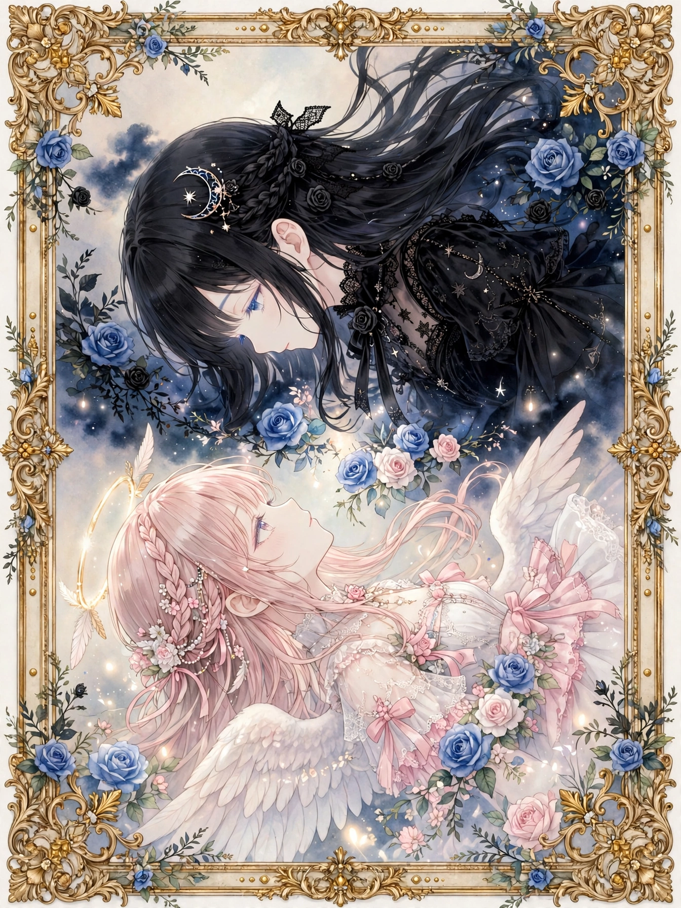
- v2 提示词原文：`Exquisite anime illustration, vertical composition, UPRIGHT vertically mirrored twin girls facing each other: upper girl in a black dress with black hair, lower girl as a white and pink angel with wings and halo, ornate golden frame, blue roses between them, symmetrical mirror composition, delicate painterly details`
- v2 对比：双子恢复竖直上下、面部朝向观众、金框与蓝玫瑰居中分隔，更接近原图的镜像结构；代价是两人不再“面对面”，而是各自正面肖像并列，镜像的互动感弱于 v1 的横置对视。
- v2 图：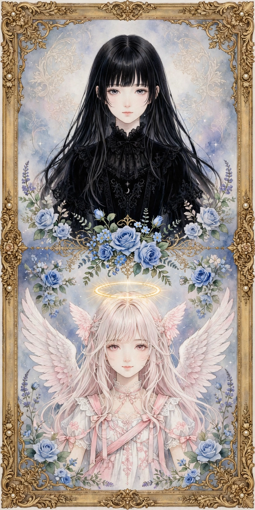
- 可复用规律：镜像画面要写“UPRIGHT + vertical composition”，只写 mirrored 时，生成器常常把镜像轴转横；同时要写两人各自的朝向，否则它会默认两张正面肖像上下拼贴。

## 4 · NightCafe · 无言的对话（和服红日）

- 原链接：https://creator.nightcafe.studio/creation/XbuGrm6xlWywBfhsb8fo/a-conversation-without-words
- 热度：187 likes，24 comments（详情页）
- 原图拆解：主体为和服女性置身日本风景；构图为人物右侧、风景铺展；光影为柔和日光；色彩为暖红与米白；材质为碎片化肌理绘画、和服纹样；风格为肌理感绘画，氛围安静克制。
- v1 提示词原文：`Textured painterly illustration with fragmented brushwork, a woman in a kimono in a Japanese landscape, large red sun, pagoda, cranes and cherry blossoms, warm red and off-white palette, quiet restrained mood, artistic impasto texture`
  - 中文解析：肌理绘画 + 碎片笔触 + 和服女子 + 日本风景 + 大红日 + 宝塔 + 仙鹤 + 樱花 + 暖红米白 + 安静克制 + 厚涂质感。
- v1 对比：像在和服、红日、宝塔、仙鹤、樱花、暖红米白；偏在厚涂肌理过重、画面偏碎；丢了原图的“克制留白”。
- v1 图：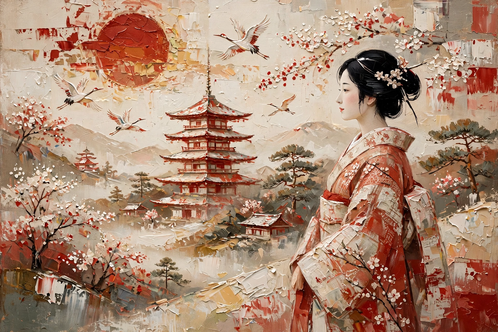
- v2 提示词原文：`Textured painterly illustration with soft fragmented brushwork, a woman in a red and white kimono in profile on the right side, Japanese landscape with a large red sun, a pagoda, cranes and cherry blossoms, warm red and off-white palette, quiet restrained mood, gentle impasto texture, not overly rough`
- v2 对比：肌理变柔、人物明确为右侧侧面、红日与宝塔层次更干净，更接近原图的安静感；代价是樱花枝的碎片感减弱，v1 的粗粝肌理反而更有“碎片化”特征。
- v2 图：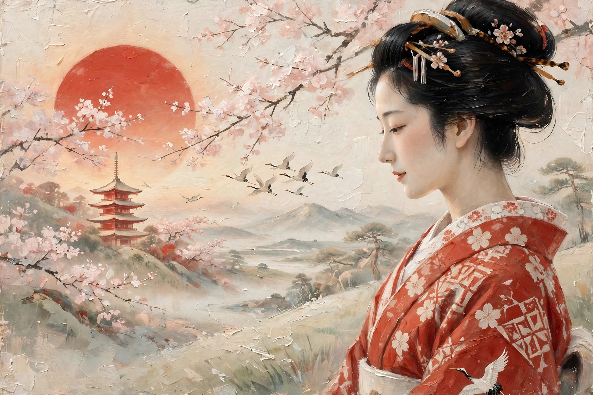
- 可复用规律：肌理词要分档（fragmented / soft / gentle / not overly rough），只写“肌理明显”时，生成器会一路加厚到粗粝；人物位置要写 on the right side，否则风景会把人物挤到角落。

## 5 · NightCafe · 月夜金樱与持伞兔

- 原链接：https://creator.nightcafe.studio/creation/09yUgfil19nPcnFxBeDh/moonlight-bloom
- 热度：133 likes，40 comments（详情页）
- 原图拆解：主体为黑金日本风景与下方小兔剪影；构图为金月高悬、富士山形山体、宝塔与樱花依次铺展；光影为夜色金光；色彩为黑、金、白；材质为水墨泼彩；风格为黑金水墨风景。
- v1 提示词原文：`Black and gold Japanese landscape painting, large golden full moon in the night sky, Mount Fuji-shaped mountain, pagoda and cherry blossoms, a small rabbit silhouette holding an umbrella below, ink wash and splashed color texture, night gold light contrasting with darkness`
  - 中文解析：黑金日本风景画 + 大金月 + 富士山形 + 宝塔樱花 + 下方持伞小兔剪影 + 水墨泼彩 + 夜金光对照黑暗。
- v1 对比：像在金月、富士、宝塔、樱花、持伞兔、水墨泼彩；偏在宝塔偏左偏大、兔子在画面底部偏小；丢了“山体居中、宝塔为中景点缀”的层级。
- v1 图：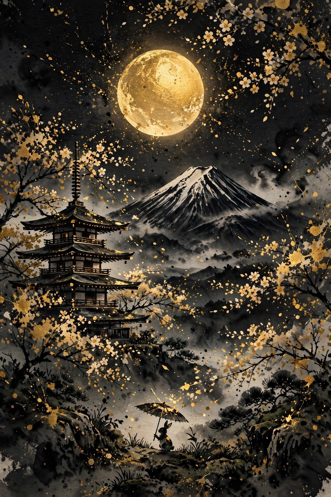
- v2 提示词原文：`Black and gold Japanese landscape painting, vertical composition, large golden full moon high in the night sky, Mount Fuji-shaped mountain and a pagoda below, cherry blossoms framing the sides, a SMALL rabbit silhouette holding an umbrella at the bottom center, ink wash and splashed gold color texture, night gold light contrasting with darkness`
- v2 对比：竖构图拉开、金月与富士居中、宝塔退到中景、兔子明确在底部中央，更接近原图的纵深层级；代价是樱花框边更对称规整，v1 的泼彩随意感稍强。
- v2 图：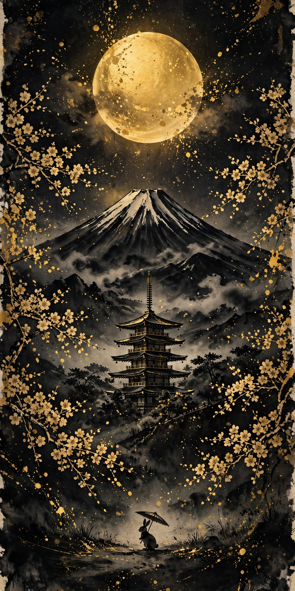
- 可复用规律：风景里的小主角要写“SMALL + at the bottom center”，只写“下方有一只兔子”，生成器会把它画成可有可无的黑点或干脆放大成主角。

## 6 · PixAI · 雨夜窗边耳机少女

- 原链接：https://pixai.art/artwork/2072110449325551103
- 热度：666 likes，58 comments（PixAI Trending 榜）
- 原图拆解：主体为白长发戴眼镜少女戴耳机看手机；构图为人物右侧、雨夜窗景左侧；光影为蓝色窗景 + 暖色台灯；色彩为蓝、暖黄、米白；材质为针织毛衣、书本、小摆件；风格为温馨动漫室内画。
- v1 提示词原文：`Anime illustration, a girl with long white hair and glasses wearing headphones, looking at her phone, sitting at a desk by a window on a rainy night, blue rainy window view contrasting with warm desk lamp light, books and small ornaments on the desk, cozy quiet indoor atmosphere`
  - 中文解析：动漫插画 + 白长发眼镜少女 + 耳机 + 看手机 + 雨夜窗边书桌 + 蓝窗景对照暖台灯 + 书本小摆件 + 温馨安静室内。
- v1 对比：像在白发、眼镜、耳机、手机、雨窗、暖灯、书本摆件；偏在桌面杂物过多（猫摆件、星星、笔筒、纸张全铺开）；丢了“桌面点缀而非陈列”的克制。
- v1 图：
- v2 提示词原文：`Anime illustration, a girl with long white hair and glasses wearing headphones, holding a phone in one hand and looking down at it, sitting at a wooden desk by a large rainy night window, blue rainy city window view contrasting with a warm desk lamp on the right, a FEW books and one small ornament on the desk, cozy quiet indoor atmosphere, no clutter`
- v2 对比：桌面只剩几本书与一个小猫摆件、人物低头看手机、暖灯在右侧，更接近原图的安静点缀感；代价是人物转为侧面、手机角度偏平，v1 的正面“看手机”动作反而更明确。
- v2 图：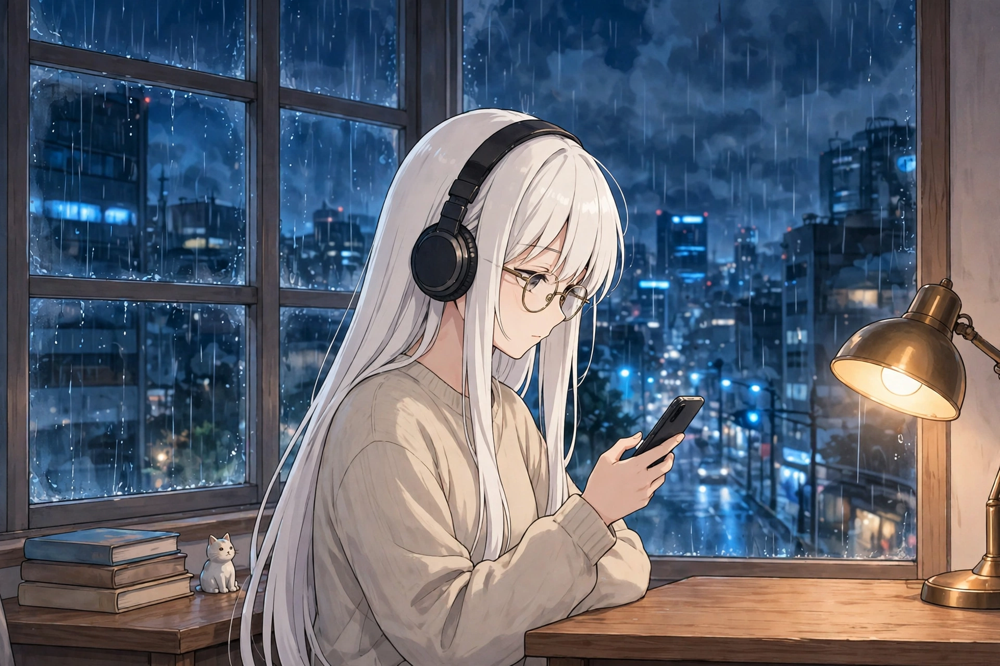
- 可复用规律：室内桌面要写“a FEW + one small ornament + no clutter”，只写“书本与小摆件”，生成器会把桌面当成杂货铺；看手机要写 holding in one hand + looking down，否则它会把手机画成展示品。

## 7 · PixAI · 银河捣蛋鬼（粉发警示牌）

- 原链接：https://pixai.art/artwork/2070892366596255652
- 热度：1.16k likes，31 comments（PixAI Trending 榜）
- 原图拆解：主体为粉红长发侧马尾、橙色眼睛少女手持警示牌；构图为人物居中、海报式；光影为明亮平面光；色彩为粉、绿、米、亮黄；材质为粗犷手绘线条、厚涂笔触；风格为明快插画海报。
- v1 提示词原文：`Bold anime illustration with rough hand-drawn lines and thick brushstrokes, a girl with long pink hair in a side ponytail and orange eyes holding a warning sign, wearing a green lace top, beige short skirt and jacket, height-chart background, bright vivid colors, energetic poster style`
  - 中文解析：粗犷动漫插画 + 手绘线条厚涂 + 粉发侧马尾橙眼 + 手持警示牌 + 绿蕾丝上衣米色短裙外套 + 身高标尺背景 + 明快色彩 + 海报感。
- v1 对比：像在粉发侧马尾、橙眼、警示牌、绿蕾丝、米裙、身高标尺；偏在生成器自加了底部大标语与多处感叹号、星星装饰；丢了“警示牌与标尺本身就是海报，不需再加口号”的克制。
- v1 图：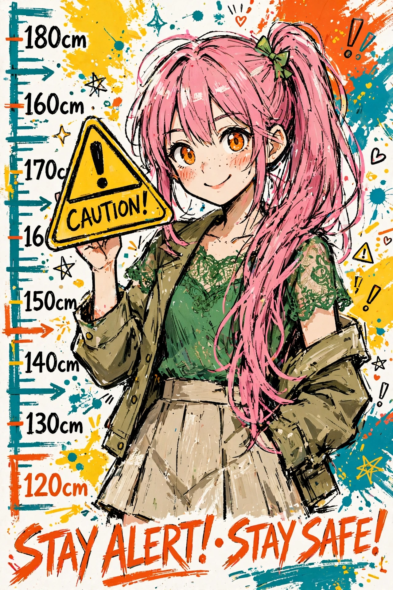
- v2 提示词原文：`Bold anime illustration with rough hand-drawn lines and thick brushstrokes, a girl with long pink hair in a side ponytail and orange eyes holding ONE yellow triangular warning sign, wearing a green lace top, beige short skirt and jacket, height-chart ruler on the left side only, bright vivid colors, no text at the bottom, no slogan`
- v2 对比：底部标语消失、标尺只在左侧、警示牌只剩一个空白黄三角，更接近原图的“道具即海报”逻辑；代价是警示牌上的文字/感叹号也随之消失，v1 的 CAUTION 牌反而更有“警示”语义。
- v2 图：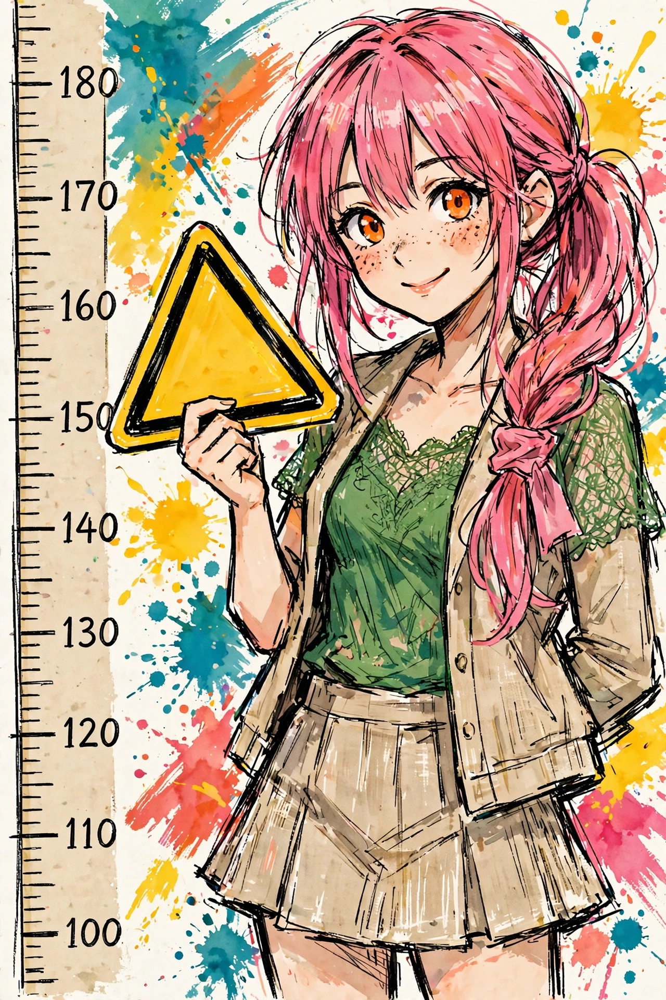
- 可复用规律：海报类要写“ONE sign + no text at the bottom + no slogan”，否则生成器会把“海报感”理解成“多加文字”；标尺要写 on the left side only，否则它会满屏铺刻度。

## 8 · Reddit r/midjourney · Edgar（哥特权杖乌鸦）

- 原链接：https://www.reddit.com/r/midjourney/comments/1xjnhlc/edgar/
- 热度：62 upvotes，0 comments；标签 AI Showcase - Midjourney
- 原图拆解：主体为哥特风格深色男子；构图为竖构图肖像；光影为青色雾气 + 烛光；色彩为黑、青、暖烛黄；材质为黑色纹理大衣、华丽权杖、乌鸦羽毛；风格为电影感绘画肖像，不计入写实照片。
- v1 提示词原文：`Cinematic gothic vertical portrait painting, a dark man in a black textured coat holding an ornate scepter, a crow perched on his shoulder, teal fog and candlelight atmosphere, dramatic film-like lighting, moody dark palette`
  - 中文解析：电影哥特竖肖像画 + 深色男子黑纹理大衣 + 华丽权杖 + 肩上乌鸦 + 青雾烛光 + 戏剧电影光 + 阴郁暗调。
- v1 对比：像在黑大衣、权杖、乌鸦、青雾、烛光、面部特写；偏在人物为面部大特写、上半身被裁掉；丢了“竖构图肖像的上半身完整感”。
- v1 图：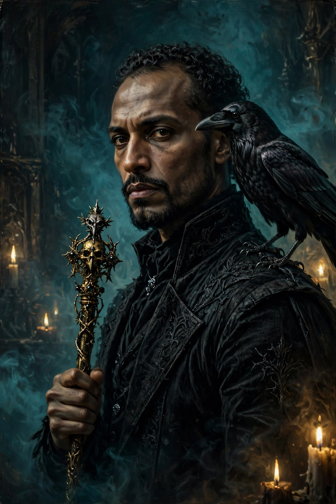
- v2 提示词原文：`Cinematic gothic vertical portrait painting, a dark man in a black textured coat, FULL upper body visible, holding an ornate scepter in one hand, a crow perched on his shoulder, teal fog and candlelight in the background, dramatic film-like lighting, moody dark palette, painterly texture`
- v2 对比：上半身完整、乌鸦在左肩、权杖在右手、烛台在背景，更接近原图的肖像全貌；代价是面部特写的压迫感下降，v1 的近距离凝视反而更有哥特肖像味道。
- v2 图：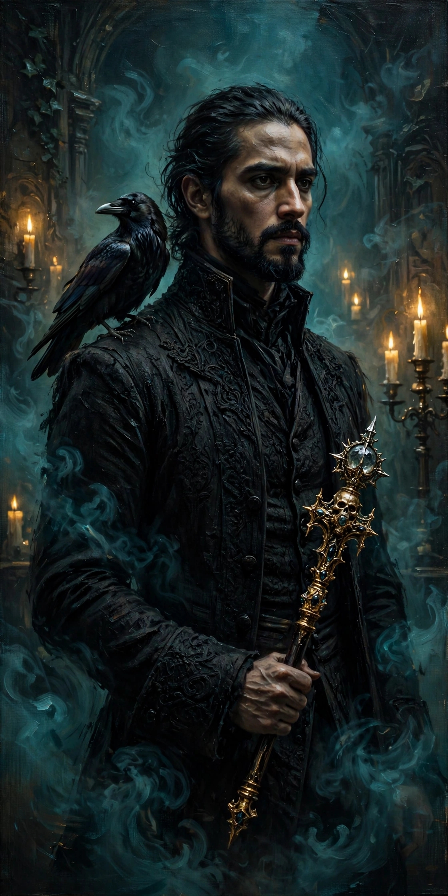
- 可复用规律：肖像画要写“FULL upper body visible”，只写“肖像”，生成器默认裁成面部特写；乌鸦与权杖要各写一只手/一侧肩膀的位置，否则它会把两个道具堆在同一侧。

## 9 · Reddit r/aiArt · 昆虫女王与幼虫王子

- 原链接：https://www.reddit.com/r/aiArt/comments/1xjogyl/portrait_of_the_queen_and_the_young_prince/
- 热度：61 upvotes，16 comments；标签 Image - ChatGPT；作者说明要点：昆虫王室肖像，另一颗星球
- 原图拆解：主体为身穿紫金长袍的女王怀抱幼虫王子；构图为女王坐于华丽座椅、人物居中；光影为暖色绘画光；色彩为紫、金、暖肤；材质为长袍金纹、座椅雕花；风格为暖色绘画肖像，不计入写实照片。
- v1 提示词原文：`Painterly fantasy portrait, an insectoid queen in a purple and gold robe holding a young larva prince, seated on an ornate throne, warm painterly texture, elaborate costume details, royal atmosphere, another planet royal court`
  - 中文解析：绘画奇幻肖像 + 昆虫女王紫金袍 + 怀抱幼虫王子 + 华丽宝座 + 暖绘画质感 + 繁复服饰 + 王室氛围 + 异星宫廷。
- v1 对比：像在紫金袍、女王昆虫头、幼虫王子、宝座、金饰；偏在背景宫廷、异星建筑、烛台、植物全铺开，画面拥挤；丢了“肖像居中、背景退后”的证件感。
- v1 图：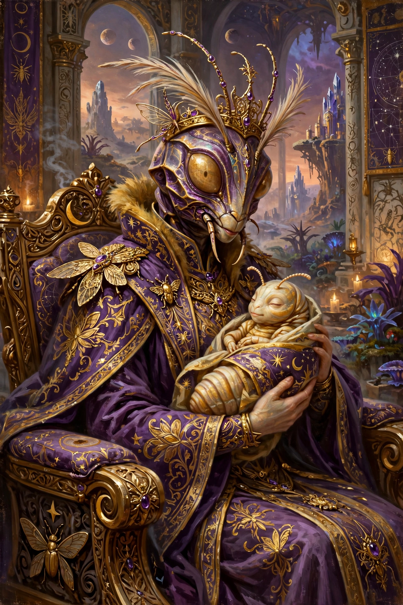
- v2 提示词原文：`Painterly fantasy portrait, centered composition, an insectoid queen in a purple and gold robe seated on an ornate throne, holding a young larva prince wrapped in cloth in both arms, warm painterly texture, elaborate gold costume details, royal atmosphere, simple background with arches, not overcrowded`
- v2 对比：背景只剩简单拱门、女王与襁褓王子居中、双手怀抱明确，更接近原图的肖像结构；代价是异星宫廷的奇幻背景信息减少，v1 的“另一颗星球”氛围反而更足。
- v2 图：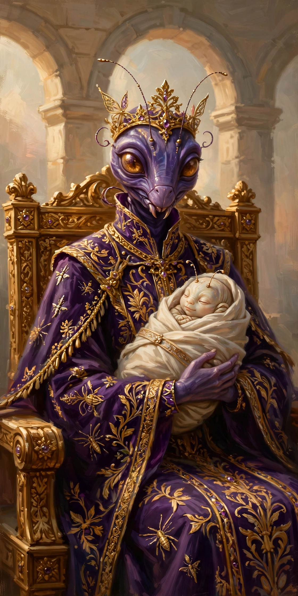
- 可复用规律：双人肖像要写“centered + holding in both arms + simple background”，只写“女王抱王子”，生成器会把背景当成第二个舞台；襁褓要写 wrapped in cloth，否则幼虫会被画成裸露的虫体特写。

## 10 · Civitai · 黄吊带黑颈链女子（写实人物）

- 原链接：https://civitai.com/images/147187815
- 热度：👍 79，❤️ 22，😂 1，😢 2
- 原图拆解：主体为胸像构图的年轻女子；构图为面部与肩部清晰的人像特写；光影为柔和日光；色彩为黄、黑、木褐、绿；材质为吊带布料、木屋、绿植；风格为户外写实人像照片。
- 写实要素拆解：短深色头发带刘海、黑色颈链、黄色吊带是造型三件套；木屋与绿植构成户外背景；日光柔和、面部与肩部清晰；皮肤质感自然。手、耳、牙齿在本张描述中未重点提及，不编。
- AI 破绽对照：本类最容易破绽是刘海贴成头盔、颈链勒出不自然阴影、皮肤磨皮过滑；重生成时用“带毛孔与小瑕疵、发丝飞散、自然光”逐项反制。
- v1 提示词原文：`Photorealistic bust portrait, a young woman with short dark hair with bangs, wearing a black choker necklace and a yellow camisole top, outdoors with a wooden cabin and green plants in the background, soft daylight, natural skin texture with pores and slight imperfections, no retouching look, candid, 85mm lens, shallow depth of field`
  - 中文解析：写实胸像 + 短深发带刘海 + 黑颈链 + 黄吊带 + 户外木屋绿植背景 + 柔和日光 + 带毛孔与小瑕疵的真实皮肤 + 无修图感 + 抓拍 + 85mm + 浅景深。
- v1 对比：像在短深发刘海、黑颈链、黄吊带、木屋绿植、雀斑与皮肤纹理；偏在面部偏向侧面、雀斑比原图描述更密；丢了“面部朝向观众”的肖像感。
- v1 图：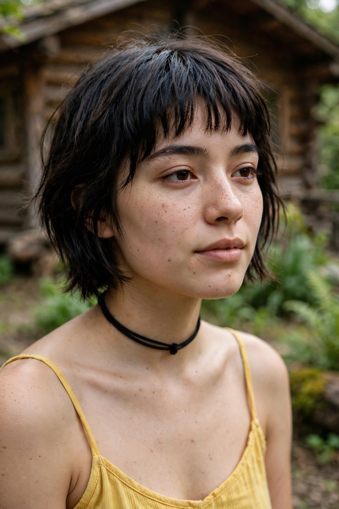
- v2 提示词原文：`Photorealistic bust portrait, face turned mostly toward the camera, a young woman with short dark hair with bangs, moderate freckles, wearing a black choker necklace and a yellow camisole top, outdoors with a wooden cabin and green plants softly blurred in the background, soft daylight, realistic skin texture with pores and slight imperfections, no retouching look, candid, 85mm lens, shallow depth of field`
- v2 对比：面部更朝向镜头、雀斑收为适中、背景虚化更明确，更接近原图的肖像感；代价是面部仍为四分之三而非全正面，v1 的侧向感反而更有“抓拍”味道。
- v2 图：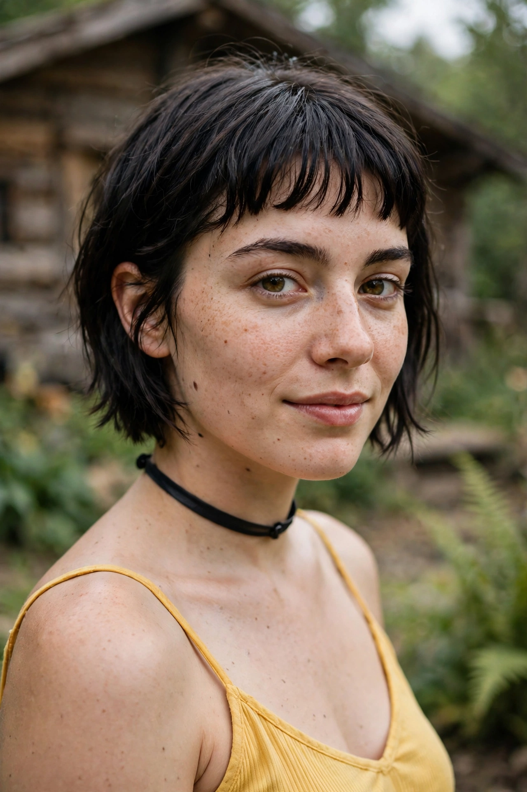
- 可复用规律：写实雀斑要写“moderate”，只写“真实皮肤”时，生成器容易把雀斑铺满全脸；面部朝向要写 turned mostly toward the camera，否则它默认四分之三或侧面。

## 11 · Civitai · 白衣波波头天台笑容（写实人物）

- 原链接：https://civitai.com/images/147187814
- 热度：👍 75，❤️ 12，😂 2，😢 2
- 原图拆解：主体为短深色波波头女子面带微笑正视镜头；构图为面部居中清晰；光影为明亮日光；色彩为白、黑、蓝天、城市暖灰；材质为白上衣布料、颈链吊坠；风格为户外日光人像照片。
- 写实要素拆解：波波头的发丝飞散与发际碎发是第一证据；面部居中、日光明亮是第二证据；白上衣与黑颈链吊坠的日常搭配是第三证据；皮肤与发丝细节自然。牙齿、手部在本张描述中未重点提及，重生成时仍按通用规则写自然牙齿、不露手部破绽。
- AI 破绽对照：本类最容易破绽是笑容僵硬露齿过多、波波头变成头盔、背景城市虚化成色块；重生成时用“放松微笑、飞散发丝、背景柔和虚化但仍可辨屋顶”反制。
- v1 提示词原文：`Photorealistic outdoor daylight portrait, a young woman with a short dark bob haircut smiling and looking at the camera, wearing a white top and a black choker with a pendant, city rooftops and blue sky in the background, bright daylight, face centered and clear, realistic skin texture with pores and slight imperfections, no retouching look, candid, 85mm lens`
  - 中文解析：写实户外日光肖像 + 短深波波头 + 微笑直视镜头 + 白上衣 + 黑颈链吊坠 + 屋顶城市蓝天背景 + 明亮日光 + 面部居中清晰 + 真实皮肤 + 无修图感 + 抓拍 + 85mm。
- v1 对比：像在波波头、白上衣、黑颈链吊坠、屋顶蓝天、面部居中；偏在笑容露齿较大、偏“对镜头大笑”；丢了原图“面带微笑”的放松度。
- v1 图：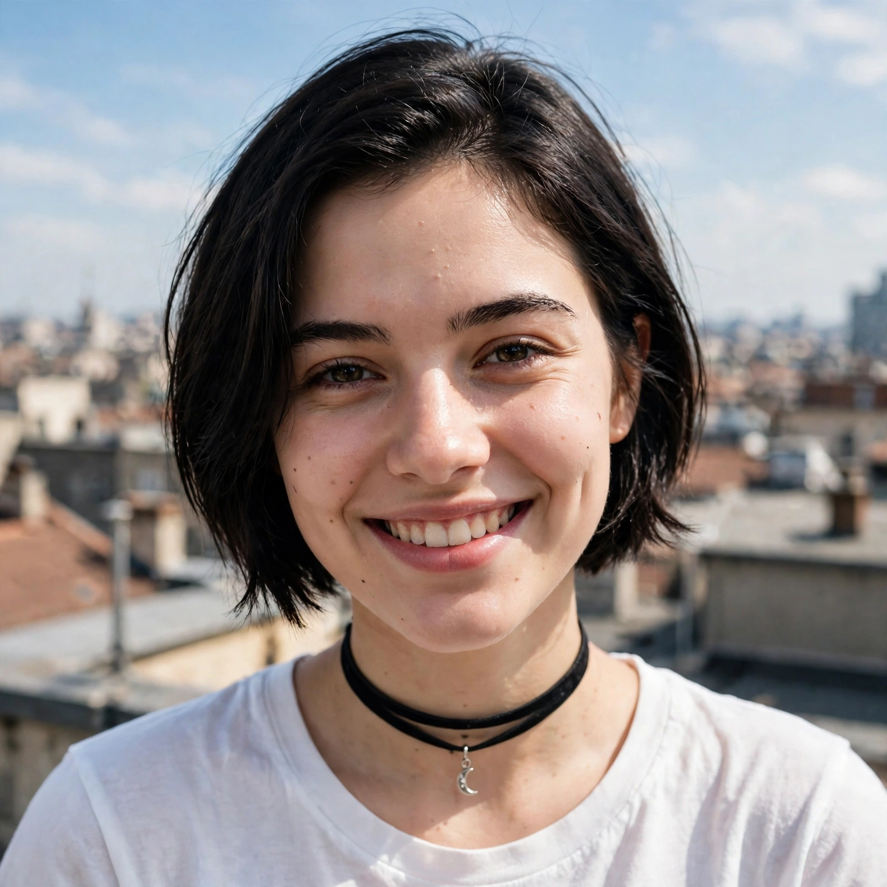
- v2 提示词原文：`Photorealistic outdoor daylight portrait, a young woman with a short dark bob haircut with a soft relaxed smile, natural teeth, looking at the camera, wearing a white top and a black choker with a small pendant, city rooftops and blue sky softly blurred in the background, bright daylight, realistic skin texture with pores and slight imperfections, no retouching look, candid, 85mm lens`
- v2 对比：笑容变柔、牙齿自然、背景虚化更柔和，更接近“放松微笑”；代价是笑容仍露齿，v1 的开怀感反而更符合“微笑正视镜头”的直白描述，两者各有取舍。
- v2 图：
- 可复用规律：写实笑容要写“soft relaxed smile + natural teeth”，只写 smiling 时，生成器默认给一个标准大笑；背景要写 softly blurred，否则屋顶会抢走面部焦点。

## 12 · Civitai · 侧面皮衣蕾丝领女子（写实人物）

- 原链接：https://civitai.com/images/147344108
- 热度：👍 26，❤️ 10，😂 2，😢 4；原帖提示词要点：A close raw analog photo featuring a confident woman in a profile shot
- 原图拆解：主体为侧面特写女子微微仰首；构图为近距离侧面肖像；光影为侧光勾勒鼻梁与面颊、深色背景带暖色虚化光斑；色彩为黑、暖黄、肤色；材质为黑色皮衣、蕾丝领口、模拟胶片颗粒；风格为 raw analog 写实照片。
- 写实要素拆解：侧光勾勒的鼻梁与面颊轮廓是第一证据；深色头发与蓝色眼睛的对照是第二证据；皮肤纹理与模拟胶片质感是第三证据；微微仰首的自信姿态（不是僵直侧脸）是第四证据。手、耳、牙齿在本张为侧面构图，不作正面推断。
- AI 破绽对照：本类最容易破绽是侧面变成四分之三、鼻梁线条过直过假、胶片颗粒变成噪点糊脸；重生成时用“PURE profile + 侧光 + film grain + 毛孔瑕疵”逐项反制。
- v1 提示词原文：`Close raw analog photograph, profile close-up of a confident woman slightly raising her chin, dark hair, blue eyes, wearing a black leather jacket with a lace collar, dark background with warm blurred bokeh lights, side light outlining her nose and cheek, visible skin texture, film grain, candid, 85mm lens`
  - 中文解析：近距离 raw 模拟照片 + 侧面特写 + 自信女子微仰首 + 深发蓝眼 + 黑皮衣蕾丝领 + 深背景暖虚化光斑 + 侧光勾勒鼻颊 + 可见皮肤纹理 + 胶片颗粒 + 抓拍 + 85mm。
- v1 对比：像在侧面、蓝眼、黑皮衣蕾丝领、暖光斑、皮肤纹理与雀斑、胶片感；偏在面部为四分之三而非纯侧面、眼神朝向镜头感较强；丢了“纯侧面轮廓线”的克制。
- v1 图：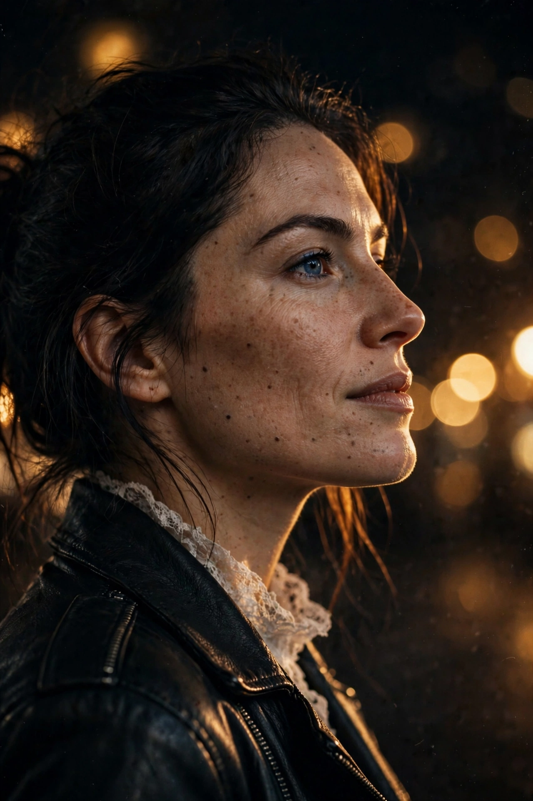
- v2 提示词原文：`Close raw analog photograph, PURE profile close-up of a confident woman with her chin slightly raised, dark hair, blue eyes, wearing a black leather jacket with a lace collar, dark background with warm blurred bokeh lights, side light outlining her nose and cheek, visible skin texture with pores and slight imperfections, no retouching look, film grain, candid, 85mm lens`
- v2 对比：纯侧面轮廓、下颌线与鼻梁线清晰、暖光斑在背景右侧，更接近原图的侧面肖像；代价是面部情绪更冷峻，v1 的四分之三眼神反而更有“自信对视”感。
- v2 图：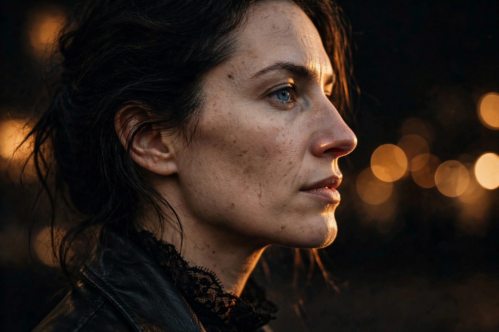
- 可复用规律：侧面肖像要写“PURE profile”，只写 profile 时，生成器默认转成四分之三；下颌角度要写 chin slightly raised，否则侧脸会塌成低头。

## 13 · Civitai · 锯齿裙石栏坐像（写实人物）

- 原链接：https://civitai.com/images/147291558
- 热度：👍 25，❤️ 8，😂 2，😢 2；原帖提示词要点：A high-resolution, reality-based photograph captures a woman in her early thirties
- 原图拆解：主体为金色长发女子坐在户外石栏上；构图为中景户外坐像；光影为均匀日光；色彩为彩色锯齿纹、棕榈绿、建筑暖灰；材质为连衣裙布料、石栏粗面；风格为户外写实照片。
- 写实要素拆解：长发飞散与自然分缕是第一证据；双手放松地放在身侧与腿部附近（不是摆拍手势）是第二证据；均匀日光下皮肤与发丝的写实细节是第三证据；棕榈与建筑背景虚化但仍可辨是第四证据。
- AI 破绽对照：本类最容易破绽是坐姿变成站姿、手部多指或粘连石栏、裙纹锯齿错位；重生成时用“SITTING on a stone railing + hands resting relaxed + 85mm”逐项反制。
- v1 提示词原文：`Photorealistic outdoor mid-shot, a woman in her early thirties with long blonde hair sitting on a stone railing outdoors, wearing a colorful zigzag sleeveless dress, palm trees and buildings in the background, even daylight, hands relaxed at her sides and near her legs, realistic skin texture with pores and slight imperfections, no retouching look, candid, 85mm lens`
  - 中文解析：写实户外中景 + 30 出头女子 + 金长发 + 坐于户外石栏 + 彩色锯齿无袖裙 + 棕榈建筑背景 + 均匀日光 + 双手放松在身侧与腿部附近 + 真实皮肤 + 无修图感 + 抓拍 + 85mm。
- v1 对比：像在金长发、锯齿裙、石栏、棕榈建筑、均匀日光；偏在画面裁成上半身、坐姿不完整；丢了“坐在石栏上的全身中景关系”。
- v1 图：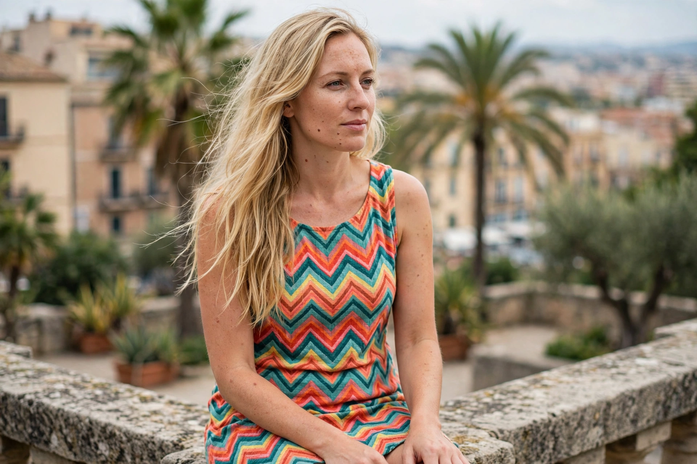
- v2 提示词原文：`Photorealistic outdoor mid-shot, WIDER framing, a woman in her early thirties with long blonde hair SITTING on a stone railing outdoors, wearing a colorful zigzag sleeveless dress, both hands resting relaxed on the railing and near her legs, palm trees and buildings softly blurred in the background, even daylight, realistic skin texture with pores and slight imperfections, no retouching look, candid, 85mm lens`
- v2 对比：画面拉宽、坐姿完整、一手撑栏一手放腿、背景虚化更柔和，更接近原图的中景坐像；代价是人物偏右侧、石栏横贯画面，v1 的居中上半身反而更像肖像。
- v2 图：
- 可复用规律：坐像要写“WIDER framing + SITTING on …”，只写“坐在石栏上”，生成器默认裁成上半身肖像；双手要写 resting relaxed on the railing，否则手会悬空或多指。

## 14 · Civitai · 月夜发光猫

- 原链接：https://civitai.com/images/147286824
- 热度：👍 101，❤️ 24，😂 3，😢 2
- 原图拆解：主体为发光的紫粉色猫咪坐在岩石地面；构图为猫居中偏下、满月高悬；光影为蓝色夜色 + 地面暖火光；色彩为紫粉、蓝、暖橙；材质为猫毛、岩石、星点光尘；风格为奇幻绘画。
- v1 提示词原文：`Fantasy night illustration, a glowing purple and pink cat sitting on rocky ground surrounded by sparkling star dust, a huge full moon high in the night sky, a black cat silhouette and a distant castle in the background, blue night contrasting with warm firelight on the ground, painterly texture`
  - 中文解析：奇幻夜景插画 + 发光紫粉猫坐岩石地面 + 星点光尘环绕 + 巨大满月高悬 + 黑猫剪影与远处城堡背景 + 蓝夜对照地面暖火光 + 绘画质感。
- v1 对比：像在紫粉发光猫、满月、黑猫剪影、城堡、星尘、暖火光；偏在猫体量过大、几乎占满画面下半部；丢了“猫是夜景中的一个亮点、而非全部”的尺度。
- v1 图：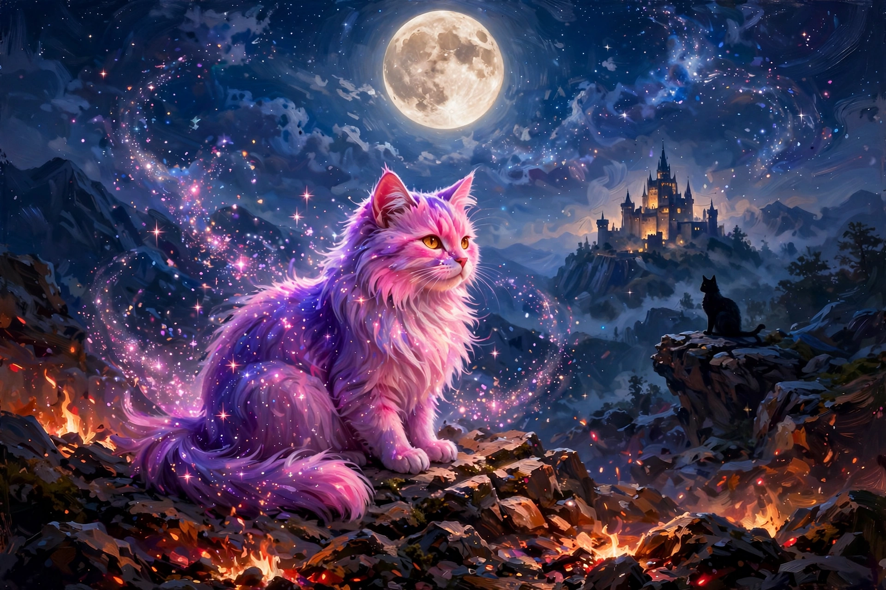
- v2 提示词原文：`Fantasy night illustration, a glowing purple and pink cat SMALLER in the frame sitting on rocky ground in the foreground, sparkling star dust around it, a huge full moon high in the night sky, a small black cat silhouette and a distant castle in the background, blue night contrasting with warm firelight on the rocks, painterly texture`
- v2 对比：猫变小退到前景下部、满月与夜空占比上升、黑猫与城堡退到中远景，更接近原图的“夜景为主、猫为亮点”；代价是猫毛发光细节与面部清晰度下降，v1 的大猫特写反而更抓眼。
- v2 图：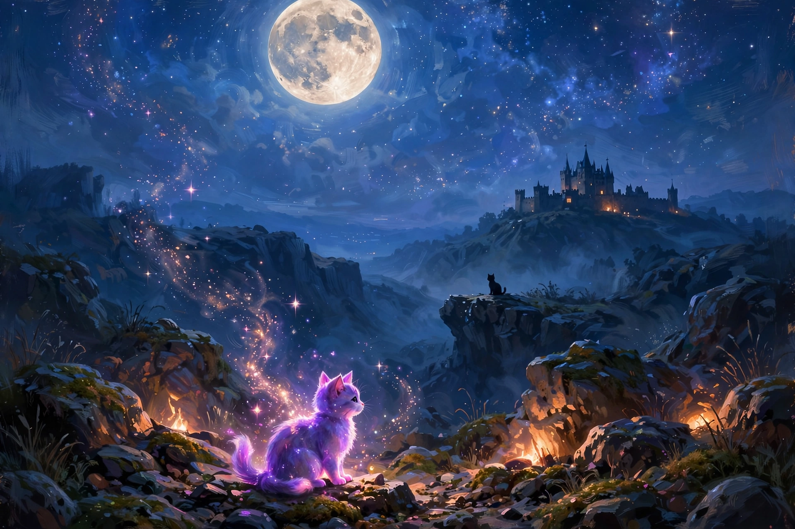
- 可复用规律：动物夜景要写“SMALLER in the frame + in the foreground”，只写“猫坐在岩石上”，生成器默认把动物放大成主角；满月要写 high in the night sky，否则它会被拉低到与猫同高。

## 15 · Civitai · 低头羽翼少女

- 原链接：https://civitai.com/images/146760485
- 热度：👍 152，❤️ 26，😂 4，😢 11
- 原图拆解：主体为长深色头发少女低头站立；构图为人物居中、羽翼展开；光影为顶部光线 + 烟雾；色彩为米、深褐、灰；材质为破旧上衣、羽毛、头盔残片；风格为厚涂绘画，本项为写实绘画风格，不计入写实照片。
- v1 提示词原文：`Thick painterly fantasy illustration, a girl with long dark hair standing with her head bowed, large feathered wings spread, wearing a worn beige sleeveless top, dark trousers and boots, scattered helmet and debris on the ground, feathers falling, smoke and light from above, moody painterly texture`
  - 中文解析：厚涂奇幻插画 + 长深发少女低头站立 + 大羽翼展开 + 破旧米色无袖上衣 + 深裤靴子 + 地面散落头盔残片 + 羽毛飘落 + 烟雾顶部光 + 阴郁绘画质感。
- v1 对比：像在低头、羽翼、破旧上衣、头盔残片、飘落羽毛、顶部光；偏在背景废墟细节过多、地面残骸铺满；丢了“人物情绪为主、废墟为点缀”的安静感。
- v1 图：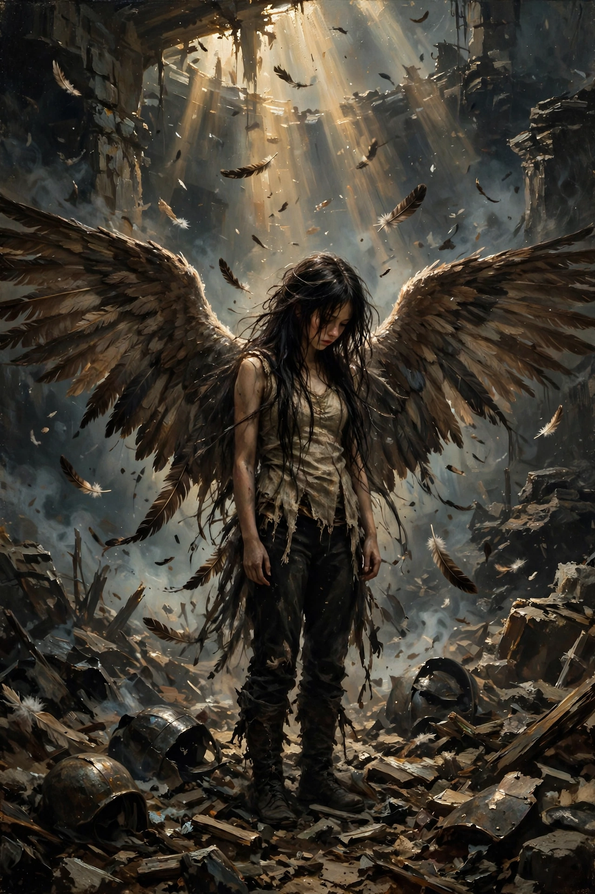
- v2 提示词原文：`Thick painterly fantasy illustration, a girl with long dark hair standing with her head bowed and shoulders slightly slumped, large feathered wings spread behind her, wearing a worn beige sleeveless top, dark trousers and boots, a FEW scattered helmets and debris on the ground only, a few feathers falling, smoke and soft light from above, moody painterly texture, restrained background`
- v2 对比：背景收敛、头盔只剩两三顶、羽毛只剩几根、肩膀微塌更明确，更接近原图的安静战败感；代价是废墟的“战场”信息减弱，v1 的满地残骸反而更有战后现场感。
- v2 图：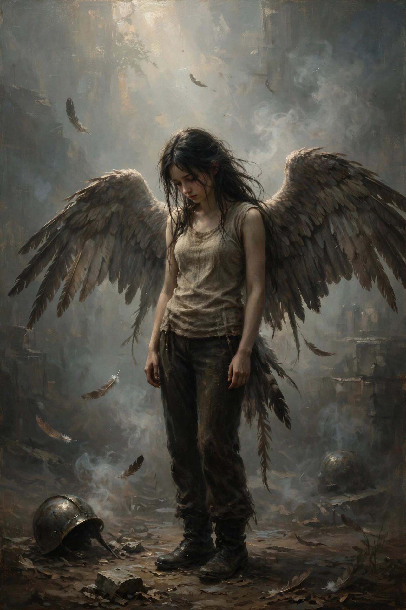
- 可复用规律：战败感要写“shoulders slightly slumped + a FEW helmets + restrained background”，只写“低头 + 残骸”，生成器会把悲伤画成废墟陈列；身体姿态词比情绪词更能卖出战败。

---

## 15 张共性结论

1. **先定位置与占比，再定细节**：本期 v1 丢的最多的不是元素，而是元素的位置与大小——双子横置、记者被招牌淹没、猫过大、坐像被裁成上半身。v2 几乎全靠“UPRIGHT、SMALLER in the frame、FULL upper body、WIDER framing、at the bottom center”这类位置词扳回来。
2. **克制词是本期主线**：a FEW、only、simple background、no clutter、no slogan、restrained——高热度原图大多不是“更多”，而是“恰好”。v2 的普遍代价是：收敛后氛围变淡（妖怪变小、警示牌变空白、废墟变安静），说明克制词要配一个保留语义的锚点，否则会把特征一起收掉。
3. **反向排除词比正向堆词更有效**：NOT a church interior、no legible text、not overcrowded、PURE profile——生成器对“不要什么”的执行比“要什么”更稳定，尤其在教堂彩窗、招牌文字、侧面转四分之三这三类顽固默认上。
4. **文字是海报的第一破绽**：警示牌、记者招牌、身高标尺三张都证明，生成器会把“海报感”自动翻译成“加文字”。要么明写 no text / no slogan，要么接受它自加的文字并把它当作 v1 的对比项，不假装原图也有这些字。
5. **双人/多元素画面要逐个定权重**：女王与王子、记者与妖怪、猫与夜空、双子上下——每加一个元素，就要同时写它的大小与位置，否则次要元素要么被吞掉，要么反客为主。
6. **v2 不一定全胜**：本期 15 张中，v2 在结构上普遍更接近原图，但在氛围与细节丰富度上常有回落（1 号举枪感、2 号妖都感、7 号警示语义、8 号面部压迫感、14 号猫毛细节）。v2 之后仍需再收一次权重，而不是默认 v2 一定全胜。

## 写实人物小结（第 10、11、12、13 张）

- **为什么看起来逼真**：不是因为“更清晰”，而是因为“有瑕疵、有重量、有单一光源”。第 10 张的雀斑与木屋日光、第 11 张的飞散发丝与天台日光、第 12 张的侧光鼻梁线与胶片颗粒、第 13 张的放松坐姿与均匀日光，都是“不完美但自洽”的证据。
- **皮肤**：`realistic skin texture with pores and slight imperfections` + `no retouching look` 仍是最有效的去塑料感组合；雀斑要加 `moderate` 控量，否则会铺满全脸（第 10 张 v1→v2 的教训）。
- **手与姿态**：第 13 张证明，坐像的手要写 resting relaxed on the railing，否则手会悬空或粘连；第 12 张证明，侧面姿态要写 PURE profile + chin slightly raised，否则侧脸会滑向四分之三。
- **光与镜头**：`candid` + `85mm lens` + 浅景深 + 一个主光源（柔和日光、明亮日光、侧光、均匀日光）是写实组的通用骨架；多光源、无方向光是塑料感的常见来源。
- **表情**：抓拍感来自“正在做事或正在看别处的表情”（面朝镜头但不摆拍、微笑放松、侧面仰首、自在坐姿），而不是对镜头摆出的僵笑、假笑。第 11 张 v1 的大笑与 v2 的放松微笑对比，就是僵笑与自然笑的分界。
- **常见 AI 破绽自查表**：皮肤过滑、五官过对称、手部变形、牙齿不自然（笑容过大）、光影不一致、坐姿裁切、侧面滑向四分之三。写实提示词里要逐项给反制词：毛孔与瑕疵、五指与放松手部、自然不对称、soft relaxed smile + natural teeth、光源单一、WIDER framing、PURE profile。

## 附：重生成图片文件清单

- v1 已生成：1、2、3、4、5、6、7、8、9、10、11、12、13、14、15（共 15 张）
- v2 已生成：1、2、3、4、5、6、7、8、9、10、11、12、13、14、15（共 15 张）
- 未生成：无。
- 图片目录：`~/workspace/goals/ai-2/hidden_files/2026-10-31/images/`，共 30 个 .webp 文件（另有同名 .json 元数据文件，不计入图片数）。
- 本地报告：`~/workspace/goals/ai-2/files/2026-10-31.md`
- GitHub 报告：`ai-image-learning/2026-10-31.md`，图片：`ai-image-learning/images/`，仓库：https://github.com/mengyangyangs/ai-learning（分支 main，私有）
