# 每日 AI 图片反推学习 · 2026-11-01

## 选图说明与缺口

- 选图时间：2026-11-01 上午（北京时间），浏览器选图任务 08:59–09:17 完成，全程未登录、未注册、未下载原图文件。本报告的原图拆解以浏览器任务回传的文字描述为准，未逐像素下载核对原图，因此 v1、v2 对比是“重生成图 vs 浏览器描述的原图特征”，不是与原图文件的逐像素对照；凡描述中未确认的细节，报告里不作推断。
- 本期 15 张构成：NightCafe 5 张 + SeaArt 4 张 + PixAI 2 张 + Reddit 3 张 + Civitai 1 张，共 5 个渠道；写实人物照片 4 张（第 3、4、5、15 张）。另有第 13 张为写实照片风格但面部被头盔遮挡，不计入面部写实项；第 14 张为绘画风格，不计入严格写实人物；第 7 张为动漫风格，不计入严格写实人物。
- **去重说明：当天未遇到重复图。** 选图前已核对以往全部报告（2026-10-29、2026-10-30、2026-10-31）的平台加图片 ID / 原链接，包括 Civitai 146487785、146475853、146432934、146447650、146623400、146442749、146478485、146540968、146492000、146540752、146437488、146370222、146756760、146645745、146746555、146854816、147187815、147187814、147344108、147291558、147286824、146760485；SeaArt db9bu95e878c73f1enag、db0pf5de878c73ae8bk0、dbcl55le878c73d1fcf0、dbe190le878c739t4idg、d7k15i5e878c7390rt50、d11h10de878c7390n9p0、d7oqn3de878c73bfac20、d8q8iq5e878c73ckj9pg、d79fgtte878c7382766g、d964365e878c73b4jgo0、d964bj5e878c73953uvg、db6n96le878c73c0hsdg、d7t8a55e878c738klapg、dagv6ute878c73fru7og；NightCafe XbuGrm6xlWywBfhsb8fo、09yUgfil19nPcnFxBeDh；PixAI 2072110449325551103、2070892366596255652；Reddit 1xjnhlc、1xjogyl。浏览器在最终热榜中未遇到上述任一 ID，跨平台视觉转载重复亦未发现。因此本期 15 张均为全新图片，无需顺延补位。
- **其他缺口（按实测，不硬编）**：NightCafe 视频关联项已跳过（《Determination》《The Mathematics of Love》含视频标识）；r/midjourney 热榜 AI Video 帖《Chitin Timber Rot》已跳过；SeaArt《Halloween Fairies》因详情链接含 auto_play 参数存在视频歧义未入选；r/StableDiffusion 热榜首屏多为 Meme、讨论帖与视频/广告，未从中取图；Civitai 最多反应页加载缓慢；NightCafe 榜单与详情页点赞数存在 1–3 的波动，报告以详情页为准；SeaArt 与 Civitai 未标注图标数字只写数字顺序，不编造类别。
- **第 4 张的特别说明**：SeaArt 详情页主图多次显示 Loading 未加载，本条细节主要来自榜单缩略图、标签与提示词要点，未能逐像素核对毛孔与颗粒，报告里不把缩略图下看不清的细节写成已确认。
- **第 7 张的热度说明**：该条页面数字为 26、3，明显低于本期其他条目，但仍为浏览器任务回传的入选清单之一，报告如实记录，不把它写成高热度。
- **生成缺口：第 8 张未完成。** 第 8 张 v1 生成未成功，且按本次任务的后续指令不再重试、不以无关图片代替，因此第 8 张无 v1 图、无 v2 图、无 v2 对比，本报告不附该张的生成提示词。其他 14 张的 v1、v2 共 28 张次全部生成成功并逐张看过对比。
- 本报告的 v1、v2 均为反推重写，不是照抄原帖提示词。
- 重生成图片保存在本任务目标工作区 `hidden_files/2026-11-01/images/` 下，报告内以图片文件名对应；GitHub 版见 ai-image-learning/2026-11-01.md，图片在 ai-image-learning/images/ 下。

## 一览表

| # | 平台 | 作者 | 原链接 | 热度（快照） |
|---|---|---|---|---|
| 1 | NightCafe | TanglewoodNumbers | https://creator.nightcafe.studio/creation/ggXyIhEmOKGWzaR69wi8/the-last-nut | 详情页 150 likes，59 comments（榜单页曾显示 149、59） |
| 2 | NightCafe | LyndanLeeAnn（@KashiAnn） | https://creator.nightcafe.studio/creation/fY2axuXZTmACDbPItoCU/lilly | 详情页 386 likes，63 comments（榜单页曾显示 385、63） |
| 3 | NightCafe | Jason2000 | https://creator.nightcafe.studio/creation/fwOD1mTLy9oGyVJc6wMG | 332 likes，131 comments |
| 4 | SeaArt | nyancodad | https://www.seaart.ai/postDetail/dba0pvte878c73c0i42g?pt=lg-cluster-66 | 页面图标数字 69、8（字段未标注，不编造类别） |
| 5 | SeaArt | kamiui | https://www.seaart.ai/postDetail/db3dv85e878c73du6ar0?pt=lg-cluster-71 | 榜单 541、163；详情页另有第三个图标数字 60，未标注类别 |
| 6 | SeaArt | SoSo | https://www.seaart.ai/postDetail/dajjl65e878c73dffa00?pt=lg-cluster-66 | 页面数字 222、106；详情页另有第三个图标数字 16，未标注类别 |
| 7 | SeaArt | Kunn Masa | https://www.seaart.ai/postDetail/dbgu69te878c73d5pukg?pt=post_bubble_s | 页面数字 26、3；详情页另有第三个图标数字 0，未标注类别 |
| 8 | PixAI | (mai) | https://pixai.art/artwork/2070627399900513165 | 2.32k likes，23 comments；发布于 2026-10-24 07:04 |
| 9 | PixAI | ^( aricat)^ | https://pixai.art/artwork/2067927035251701875 | 330 likes，5 comments；发布于 2026-10-16 20:14 |
| 10 | Reddit r/midjourney | u/Zenchilada | https://www.reddit.com/r/midjourney/comments/1xknxf8/werewolves/ | 52 upvotes，3 comments；图集共 12 张，取第 1 张 |
| 11 | Reddit r/midjourney | u/Sharp_Alternative845 | https://www.reddit.com/r/midjourney/comments/1xkdhl8/exotic_places/ | 58 upvotes，0 comments；图集共 7 张，取第 1 张 |
| 12 | Reddit r/aiArt | u/Cristas_Peach | https://www.reddit.com/r/aiArt/comments/1xkg7fy/playing_in_the_rain/ | 31 upvotes，3 comments；Flair 为 Image - ChatGPT |
| 13 | Civitai | FreijaFoxy | https://civitai.com/images/147383374 | 👍 107，❤️ 46，😂 10，😢 6；另有未标注的“40”按钮数字 |
| 14 | NightCafe | Fantasy（@FantasyCreator1） | https://creator.nightcafe.studio/creation/8uWKxfG794U1QNjyymN4/wild-summer-heat | 详情页 219 likes，35 comments（榜单页曾显示 216、35） |
| 15 | NightCafe | Artless（@ArtlessCafe） | https://creator.nightcafe.studio/creation/P4pQkpexJJafOXMqpkPd/portrait-dreamshaper-v8 | 72 likes，12 comments |

类别分布：动物绘画 2 张（1、2），写实人物照片 4 张（3、4、5、15），黑白插画 1 张（6），动漫/插画 3 张（7、9 及 12 的印象派绘画），绘画肖像/风景 3 张（11、12、14），写实风格动作照片 1 张（13），未生成 1 张（8）。

---

## 1 · NightCafe · 最后一颗橡子（红松鼠）

- 原链接：https://creator.nightcafe.studio/creation/ggXyIhEmOKGWzaR69wi8/the-last-nut
- 热度：详情页 150 likes，59 comments（榜单页曾显示 149、59）
- 原图拆解：主体为红松鼠直立于纯黑背景前，双爪抱住一颗橡子；构图为竖幅居中；光影为柔和正面光、黑底反衬暖橙；色彩为暖橙与纯黑；材质为粉彩/粉笔质感、毛发边缘柔和；风格为粉彩动物插画。
- v1 提示词原文：`Pastel and chalk illustration of a red squirrel standing upright against a pure black background, holding a single acorn in both front paws, fluffy orange fur with soft edges, distinct whiskers, large dark eyes looking directly at the viewer, warm orange against black, soft chalky texture, centered vertical portrait composition`
  - 中文解析：粉彩粉笔插画 + 红松鼠直立 + 纯黑背景 + 双爪抱一颗橡子 + 蓬松橙毛柔和边缘 + 分明胡须 + 大黑眼直视 + 暖橙对照黑 + 粉笔质感 + 竖幅居中。
- v1 对比：像在直立松鼠、双爪抱橡子、纯黑背景、暖橙毛色、粉笔质感、大眼直视；偏在画面为面部大特写、胡须又白又长、身体下部几乎出画；丢了“全身直立、中景留白”的构图。
- v1 图：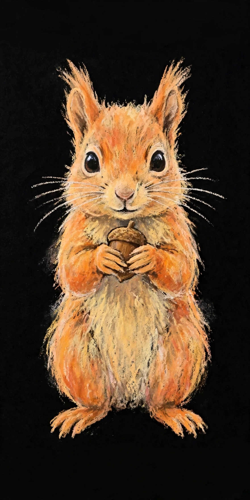
- v2 提示词原文：`Pastel and chalk illustration, medium shot of a red squirrel standing upright against a pure black background, holding one acorn in both front paws at chest level, fluffy orange fur, a FEW short distinct whiskers only, large dark eyes looking directly at the viewer, warm orange against black, soft chalky texture, squirrel occupying the middle of the frame with black space above and below, not a close-up face`
- v2 对比：胡须变短变少、橡子明确在胸前、上下黑空留出，中景感更接近描述；代价是多出一条大尾巴铺在画面下方，v1 的“无尾正面”反而更干净。
- v2 图：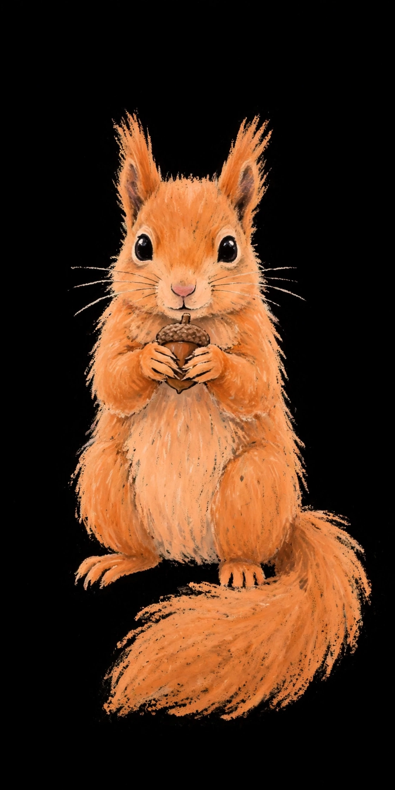
- 可复用规律：动物中景要写“medium shot + occupying the middle + black space above and below + not a close-up face”，只写“直立”生成器默认推成面部特写；胡须要定量“a FEW short only”，否则它会画成白色放射线。

## 2 · NightCafe · 暹罗猫与百合

- 原链接：https://creator.nightcafe.studio/creation/fY2axuXZTmACDbPItoCU/lilly
- 热度：详情页 386 likes，63 comments（榜单页曾显示 385、63）
- 原图拆解：主体为暹罗猫侧面肖像，嘴边一朵粉色百合；构图为竖幅约 3:4；光影为柔和印象派光感；色彩为奶油色被毛、深色面罩、明亮蓝眼、粉色百合、浅色背景；材质为厚涂 impasto 笔触；风格为厚涂印象派油画。
- v1 提示词原文：`Impasto impressionist oil painting, side profile portrait of a Siamese cat, cream-colored fur, dark brown face mask and ears, bright blue eyes, a single pink lily beside its mouth, thick visible brushstrokes, soft impressionist light, pale light background, vertical portrait composition`
  - 中文解析：厚涂印象派油画 + 暹罗猫侧面肖像 + 奶油被毛 + 深棕面罩耳 + 明亮蓝眼 + 嘴边一朵粉百合 + 厚涂笔触 + 柔和印象派光 + 浅色背景 + 竖幅。
- v1 对比：像在侧面猫、奶油被毛、深色面罩、蓝眼、厚涂笔触、浅色背景；偏在百合在画面右下独立成一株、与嘴相距甚远，猫头偏大；丢了“百合贴嘴、小而点缀”的关系。
- v1 图：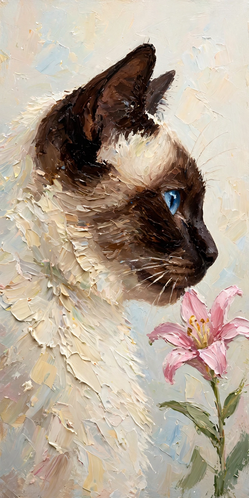
- v2 提示词原文：`Impasto impressionist oil painting, side profile portrait of a Siamese cat with its whole head in frame, cream-colored fur, dark brown face mask and ears, bright blue eye, one small pink lily touching its mouth, thick visible brushstrokes, soft impressionist light, pale light background, vertical portrait composition`
- v2 对比：百合变小并贴到嘴边、猫头完整入画，更接近描述；代价是百合只剩花头、花茎消失，v1 的完整花株反而更像一朵花。
- v2 图：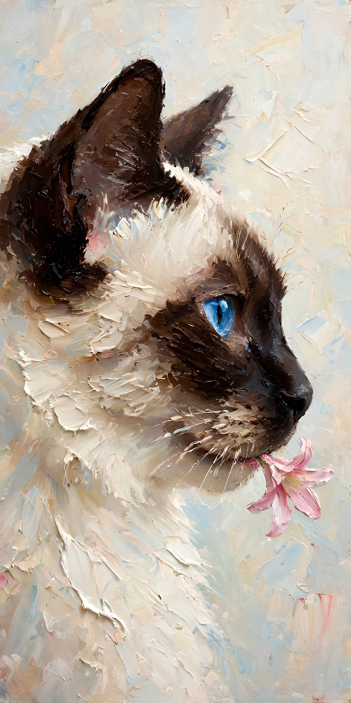
- 可复用规律：配角花要写“one small + touching its mouth”，只写“beside its mouth”生成器会把花画成独立静物；同时要写“whole head in frame”，否则侧面肖像容易被裁成半头。

## 3 · NightCafe · Malena（写实人物）

- 原链接：https://creator.nightcafe.studio/creation/fwOD1mTLy9oGyVJc6wMG
- 热度：332 likes，131 comments
- 原图拆解：主体为深色卷发女子站在意大利街道上，身穿红黑连衣裙，佩戴项链与耳环，面部朝向镜头、表情平静；构图为上半身肖像；光影为自然日光；色彩为红黑裙、暖肤、石材与旗帜色；材质为卷发、布料、石材建筑；风格为写实照片。写实要素：自然日光下柔和的真实皮肤质感、卷发发丝分明、背景大教堂与旗帜中等虚化仍可辨认；页面标注为 Uploaded（非站内生成），提示词已隐藏。
- AI 破绽对照：本类最容易破绽是卷发画成均匀波浪、皮肤磨皮过滑、背景旗帜与建筑透视打架；原图用“发丝分明、背景中等虚化”稳住真实感。
- v1 提示词原文：`Photorealistic candid portrait of a woman with dark curly hair standing on an Italian street, wearing a red and black dress, necklace and earrings, calm expression facing the camera, natural daylight, realistic skin texture with pores and slight imperfections, individual curly hair strands and flyaways, cathedral and old buildings with flags softly blurred in the background, 85mm lens, shallow depth of field, natural relaxed expression, no retouching look`
  - 中文解析：写实抓拍肖像 + 深色卷发女子 + 意大利街道 + 红黑裙 + 项链耳环 + 平静朝镜头 + 自然日光 + 毛孔与小瑕疵的真实皮肤 + 卷发单根与飞丝 + 大教堂老建筑旗帜柔和虚化 + 85mm + 浅景深 + 自然放松表情 + 无修图感。
- v1 对比：像在深色卷发、红黑裙、项链耳环、意大利大教堂与旗帜、皮肤小痣与纹理、平静朝镜头；偏在裙子多了蕾丝花纹、背景旗帜与建筑仍较清晰；丢了“裙子简洁、背景更虚”的层次。
- v1 图：
- v2 提示词原文：`Photorealistic candid portrait of a woman with dark curly hair standing on an Italian street, wearing a simple red and black dress without lace pattern, necklace and earrings, calm expression facing the camera, natural daylight, realistic skin texture with pores and slight imperfections, individual curly hair strands and flyaways, cathedral and old buildings with flags heavily blurred in the background, 85mm lens, shallow depth of field, natural relaxed expression, no retouching look`
- v2 对比：裙子变回简洁红黑、背景明显虚化、皮肤纹理保留，更接近描述；代价是项链吊坠变小、耳环几乎看不见，v1 的配饰反而更明确。
- v2 图：
- 可复用规律：写实裙装要写“simple + without lace pattern”，否则生成器会自加蕾丝花纹；背景虚化要分档（softly / heavily blurred），只写“blurred”它常停在中等清晰。

## 4 · SeaArt · 監視塔（写实人物）

- 原链接：https://www.seaart.ai/postDetail/dba0pvte878c73c0i42g?pt=lg-cluster-66
- 热度：页面图标数字 69、8（字段未标注，不编造类别）
- 原图拆解（受限说明见选图说明）：主体为穿迷彩的短黑发女子站在木质瞭望塔上，面向悬崖与右侧山谷，山谷下方有怪物剪影；构图为人物与塔体为主、远景开阔；光影为阴天日光；色彩为迷彩绿褐、木色、灰绿山谷；材质为迷彩布料、旧木塔；风格为写实摄影。写实要素（仅缩略图与提示词可确认的部分）：阴天漫射光、人物与塔的比例关系、远景开阔；毛孔、颗粒、手耳牙齿等近景细节在详情页未加载的情况下不作认定。
- AI 破绽对照：本类最容易破绽是迷彩画成均匀色块、塔体结构不合重力、怪物剪影画成清晰怪物；原图用“怪物只作远景剪影”规避了怪物细节破绽。
- v1 提示词原文：`Photorealistic photo of a woman with short black hair in camouflage clothing standing on a wooden watchtower, looking out over a cliff and a wide valley on the right, dark monster silhouettes far below in the valley, overcast daylight, realistic skin texture with pores and slight imperfections, candid documentary feel, natural light and shadow, shallow depth of field, film grain`
  - 中文解析：写实照片 + 短黑发迷彩女子 + 木瞭望塔 + 面向悬崖与右侧宽山谷 + 山谷下方远处深色怪物剪影 + 阴天日光 + 毛孔小瑕疵真实皮肤 + 纪实抓拍感 + 自然光影 + 浅景深 + 胶片颗粒。
- v1 对比：像在短黑发、迷彩、木塔栏杆、雾中山谷、远处怪物剪影、阴天光；偏在人物为侧面大特写、塔栏杆占画面前景；丢了“人物全身站在塔上、塔与山谷同框”的全景关系。
- v1 图：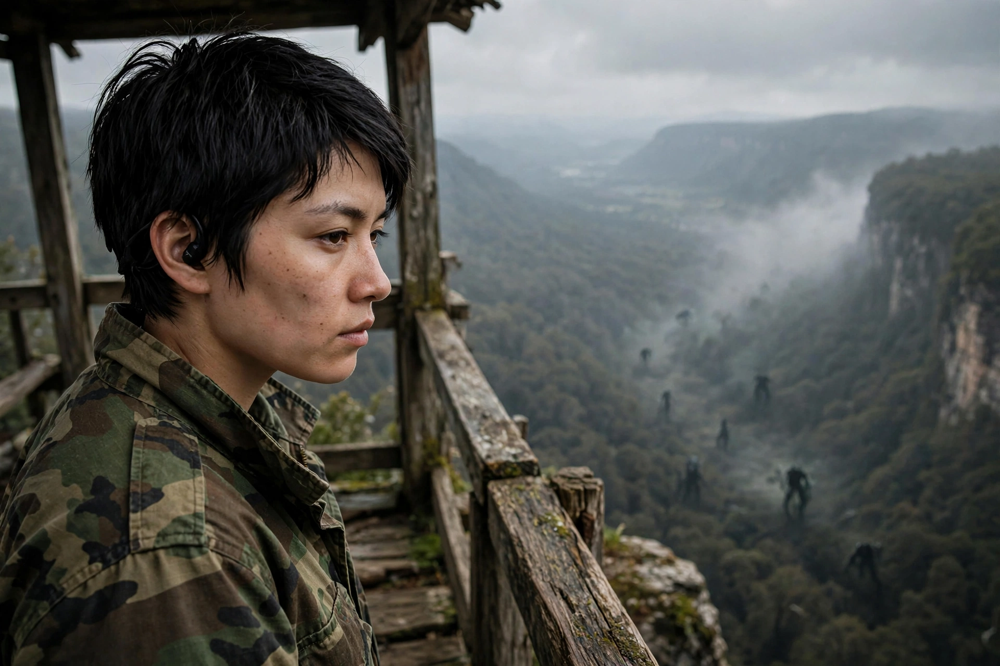
- v2 提示词原文：`Photorealistic wide shot of a woman with short black hair in camouflage clothing standing full-body on a wooden watchtower, looking out over a cliff and a wide misty valley, a FEW small dark monster silhouettes far below in the valley only, overcast daylight, realistic skin texture with pores and slight imperfections, candid documentary feel, natural light and shadow, film grain, person small in the frame with tower and valley visible`
- v2 对比：拉成全景、塔体完整、人物变小站在塔上、山谷开阔，更接近描述；代价是人物面部不可见、怪物剪影几乎看不见，v1 的“人物+怪物同框清晰度”反而更好。
- v2 图：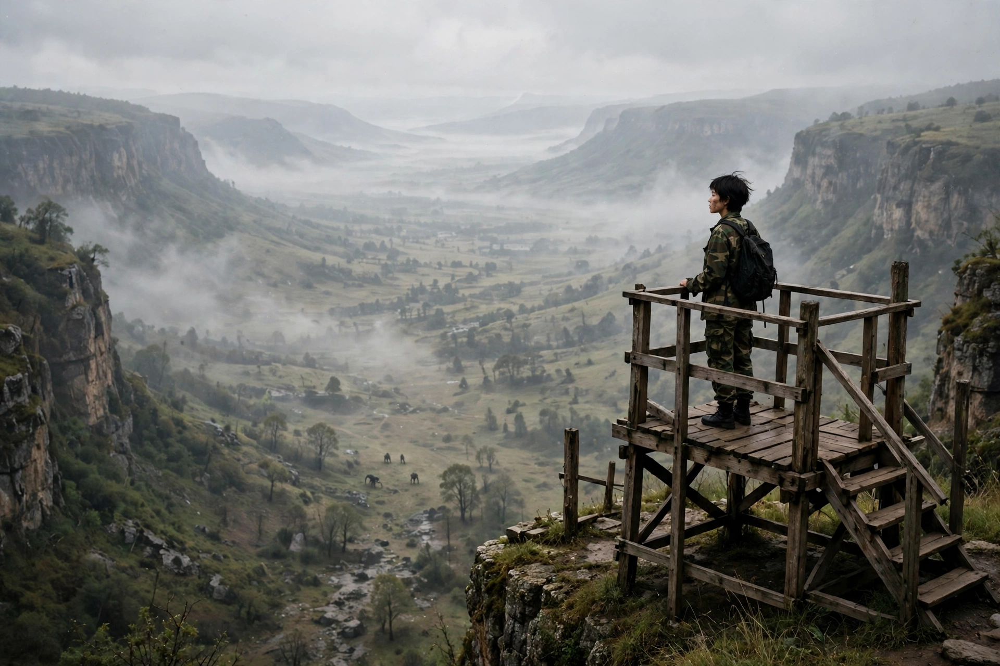
- 可复用规律：全景人物要写“wide shot + full-body + person small in the frame”，只写“站在塔上”生成器默认推成人物特写；远景怪物要写“a FEW small + far below only”，否则它会把怪物拉近成主角。

## 5 · SeaArt · 干净街道老板（写实人物）

- 原链接：https://www.seaart.ai/postDetail/db3dv85e878c73du6ar0?pt=lg-cluster-71
- 热度：榜单 541、163；详情页另有第三个图标数字 60，未标注类别
- 原图拆解：主体为金色长发女子戴白色兔耳、黑色墨镜，穿黑色长大衣与高领，肩扛红色扫帚/刷子，走在黎明旧街道上；构图为人物居中、街道纵深；光影为暖色晨光斜照；色彩为金发、白兔耳、黑大衣、红扫帚、暖晨光；材质为大衣布料、扫帚毛、石板路；风格为写实摄影，标签含写实、摄影。写实要素：面部下半部分皮肤自然、嘴唇与下颌线清晰、墨镜遮住眼睛故眼神光不作认定、长发飞丝、晨光方向一致。
- AI 破绽对照：本类最容易破绽是兔耳画成卡通道具、扫帚与肩膀穿帮、身后西装男子面部变形；原图用“墨镜遮眼、男子退后虚化”规避了眼部与群像破绽。
- v1 提示词原文：`Photorealistic photo at dawn on an old European street, a woman with long blonde hair wearing white rabbit ears, black sunglasses, a black long coat and turtleneck, carrying a red broom over her shoulder, walking toward the camera, several men in black suits carrying bags walking behind her, warm morning light slanting across old buildings, realistic skin texture with pores and slight imperfections, natural relaxed expression, candid, 85mm lens, shallow depth of field`
  - 中文解析：写实照片 + 黎明旧欧洲街道 + 金长发女子 + 白兔耳 + 黑墨镜 + 黑长大衣高领 + 肩扛红扫帚 + 走向镜头 + 身后多名黑西装提包男子 + 暖晨光斜照老建筑 + 下半面部真实皮肤 + 自然放松表情 + 抓拍 + 85mm + 浅景深。
- v1 对比：像在白兔耳、黑墨镜、黑大衣高领、红扫帚、身后黑西装男子、暖晨光旧街；偏在扫帚斜穿画面前方、扫帚头在左下过大；丢了“扫帚扛在肩后、头在身后”的位置关系。
- v1 图：
- v2 提示词原文：`Photorealistic photo at dawn on an old European street, a woman with long blonde hair wearing white rabbit ears, black sunglasses, a black long coat and turtleneck, a red broom resting on her shoulder with its head behind her shoulder, walking toward the camera, a FEW men in black suits with bags far behind her only, warm morning light slanting across old buildings, realistic skin texture on the lower face with pores and slight imperfections, natural relaxed expression, candid, 85mm lens, shallow depth of field`
- v2 对比：扫帚明确扛在肩上、扫帚头在右肩后、男子退到远处背景，更接近描述；代价是扫帚头仍偏大、男子改为背对行走，v1 的“男子正向跟随”压迫感反而更强。
- v2 图：
- 可复用规律：肩扛道具要写“resting on her shoulder + head behind her shoulder”，只写“over her shoulder”生成器会把道具斜穿到画面前方；群像配角要写“a FEW + far behind only”，否则它会把配角拉到与主角同排。

## 6 · SeaArt · 骑士与小机器人（黑白插画）

- 原链接：https://www.seaart.ai/postDetail/dajjl65e878c73dffa00?pt=lg-cluster-66
- 热度：页面数字 222、106；详情页另有第三个图标数字 16，未标注类别
- 原图拆解：主体为黑白单色插画中的跪姿铠甲骑士，深色束发，面向左侧飞翔的白鸽；构图为骑士在右、白鸽在左；光影为高对比黑白；色彩为纯黑白灰；材质为粗线条、石质城堡；风格为干净粗线条、高对比单色插画、cel shading 质感。注：标题含“小机器人”，但浏览器描述的主体为骑士与白鸽，报告以描述为准，不另编机器人形象。
- v1 提示词原文：`High contrast black and white monochrome illustration, clean bold line art, graphic cel shading, a kneeling knight in detailed armor with dark tied-back hair, facing a small white dove flying to the left, stone castle background, dramatic black and white ink illustration`
  - 中文解析：高对比黑白单色插画 + 干净粗线条 + 平面 cel shading + 跪姿细致铠甲骑士 + 深色束发 + 面向左侧飞翔的小白鸽 + 石城堡背景 + 戏剧黑白墨水插画。
- v1 对比：像在跪姿骑士、深色束发、左侧白鸽、黑白高对比、粗线条铠甲；偏在背景出现多座城堡与山崖、画面过满；丢了“背景简洁、骑士与鸽子二元对照”的克制。
- v1 图：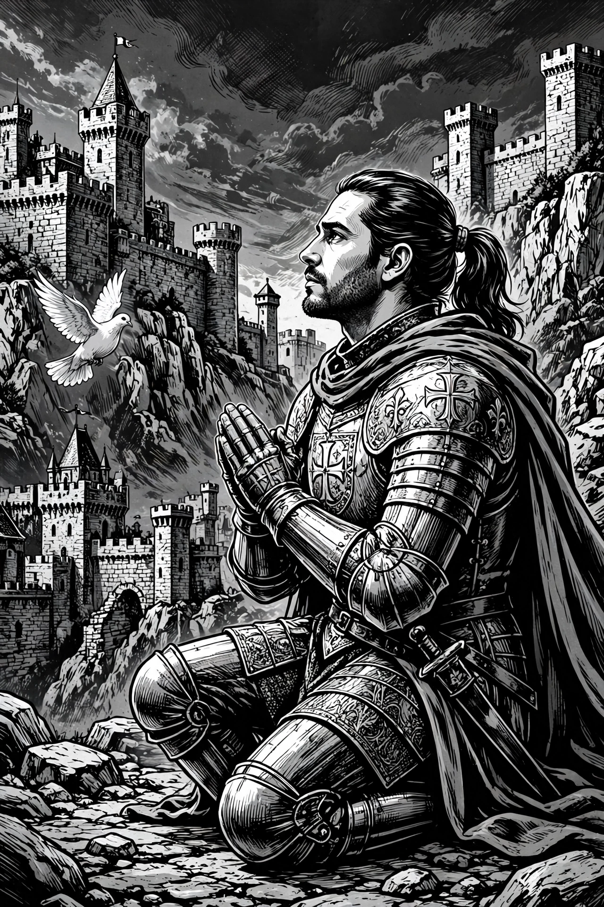
- v2 提示词原文：`High contrast black and white monochrome illustration, clean bold line art, graphic cel shading, simple composition, a kneeling knight in detailed armor with dark tied-back hair facing left, one small white dove flying on the left, one simple stone castle in the background only, no extra castles, dramatic black and white ink illustration`
- v2 对比：背景只剩一座小城堡、骑士与鸽子对照清晰，更接近描述；代价是背景变为空白、戏剧天空消失，v1 的“城堡群史诗感”反而更浓。
- v2 图：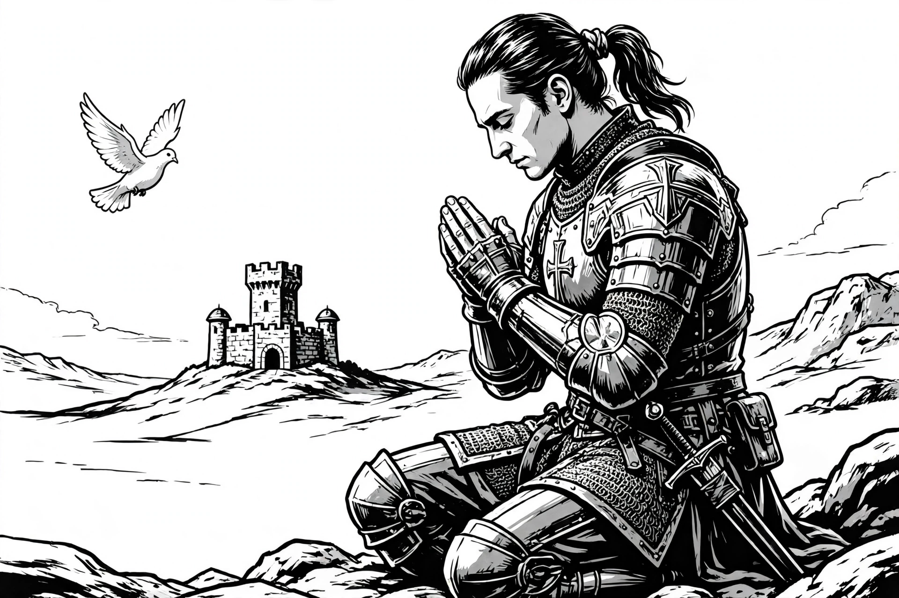
- 可复用规律：黑白插画背景要写“simple composition + one castle only + no extra castles”，只写“城堡背景”生成器会把背景画成城堡群；“简洁”要配一个保留的锚点（天空或地面），否则会直接变空白。

## 7 · SeaArt · 夏风与微笑

- 原链接：https://www.seaart.ai/postDetail/dbgu69te878c73d5pukg?pt=post_bubble_s
- 热度：页面数字 26、3；详情页另有第三个图标数字 0，未标注类别
- 原图拆解：主体为初夏阳光下乡间小路上的短发少女，穿白色吊带，温柔微笑，面向镜头；构图为人物居中、小路纵深；光影为柔和明亮光线；色彩为蓝天、茂密绿树、黄色花丛、白色吊带；材质为发丝、布料、树叶；风格为动漫美少女，不计入严格写实人物。
- v1 提示词原文：`Anime illustration, a girl with short hair wearing a white camisole top, gentle smile facing the camera, standing on a countryside path in early summer sunshine, blue sky, lush green trees, yellow flower bushes, soft bright light, fresh clear colors, cinematic lighting, shallow depth of field`
  - 中文解析：动漫插画 + 短发少女 + 白吊带 + 温柔微笑朝镜头 + 初夏阳光乡间小路 + 蓝天 + 茂密绿树 + 黄花丛 + 柔和明亮光 + 清新色彩 + 电影光 + 浅景深。
- v1 对比：像在短发、白吊带、温柔微笑、蓝天绿树黄花、明亮柔光；偏在人物为面部特写、小路只在身后两侧露一点；丢了“站在小路上、小路纵深”的空间感。
- v1 图：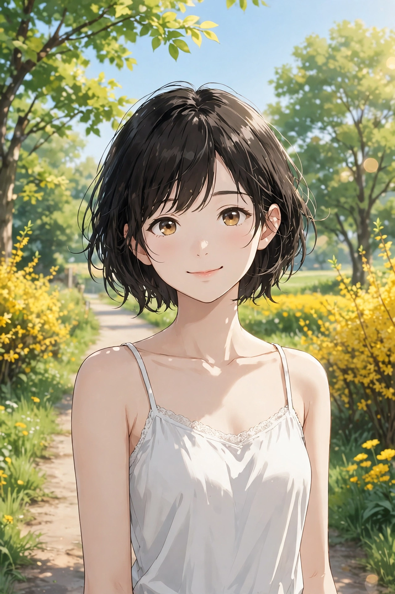
- v2 提示词原文：`Anime illustration, medium shot of a girl with short hair wearing a white camisole top, gentle smile facing the camera, standing on a countryside path in early summer sunshine, the path leading back between green trees and yellow flower bushes, blue sky, soft bright light, fresh clear colors, cinematic lighting, shallow depth of field`
- v2 对比：小路明确从身后左侧纵深伸出、黄花丛在右侧，更接近描述；代价是人物仍为上半身特写、面部略侧，v1 的正面微笑反而更直接。
- v2 图：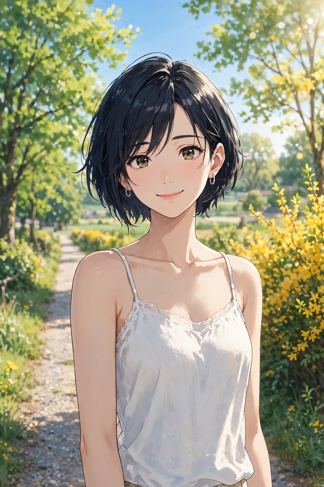
- 可复用规律：人物+小路要写“medium shot + path leading back”，只写“站在小路上”生成器默认推成人物特写、小路只剩背景色块。

## 8 · PixAI · 未生成项

- 原链接：https://pixai.art/artwork/2070627399900513165
- 热度：2.32k likes，23 comments；发布于 2026-10-24 07:04
- 原图拆解：主体为橙红头发女子特写，环状黄眼，一手持银叉遮住一只眼，另一手持利刃贴近脸颊；构图为面部特写；光影为柔和定向光、深色中性背景；色彩为红与暗 muted 配色；材质为光泽唇、金属叉与刃；风格为 chalky block 质感、氛围诡异而宁静。
- 生成状态：**v1 未成功，v2 未进行，无 v1 图、无 v2 图，不以无关图片代替。** 本报告不附该张的生成提示词，不声称已完成该张的反推对比。
- 可复用规律：无——本张无生成对比，不从失败中推导规律。

## 9 · PixAI · 侦探少女与白犬

- 原链接：https://pixai.art/artwork/2067927035251701875
- 热度：330 likes，5 comments；发布于 2026-10-16 20:14
- 原图拆解：主体为粉发侦探帽少女手持放大镜，与戴小帽的白色犬并列；构图为中近景 cowboy shot、平视；光影为室内暖光；色彩为粉发、暖木书架、暖光；材质为侦探帽、放大镜、书本；风格为动漫插画。
- v1 提示词原文：`Anime illustration, medium close-up cowboy shot at eye level, a girl with pink hair wearing a detective hat, holding a magnifying glass, standing beside a small white dog wearing a tiny hat, indoor bookshelf background, warm light, 35mm lens look`
  - 中文解析：动漫插画 + 中近景 cowboy shot 平视 + 粉发侦探帽少女 + 手持放大镜 + 身旁戴小帽白犬 + 室内书架背景 + 暖光 + 35mm 观感。
- v1 对比：像在粉发、侦探帽、放大镜、白犬小帽、书架暖光；偏在放大镜只举在身侧未贴眼、白犬体量与少女接近；丢了“放大镜是动作主角、白犬是配角”的主次。
- v1 图：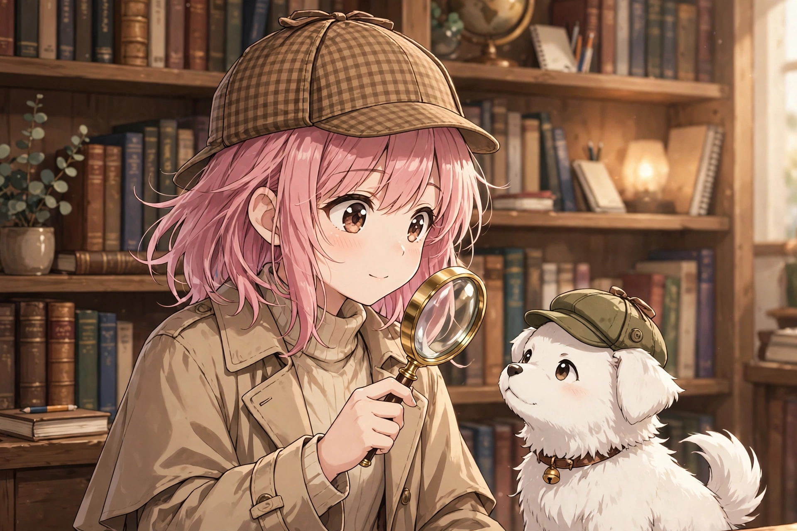
- v2 提示词原文：`Anime illustration, medium close-up cowboy shot at eye level, a girl with pink hair wearing a detective hat, holding a magnifying glass up near her face, a SMALL white dog wearing a tiny hat standing beside her at lower right, indoor bookshelf background, warm light, 35mm lens look`
- v2 对比：放大镜贴到眼前并放大眼睛、白犬退到右下变小，更接近描述；代价是少女头发变双辫、眼睛变紫、白犬品种感变化，v1 的“粉发披发+原犬种”反而更贴近。
- v2 图：
- 可复用规律：道具动作要写“up near her face”，只写“holding”生成器会把道具挂在身侧；配角体量要写“SMALL + at lower right”，否则它会把配角画成与主角等大。

## 10 · Reddit r/midjourney · 狼人

- 原链接：https://www.reddit.com/r/midjourney/comments/1xknxf8/werewolves/
- 热度：52 upvotes，3 comments；图集共 12 张，取第 1 张
- 原图拆解：主体为巨型深色狼人向前扑；构图为狼人居中扑向镜头方向；光影为冷色月光与阴影对比；色彩为蓝灰毛发、深夜森林；材质为肌肉与毛发细节；风格为电影感暗黑奇幻插画。
- v1 提示词原文：`A giant dark werewolf lunging forward in a moonlit forest, blue-grey fur, bared teeth, detailed muscles and fur, cold moonlight and strong shadows, cinematic dark fantasy illustration`
  - 中文解析：巨型深色狼人向前扑 + 月夜森林 + 蓝灰毛发 + 龇牙 + 肌肉与毛发细节 + 冷月光强阴影 + 电影暗黑奇幻插画。
- v1 对比：像在巨型狼人、蓝灰毛发、龇牙、月夜森林、冷月光；偏在狼人为正面扑向镜头、四肢为人形感强；丢了“侧向扑跃的身体纵深”。
- v1 图：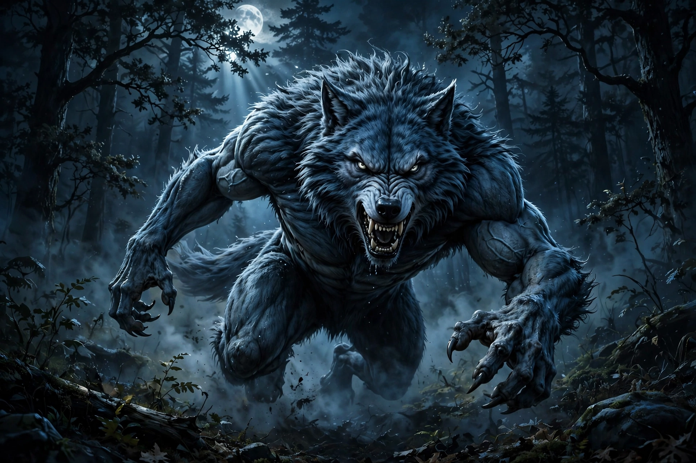
- v2 提示词原文：`A giant dark werewolf lunging sideways from left to right through a moonlit forest, body in profile leaping forward, blue-grey fur, bared teeth, detailed muscles and fur, cold moonlight and strong shadows, mist between trees, cinematic dark fantasy illustration`
- v2 对比：身体转为侧面自左向右扑跃、月亮在右上、雾气拉开纵深，更接近“向前扑”的动作线；代价是前肢更像狼爪、面部压迫感下降，v1 的正面凝视反而更有冲击。
- v2 图：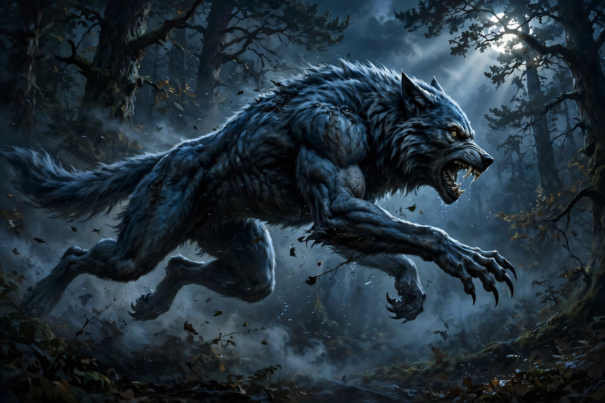
- 可复用规律：扑跃方向要写“sideways from left to right + body in profile”，只写“lunging forward”生成器默认画成正面扑向镜头；月光位置要写方位，否则它会把月亮藏到树后。

## 11 · Reddit r/midjourney · 异域之地

- 原链接：https://www.reddit.com/r/midjourney/comments/1xkdhl8/exotic_places/
- 热度：58 upvotes，0 comments；图集共 7 张，取第 1 张
- 原图拆解：主体为阳光下蜿蜒小径穿过异域森林；构图为小径居中纵深、树根枝条顶篷；光影为金色光线透过林冠；色彩为浅色树根、深紫 foliage、白色飞鸟、金光；材质为水彩感树叶与枝条；风格为水彩感梦幻风景。
- v1 提示词原文：`A winding sunlit path through an exotic forest, interwoven pale tree roots and branches forming a canopy overhead, white egret-like birds flying, deep purple foliage, golden light filtering through the canopy, watercolor-like dreamy atmosphere`
  - 中文解析：阳光蜿蜒小径 + 异域森林 + 交织浅色树根枝条成顶篷 + 白鹭类飞鸟 + 深紫 foliage + 金光透过林冠 + 水彩梦幻氛围。
- v1 对比：像在蜿蜒小径、浅色树根顶篷、白鹭、深紫 foliage、金光、水彩感；偏在飞鸟多达 6 只以上、小径在画面下部偏窄；丢了“小径为主、飞鸟点缀”的主次。
- v1 图：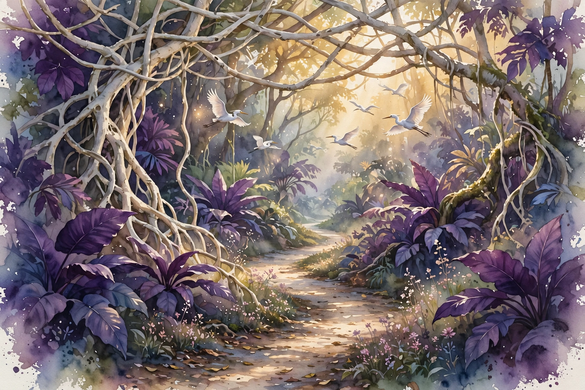
- v2 提示词原文：`A winding sunlit path in the center leading through an exotic forest, interwoven pale tree roots and branches forming a canopy overhead, only three white egret-like birds flying, deep purple foliage at the sides, golden light filtering through the canopy, watercolor-like dreamy atmosphere`
- v2 对比：飞鸟减为 3 只、小径居中蜿蜒、顶篷成拱，更接近描述；代价是画面中部绿色增多、深紫占比下降，v1 的“紫色异域感”反而更浓。
- v2 图：
- 可复用规律：风景飞鸟要定数“only three”，只写“飞鸟”生成器会铺满天空；小径要写“in the center leading through”，否则它会把小径推到画面边缘当配角。

## 12 · Reddit r/aiArt · 雨中玩耍

- 原链接：https://www.reddit.com/r/aiArt/comments/1xkg7fy/playing_in_the_rain/
- 热度：31 upvotes，3 comments；Flair 为 Image - ChatGPT
- 原图拆解：主体为印象派风格女子赤脚、穿花裙，在雨中撑倒置雨伞，站在石阶与花园中；构图为人物居中、石阶纵深；光影为柔和雨光；色彩为明亮花色、湿润地面反光；材质为雨丝、湿石、花裙布料；风格为莫奈式印象派笔触。
- v1 提示词原文：`Impressionist painting in the style of Monet, a woman barefoot in a floral dress playing in the rain, holding an upside-down umbrella, standing on stone steps in a garden, soft rain streaks, wet ground reflections, bright colors, soft light`
  - 中文解析：莫奈式印象派绘画 + 赤脚花裙女子雨中玩耍 + 撑倒置雨伞 + 站在花园石阶上 + 柔和雨丝 + 湿地面反光 + 明亮色彩 + 柔和光。
- v1 对比：像在赤脚花裙、雨丝、石阶花园、湿地面反光、明亮色彩；偏在雨伞为正常撑开而非倒置、人物低头看地面；丢了“伞倒置如碗接雨”这一核心动作。
- v1 图：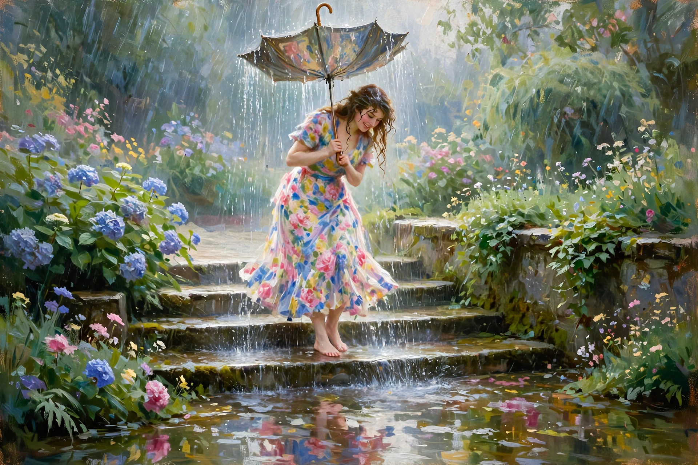
- v2 提示词原文：`Impressionist painting in the style of Monet, a woman barefoot in a floral dress playing in the rain, holding an umbrella UPSIDE DOWN like an open bowl catching rain above her head, standing on stone steps in a garden, soft rain streaks, wet ground reflections, bright colors, soft light`
- v2 对比：雨伞真正倒置成碗、雨水落在碗中、人物仰头笑，更接近描述的核心动作；代价是人物姿态从“低头玩耍”变为“仰头接雨”，v1 的“石阶玩水”氛围反而更贴近标题。
- v2 图：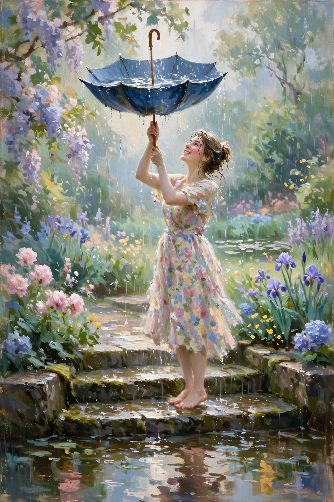
- 可复用规律：反常识道具要写出物理形态“UPSIDE DOWN like an open bowl catching rain”，只写“upside-down”生成器会把它理解成普通雨伞换个角度；核心动作词要配身体朝向，否则它会用姿态把动作改回去。

## 13 · Civitai · 猫耳头盔摩托骑手

- 原链接：https://civitai.com/images/147383374
- 热度：👍 107，❤️ 46，😂 10，😢 6；另有未标注的“40”按钮数字
- 原图拆解：主体为白黑皮衣骑手戴白色带黑猫耳头盔，驾驶白色运动摩托倾斜过弯；构图为摩托与骑手斜向居中；光影为日光；色彩为白黑皮衣、白车身、绿树背景；材质为皮衣、头盔、路面动态模糊；风格为写实照片。面部被头盔遮挡，不计入面部写实项；写实要素为日光质感、路面动态模糊、速度线。
- AI 破绽对照：本类最容易破绽是头盔猫耳画成真猫耳、骑手与车身角度脱节、手套与车把穿帮；原图用“头盔遮面、车身倾斜”把面部破绽整体规避。
- v1 提示词原文：`Photorealistic photo of a motorcycle rider in a white and black leather suit wearing a white helmet with black cat ears, leaning into a corner on a white sport motorcycle, road motion blur, trees in the background, speed lines, bright daylight, realistic photographic detail`
  - 中文解析：写实照片 + 白黑皮衣骑手 + 白色黑猫耳头盔 + 白色运动摩托倾斜过弯 + 路面动态模糊 + 树木背景 + 速度线 + 明亮日光 + 写实照片细节。
- v1 对比：像在白黑皮衣、白猫耳头盔、白运动摩托、路面动态模糊、树木背景、日光；偏在车身倾斜大、骑手身体相对直立，人车角度略脱节；丢了“人与车同向倾斜”的整体感。
- v1 图：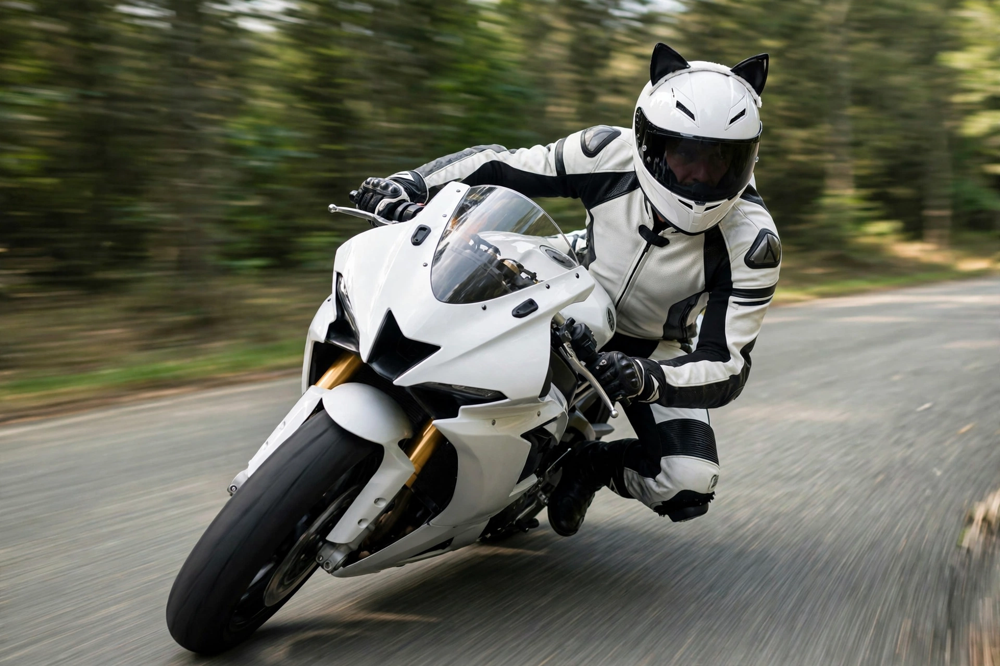
- v2 提示词原文：`Photorealistic photo of a motorcycle rider in a white and black leather suit wearing a white helmet with black cat ears, leaning WITH the bike into a corner on a white sport motorcycle, body tilted sideways, road motion blur, trees in the background, speed lines, bright daylight, realistic photographic detail`
- v2 对比：骑手身体更贴近车身、弯道弧线更明确，更接近“人车一体过弯”；代价是车身倾斜角反而变小，v1 的“大倾角”视觉冲击更强。
- v2 图：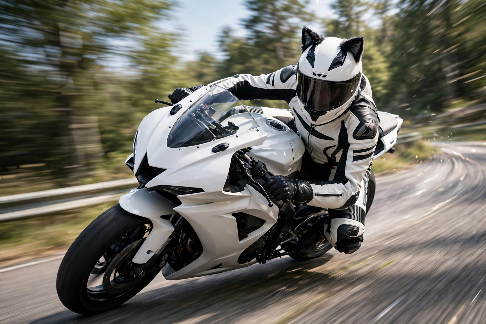
- 可复用规律：人车同向要写“leaning WITH the bike + body tilted sideways”，只写“leaning into a corner”生成器会只倾斜车、不倾斜人；速度感要同时写路面模糊与弯道弧线，只写其一它会只做背景拖影。

## 14 · NightCafe · 野夏之热（绘画风格）

- 原链接：https://creator.nightcafe.studio/creation/8uWKxfG794U1QNjyymN4/wild-summer-heat
- 热度：详情页 219 likes，35 comments（榜单页曾显示 216、35）
- 原图拆解：主体为 27 岁女子，火铜红色卷发，穿白色背心与牛仔短裤，站在乡间道路旁，身边有红色皮卡；构图为人物居中、皮卡在旁；光影为暖夏光；色彩为火铜红发、白背心、牛仔蓝、红皮卡、金色叶状飞溅；材质为混合媒介绘画感；风格为 fine-art mixed-media 绘画，不计入严格写实人物。
- v1 提示词原文：`Fine-art mixed-media painting of a 27-year-old woman with fiery copper-red curly hair, wearing a white tank top and denim shorts, standing beside a country road next to a red pickup truck, golden leaf-like splashes around her, painterly mixed-media texture, warm summer light`
  - 中文解析：美术混合媒介绘画 + 27 岁女子 + 火铜红卷发 + 白背心牛仔短裤 + 乡间路旁红皮卡 + 身边金色叶状飞溅 + 混合媒介绘画质感 + 暖夏光。
- v1 对比：像在火铜红卷发、白背心牛仔短裤、红皮卡、金色叶状飞溅、混合媒介质感；偏在金色飞溅铺满人物与画面、皮卡只露左半；丢了“人物为主、金叶为边缘点缀、皮卡完整”的层级。
- v1 图：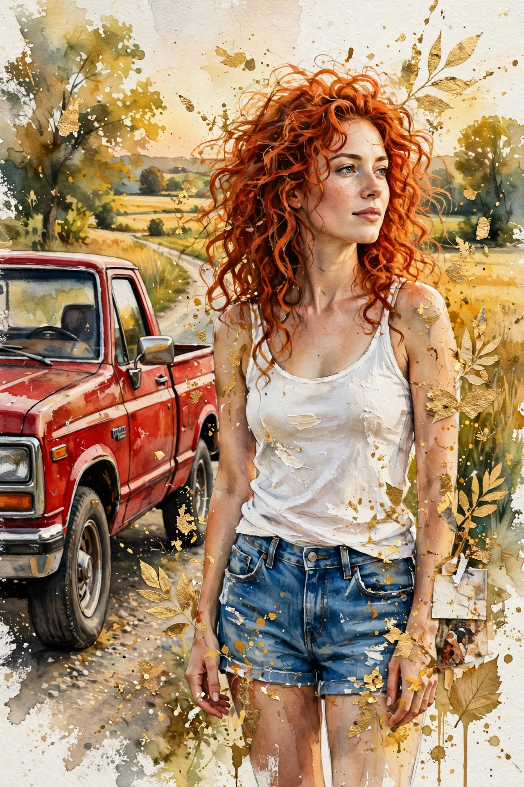
- v2 提示词原文：`Fine-art mixed-media painting of a 27-year-old woman with fiery copper-red curly hair, wearing a white tank top and denim shorts, standing beside a country road with a full red pickup truck beside her, only a FEW small golden leaf splashes at the edges of the image, painterly mixed-media texture, warm summer light, woman clearly the main subject`
- v2 对比：金叶收回边缘、红皮卡完整在右、人物明确为主体，更接近描述；代价是皮卡移到人物身后右侧、画面转为横向构图感，v1 的“人物与皮卡并列”纵深反而更直接。
- v2 图：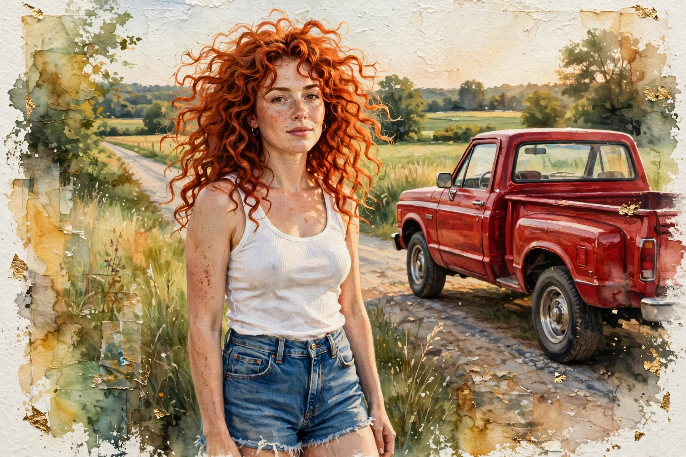
- 可复用规律：装饰飞溅要写“only a FEW small + at the edges”，只写“around her”生成器会把装饰铺到人物身上；配角车辆要写“full + beside her”，否则它会把车裁成半辆当背景。

## 15 · NightCafe · 肖像 DreamShaper v8（写实人物）

- 原链接：https://creator.nightcafe.studio/creation/P4pQkpexJJafOXMqpkPd/portrait-dreamshaper-v8
- 热度：72 likes，12 comments
- 原图拆解：主体为面部特写充满画面，棕色长发有飞丝垂落额前并部分遮住一只眼；构图为面部充满画面、裁切较紧；光影为柔和正面光、深色虚化背景；色彩为淡色皮肤、自然粉唇、蓝绿虹膜；材质为发丝、睫毛、皮肤；风格为写实肖像，评论称 vintage vibe、神秘注视。写实要素：蓝绿色虹膜与清晰眼神光、睫毛与眉形分明、直视镜头的神秘注视、淡色柔和皮肤质感、自然粉色闭合嘴唇、鼻梁与面部阴影过渡自然；手、耳、牙齿因裁切较紧均不可见，不作认定。
- AI 破绽对照：本类最容易破绽是发丝遮眼变成“头发糊脸”、双眼虹膜颜色不一致、皮肤磨皮成塑料；原图用“飞丝只遮一只眼、双眼同色、皮肤留纹理”稳住真实感。
- v1 提示词原文：`Photorealistic close-up portrait filling the frame, a woman with long brown hair with fine flyaway strands falling across her forehead and partly covering one eye, blue-green eyes with clear catchlights, distinct eyelashes and eyebrows, mysterious direct gaze at the camera, soft pale skin with natural texture, closed natural pink lips, natural shadow transitions on the nose and face, dark blurred background, soft frontal light, shallow depth of field, 85mm lens, candid, no retouching look, vintage feel`
  - 中文解析：写实面部特写充满画面 + 棕长发 + 细飞丝垂落额前部分遮一只眼 + 蓝绿眼清晰眼神光 + 睫毛眉形分明 + 神秘直视 + 淡色自然纹理皮肤 + 闭合自然粉唇 + 鼻面阴影自然过渡 + 深色虚化背景 + 柔和正面光 + 浅景深 + 85mm + 抓拍 + 无修图感 + 复古感。
- v1 对比：像在面部特写、飞丝遮眼、蓝绿眼神光、睫毛眉形、自然粉唇、皮肤纹理；偏在飞丝成厚帘遮住半张脸、背景带绿色而非深色；丢了“飞丝为细丝、背景为深色”的克制。
- v1 图：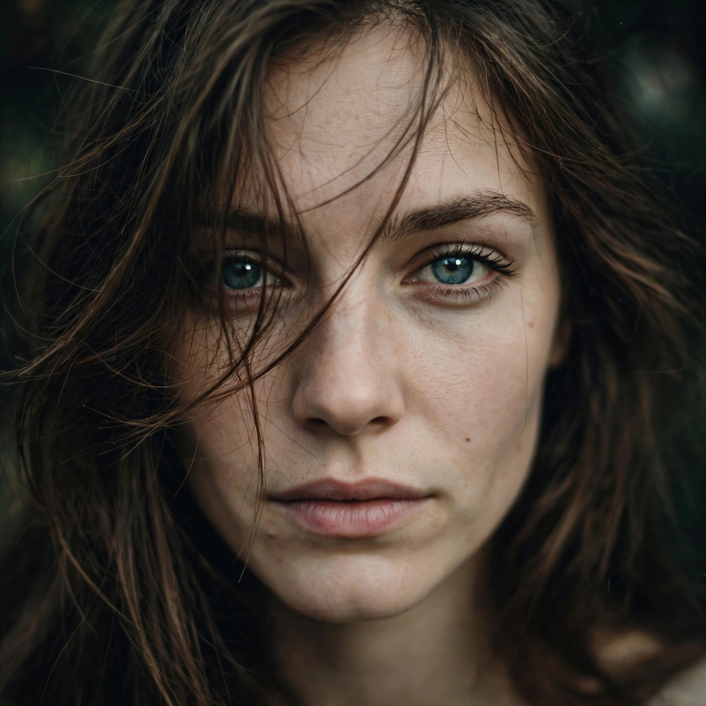
- v2 提示词原文：`Photorealistic close-up portrait filling the frame, a woman with long brown hair, only a FEW fine flyaway strands across her forehead, both blue-green eyes clearly visible with clear catchlights, distinct eyelashes and eyebrows, mysterious direct gaze at the camera, soft pale skin with natural texture and pores, closed natural pink lips, dark blurred background, soft frontal light, shallow depth of field, 85mm lens, candid, no retouching look, vintage feel`
- v2 对比：飞丝变细变少、双眼均清晰、背景变深、毛孔可见，更接近描述；代价是神秘注视变柔和中性、复古感减弱，v1 的“凝视压迫感”反而更接近原图评论。
- v2 图：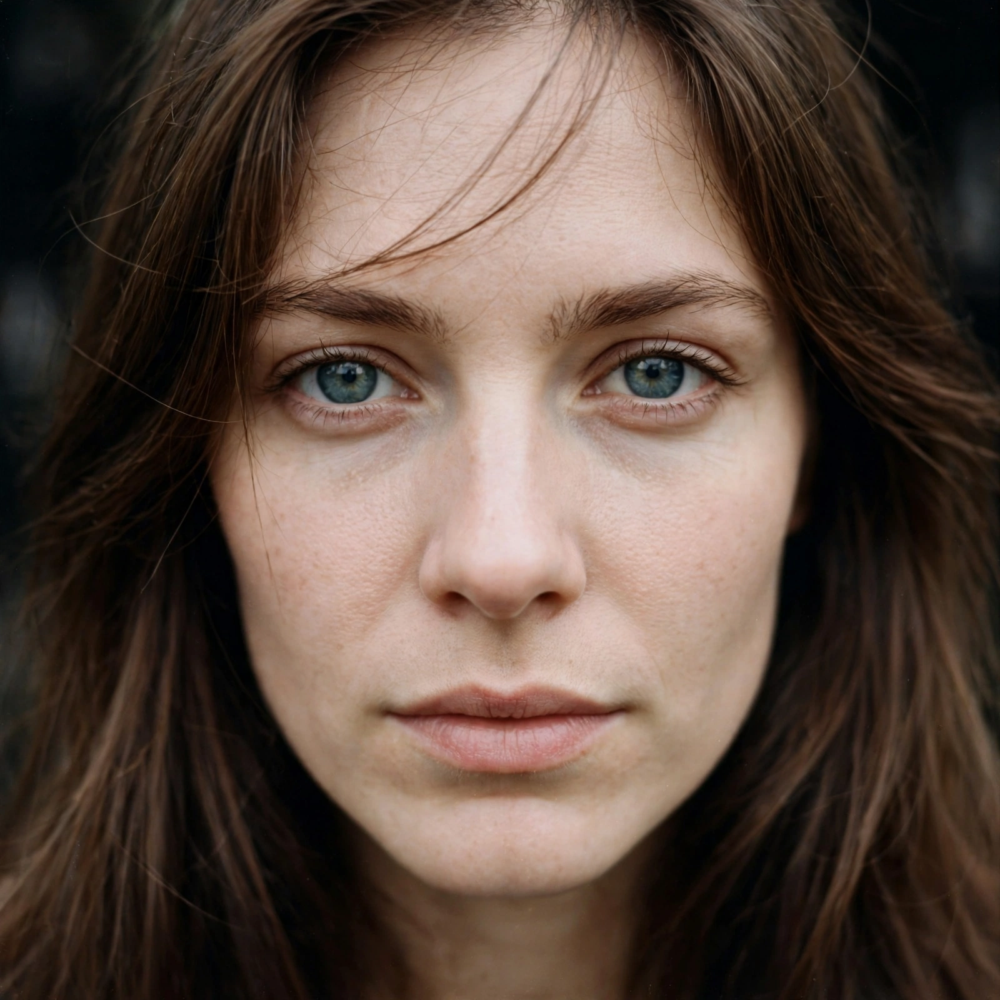
- 可复用规律：遮眼发丝要写“only a FEW fine strands”，只写“flyaway strands partly covering one eye”生成器会画成厚发帘；双眼同色要写“both eyes clearly visible”，否则它会用遮挡掩盖双眼不一致。

---

## 共性结论

1. **定量词是本期主线**：a FEW、only three、one small、SMALL、full-body、wide shot——高热度原图大多不是“更多”，而是“恰好”。v2 的普遍代价是：收敛后氛围变淡（城堡变空白、紫色变绿、怪物变小、复古感变弱），说明克制词要配一个保留语义的锚点，否则会把特征一起收掉。
2. **位置词比形容词管用**：at chest level、at lower right、in the center、behind her shoulder、far below only——只写“持有”“在旁”“在后”，生成器默认把道具和配角推到最显眼的位置；写出身体部位与画面方位才能定住主次。
3. **反常识动作必须写出物理形态**：倒置雨伞要写成“open bowl catching rain”，侧向扑跃要写成“body in profile”，人车同倾要写成“leaning WITH the bike”；只写动作名，生成器会用最常见的姿态把它改回去。
4. **v2 不一定全胜**：本期 14 组有对比的项目中，v2 在结构上普遍更接近描述，但在氛围与细节丰富度上常有回落（1 号尾巴、2 号花茎、4 号怪物、6 号天空、9 号发辫与眼色、13 号倾角）。v2 之后仍需再收一次权重，而不是默认 v2 一定全胜。
5. **描述来源要如实标注**：本期未下载原图文件，对比以浏览器文字描述为准；凡缩略图下看不清的细节（第 4 张毛孔与颗粒）不写成已确认，凡未标注的热度数字不编造类别。这是本期与往期“下载原图对照”不同的地方，也是本期报告可信度的边界。

## 写实人物小结

- 本期写实人物 4 张（3、4、5、15）加写实风格动作 1 张（13）的共同骨架仍是：`candid` + `85mm lens` + 浅景深 + 一个主光源（自然日光、阴天漫射光、黎明暖光、柔和正面光）+ `realistic skin texture with pores and slight imperfections` + `no retouching look`。
- 为什么看起来逼真：3 号靠卷发单根与背景虚化分层；4 号靠阴天漫射光与“怪物只作远景剪影”；5 号靠墨镜遮眼、下半面部皮肤与晨光方向一致；15 号靠飞丝只遮少量、双眼同色、皮肤留纹理；13 号靠头盔遮面、路面动态模糊。
- 常见 AI 破绽对照：皮肤过滑（用毛孔与小瑕疵词对冲）、五官过对称（用不对称飞丝与小痣留破绽）、手部变形（本期 4、5、15 号多用“手不出画或退后”规避，13 号用手套与车把遮挡）、牙齿不自然（本期写实组多为闭唇，规避了牙齿破绽）、光影不一致（用单一主光源词对冲）。
- 能避免塑料感的提示词（本期验证有效）：`realistic skin texture with pores and slight imperfections`、`no retouching look`、`candid`、`85mm lens`、`only a FEW fine flyaway strands`、`heavily blurred in the background`（分档虚化）、`natural relaxed expression`（不是僵笑、假笑）。
- 本期写实组的代价同样明显：背景虚化分档一收，配饰（项链、耳环）就容易变小消失；飞丝一收，神秘感就变中性；全景一拉，面部信息就丢失。写实不是“越真越好”，而是“真细节与主角信息量的取舍”。

## GitHub 同步

- 仓库：https://github.com/mengyangyangs/ai-learning（分支 main，私有）
- 报告：`ai-image-learning/2026-11-01.md`
- 图片文件夹：`ai-image-learning/images/`
- 图片：28 张（第 8 张未生成，不嵌入、不替代）；未改动 README，未删除仓库里的任何文件，未动 reports/ 与 tech-reports/。
