# 每日 AI 图片反推学习 · 2026-11-02

## 选图说明与缺口

- 选图时间：2026-11-02 上午（北京时间），浏览器选图任务 08:58–09:17 完成，全程未登录、未注册、未购买、未下载原图文件。本报告的原图拆解以浏览器任务回传的文字描述为准，未逐像素下载核对原图，因此 v1、v2 对比是“重生成图 vs 浏览器描述的原图特征”，不是与原图文件的逐像素对照；凡描述中未确认的细节，报告里不作推断。
- 本期 15 张构成：NightCafe 2 张 + Reddit 4 张（r/StableDiffusion 1、r/midjourney 2、r/aiArt 1）+ Civitai 4 张 + Midjourney Explore Top day 2 张 + SeaArt 1 张 + PixAI 2 张，共 6 个平台、8 个子渠道；写实人物照片 3 张（第 2、3、12 张，均为面部可见）。
- **去重说明：当天共跳过 9 张重复图，均未入选、未反推、未生成，见下表。** 选图前已核对以往全部报告（2026-10-29、2026-10-30、2026-10-31、2026-11-01）的平台加图片 ID / 原链接；本期 15 张均为全新图片，系跳过重复图后顺延补位凑满。

| 平台 | 原链接 | 首次出现日期 |
|---|---|---|
| NightCafe《The last nut》 | https://creator.nightcafe.studio/creation/ggXyIhEmOKGWzaR69wi8/the-last-nut | 2026-11-01 |
| NightCafe《Malena》 | https://creator.nightcafe.studio/creation/fwOD1mTLy9oGyVJc6wMG | 2026-11-01 |
| SeaArt《Сладкий Мечтатель 🍫》 | https://www.seaart.ai/postDetail/d11h10de878c7390n9p0 | 2026-10-30 |
| SeaArt《Brick Breaker Hero》 | https://www.seaart.ai/postDetail/d964365e878c73b4jgo0 | 2026-10-30 |
| SeaArt《O Portal Mágico Soltou Esse Gato Assustado! 😱》 | https://www.seaart.ai/postDetail/d964bj5e878c73953uvg | 2026-10-30 |
| SeaArt《「予算ゼロ？勇者部が誇る手作りアーマー」「アーマーデザインコンテスト」》 | https://www.seaart.ai/postDetail/d8q8iq5e878c73ckj9pg | 2026-10-30 |
| SeaArt《space fish that feed on moon pollen》 | https://www.seaart.ai/postDetail/d79fgtte878c7382766g | 2026-10-30 |
| PixAI《🖤🍴🩸》（Makima） | https://pixai.art/artwork/2070627399900513165 | 2026-11-01 |
| PixAI《detective anya and bond》 | https://pixai.art/artwork/2067927035251701875 | 2026-11-01 |

- **其他缺口（按实测，不硬编）**：Reddit 当日可直接访问，未遇到网络安全封锁；多图组图已注明“只选第 1 张”。ArtStation 用 Trending 地址访问时被重定向到 404 页，未获得画廊，故未从该渠道选图。Midjourney Explore 首次打开页面空白，重新查看后 Top day 榜单正常加载；页面本身不显示点赞数字，只记录榜单位次与发布时间。SeaArt /discover 会重定向回首页，改用首页作品区与详情页核对；第 13 张详情页主图加载不完整，精细细节以首页缩略图与标题、标签为准，标注“未确认”。Civitai 按公开图片接口（最多反应、近一周、非成人内容）核对，接口与详情页个别数字有 ±1 的实时波动时以接口数字为准；接口中出现的 1 条视频条目未入选。LiblibAI、PromptHero、Tensor.art、DeviantArt、Lexica、PromeAI 因首选与次选已满 15 张而未启用，不属于访问失败；OpenArt、Ideogram、Leonardo、Pinterest 全程未作为选图来源。
- **第 13 张的特别说明**：该条详情页主图处于加载状态，少女面部、手部与汽水罐文字等精细细节未确认；本报告对该条只按浏览器描述的“亮橙色汽水为视觉中心、汽水飞溅、水珠与橙片环绕、高饱和、夏日清凉感、明亮背景、标签指向动漫少女展示冰镇橙汁”来反推，不把 v1、v2 自加的玻璃杯、海报文案、少女发色等写成原图特征。
- 本报告的 v1、v2 均为反推重写，不是照抄原帖提示词；第 11、12 张页面可见的原提示词要点已改写进反推提示词，不原文照抄。
- 重生成图片保存在本任务目标工作区 `hidden_files/2026-11-02/images/` 下，报告内以图片文件名对应；GitHub 版见 ai-image-learning/2026-11-02.md，图片在 ai-image-learning/images/ 下。
- 15 张的 v1、v2 共 30 张次全部生成成功并逐张看过对比，无未完成项。

## 一览表

| # | 平台 | 作者 | 原链接 | 热度（快照） |
|---|---|---|---|---|
| 1 | NightCafe | Moon_dreamer（@Moon_dreamer） | https://creator.nightcafe.studio/creation/ou9YJKStR40tiZi4qi71/desert-wind | 详情页 289 likes，100 comments；Explore Hot 榜出现；创建于 2026-10-29，发布于 2026-11-02 |
| 2 | NightCafe | Benji（@Benjirot） | https://creator.nightcafe.studio/creation/RDuVlXYoVABVghXmbDoJ/fotografie | 76 likes，16 comments；Explore Hot 榜出现；模型 Flux 2 Klein 9B Fast，提示词已隐藏 |
| 3 | Reddit r/StableDiffusion | u/Outrageous_Still9335 | https://www.reddit.com/r/StableDiffusion/comments/1xlfsjd/making_mossbase_look_good_for_realism_workflow/ | 热门榜 55 upvotes，17 comments；帖子为 20 张组图，只选第 1 张 |
| 4 | Reddit r/midjourney | u/Euratza2052 | https://www.reddit.com/r/midjourney/comments/1xldee7/walking_alone/ | 热门榜 25 upvotes，0 comments |
| 5 | Reddit r/midjourney | u/Dropdeadlegs84 | https://www.reddit.com/r/midjourney/comments/1xleld4/marmarina_nisia/ | 热门榜 128 upvotes，2 comments；帖子为 7 张组图，只选第 1 张 |
| 6 | Reddit r/aiArt | u/Intelligent-Rain-22 | https://www.reddit.com/r/aiArt/comments/1xlhta8/the_hidden_architecture_of_life/ | 12 upvotes，评论按钮显示 1（可见评论为 AutoModerator 欢迎帖）；Flair 为 Image - ChatGPT |
| 7 | Civitai | Pitchoun | https://civitai.com/images/146878246 | 接口：👍 1258，❤️ 416，😂 309，😢 62，评论 15；模型 Krea 2；创建于 2026-10-26 |
| 8 | Civitai | vedrom | https://civitai.com/images/146869711 | 接口：👍 1185，❤️ 405，😂 120，😢 41，评论 4；模型 Krea 2 Turbo；创建于 2026-10-26 |
| 9 | Civitai | FUNLUCKY | https://civitai.com/images/146990549 | 接口：👍 1155，❤️ 390，😂 119，😢 50，评论 16；模型 Krea 2 Turbo；创建于 2026-10-27 |
| 10 | Civitai | haova | https://civitai.com/images/146973861 | 接口：👍 1132，❤️ 444，😂 103，😢 45，评论 4；模型 Krea 2 Turbo；创建于 2026-10-27 |
| 11 | Midjourney Explore Top day | Anya Golub（@anygol） | https://www.midjourney.com/jobs/4cf92521-0b33-4725-aa81-7c1ce266cc11?index=0 | 页面未显示点赞数字，不编造；Top day 首屏第 1 位，发布于 22 小时前 |
| 12 | Midjourney Explore Top day | kozyreva.smm（@kozyreva.smm） | https://www.midjourney.com/jobs/714a17bb-db98-4e12-8711-d87160041231?index=2 | 页面未显示点赞数字，不编造；Top day 首屏第 4 位，发布于 12 小时前 |
| 13 | SeaArt | Slender Man | https://www.seaart.ai/postDetail/d8dohbde878c73bhb820 | 详情页依次显示 213、48、1.2K、0（页面未标注各数字类别，只按顺序记录、不编造类别）；发布于 2026-05-31；标签含 Anime girl shows off iced orange soda |
| 14 | PixAI | (mai) | https://pixai.art/artwork/2068121399153581322 | 1.65k likes，16 comments；发布于 2026-10-17；模型 PixAI DiT.2 Tsubaki.2 |
| 15 | PixAI | AMnatsu | https://pixai.art/artwork/2067105397218494219 | 1.14k likes，23 comments；发布于 2026-10-14；模型 PixAI DiT.3 Tsubaki.3 |

类别分布：素描 1 张（1），写实人物照片 3 张（2、3、12），风景与奇幻场景 5 张（4、5、6、8、11），恐怖与节日题材 2 张（7、9），动漫 4 张（10、13、14、15）。

---

## 1 · NightCafe · 沙漠之风（铅笔素描）

- 原链接：https://creator.nightcafe.studio/creation/ou9YJKStR40tiZi4qi71/desert-wind
- 热度：详情页 289 likes，100 comments；Explore Hot 榜出现
- 原图拆解：主体为左侧侧脸的贝都因女性与右侧并行的马；构图为左右呼应、人物与马各占约一半画面；光影为排线疏密过渡的明暗；色彩为低饱和暖灰；材质为暖灰褐纸面、细密排线；风格为铅笔素描。风把头巾、长发与马鬃一同吹向右侧，画面以斜向风线与留白营造沙漠风感。
- v1 提示词原文：`Pencil sketch illustration on warm grey-brown paper, a Bedouin woman in profile on the left with headscarf and long hair blown to the right by desert wind, a horse walking beside her on the right with its mane blown by the same wind, fine dense hatching lines, soft shading by line density, low-saturation warm grey tones, diagonal wind lines and empty space, balanced left-right composition, woman and horse each occupying about half the frame`
  - 中文解析：铅笔素描 + 暖灰褐纸面 + 左侧侧脸贝都因女性 + 头巾长发被风吹向右 + 右侧马同向行走、马鬃同被风吹 + 细密排线 + 排线疏密明暗 + 低饱和暖灰 + 斜向风线与留白 + 左右均衡、各占一半。
- v1 对比：像在侧脸女性、头巾、马、排线纸面、暖灰色调、风感；偏在长发过长、与马鬃在画面中部连成一片，人物与马的界限被风发模糊；丢了“发与鬃分开、各自成形”的清晰度。
- v1 图：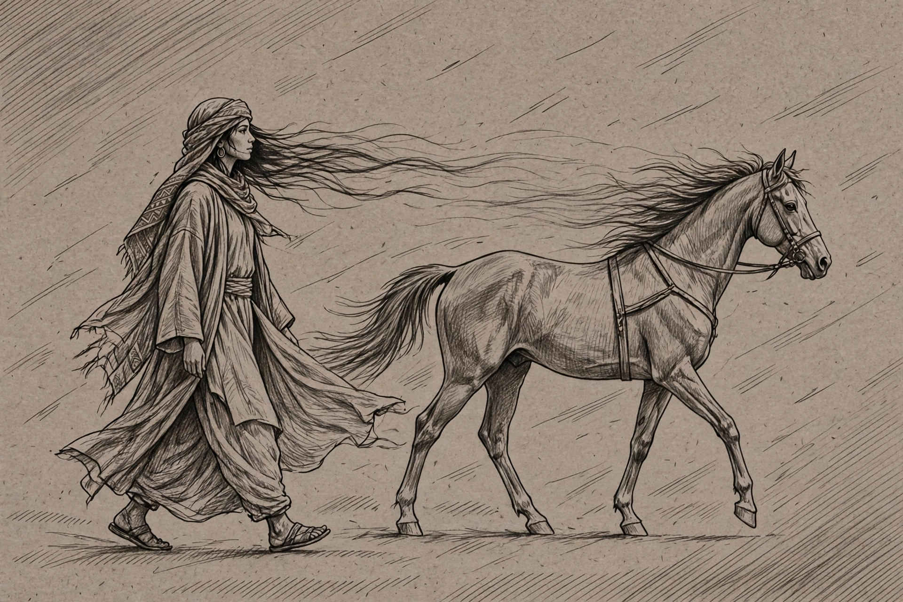
- v2 提示词原文：`Pencil sketch illustration on warm grey-brown paper, a Bedouin woman in profile on the left with headscarf and medium-length hair blown to the right by desert wind, a horse walking beside her on the right with a short blown mane, a clear gap between her hair and the horse's mane, fine dense hatching lines, soft shading by line density, low-saturation warm grey tones, a FEW diagonal wind lines and empty space, woman and horse side by side walking in the same direction, each occupying about half the frame, not a long flowing hair veil`
- v2 对比：发变短、鬃变短、发与鬃之间留出空隙，更接近“各自被风吹”的描述；代价是女性走到马身前方、遮住马腹，并行感变弱，v1 的“左右并行”反而更直接。
- v2 图：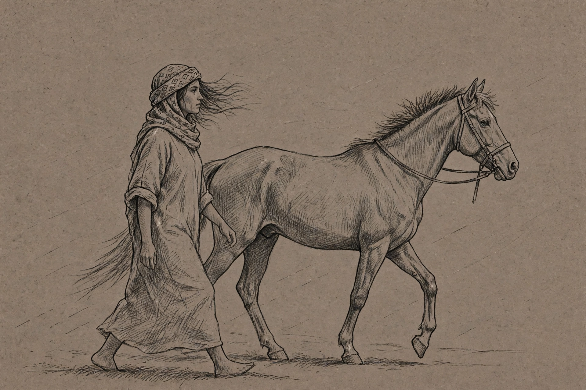
- 可复用规律：两个被风吹的主体要写“a clear gap between her hair and the horse's mane + short / medium-length”，只写“都被风吹”生成器会把发与鬃连成一条风带；并行关系要写“side by side”并配前后位置，否则收敛发长时会把一人推到另一主体前方。

## 2 · NightCafe · Fotografie（写实人物）

- 原链接：https://creator.nightcafe.studio/creation/RDuVlXYoVABVghXmbDoJ/fotografie
- 热度：76 likes，16 comments；Explore Hot 榜出现
- 原图拆解：主体为金发女性特写肖像，面部约四分之三朝向镜头；构图为近景特写；光影为柔和均匀光、无强烈硬阴影；色彩为暖肤、浅灰背景；材质为发丝、妆面；风格为写实照片。写实要素：风把额前与面颊发丝吹散、几缕发丝横过面部、棕色眼睛直视镜头且可见眼神光、另一侧眼睛部分被发丝遮挡、带光泽的粉色闭唇、平静自然表情、背景柔和浅灰虚化。毛孔、细纹、眼角纹、颗粒在当前预览下不明显，标注“未确认”；手部未出画，牙齿因闭唇不可见，耳朵被头发遮挡，均标注“未确认”。
- AI 破绽对照：本类最容易破绽是皮肤偏滑、面部过对称；原图用“发丝遮挡造成的不对称 + 眼神光”削弱塑料感，但皮肤偏滑仍是需要对照的特征。
- v1 提示词原文：`Photorealistic close-up portrait, a blonde woman in three-quarter view facing the camera, wind blowing fine strands of hair across her forehead and cheeks, brown eyes with clear catchlights looking directly at the camera, glossy pink closed lips, calm natural expression, warm even skin, soft uniform light, softly blurred pale grey background, shallow depth of field, candid, no retouching look`
  - 中文解析：写实特写肖像 + 金发女性四分之三朝镜头 + 风吹细发丝横过额颊 + 棕眼清晰眼神光直视 + 光泽粉色闭唇 + 平静自然表情 + 暖色均匀皮肤 + 柔和均匀光 + 浅灰虚化背景 + 浅景深 + 抓拍 + 无修图感。
- v1 对比：像在金发、风吹发丝横面、棕眼眼神光、光泽粉唇、浅灰虚化背景、皮肤纹理；偏在面部偏正面而非四分之三、鼻颊多了原图描述未提的雀斑；丢了“四分之三角度、均匀妆面无雀斑”的限定。
- v1 图：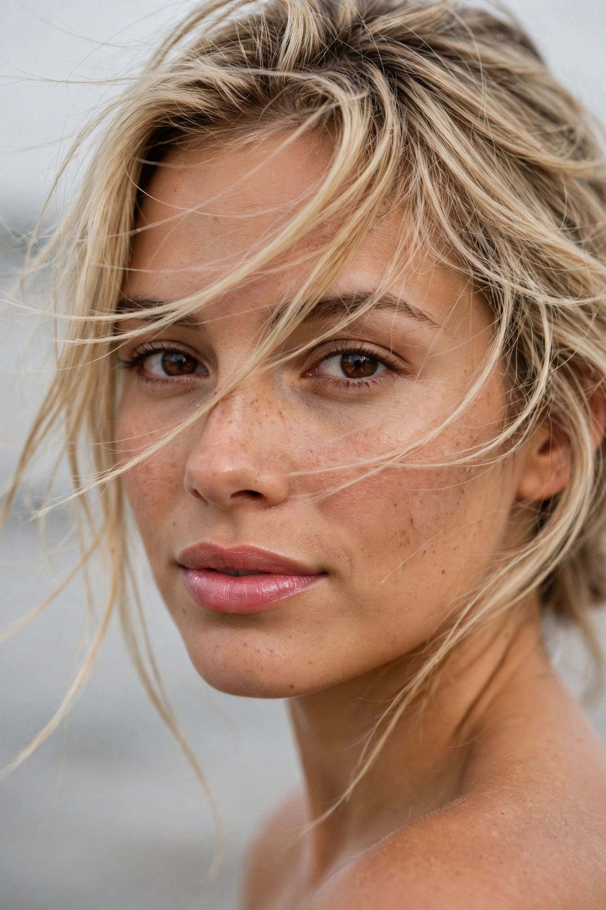
- v2 提示词原文：`Photorealistic close-up portrait in three-quarter view, a blonde woman with her face turned three-quarters toward the camera, wind blowing a FEW fine strands of hair across her forehead and cheeks, brown eyes with clear catchlights looking directly at the camera, clear eyeliner, glossy pink closed lips, calm natural expression, warm even skin with no freckles, soft uniform light, softly blurred pale grey background, shallow depth of field, candid, no retouching look`
- v2 对比：四分之三角度明确、眼线清晰、雀斑消失、只剩几缕细发横面，更接近描述；代价是左侧头发更蓬松、遮住一侧面颊，表情比 v1 更疏离，v1 的“直视亲近感”反而更强。
- v2 图：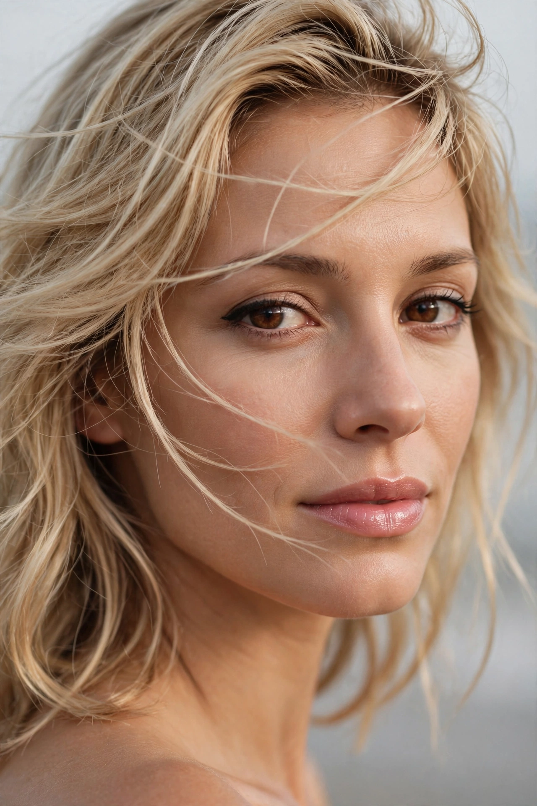
- 可复用规律：写实肖像的“不要什么”要写出来（`with no freckles`），只写“均匀皮肤”生成器仍会自加雀斑来冒充真实感；角度要写两次（`in three-quarter view` + `face turned three-quarters`），只写一次它常滑回正面特写。

## 3 · Reddit r/StableDiffusion · MOSS 写实组图第 1 张（写实人物）

- 原链接：https://www.reddit.com/r/StableDiffusion/comments/1xlfsjd/making_mossbase_look_good_for_realism_workflow/
- 热度：热门榜 55 upvotes，17 comments；帖子为 20 张组图，只选第 1 张
- 原图拆解：主体为红发女性近景特写，正对镜头，右手食指竖在唇前；构图为近景特写；光影为柔和均匀光、面部受光均匀；色彩为红发、绿虹膜、灰色柔焦室内；材质为发丝、睫毛、指甲、颈链；风格为写实照片。写实要素：绿色眼睛、浓密睫毛、眉形左右略有差异、鼻梁与面颊密集雀斑、唇微张、指尖贴近下唇、黑色指甲、黑色颈链、额前细碎发丝、鼻额轻微油光。毛孔与细纹、自然皱纹、颗粒在当前预览分辨率下不明显，标注“未确认”；耳朵被头发遮挡，牙齿被手指与唇部遮挡，均标注“未确认”。
- AI 破绽对照：帖子评论中也有读者指出部分图片显“塑料感”；本图面颊同样偏滑，是重点对照特征，雀斑与发丝是反向的真实感线索；手部单指、指甲与指节比例自然，未见多指或变形。
- v1 提示词原文：`Photorealistic close-up portrait, a red-haired woman facing the camera, right index finger held vertically in front of her lips, green eyes with clear catchlights, thick eyelashes, slightly different eyebrow shapes, dense freckles across nose and cheeks, lips slightly parted with fingertip near lower lip, black nail polish, black choker necklace, softly blurred grey indoor background, soft even light, realistic skin texture with pores and slight imperfections, candid, 85mm lens, shallow depth of field, no retouching look`
  - 中文解析：写实特写 + 红发女性正对镜头 + 右手食指竖在唇前 + 绿眼清晰眼神光 + 浓密睫毛 + 眉形略有差异 + 鼻颊密集雀斑 + 唇微张、指尖近下唇 + 黑指甲 + 黑颈链 + 灰色柔焦室内 + 柔和均匀光 + 毛孔小瑕疵真实皮肤 + 抓拍 + 85mm + 浅景深 + 无修图感。
- v1 对比：像在红发、绿眼、雀斑、竖指、黑指甲、黑颈链、灰色虚化背景；偏在指尖落在唇中部而非下唇、眉形差异不明显；丢了“指尖只贴下唇、眉毛一高一低”的精确位置。
- v1 图：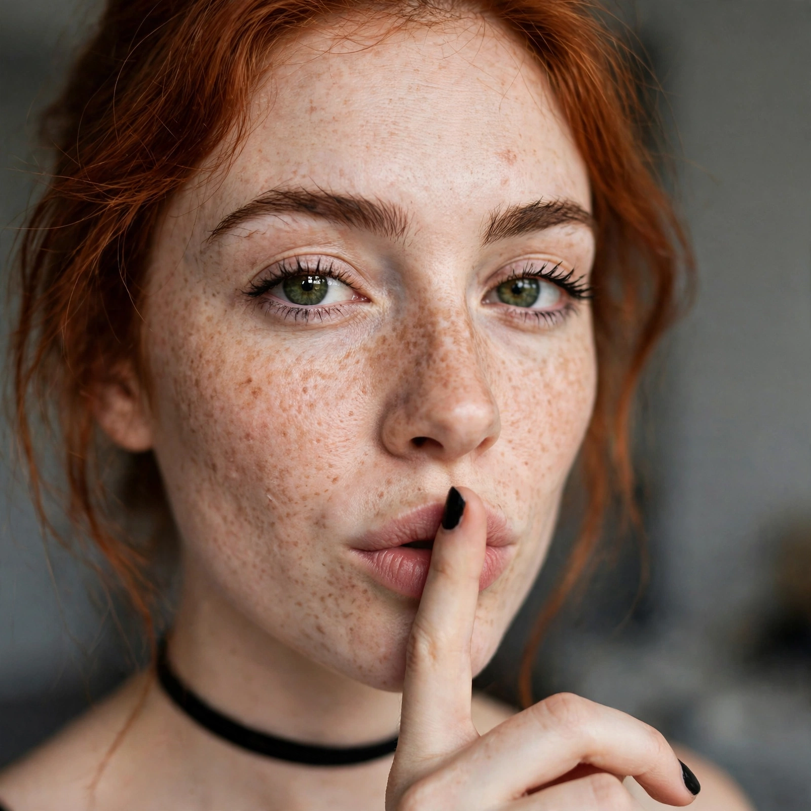
- v2 提示词原文：`Photorealistic close-up portrait, a red-haired woman facing the camera, right index finger held vertically with its tip touching only her lower lip, green eyes with clear catchlights, thick eyelashes, one eyebrow slightly higher and more arched than the other, dense freckles across nose and cheeks, slight shine on nose and forehead, black nail polish, black choker necklace, softly blurred grey indoor background, soft even light, realistic skin texture with pores and slight imperfections, candid, 85mm lens, shallow depth of field, no retouching look`
- v2 对比：指尖明确贴下唇、眉毛一高一拱的差异可见、鼻额带轻微油光，更接近描述；代价是颈链变双层、额头多了皱纹、头发更蓬乱，v1 的“单层颈链 + 平整额头”反而更干净。
- v2 图：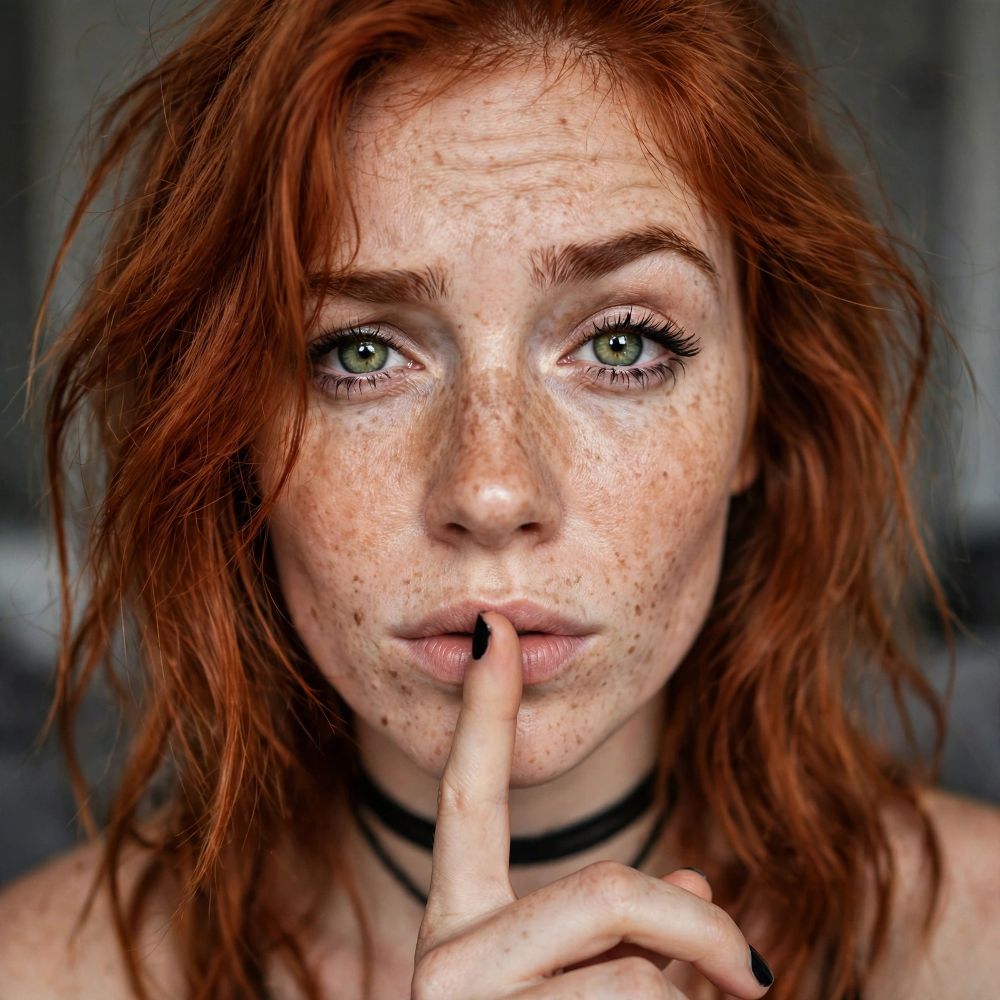
- 可复用规律：手指落点要写“tip touching only her lower lip”，只写“in front of her lips / near lower lip”生成器会把手指贴到唇中部；不对称要写成可比较的差异（`one eyebrow slightly higher and more arched than the other`），只写“slightly different”它常画成对称眉。

## 4 · Reddit r/midjourney · 独自行走（剪影）

- 原链接：https://www.reddit.com/r/midjourney/comments/1xldee7/walking_alone/
- 热度：热门榜 25 upvotes，0 comments
- 原图拆解：主体为剪影人物独自走在伸入海面的木栈道上，背对镜头走向画面深处；构图为栈道引导线、纵深感强；光影为橙紫晚霞、太阳低悬于海平面附近、海面暖色反光；色彩为暖橙、暗紫、深蓝对比；材质为木栈道、暗色剪影；风格为电影感孤寂场景。人物面部不可见，不计入写实面部人物。
- v1 提示词原文：`Cinematic silhouette scene, a lone person seen from behind walking alone along a wooden pier extending into the sea toward the horizon, orange and purple sunset sky with heavy clouds, low sun near sea level, warm reflections on the water, dark silhouette figure and pier, pier as a leading line into depth, warm orange, dark purple and deep blue contrast, lonely film-like atmosphere`
  - 中文解析：电影剪影场景 + 孤身一人背对镜头走在伸入海面的木栈道上 + 橙紫晚霞厚云 + 低悬太阳近海平面 + 海面暖色反光 + 暗色剪影人物与栈道 + 栈道为纵深引导线 + 暖橙暗紫深蓝对比 + 孤寂电影氛围。
- v1 对比：像在背对镜头的人、木栈道纵深、橙紫晚霞、海面暖反光、孤寂感；偏在人物在画面中下部偏大偏近、带兜帽与背包；丢了“人物渺小、栈道更长”的距离感。
- v1 图：
- v2 提示词原文：`Cinematic silhouette scene, a SMALL lone person seen from behind walking far down a long wooden pier extending into the sea toward the horizon, person small in the frame at the middle distance, orange and purple sunset sky with heavy clouds, low sun near sea level, warm reflections on the water, dark silhouette figure and pier, pier as a long leading line into depth, warm orange, dark purple and deep blue contrast, lonely film-like atmosphere`
- v2 对比：人物变小、退到中远距离、栈道更长，更接近“独自走向深处”；代价是栈道在远处分叉成多条残桩、晚霞变 diffuse，v1 的“单条栈道 + 厚云戏剧光”反而更集中。
- v2 图：
- 可复用规律：远景人物要写“SMALL + small in the frame at the middle distance”，只写“独自走在栈道上”生成器默认把人物推到前景；但“长栈道”要配“single pier”，否则它会用分叉残桩来填满远景水面。

## 5 · Reddit r/midjourney · Marmarina Nisia 第 1 张（遗址临水）

- 原链接：https://www.reddit.com/r/midjourney/comments/1xleld4/marmarina_nisia/
- 热度：热门榜 128 upvotes，2 comments；帖子为 7 张组图，只选第 1 张
- 原图拆解：主体为古代石质遗址临水场景，残存石墙与石柱在画面左侧与中部；构图为开阔、水平视线、建筑与倒影上下呼应；光影为明亮日光、阴影清晰；色彩为石材暖灰、植被绿、天空蓝；材质为石材、棕榈、植被；风格为自然风景照片感。右侧有棕榈树与绿色植被，远处为开阔水面与蓝天白云。
- v1 提示词原文：`Ancient stone ruins beside calm water, weathered stone walls and columns on the left and centre, water reflecting the ruins and sky, palm trees and green plants on the right, open water and blue sky with white clouds in the distance, bright daylight, clear shadows, warm grey stone, green vegetation and blue sky, wide open composition, eye-level view`
  - 中文解析：古代石质遗址临水 + 左侧与中部残墙石柱 + 水面倒映遗址与天空 + 右侧棕榈与植被 + 远处开阔水面蓝天白云 + 明亮日光 + 阴影清晰 + 暖灰石材 + 绿植蓝天 + 开阔构图 + 平视。
- v1 对比：像在左中部石墙石柱、棕榈在右、水面倒影、蓝天白云、明亮日光；偏在水面占据前景大半、遗址沿对角线退后；丢了“遗址为主、倒影为呼应而非前景”的层级。
- v1 图：
- v2 提示词原文：`Ancient stone ruins beside calm water seen from the front, a row of weathered stone walls and columns occupying the left half of the frame, their reflection in the water below, open water and blue sky with white clouds on the right, palm trees and green plants on the far right edge only, bright daylight, clear shadows, warm grey stone, green vegetation and blue sky, wide open composition, eye-level view, water as a reflection strip not a large foreground`
- v2 对比：遗址正面占据左半、倒影在下方成带、开阔水面在右，更接近描述的层级；代价是倒影变成画面下半的横带、水面与遗址的临水关系变弱，v1 的“遗址临水、倒影连贯”反而更自然。
- v2 图：
- 可复用规律：风景倒影要写“reflection in the water below + water as a reflection strip not a large foreground”，只写“水面倒映”生成器会把水推成前景主体；遗址位置要写“occupying the left half”，否则它会用对角线透视把遗址推远。

## 6 · Reddit r/aiArt · 生命的隐藏建筑（书中世界）

- 原链接：https://www.reddit.com/r/aiArt/comments/1xlhta8/the_hidden_architecture_of_life/
- 热度：12 upvotes，评论按钮显示 1（可见评论为 AutoModerator 欢迎帖）；Flair 为 Image - ChatGPT
- 原图拆解：主体为一本摊开的旧书铺满前景，书页向上隆起化作山地景观：书页纹理即是山峦与河谷，远处有雪山、落日与云雾，山崖上立着一个极小的人影；构图为书在前景、山地在书页之上；光影为暖色夕阳与室内暖光交织；色彩为书页米黄、山体暖棕、天空橙蓝；材质为旧书页、枯叶、常春藤、窗光；风格为奇幻书卷气。注：帖子文字提到的“人行道裂缝”属于文字说明，画面主体是书中世界，并非写实裂缝特写；左侧有叠放的旧书与带常春藤的窗光，书页边缘有枯叶。
- v1 提示词原文：`Fantasy scene, an open old book filling the foreground, its pages rising up to form a mountain landscape with valleys, a river, distant snow mountains, sunset and clouds, one tiny human figure standing on a cliff, stacked old books and ivy by a window on the left, dry leaves on the book edges, warm sunset light mixed with warm indoor light, cream book pages, warm brown mountains, orange and blue sky`
  - 中文解析：奇幻场景 + 摊开旧书铺满前景 + 书页隆起成山地河谷 + 远处雪山落日云雾 + 崖上极小人影 + 左侧叠放旧书与常春藤窗光 + 书页边缘枯叶 + 暖夕阳与室内暖光交织 + 米黄书页 + 暖棕山体 + 橙蓝天空。
- v1 对比：像在前景摊开旧书、书页隆起成山、崖上小人、左侧叠书常春藤窗光、枯叶、雪山落日；偏在书页皱成折纸状的尖锐山体、窗光带眩光；丢了“书页纹理即是山峦”的平滑纸感。
- v1 图：
- v2 提示词原文：`Fantasy scene, an open old book filling the foreground, its smooth printed pages gently rising to form rolling hills and a valley with a river, distant snow mountains, sunset and clouds, one tiny human figure standing on a cliff, stacked old books and ivy by a window on the left, dry leaves on the book edges, warm sunset light mixed with warm indoor light, cream book pages, warm brown hills, orange and blue sky, pages as smooth paper hills not crumpled origami`
- v2 对比：书页变平滑的印刷纸丘陵、河谷与小人俱在、左侧叠书窗光保留，更接近“纸即是山”的概念；代价是书页变成波浪、远处雪山变成背景照片而非纸山，v1 的“整座纸山世界”反而更统一。
- v2 图：
- 可复用规律：材质转景观要写“smooth printed pages gently rising + pages as smooth paper hills not crumpled origami”，只写“书页隆起成山”生成器会把纸折成折纸山；同时要写远处雪山也是纸的一部分，否则它会把远景换成真实照片山。

## 7 · Civitai · 兜帽面具与红手机

- 原链接：https://civitai.com/images/146878246
- 热度：接口 👍 1258，❤️ 416，😂 309，😢 62，评论 15；模型 Krea 2；创建于 2026-10-26
- 原图拆解：主体为竖幅中戴兜帽的人物占据画面中心，白色《惊声尖叫》式面具（黑眼黑嘴）正对镜头，黑色手套的手把一部红色手机贴在耳边；构图为居中、压迫感强；光影为兜帽深阴影；色彩为面具白、手机红、深青与暗色晕染；材质为厚重绘画质感；风格为万圣节恐怖题材。
- v1 提示词原文：`Vertical Halloween horror illustration, a hooded figure centred in frame wearing a white scream-style mask with black eyes and black mouth, facing the camera, a black-gloved hand holding a red mobile phone to the ear, dark teal and dark smoky background, white mask and red phone in strong contrast, heavy painterly texture, deep hood shadow, oppressive centred composition`
  - 中文解析：竖幅万圣节恐怖插画 + 兜帽人物居中 + 白色尖叫式面具黑眼黑嘴正对镜头 + 黑手套手持红手机贴耳 + 深青暗色烟雾背景 + 白面具与红手机强对比 + 厚重绘画质感 + 兜帽深阴影 + 居中压迫构图。
- v1 对比：像在兜帽居中、白面具黑眼黑嘴、红手机贴耳、深青背景、厚重笔触、压迫感；偏在手部在画面右下偏大、面具嘴部拉长成尖叫形；丢了“手机是配角、手不抢面具”的主次。
- v1 图：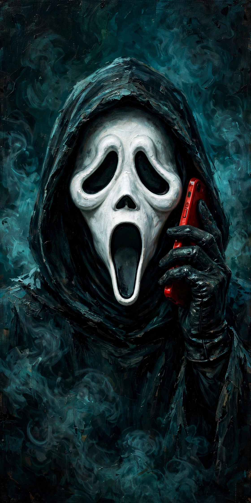
- v2 提示词原文：`Vertical Halloween horror illustration, a hooded figure in medium shot wearing a white scream-style mask with black eyes and black mouth, facing the camera, a SMALL red mobile phone held to the ear by a black-gloved hand at the side of the mask, hand small in the frame, dark teal and dark smoky background, white mask and red phone in strong contrast, heavy painterly texture, deep hood shadow, oppressive centred composition`
- v2 对比：手机变小、手退到面具侧面、面具更居中，更接近“手机为配角”；代价是手机变成复古小机器、面具嘴变短，v1 的“现代智能手机 + 长尖叫嘴”反而更贴合原图题材。
- v2 图：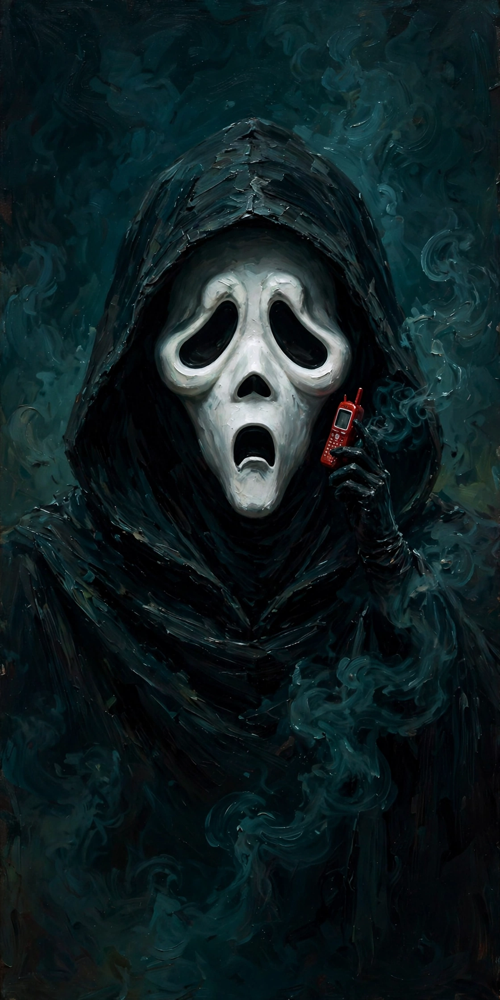
- 可复用规律：配角道具要写“SMALL + hand small in the frame + at the side of the mask”，只写“手持手机贴耳”生成器会把手推成前景主角；但“小”要配现代机型词，否则它会把小手机画成复古玩具机。

## 8 · Civitai · 森林湖畔持剑女王

- 原链接：https://civitai.com/images/146869711
- 热度：接口 👍 1185，❤️ 405，😂 120，😢 41，评论 4；模型 Krea 2 Turbo；创建于 2026-10-26
- 原图拆解：主体为森林湖畔奇幻场景，金发女性头戴金色王冠、身穿白色金绣长裙，站在水边，双手把一把发光长剑的剑尖探入水中；构图为人物在右、水面在左；光影为一道金色光束从树冠间斜射而下、水面光斑与涟漪；色彩为森林绿、金色、水面浅蓝；材质为苔藓树干、蕨类、小蘑菇；风格为梦幻华丽奇幻。
- v1 提示词原文：`Fantasy scene at a forest lakeside, a blonde woman wearing a golden crown and a white dress with gold embroidery standing at the water edge, holding a glowing long sword with both hands, its tip touching the water, one golden beam of light slanting down through tree canopy, light spots and ripples on the water, mossy tree trunks, ferns and small mushrooms around, forest green, gold and pale blue water, dreamy light, rich detail`
  - 中文解析：森林湖畔奇幻 + 金发女性金冠白金绣长裙站在水边 + 双手持发光长剑、剑尖触水 + 一道金光束斜射树冠 + 水面光斑涟漪 + 苔藓树干蕨类小蘑菇 + 森林绿金色浅蓝水面 + 梦幻光 + 华丽细节。
- v1 对比：像在金冠、白金绣长裙、发光长剑触水、斜射金光束、苔藓蕨类蘑菇、绿金浅蓝；偏在女性裙摆浸入水中、光束从左上铺开偏宽；丢了“人站在岸上、只有剑尖触水、光束为窄束”的精确关系。
- v1 图：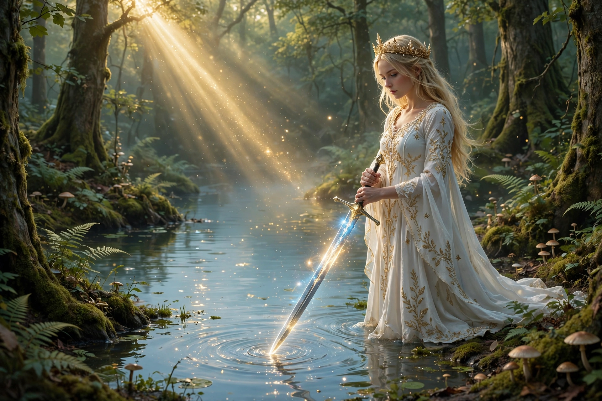
- v2 提示词原文：`Fantasy scene at a forest lakeside, a blonde woman wearing a golden crown and a white dress with gold embroidery standing on the bank at the water edge, not standing in the water, holding a glowing long sword with both hands, only its tip touching the water surface, one narrow golden beam of light slanting down through tree canopy, light spots and ripples on the water, mossy tree trunks, ferns and small mushrooms around, forest green, gold and pale blue water, dreamy light, rich detail`
- v2 对比：女性明确站在岸上苔藓边、剑尖触水成涟漪、光束收窄，更接近描述；代价是长剑过长成斜对角线、裙摆铺在苔藓上，v1 的“人剑水面居中”反而更简洁。
- v2 图：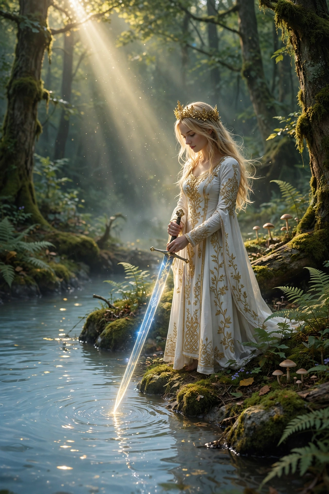
- 可复用规律：岸上持剑要写“standing on the bank + not standing in the water + only its tip touching”，只写“站在水边、剑尖触水”生成器会把人也放进水里；光束要写“one narrow beam”，否则它会把光铺成整片林间雾光。

## 9 · Civitai · 黑猫与南瓜灯、蒸汽火车

- 原链接：https://civitai.com/images/146990549
- 热度：接口 👍 1155，❤️ 390，😂 119，😢 50，评论 16；模型 Krea 2 Turbo；创建于 2026-10-27
- 原图拆解：主体为万圣节夜景中一只黑猫围着红色围巾、抱着点亮的南瓜灯站在画面前景，猫眼圆亮、毛发蓬松；构图为猫为视觉中心、火车为纵深背景；光影为暖黄灯光与冷蓝夜色对比；色彩为深蓝夜空、暖黄灯光、红围巾；材质为蓬松猫毛、南瓜灯、秋叶与火星；风格为童话节日气氛。身后一列蒸汽火车驶过，满月高悬。
- v1 提示词原文：`Halloween night scene, a black cat wearing a red scarf in the foreground holding a lit jack-o-lantern pumpkin, round bright cat eyes, fluffy fur, a steam train passing behind, full moon high in a deep blue night sky, autumn leaves and sparks drifting in air and on ground, warm yellow lantern light against cold blue night, cat as visual centre, train as deep background`
  - 中文解析：万圣节夜景 + 前景黑猫红围巾抱点亮南瓜灯 + 圆亮猫眼 + 蓬松毛发 + 身后蒸汽火车驶过 + 深蓝夜空高悬满月 + 空中地面飘秋叶火星 + 暖黄灯光对冷蓝夜色 + 猫为视觉中心 + 火车为纵深背景。
- v1 对比：像在黑猫红围巾、南瓜灯、圆亮黄眼、蒸汽火车、满月、秋叶火星、暖冷对比；偏在猫为面部大特写、南瓜灯在胸前偏大；丢了“猫全身站立、地面可见”的完整体态。
- v1 图：
- v2 提示词原文：`Halloween night scene, a black cat standing full-body in the foreground wearing a red scarf and holding a lit jack-o-lantern pumpkin in front of its body, cat medium-sized in the frame with ground visible below, round bright cat eyes, fluffy fur, a steam train passing behind in the background, full moon high in a deep blue night sky, autumn leaves and sparks drifting, warm yellow lantern light against cold blue night, train as a long horizontal background`
- v2 对比：猫变全身站立、地面与落叶可见、火车横向在后，更接近描述；代价是猫体量变小、南瓜灯顶多了火焰、面部冲击力下降，v1 的“大特写猫脸 + 南瓜灯”反而更有节日海报感。
- v2 图：
- 可复用规律：前景动物要写“standing full-body + medium-sized in the frame with ground visible below”，只写“前景黑猫”生成器默认推成面部特写；背景火车要写“long horizontal background”，否则它会把火车画成斜穿画面的主角。

## 10 · Civitai · 常春藤兜帽少女与法杖

- 原链接：https://civitai.com/images/146973861
- 热度：接口 👍 1132，❤️ 444，😂 103，😢 45，评论 4；模型 Krea 2 Turbo；创建于 2026-10-27
- 原图拆解：主体为动漫风格少女，头戴绿色常春藤兜帽斗篷，棕色卷发垂落肩头，一只眼睛闭起、露出微笑，手持缠绕藤蔓的法杖；构图为半身居中、视线朝向镜头；光影为柔和偏暖光；色彩为绿色藤蔓、棕色发色、暖黄背景；材质为斗篷、藤蔓、法杖；风格为动漫插画。背景为暖色市集摊位与人群虚影。
- v1 提示词原文：`Anime illustration, half-body portrait of a girl wearing a green ivy hooded cloak, brown curly hair falling over shoulders, one eye closed in a smile, holding a staff wrapped with vines, warm market stalls and blurred crowd in background, soft warm light, green ivy, brown hair and warm yellow background, centred composition, looking toward camera`
  - 中文解析：动漫插画 + 半身肖像 + 绿常春藤兜帽斗篷 + 棕卷发垂肩 + 一眼闭起微笑 + 手持缠藤法杖 + 暖色市集摊位与虚化人群背景 + 柔和暖光 + 绿藤棕发暖黄背景 + 居中构图 + 朝向镜头。
- v1 对比：像在绿藤兜帽、棕卷发、一眼闭起微笑、缠藤法杖、暖市集背景；偏在人物为面部特写、法杖在右侧竖立；丢了“半身居中、斗篷与上半身完整”的画幅。
- v1 图：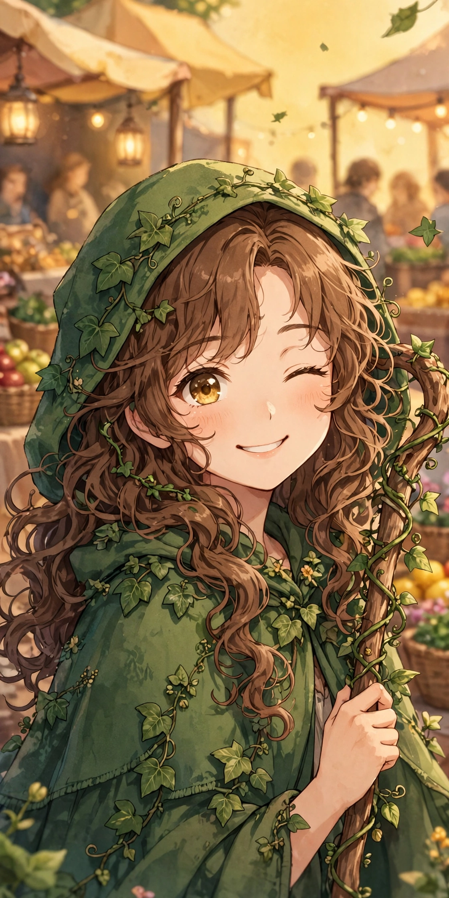
- v2 提示词原文：`Anime illustration, medium shot half-body portrait of a girl wearing a green ivy hooded cloak, brown curly hair falling over shoulders, one eye closed in a smile, holding a staff wrapped with vines down at her side, cloak and upper body fully visible, warm market stalls and blurred crowd in background, soft warm light, green ivy, brown hair and warm yellow background, centred composition, looking toward camera, not a close-up face`
- v2 对比：半身明确、斗篷与上半身完整、市集在两侧，更接近描述；代价是法杖只剩右下斜段、面部变小，v1 的“法杖竖立 + 眨眼特写”反而更直接。
- v2 图：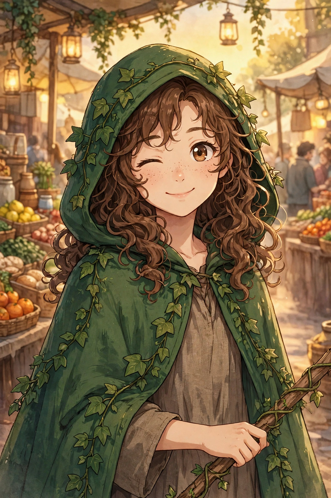
- 可复用规律：半身动漫人物要写“medium shot + cloak and upper body fully visible + not a close-up face”，只写“半身肖像”生成器仍会推成面部特写；法杖位置要写“down at her side + full staff visible”，否则它会把法杖裁成一段斜杆。

## 11 · Midjourney Explore Top day · 黑猫与金鱼（厚涂油画）

- 原链接：https://www.midjourney.com/jobs/4cf92521-0b33-4725-aa81-7c1ce266cc11?index=0
- 热度：页面未显示点赞数字，不编造；Top day 首屏第 1 位，发布于 22 小时前
- 原图拆解：主体为油画厚涂质感中一只黑猫坐在铺着碎花桌布的桌上，注视玻璃鱼缸里的金鱼；构图为平稳、生活气息与绘画肌理并重；光影为室内柔和光；色彩为黑猫深色、金鱼橙红、桌布碎花、墙面明黄；材质为厚重笔触、颜料堆积感、玻璃鱼缸；风格为厚涂油画。桌上另有一瓶干花，背景为黄色墙面。
- v1 提示词原文：`Oil painting with thick impasto texture on canvas, a black cat sitting on a table covered with a floral oilcloth, looking at a goldfish in a glass bowl, a vase of dried flowers also on the table, yellow wall in background, thick visible paint strokes, black cat, orange-red goldfish, floral tablecloth and bright yellow wall, calm stable composition`
  - 中文解析：厚涂油画 + 黑猫坐在碎花桌布桌上 + 注视玻璃鱼缸金鱼 + 桌上另有干花瓶 + 黄色墙面背景 + 厚重可见笔触 + 黑猫 + 橙红金鱼 + 碎花桌布与明黄墙面 + 平稳构图。
- v1 对比：像在黑猫、金鱼玻璃缸、干花瓶、明黄墙面、厚涂笔触、碎花桌布；偏在猫坐在桌布右边缘的木面上、干花瓶在左偏大；丢了“猫完全坐在碎花布上、鱼缸在猫与花瓶之间”的三件套顺序。
- v1 图：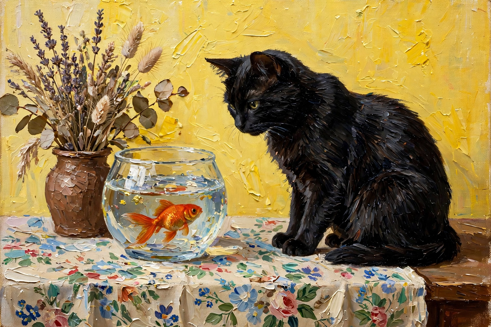
- v2 提示词原文：`Oil painting with thick impasto texture on canvas, a black cat sitting fully on a table covered with a floral oilcloth, looking at a goldfish in a glass bowl placed between the cat and a vase of dried flowers, yellow wall in background, thick visible paint strokes, black cat, orange-red goldfish, floral tablecloth and bright yellow wall, calm stable composition, cat medium-sized on the cloth`
- v2 对比：猫完全坐在碎花布上、鱼缸在猫与花瓶之间、三件套顺序明确，更接近描述；代价是猫体量变大、鱼缸金鱼朝右，v1 的“花瓶左、鱼缸中、猫右”的横向平衡反而更平稳。
- v2 图：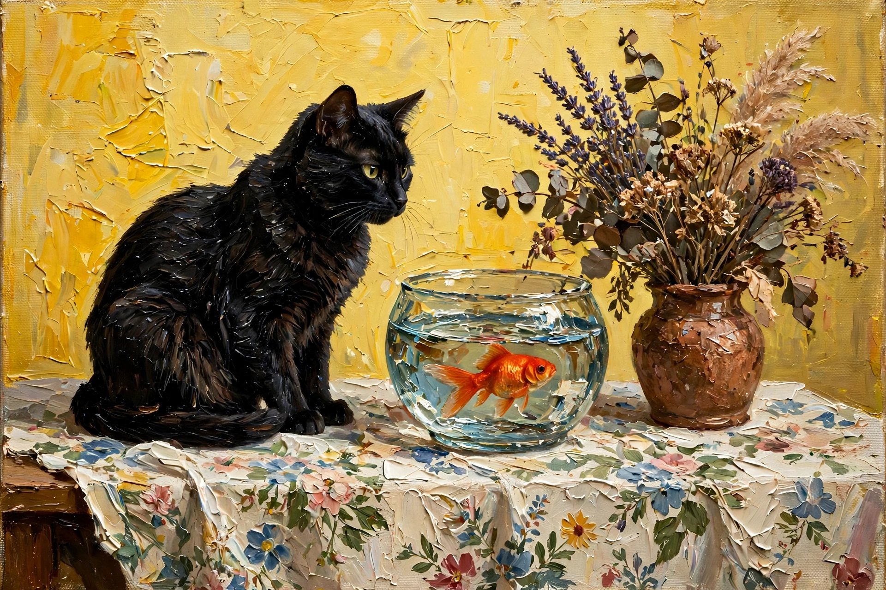
- 可复用规律：桌面三件套要写出顺序（`bowl placed between the cat and a vase`）和“sitting fully on”，只写“桌上有猫、鱼缸、花瓶”生成器会把猫推到桌布边缘、把花瓶推成主角。

## 12 · Midjourney Explore Top day · 粉色西装与小提琴（写实人物）

- 原链接：https://www.midjourney.com/jobs/714a17bb-db98-4e12-8711-d87160041231?index=2
- 热度：页面未显示点赞数字，不编造；Top day 首屏第 4 位，发布于 12 小时前
- 原图拆解：主体为写实照片中金发女性身穿粉色西装外套、内搭黑色上衣，站在城市街道上，手持小提琴与琴弓，身体微侧、面带笑容看向镜头；构图为人物居中、街景在后；光影为暖和日光、面部受光自然；色彩为粉色外套与街景中性色对比；材质为西装布料、小提琴木质；风格为写实照片。写实要素：笑容左右略有差异、金色波浪长发有少量飞散发丝、双眼可见且直视镜头、左手扶琴颈、右手持弓、缩略图上手指比例自然、85mm、f1.8 与浅景深、背景虚化一致、光影方向与面部阴影一致。毛孔与细纹、自然皱纹、颗粒、精细指节、耳朵、牙齿细节在当前缩略图分辨率下不明显，标注“未确认”。
- AI 破绽对照：未见手部变形、光影不一致等明显破绽，仍需原图放大核对毛孔与牙齿细节；本组最容易破绽是琴弓与琴颈穿帮、手指多节，v1、v2 均需对照手部。
- v1 提示词原文：`Photorealistic photo, a blonde woman in a pink blazer over a black top standing on a city street, holding a violin and bow, body slightly turned, smiling at the camera, blurred street buildings and pedestrians in background, warm daylight, natural light on face, pink blazer against neutral street colours, realistic skin texture with pores and slight imperfections, natural relaxed smile, candid, 85mm lens, f1.8, shallow depth of field, no retouching look`
  - 中文解析：写实照片 + 金发女性粉色西装内搭黑上衣站在城市街道 + 手持小提琴与琴弓 + 身体微侧 + 微笑看向镜头 + 虚化街景建筑行人背景 + 暖和日光 + 面部自然受光 + 粉色外套对中性街景 + 毛孔小瑕疵真实皮肤 + 自然放松微笑 + 抓拍 + 85mm + f1.8 + 浅景深 + 无修图感。
- v1 对比：像在粉色西装、黑内搭、金发波浪、微笑、虚化街景、暖日光；偏在小提琴竖在身侧、下部被裁切、琴弓竖立；丢了“小提琴完整可见、双手持琴”的持琴姿态。
- v1 图：
- v2 提示词原文：`Photorealistic photo, a blonde woman in a pink blazer over a black top standing on a city street, holding a complete violin in front of her waist with both hands and a bow across it, body slightly turned, smiling at the camera, whole violin body visible in frame, blurred street buildings and pedestrians in background, warm daylight, natural light on face, pink blazer against neutral street colours, realistic skin texture with pores and slight imperfections, natural relaxed smile, candid, 85mm lens, f1.8, shallow depth of field, no retouching look`
- v2 对比：小提琴完整横在腰前、琴弓横过琴身、双手持琴明确，更接近“手持小提琴”；代价是小提琴占据画面下半、面部变小、琴弓伸出画面边缘，v1 的“竖琴 + 街景纵深”反而更像街头肖像。
- v2 图：
- 可复用规律：持琴姿态要写“holding a complete violin in front of her waist with both hands + whole violin body visible”，只写“holding a violin and bow”生成器会把琴竖在身侧并裁掉琴身；但“完整琴身”要配画幅上限，否则琴会压过面部成为下半主体。

## 13 · SeaArt · 冰镇橙汁（动漫广告海报，受限条目）

- 原链接：https://www.seaart.ai/postDetail/d8dohbde878c73bhb820
- 热度：详情页依次显示 213、48、1.2K、0（页面未标注各数字类别，只按顺序记录、不编造类别）；发布于 2026-05-31；标签含 Anime girl shows off iced orange soda
- 原图拆解（受限说明见选图说明）：画面以亮橙色汽水为视觉中心，汽水飞溅、水珠与橙片环绕，色彩高饱和、夏日清凉感强，背景明亮；标签与标题指向动漫少女展示冰镇橙汁的主题。少女面部、手部与汽水罐文字等精细细节在详情页加载不完整的情况下未确认，不作认定；以下 v1、v2 对比只对照浏览器描述的上述可确认特征，不把重生成图自加的细节反推为原图特征。
- v1 提示词原文：`Anime advertising poster, a bright orange iced soda as visual centre, soda splashing, water droplets and orange slices flying around, an anime girl presenting the iced orange soda, high saturation, bright summer cool feeling, bright background, dynamic splash composition`
  - 中文解析：动漫广告海报 + 亮橙色冰镇汽水为视觉中心 + 汽水飞溅 + 水珠与橙片环绕 + 动漫少女展示冰镇橙汁 + 高饱和 + 夏日清凉感 + 明亮背景 + 动感飞溅构图。
- v1 对比：像在亮橙汽水为中心、飞溅水珠橙片、高饱和、明亮背景、少女展示；偏在重生成图自加了大号海报文案、玻璃杯而非汽水罐、少女在右侧偏大；丢了“无文案核对、汽水形态未确认”的克制——本条的 v1 差异首先是“自加信息”，而非与原图的像素差异。
- v1 图：
- v2 提示词原文：`Anime advertising poster with no text, a bright orange iced soda in a tall glass as visual centre, soda splashing, water droplets and orange slices flying around, an anime girl presenting the iced orange soda beside the glass, high saturation, bright summer cool feeling, bright background, dynamic splash composition, no letters, no words, no poster text`
- v2 对比：文案消失、汽水仍为中心、少女在左侧展示，更接近浏览器描述的可确认部分；代价是少女变小、退到画面左边缘、汽水杯变得巨大，v1 的“少女与汽水并列展示”反而更像广告海报。
- v2 图：
- 可复用规律：受限条目要先写“no text / no letters / no words”清掉生成器自加的海报文案，再谈构图；只写“广告海报”它默认加标题与口号。更重要的是：原图未加载的细节不写进 v1，否则 v2 的“修正”只是在修正自己加的东西。

## 14 · PixAI · 镜面与蜡烛（双格超现实）

- 原链接：https://pixai.art/artwork/2068121399153581322
- 热度：1.65k likes，16 comments；发布于 2026-10-17；模型 PixAI DiT.2 Tsubaki.2
- 原图拆解：上下两格构图。上格：红发少女头顶一支点燃的蜡烛，融化的红蜡沿发丝流下，周围漂浮着多块镜面碎片，每块碎片中映出少女面部的局部；背景为深蓝星空与闪烁星点。下格：特写一块菱形镜面碎片中的少女面部，金色眼睛、长睫毛，镜面边缘有星芒光晕；整体为梦幻复古喷绘美学，柔焦雾化、色彩为红蜡、暖黄烛光与深蓝夜空的对比，超现实氛围浓厚。
- v1 提示词原文：`Dreamy retro airbrush illustration in two panels stacked vertically. Upper panel: a red-haired girl with a lit candle on top of her head, melted red wax running down her hair, many floating mirror shards around her, each shard reflecting part of her face, deep blue starry sky background. Lower panel: close-up of one diamond-shaped mirror shard showing the girl's face with golden eyes and long eyelashes, star sparkle halo around the mirror edge, soft blur, red wax, warm candlelight and deep blue night contrast, surreal atmosphere`
  - 中文解析：梦幻复古喷绘 + 上下两格 + 上格红发少女头顶燃烛 + 红蜡沿发丝流下 + 多块漂浮镜面碎片各映面部局部 + 深蓝星空背景 + 下格特写菱形镜面碎片中少女面部 + 金眼长睫毛 + 镜边星芒光晕 + 柔焦雾化 + 红蜡暖烛光对深蓝夜空 + 超现实氛围。
- v1 对比：像在上下两格、头顶燃烛、红蜡流下、多块镜面碎片映面部局部、下格菱形镜面金眼长睫毛、星芒光晕、红蜡暖烛光对深蓝夜空；偏在上格蜡过厚、碎片过多、少女为侧面仰视；丢了“蜡为细流、碎片为点缀”的克制。
- v1 图：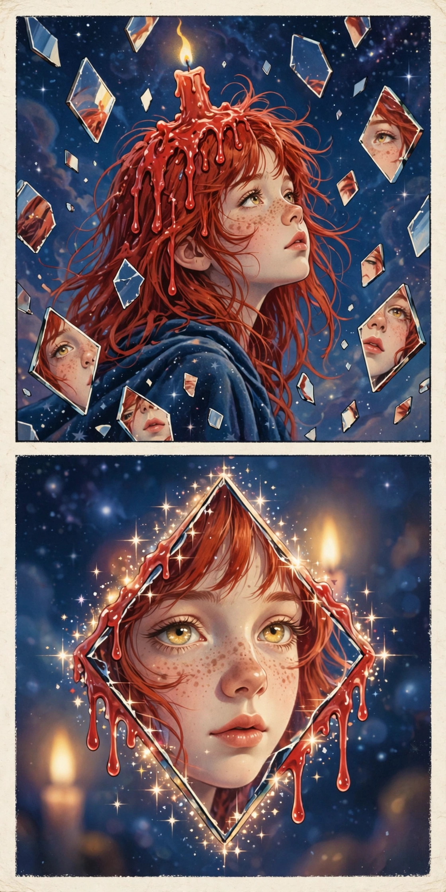
- v2 提示词原文：`Dreamy retro airbrush illustration in two panels stacked vertically. Upper panel: a red-haired girl in three-quarter view with a lit candle on top of her head, only a thin trail of melted red wax down her hair, a FEW small floating mirror shards around her, each shard reflecting part of her face, deep blue starry sky background. Lower panel: close-up of one diamond-shaped mirror shard showing the girl's face with golden eyes and long eyelashes, star sparkle halo around the mirror edge, soft blur, red wax, warm candlelight and deep blue night contrast, surreal atmosphere`
- v2 对比：蜡变细流、碎片变少变小、上格为四分之三面、下格菱形镜面金眼俱在，更接近描述；代价是上格少女低头、眼神下垂，下格镜面变成玻璃裂纹叠加，v1 的“仰视 + 多碎片梦境感”反而更超现实。
- v2 图：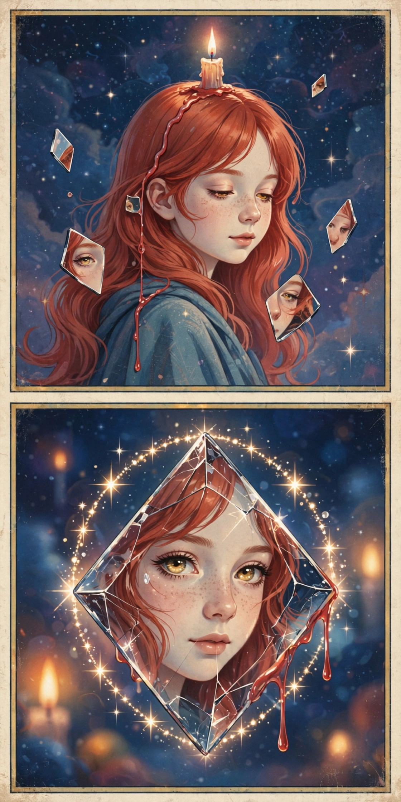
- 可复用规律：超现实装饰要写“only a thin trail + a FEW small shards”，只写“蜡流下、碎片漂浮”生成器会把蜡画成厚盖、碎片铺满画面；双格结构要写“two panels stacked vertically”并分格描述，否则它会把上下格拼成单幅。

## 15 · PixAI · 女仆装少女（动漫互动肖像）

- 原链接：https://pixai.art/artwork/2067105397218494219
- 热度：1.14k likes，23 comments；发布于 2026-10-14；模型 PixAI DiT.3 Tsubaki.3
- 原图拆解：主体为动漫少女上半身居中，金色短发、紫色眼睛，头戴白色蕾丝女仆头饰，身穿白色围裙女仆装、绿色蝴蝶结；构图为活泼、面向镜头互动感强；光影为明亮柔和光；色彩为明亮柔和、金发、紫眼、白围裙、绿蝴蝶结；材质为蕾丝、围裙布料；风格为动漫插画。一手向镜头伸出、一手在颊边比出姿势，眨眼微笑、面颊泛红；背景为浅色格纹与星星、花朵、猫咪挂饰等贴纸元素。
- v1 提示词原文：`Anime illustration, upper-body portrait of a girl with short golden hair and purple eyes, wearing a white lace maid headdress and a white apron maid outfit with a green bow, one hand reaching toward the camera, other hand posing beside her cheek, winking and smiling with blushing cheeks, light checkered background with stars, flowers and cat charms as sticker elements, bright soft colours, lively composition facing the camera`
  - 中文解析：动漫插画 + 上半身肖像 + 金色短发紫眼 + 白蕾丝女仆头饰 + 白围裙女仆装绿蝴蝶结 + 一手伸向镜头 + 另一手在颊边比姿势 + 眨眼微笑面颊泛红 + 浅色格纹背景星星花朵猫咪挂饰贴纸元素 + 明亮柔和色彩 + 活泼面向镜头构图。
- v1 对比：像在金短发紫眼、白蕾丝头饰、白围裙绿蝴蝶结、眨眼微笑泛红、格纹贴纸背景、一手伸向镜头、一手在颊边；偏在伸向镜头的手因透视过大、占据画面左下；丢了“伸手为互动点缀、面部仍为中心”的主次。
- v1 图：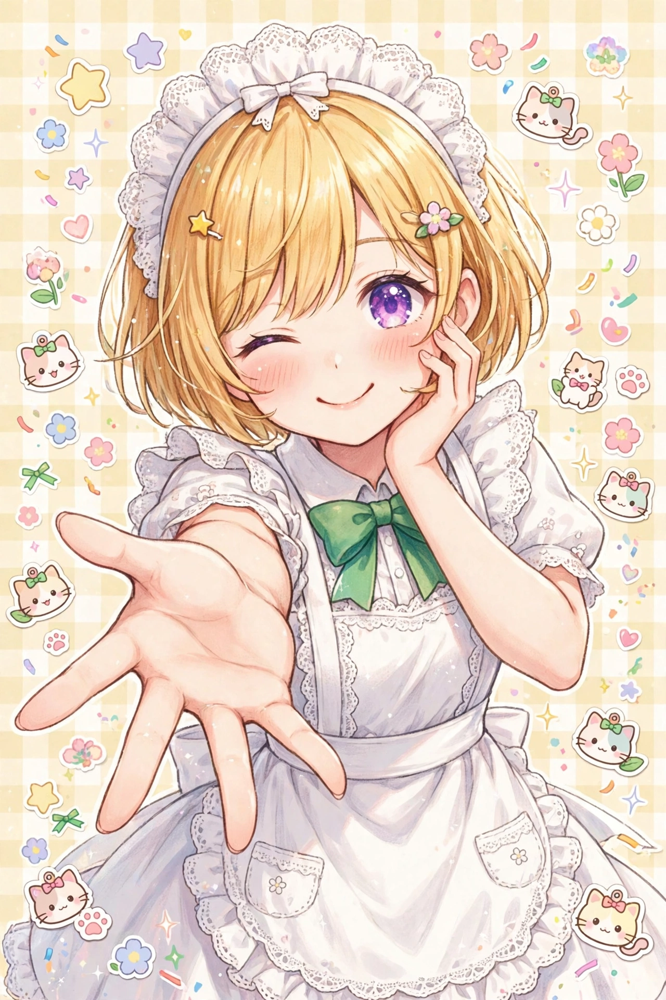
- v2 提示词原文：`Anime illustration, upper-body portrait of a girl with short golden hair and purple eyes, wearing a white lace maid headdress and a white apron maid outfit with a green bow, one SMALL hand reaching toward the camera at the lower edge of the frame, other hand posing beside her cheek, winking and smiling with blushing cheeks, face clearly centred, light checkered background with stars, flowers and cat charms as sticker elements, bright soft colours, lively composition facing the camera, reaching hand small not covering the apron`
- v2 对比：伸手变小、退到画面下边缘、面部明确居中、围裙完整，更接近描述的主次；代价是伸手看起来像画面底部另加的一只手、与身体连接感弱，v1 的“透视伸手”反而更有一体感。
- v2 图：
- 可复用规律：向镜头伸手要写“one SMALL hand + at the lower edge + face clearly centred + not covering the apron”，只写“one hand reaching toward the camera”生成器会用透视把手放大成画面主体；但“小”要配手臂连接词，否则它会把手画成脱离身体的贴纸。

---

## 共性结论

1. **“不要什么”与“只有多少”同样重要**：本期 v2 的有效修正大多是限定词——`with no freckles`、`only its tip touching`、`a FEW small shards`、`no text`、`SMALL hand`。只写肯定描述，生成器会用“更像”来填充：雀斑冒充真实感、整个人进水、碎片铺满画面、海报文案自带标题。
2. **位置与顺序要写成可核对的句子**：`bowl placed between the cat and a vase`、`sitting fully on`、`at the lower edge`、`occupying the left half`——三件套、倒影、伸手、遗址的 v2 进步都来自这类句子，而不是形容词升级。
3. **v2 不一定全胜**：本期 15 组中，v2 在结构与限定上普遍更接近描述，但在氛围与冲击力上常有回落（1 号并行感、2 号亲近感、4 号单栈道戏剧光、7 号现代手机与长嘴、9 号面部冲击、12 号街头肖像感、13 号广告并列感、14 号仰视梦境感、15 号透视一体感）。v2 之后仍需再收一次权重，而不是默认 v2 一定全胜。
4. **受限条目要先划清可确认边界**：第 13 张的教训是，详情页未加载时，v1 里任何“看起来合理”的补充（玻璃杯、文案、发色）都会变成后续对比的噪音；先写“未确认”，再写反推，报告才可信。
5. **描述来源要如实标注**：本期未下载原图文件，对比以浏览器文字描述为准；凡缩略图下看不清的细节（写实组毛孔、细纹、颗粒、精细指节、牙齿）不写成已确认，凡未标注的热度数字不编造类别。这是本期报告可信度的边界。

## 写实人物小结

- 本期写实人物 3 张（2、3、12）的共同骨架仍是：`candid` + `85mm lens` + 浅景深 + 一个主光源（柔和均匀光、暖和日光）+ `realistic skin texture with pores and slight imperfections` + `no retouching look`。
- 为什么看起来逼真：2 号靠风吹发丝横面造成的不对称 + 棕眼眼神光 + 光泽闭唇；3 号靠密集雀斑分布不对称 + 眉形差异 + 单指落点 + 鼻额轻微油光；12 号靠笑容左右差异 + 少量飞散发丝 + 85mm、f1.8 与背景虚化一致 + 光影方向与面部阴影一致。
- 常见 AI 破绽对照：皮肤过滑（2 号、3 号面颊均偏滑，用毛孔与小瑕疵词对冲，但 v1 仍会自加雀斑冒充纹理）；五官过对称（用发丝遮挡、眉形差异、笑容差异留破绽）；手部变形（3 号单指与 12 号持琴持弓是高风险点，本期 v1、v2 均未见明显多指，但 12 号琴弓与琴颈的位置仍需放大核对）；牙齿不自然（本期写实组 2 号闭唇、3 号手指遮唇，规避了牙齿破绽；12 号笑容牙齿较小，细节未确认）；光影不一致（用单一主光源词对冲，12 号的街景虚化与面部受光方向一致是加分项）。
- 能避免塑料感的提示词（本期验证有效）：`realistic skin texture with pores and slight imperfections`、`no retouching look`、`candid`、`85mm lens`、`a FEW fine strands`（发丝要定量）、`tip touching only her lower lip`（手指落点要定点）、`with no freckles`（不要的特征要明写）、`natural relaxed smile`（不是僵笑、假笑）。
- 本期写实组的代价同样明显：去雀斑一收，面部就更像棚拍妆面；指尖落点一收，颈链就变双层、额头就多皱纹；琴身完整一收，面部就变小、琴弓就出画。写实不是“越真越好”，而是“真细节与主角信息量的取舍”。

## GitHub 同步

- 仓库：https://github.com/mengyangyangs/ai-learning（分支 main，私有）
- 报告：`ai-image-learning/2026-11-02.md`
- 图片文件夹：`ai-image-learning/images/`
- 图片：30 张（15 张 v1 + 15 张 v2）；未改动 README，未删除仓库里的任何文件，未动 reports/ 与 tech-reports/。
- 同步状态：待浏览器同步任务回传核对后补记。
