# 每日 AI 图片反推学习 · 2026-11-03

## 选图说明与缺口

- 选图时间：2026-11-03 上午（北京时间），浏览器选图任务 09:01–09:45 完成，全程未登录、未注册、未购买、未下载原图文件。本报告的原图拆解以浏览器任务回传的文字描述为准，未逐像素下载核对原图，因此 v1、v2 对比是“重生成图 vs 浏览器描述的原图特征”，不是与原图文件的逐像素对照；凡描述中未确认的细节，报告里不作推断。
- 本期 15 张构成：Civitai 4 张 + NightCafe 3 张 + SeaArt 2 张 + PixAI 2 张 + Reddit 2 张（r/midjourney 1、r/aiArt 1）+ PromptHero 2 张，共 6 个平台；写实人物照片 3 张（第 4、14、15 张，均为面部可见）。第 13 张为印象派风格人像，面部可见但非照片写实，不计入写实人物 3 张。
- **去重说明：当天共跳过 1 张重复图，未入选、未反推、未生成，见下表。** 选图前已核对以往全部报告（2026-10-29、2026-10-30、2026-10-31、2026-11-01、2026-11-02）的平台加图片 ID / 原链接；本期 15 张均为全新图片，系跳过重复图后顺延补位凑满。

| 平台 | 原链接 | 首次出现日期 |
|---|---|---|
| NightCafe《Bedouin Woman and Horse in Desert Wind Pencil Drawing》 | https://creator.nightcafe.studio/creation/ou9YJKStR40tiZi4qi71 | 2026-11-02（对应往期 slug 为 desert-wind；浏览器回传时未能从本页对应首次出现日期，此处按往期报告补记） |

- **其他缺口（按实测，不硬编）**：Reddit 当日可直接访问，未遇到网络安全封锁；多图组图已注明“只选第 1 张”。ArtStation 用 Trending 地址访问时返回 404，未获得画廊，故未从该渠道选图。Midjourney Explore Top 游客页加载后图片区为空白、无可验证作品，故未入选。LiblibAI 灵感页已浏览，但卡片未显示可验证的点赞/热度数字，且高优先级渠道已凑满，故未入选。Tensor.art、DeviantArt、Lexica、PromeAI 因首选与次选已满 15 张而未启用，不属于访问失败；OpenArt、Ideogram、Leonardo、Pinterest 全程未作为选图来源。PromptHero 注册墙可关闭，关闭两次后正常浏览 Hot 页。Civitai 游客图库卡片本次在浏览器中可见，入选仍以详情页反应数字核对。SeaArt 万圣节精灵帖 dbd9uite878c73a2cmj0 曾考虑入选，但详情主图未加载且卡片带视频标识，无法确认静态图，已弃用。
- **第 7、14、15 张的特别说明**：第 7 张详情页大图当时未加载完成，描述以热门页缩略图为准，面部因绷带包裹、细节未确认。第 14 张详情页大图当时未加载完成，以热门页缩略图与页面提示词文本为准，提示词称右颊有疤、留短须，缩略图未看清疤痕，皮肤毛孔、眼神光、发丝飞散、颗粒与噪点均未确认。第 15 张详情页大图当时未加载完成，页面提示词只确认“超写实女性特写人像、Sony A7III 拍摄”，热门页缩略图只显示女性面部特写；除“女性面部特写”外，本报告不对第 15 张原图的发色、眼色、雀斑、服装、背景作任何推断，v1、v2 自带的棕发、绿眼、雀斑、黑衣、户外虚化背景等均为重生成时自加的特征，不是原图特征。
- 本报告的 v1、v2 均为反推重写，不是照抄原帖提示词；第 14、15 张页面可见的原提示词要点已改写进反推提示词，不原文照抄。
- 重生成图片保存在本任务目标工作区 `hidden_files/2026-11-03/images/` 下，报告内以图片文件名对应；GitHub 版见 ai-image-learning/2026-11-03.md，图片在 ai-image-learning/images/ 下。
- **生成完成情况：15 张的 v1 共 14 张次生成成功、1 张次未完成；v2 共 13 张次生成成功、2 张次未完成；合计 27 张次成功。第 12 张 v1 未能生成，v2 因此未尝试；第 13 张 v2 未能生成；未完成项均未用无关图片代替。**

## 一览表

| # | 平台 | 作者 | 原链接 | 热度（快照） |
|---|---|---|---|---|
| 1 | Civitai | Smorafina | https://civitai.com/images/146969267 | 反应 👍1378、❤️484、😂165、😢73，2026-10-27 上传；页面未显示评论总数文字 |
| 2 | Civitai | 5990ef66795d77d0 | https://civitai.com/images/147031005 | 反应 👍1026、❤️354、😂114、😢53，2026-10-28 上传 |
| 3 | Civitai | FLESK | https://civitai.com/images/147083617 | 反应 👍980、❤️319、😂133、😢61，2026-10-28 上传；Master Generators 第 3 名 |
| 4 | Civitai（写实人物） | SteinPilz | https://civitai.com/images/147533640 | 反应 👍322、❤️111、😂17、😢5，2026-11-01 上传 |
| 5 | NightCafe | Dreamer | https://creator.nightcafe.studio/creation/EaI1y7t0CyuiusazCnBY | 点赞 705、收藏 16、评论 212，2026-11-02 发布；Daily Winner（Daily Challenge #1479） |
| 6 | NightCafe | Staircase Flash | https://creator.nightcafe.studio/creation/GmPmcbkVMxZK3OZ2PIjz | 点赞 617、收藏 25、评论 130，2026-11-02 发布 |
| 7 | NightCafe | Cilia | https://creator.nightcafe.studio/creation/8D3ecK2QcEnU7Hk98c0F | 点赞 625、收藏 13、评论 165，2026-11-01 发布；Daily Challenge #1478 Happy Halloween，Daily 5% |
| 8 | SeaArt | 未显示（页面显示为“--”） | https://www.seaart.ai/postDetail/daf00fde878c738ek1a0 | 页面显示 1.5K、579、浏览 145、评论 30，2026-09-07 发布；第二项图标页面未用文字标注名称，不编造 |
| 9 | SeaArt | Newniwa | https://www.seaart.ai/postDetail/d9sh9vle878c739nhau0 | 页面显示 1.4K、544、浏览 200、评论 2，2026-08-10 发布 |
| 10 | PixAI | ^( aricat )^ | https://pixai.art/artwork/2073338548770559862 | 点赞 555（详情页）、评论 11，2026-11-01 发布 |
| 11 | PixAI | リオ | https://pixai.art/artwork/2072756675267802567 | 点赞 941、评论 21，2026-10-30 发布；Halloween Oddities Club 参赛作品 |
| 12 | Reddit r/midjourney | Mordrat_The_Grey | https://www.reddit.com/r/midjourney/comments/1xlyuah/so_real_surrealism/ | 顶贴 219（详情页；列表页为 214）、评论 7，2026-11-02 22:35 GMT+8 发布；组图共 20 张，只选第 1 张 |
| 13 | Reddit r/aiArt | WallySchirra | https://www.reddit.com/r/aiArt/comments/1xlvuvl/clawed_monet/ | 顶贴 141、评论 9，2026-11-02 20:28 GMT+8 发布；标签 Image - ChatGPT |
| 14 | PromptHero（写实人物） | @feelicious | https://prompthero.com/prompt/869df0f4100-flux-flux-3-a-masterpiece-cinematic-color-photo-of-a-34-year-old-muscular-italian-man-with-gritty-masculine-and-intense-gaze-sharp | 浏览 1.8k、收藏 6、评论 0，2026-10-06 发布 |
| 15 | PromptHero（写实人物） | @kreatix | https://prompthero.com/prompt/0b7b879ba91-hero-10-close-up-of-a-stunning-fashion-model-ultra-realistic-portrait-shot-on-a-sony-a7iii-high-quality-ar-3564-stylize | 浏览 1.1k、收藏 5、评论 0，2026-10-16 发布 |

类别分布：超现实 2 张（1、12），夜景街拍 1 张（2），恐怖玩偶 2 张（3、11），写实人物照片 3 张（4、14、15），彩绘玻璃奇幻 1 张（5），水墨动物 1 张（6），万圣节墓园 1 张（7），动漫 1 张（8），奇幻骑士 1 张（9），哥特 1 张（10），印象派幽默人像 1 张（13）。

---

## 1 · Civitai · 室内倾斜小屋群

- 原链接：https://civitai.com/images/146969267
- 热度：反应 👍1378、❤️484、😂165、😢73，2026-10-27 上传；页面未显示评论总数文字
- 原图拆解：主体为一簇色彩斑斓的小房子斜插、倾倒着堆叠在房间一角，窗户透出暖黄灯光；构图为透视夸张、倾斜感强；光影为暖调与冷灰室内光对比；色彩为多彩小屋对冷灰室内；材质似微缩模型与油画结合，门窗线条清晰；地面有微小人物剪影与家具轮廓，天花板为浅色方格吊顶、悬挂多盏灯；颗粒与噪点未确认。
- v1 提示词原文：`Surreal interior scene, a cluster of colourful small houses tilted and stacked leaning in one corner of a room, their windows glowing warm yellow, tiny silhouetted figures and furniture outlines on the floor below, pale square-grid ceiling with several hanging lamps, warm tones contrasting with cool grey indoor light, exaggerated tilted perspective, texture like a miniature model combined with oil painting, clear door and window lines`
  - 中文解析：超现实室内 + 一簇多彩小房子斜插堆叠在房间一角 + 窗户暖黄灯光 + 地面微小人物剪影与家具轮廓 + 浅色方格吊顶多盏吊灯 + 暖调对冷灰室内光 + 夸张倾斜透视 + 微缩模型结合油画质感 + 门窗线条清晰。
- v1 对比：像在右侧堆叠小屋、方格吊顶吊灯、暖黄窗光、地面微小人物与家具轮廓、倾斜透视；偏在左侧自加了一扇大法式门窗，小屋堆成右侧高塔而非“一角的簇”；丢了“左墙干净、只有一角有屋”的留白。
- v1 图：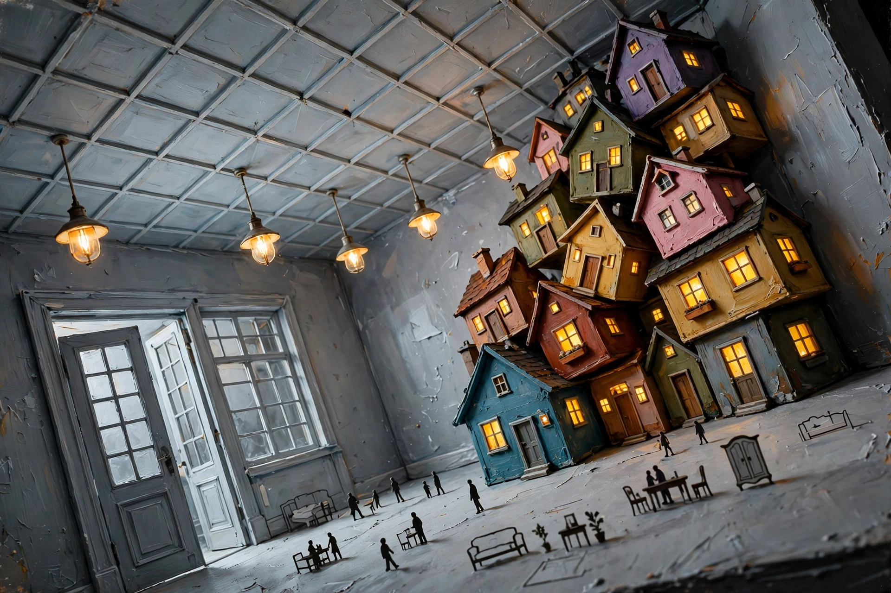
- v2 提示词原文：`Surreal interior scene, a cluster of colourful small houses tilted and stacked in ONE corner of a room only, their windows glowing warm yellow, a FEW tiny silhouetted figures at the base of the houses, plain grey walls with no large door or window on the left wall, pale square-grid ceiling with several hanging lamps, warm tones contrasting with cool grey indoor light, exaggerated tilted perspective, texture like a miniature model combined with oil painting, clear door and window lines on the small houses`
- v2 对比：左墙变干净素灰、小屋只在一角、几个人影只在屋基处，更接近“一角的簇”；代价是地面家具轮廓消失、小屋堆得更高更塔状，v1 的“地面家具轮廓 + 矮簇”反而更贴合原描述的地面细节。
- v2 图：
- 可复用规律：室内一角的堆叠要写“in ONE corner only + plain grey walls with no large door or window on the left wall”，只写“在一角”生成器仍会在另一面墙补门窗来填画面；地面小道具要单独写“furniture outlines on the floor”，否则收紧一角时会把地面道具一并收掉。

## 2 · Civitai · 雨夜小巷剪影男子

- 原链接：https://civitai.com/images/147031005
- 热度：反应 👍1026、❤️354、😂114、😢53，2026-10-28 上传
- 原图拆解：主体为男子全身剪影站在雨夜小巷中央，头戴鸭舌帽、穿长款外套与靴子，右手举至嘴边似在吸烟，烟头有微弱亮点；构图为小巷纵深、人物居中；光影为街灯暖光与冷色霓虹；色彩为暗部偏黑、暖冷对比；材质为湿润反光地面、雨夜颗粒；两侧为带霓虹灯箱的店铺与停放的车辆；面部因逆光剪影不可见，皮肤与手部细节未确认。
- v1 提示词原文：`Night street photograph in a rainy alley, a man in full silhouette standing in the centre, wearing a baseball cap, long coat and boots, right hand raised to his mouth as if smoking, a faint glowing cigarette tip, neon shop signs on both sides and parked vehicles, wet ground with reflections, visible film grain, dark shadows, warm street-lamp light against cold neon light, damp gloomy atmosphere`
  - 中文解析：雨夜小巷夜景照片 + 中央全身剪影男子 + 鸭舌帽长外套靴子 + 右手举至嘴边似吸烟 + 烟头微弱亮点 + 两侧霓虹店铺与停放车辆 + 湿润反光地面 + 可见颗粒 + 暗阴影 + 暖街灯对冷霓虹 + 潮湿阴郁氛围。
- v1 对比：像在中央剪影男子、鸭舌帽长外套、举手至嘴、两侧霓虹、湿润反光地面、雨与颗粒；偏在面部侧面轮廓隐约可见、霓虹自加了可读文字（RAMEN、LIQUOR 等），还多了摩托车；丢了“面部全黑、霓虹只作光晕”的纯剪影感。
- v1 图：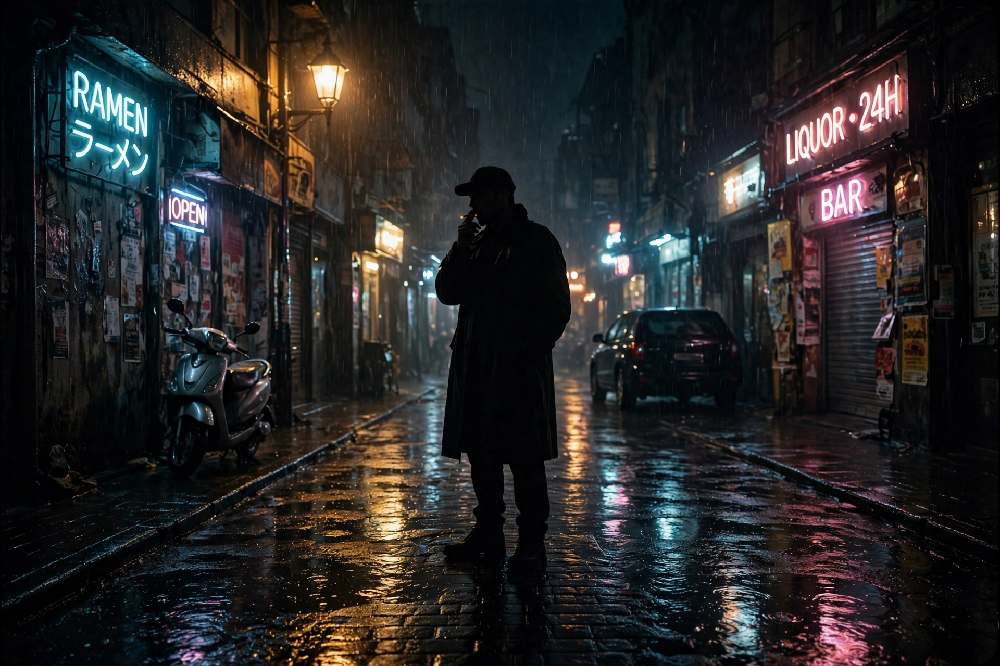
- v2 提示词原文：`Night street photograph in a rainy alley, a man as a COMPLETELY black silhouette standing in the centre, face fully in shadow with no visible features, wearing a baseball cap, long coat and boots, right hand raised to his mouth as if smoking, only a faint glowing cigarette tip as light on his hand, neon glow from shop signs on both sides with no legible words, parked vehicles, wet ground with reflections, visible film grain, dark shadows, warm street-lamp light against cold neon light, damp gloomy atmosphere`
- v2 对比：面部变全黑、只有烟头一点亮光、人物更纯剪影，更接近描述；代价是两侧霓虹变粉紫主调、车辆更近更抢眼、巷子纵深感变弱，v1 的“暖街灯 + 深巷纵深”反而更有雨夜小巷感。
- v2 图：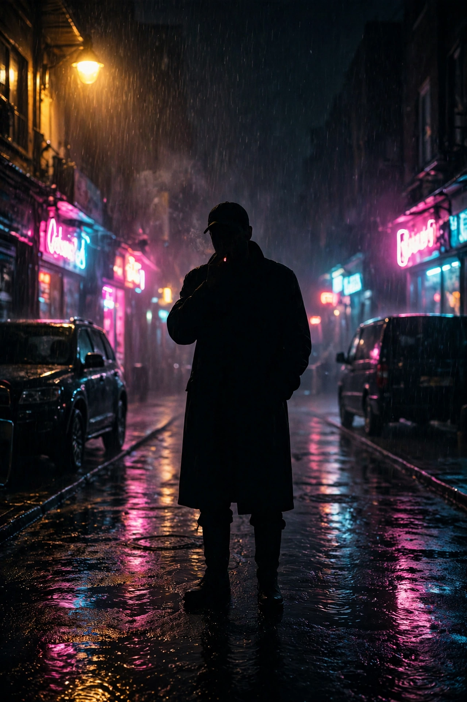
- 可复用规律：纯剪影要写“COMPLETELY black silhouette + face fully in shadow with no visible features”，只写“剪影”生成器仍会给侧脸留光；霓虹要写“neon glow with no legible words”，否则它会用可读招牌文字来填两侧店铺。

## 3 · Civitai · 刺绣玩偶风恐怖少年

- 原链接：https://civitai.com/images/147083617
- 热度：反应 👍980、❤️319、😂133、😢61，2026-10-28 上传；Master Generators 第 3 名
- 原图拆解：主体为刺绣/玩偶风恐怖少年全身像，戴红色棒球帽、穿黄白条纹短袖、蓝色短裤与红色运动鞋；构图为全身居中；光影为柔和正面光；色彩为红帽、黄白条纹、蓝短裤、红鞋对深色背景；材质为布偶质感、接缝与针脚清晰；面部为眼睛圆睁、嘴角上扬成诡异笑容；背景为深色圆形花纹图案，地面为粉色并散落小锥体。
- v1 提示词原文：`Embroidered cloth-doll horror boy, full body, wearing a red baseball cap, yellow and white striped short-sleeve shirt, blue shorts and red sneakers, cloth doll texture with clear seams and stitches, wide round eyes and an eerie upturned smile, dark background with circular patterns, pink ground scattered with small cones, strong colour contrast, creepy yet childlike`
  - 中文解析：刺绣布偶恐怖少年 + 全身 + 红棒球帽 + 黄白条纹短袖 + 蓝短裤红运动鞋 + 布偶质感接缝针脚清晰 + 圆睁大眼诡异上扬笑 + 深色圆形花纹背景 + 粉色地面散落小锥体 + 强色彩对比 + 恐怖中带童趣。
- v1 对比：像在红帽、黄白条纹、蓝短裤红鞋、布面针脚、圆睁大眼、缝线笑容、深色圆形背景、粉色地面小锥体；偏在头部比例过大、眼睛为巨大的纽扣白眼、地面锥体密而多；丢了“全身比例正常、锥体只是点缀”的克制。
- v1 图：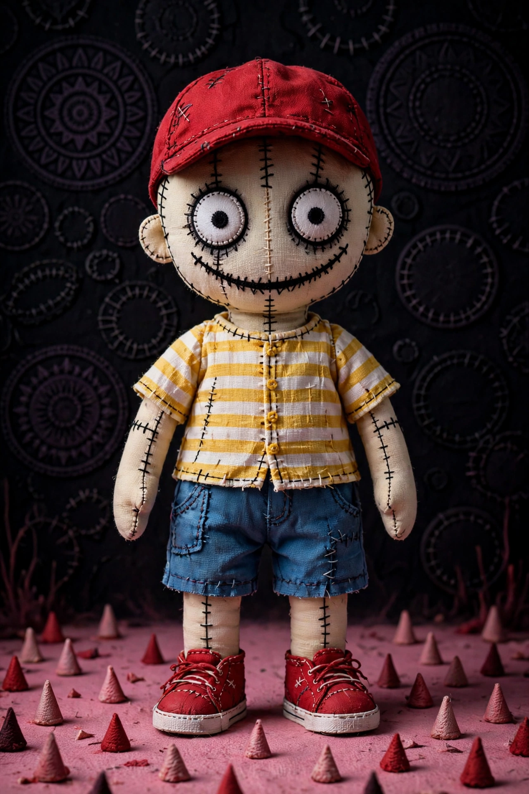
- v2 提示词原文：`Embroidered cloth-doll horror boy, full body standing with a SMALLER head relative to his body, wearing a red baseball cap, yellow and white striped short-sleeve shirt, blue shorts and red sneakers, cloth doll texture with clear seams and stitches, smaller round eyes and an eerie upturned smile, arms at his sides, dark background with circular patterns, pink ground with only a FEW small cones scattered, strong colour contrast, creepy yet childlike`
- v2 对比：头部变小、眼睛变小变黑、地面只剩几只橙色小锥，更接近“全身比例 + 点缀锥体”；代价是眼睛失去 v1 的纽扣白眼冲击力、面部更像普通布娃娃，v1 的“大白眼 + 密锥”反而更有恐怖海报感。
- v2 图：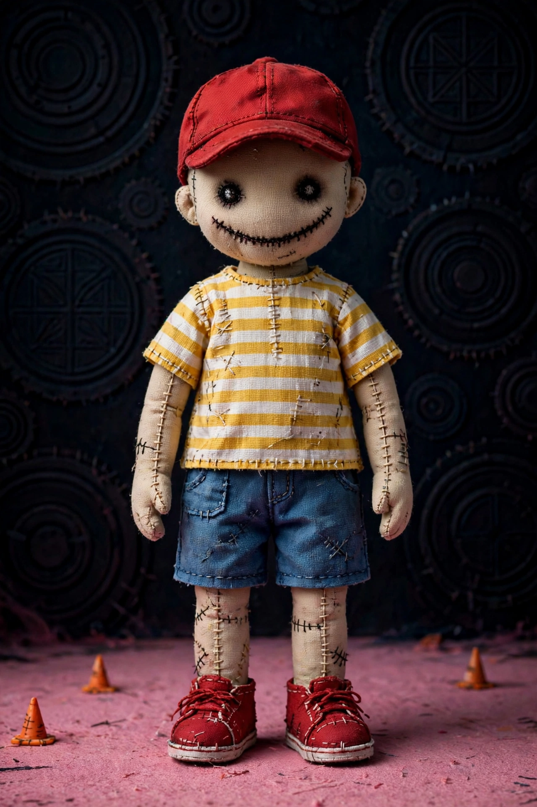
- 可复用规律：玩偶全身比例要写“SMALLER head relative to his body”，只写“全身”生成器默认把头推大；地面点缀要写“only a FEW small cones”，否则它会用密铺锥体来填粉色地面。

## 4 · Civitai · 写实女性肖像（写实人物）

- 原链接：https://civitai.com/images/147533640
- 热度：反应 👍322、❤️111、😂17、😢5，2026-11-01 上传
- 原图拆解：主体为写实女性肖像，面部可见并直视镜头，红褐色卷发、白色头巾、肩部裸露、穿白色亚麻质感露肩服装并以手扶于胸前；构图为近景肖像；光影为侧向暖光塑造面部立体感；色彩为红褐发、白头巾、深色背景；材质为亚麻、卷发；风格为写实照片。写实要素：鼻梁与两颊有明显雀斑，皮肤纹理与雀斑为主要真实感来源，绿灰色眼睛、唇色自然，卷发边缘有飞散发丝；画面外围有新艺术风格装饰边框，背景深色带雾气并虚化。眼神光、毛孔、眼角细纹在预览中不明显，记未确认；镜头焦段数值页面未标注，景深表现为背景虚化，颗粒与噪点未确认。
- AI 破绽对照：本类最容易破绽是皮肤偏滑、面部过对称；原图用“雀斑 + 飞散卷发 + 不对称发量”削弱塑料感，但眼神光与毛孔在预览中未确认，不能写成已验证的真实感证据。
- v1 提示词原文：`Photorealistic portrait of a woman looking directly at the camera, reddish-brown curly hair, white headscarf, bare shoulders, white linen off-shoulder garment, one hand resting at her chest, clear freckles across nose and cheeks, grey-green eyes, natural lip colour, flyaway curls at the edges of her hair, an Art Nouveau decorative border around the frame, dark misty blurred background, warm side light shaping her face, realistic skin texture with pores and slight imperfections, candid, no retouching look`
  - 中文解析：写实肖像 + 女性直视镜头 + 红褐卷发 + 白头巾 + 裸肩 + 白亚麻露肩服装 + 手扶胸前 + 鼻颊清晰雀斑 + 绿灰眼 + 自然唇色 + 发边飞散卷发 + 新艺术装饰边框 + 深色雾气虚化背景 + 暖侧光塑形 + 毛孔小瑕疵真实皮肤 + 抓拍 + 无修图感。
- v1 对比：像在红褐卷发、白头巾、裸肩白亚麻、手扶胸前、鼻颊雀斑、绿灰眼、新艺术边框、深色虚化背景；偏在头发过于蓬松、唇微张；丢了“发量收敛、唇自然闭合”的克制。
- v1 图：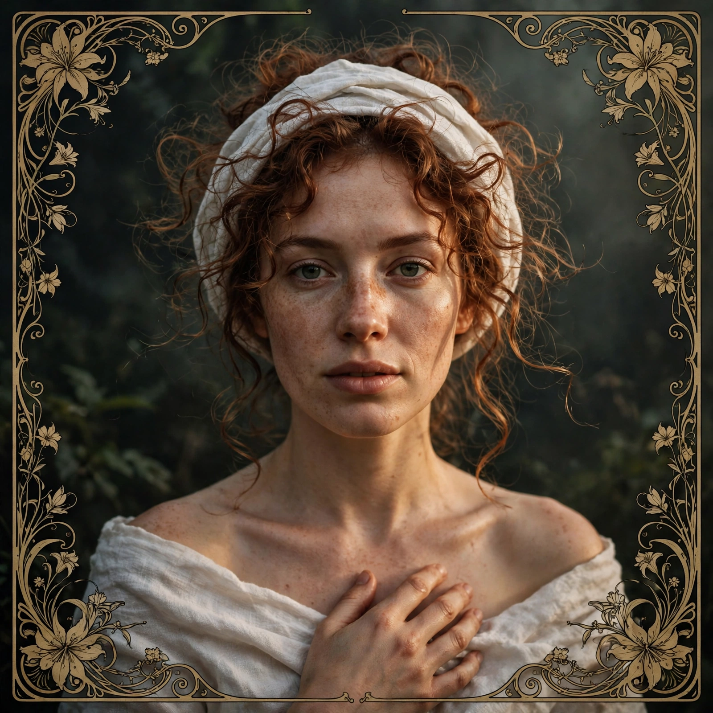
- v2 提示词原文：`Photorealistic portrait of a woman looking directly at the camera, reddish-brown curly hair with a FEW flyaway curls only, not voluminous, white headscarf, bare shoulders, white linen off-shoulder garment, one hand resting at her chest, clear freckles across nose and cheeks, grey-green eyes with clear catchlights, lips closed with natural colour, an Art Nouveau decorative border around the frame, dark misty blurred background, warm side light shaping her face, realistic skin texture with pores and slight imperfections, candid, no retouching look`
- v2 对比：发量收敛、只剩几缕飞散卷发、唇闭合自然、边框变细，更接近描述；代价是背景雾气变弱、手的位置下移、面部更偏向一侧，v1 的“手扶胸前 + 深雾背景”反而更完整。
- v2 图：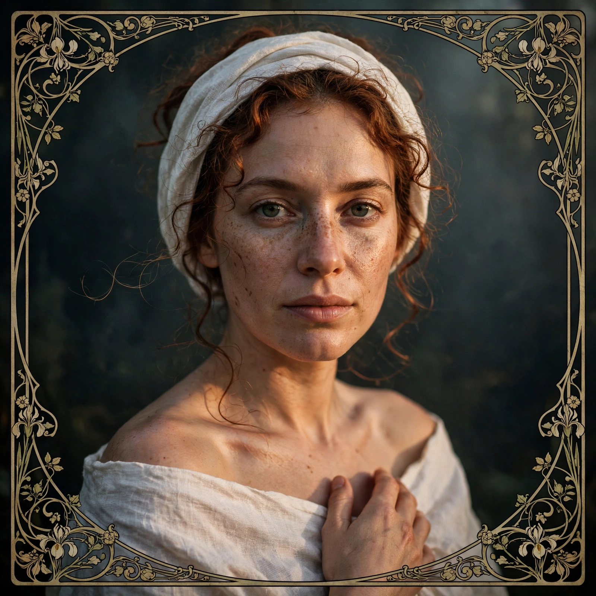
- 可复用规律：写实卷发要写“a FEW flyaway curls only, not voluminous”，只写“飞散发丝”生成器会把头发推成蓬松头套；唇要写“lips closed”，只写“自然唇色”它常画成微张唇。

## 5 · NightCafe · 彩绘玻璃热气球群

- 原链接：https://creator.nightcafe.studio/creation/EaI1y7t0CyuiusazCnBY
- 热度：点赞 705、收藏 16、评论 212，2026-11-02 发布；Daily Winner（Daily Challenge #1479）
- 原图拆解：主体为夜空彩绘玻璃热气球群，前景一只巨大热气球球囊为牡丹与鸢尾花纹的彩绘玻璃，红、桃红、紫、蓝、黄色块分明，边缘有黑色铅条；构图为前景大球囊、中景数只小气球、远景风景；光影为夜空与暖色灯光；色彩为高饱和彩绘玻璃色；材质为玻璃透光感；中景气球吊篮中有剪影人物，远景为满月、城堡、河流、石桥与瀑布，暖色灯光点缀。
- v1 提示词原文：`Dreamy night scene of stained-glass hot air balloons, one huge balloon in the foreground whose envelope is stained glass with peony and iris patterns in red, magenta, purple, blue and yellow panels outlined with black lead lines, several smaller stained-glass balloons in the middle distance with silhouetted figures in their baskets, full moon, a castle, a river, a stone bridge and a waterfall in the far distance, warm lights scattered, saturated colours, glowing glass translucency`
  - 中文解析：梦幻夜景彩绘玻璃热气球 + 前景巨大球囊牡丹鸢尾花纹 + 红桃红紫蓝黄色块黑铅条 + 中景数只小气球吊篮剪影人物 + 远景满月城堡河流石桥瀑布 + 暖色灯光点缀 + 高饱和 + 玻璃透光感。
- v1 对比：像在前景巨大牡丹鸢尾彩绘球囊、黑铅条、多个中景气球、满月城堡河流石桥瀑布、暖灯点缀；偏在前景球囊过大、顶部略出画、中景气球多达 5 只；丢了“前景球囊完整入画、中景气球数量克制”的层级。
- v1 图：
- v2 提示词原文：`Dreamy night scene of stained-glass hot air balloons, ONE huge balloon fully in frame in the foreground whose envelope is stained glass with peony and iris patterns in red, magenta, purple, blue and yellow panels outlined with black lead lines, only THREE smaller stained-glass balloons in the middle distance with silhouetted figures in their baskets, full moon, a castle, a river, a stone bridge and a waterfall in the far distance, warm lights scattered, saturated colours, glowing glass translucency`
- v2 对比：前景球囊完整入画、吊篮可见、中景只剩 3 只、城堡河流石桥瀑布更清晰，更接近层级；代价是前景球囊花纹变竖条色带、牡丹鸢尾细节变弱，v1 的“大花纹面板”反而更贴合原描述的花纹感。
- v2 图：
- 可复用规律：前景巨物要写“fully in frame + only THREE smaller balloons”，只写“前景巨大、中景数只”生成器会把前景裁出画并用一群小气球填满天空；花纹要写花名加色块，否则收紧数量时会把花纹简化成色带。

## 6 · NightCafe · 水墨暹罗小猫

- 原链接：https://creator.nightcafe.studio/creation/GmPmcbkVMxZK3OZ2PIjz
- 热度：点赞 617、收藏 25、评论 130，2026-11-02 发布
- 原图拆解：主体为极简水墨风暹罗小猫，身体前倾、尾巴上翘、前爪伸出似扑玩，头部微倾、眼睛圆大、耳朵尖立；构图为右侧小猫、左侧大面积留白；光影为纸面平光；色彩为米色纸面与黑色墨色；材质为米色粗糙纸纹、黑色墨色线条与色块；风格为宣纸水墨与速写结合，笔触干涩飞白。
- v1 提示词原文：`Minimalist ink-wash painting of a Siamese kitten on coarse beige paper texture, the cat drawn in black ink lines and ink blocks, body leaning forward, tail raised, front paw reaching out as if pouncing, head slightly tilted, round large eyes, pointed ears upright, lots of empty white space, dry brush with flying-white strokes, texture like rice paper ink and quick sketch combined`
  - 中文解析：极简水墨 + 暹罗小猫 + 米色粗糙纸纹 + 黑墨线条色块 + 身体前倾 + 尾巴上翘 + 前爪伸出似扑玩 + 头微倾 + 圆大眼 + 尖立耳 + 大面积留白 + 干笔飞白 + 宣纸水墨速写结合。
- v1 对比：像在右侧小猫、米色纸纹、黑墨线条、前倾扑玩姿态、圆大眼尖耳、左侧大面积留白、干笔飞白；偏在小猫偏右下偏小、尾巴带爆炸式飞溅墨迹；丢了“小猫体量稍大、尾巴只是一条上翘曲线”的干净。
- v1 图：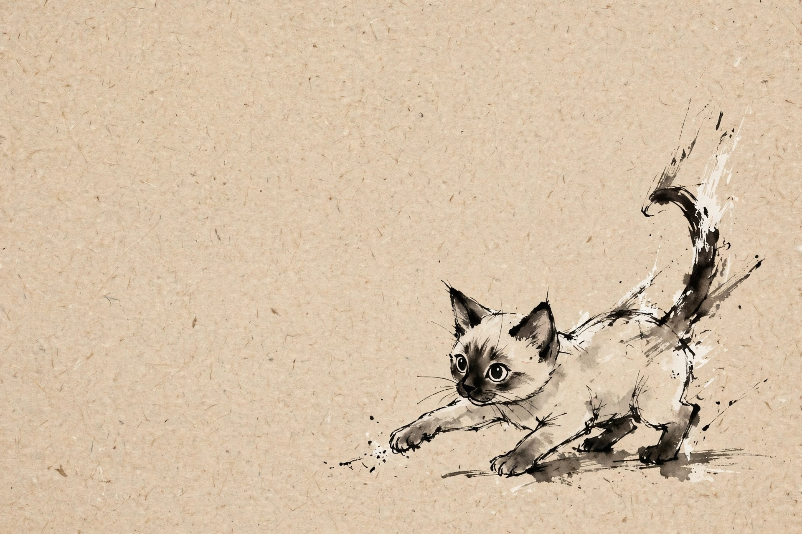
- v2 提示词原文：`Minimalist ink-wash painting of a Siamese kitten on coarse beige paper texture, the cat drawn in black ink lines and ink blocks, slightly LARGER in the frame but still with lots of empty white space on the left, body leaning forward, tail raised without explosive splashes, front paw reaching out as if pouncing, head slightly tilted, round large eyes, pointed ears upright, dry brush with flying-white strokes, texture like rice paper ink and quick sketch combined`
- v2 对比：小猫变大、尾巴变干净上翘曲线、留白仍在左侧，更接近描述；代价是猫身更横向拉长、头部更正面，v1 的“侧身扑玩 + 飞溅动感”反而更有扑玩瞬间感。
- v2 图：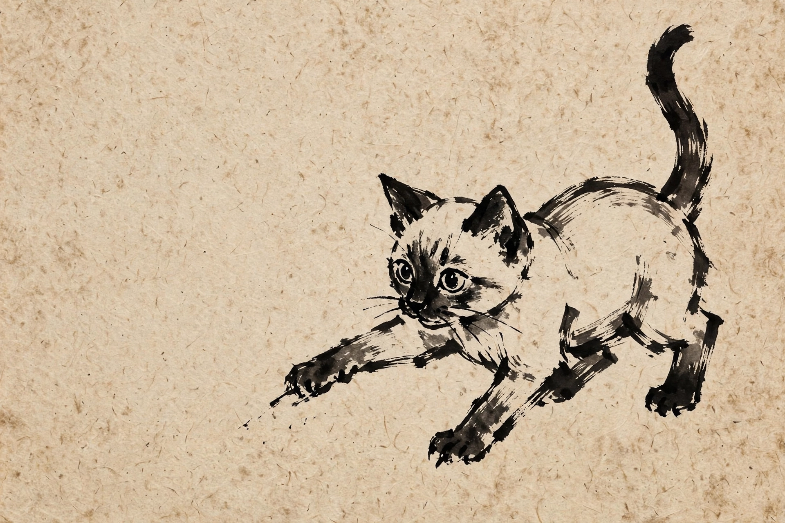
- 可复用规律：水墨留白动物要写“slightly LARGER but still with lots of empty white space on the left + tail raised without explosive splashes”，只写“留白极多”生成器会把动物缩到角落并用飞溅墨迹填补动感。

## 7 · NightCafe · 万圣节墓园木乃伊与黑猫

- 原链接：https://creator.nightcafe.studio/creation/8D3ecK2QcEnU7Hk98c0F
- 热度：点赞 625、收藏 13、评论 165，2026-11-01 发布；Daily Challenge #1478 Happy Halloween，Daily 5%
- 原图拆解（以热门页缩略图为准，详情页大图当时未加载完成）：主体为万圣节墓园场景，木乃伊式人物全身裹着松散绷带、绷带向外飘散，肩头趴着一只黑猫并伸爪；构图为人物居中、墓园环绕；光影为暖橙色灯光为主调；色彩为暖橙对暗夜；材质为绷带、墓碑、枯树；周围有橙色南瓜、墓碑、枯树与飘落秋叶；面部因绷带包裹、细节未确认。
- v1 提示词原文：`Halloween graveyard scene, a mummy-like figure fully wrapped in loose bandages with bandage ends drifting outward, a black cat lying on its shoulder reaching out a paw, orange pumpkins, tombstones, dead trees and falling autumn leaves around, warm orange lighting as the main tone, spooky festive atmosphere`
  - 中文解析：万圣节墓园 + 木乃伊全身松散绷带 + 绷带向外飘散 + 肩头黑猫伸爪 + 橙色南瓜 + 墓碑 + 枯树 + 飘落秋叶 + 暖橙主调 + 阴森节日氛围。
- v1 对比：像在中央木乃伊、松散飘散绷带、肩头黑猫伸爪、南瓜墓碑枯树秋叶、暖橙主调；偏在自加了墓碑上的可读文字（1804 R.I.P.、REST 1799）与发光南瓜灯笑脸，猫身横跨双肩；丢了“墓碑无文字、猫只在一肩、南瓜只是橙色点缀”的克制。
- v1 图：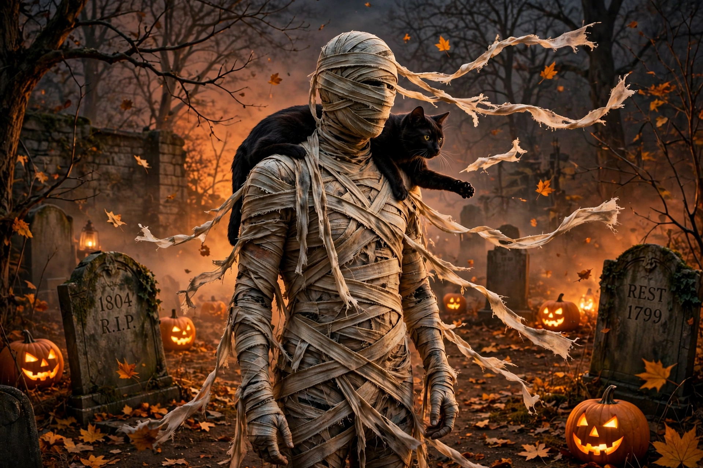
- v2 提示词原文：`Halloween graveyard scene, a mummy-like figure fully wrapped in loose bandages with bandage ends drifting outward, ONE small black cat lying on ONE shoulder only reaching out a paw, orange pumpkins, tombstones with no legible words, dead trees and falling autumn leaves around, warm orange lighting as the main tone, spooky festive atmosphere`
- v2 对比：猫变小且只在一肩、墓碑无文字，更接近克制版描述；代价是南瓜变普通无灯橙南瓜、墓园更雾化，v1 的“发光南瓜灯 + 清晰墓碑”反而更有万圣节墓园感。
- v2 图：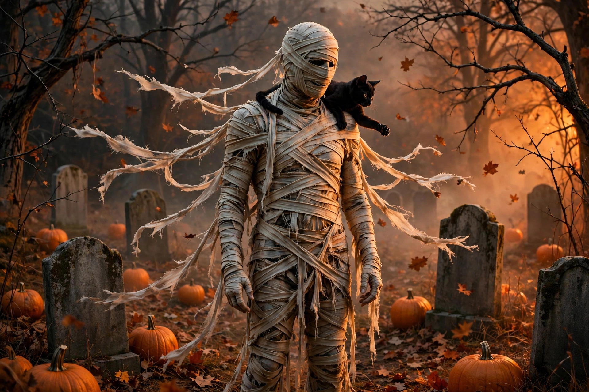
- 可复用规律：墓园配角要写“ONE small cat on ONE shoulder only + tombstones with no legible words”，只写“肩头黑猫、墓碑”生成器会把猫拉成横跨双肩并给墓碑刻字；南瓜灯要单独写“lit jack-o-lanterns”，否则“橙色南瓜”会被画成普通南瓜。

## 8 · SeaArt · 粉发少女与星空巨物对峙

- 原链接：https://www.seaart.ai/postDetail/daf00fde878c738ek1a0
- 热度：页面显示 1.5K、579、浏览 145、评论 30，2026-09-07 发布；第二项图标页面未用文字标注名称，不编造
- 原图拆解：主体为动漫风粉发少女穿白裙、红围巾与红包、棕色长靴，站在狭窄街道上回头面对一只高大的半透明异世界生物；构图为人物与巨物对峙、纵深感强；光影为白天明亮光线；色彩为粉发白裙红围巾对彩色星云；材质为动漫插画、星云触手；生物头部为黑色星空质感、眼睛发光，身体为彩色星云与触手状结构；街道地面湿润反光、纸张飞舞。
- v1 提示词原文：`Anime illustration, a pink-haired girl in a white dress, red scarf, red bag and brown long boots standing in a narrow street, turning back to face a tall translucent otherworldly creature whose head is black starry texture with glowing eyes and whose body is colourful nebula and tentacle-like structures, wet reflective street ground, papers flying in the air, bright daylight, strong depth as the girl confronts the giant creature`
  - 中文解析：动漫插画 + 粉发少女白裙红围巾红包棕长靴 + 狭窄街道 + 回头面对高大半透明异世界生物 + 黑色星空头部发光眼 + 彩色星云触手身体 + 湿润反光地面 + 纸张飞舞 + 白天明亮光 + 人物与巨物对峙纵深。
- v1 对比：像在粉发少女、白裙红围巾红包棕靴、星空头部发光眼、彩色星云触手、湿润反光地面、纸张飞舞、明亮白天；偏在少女自加了双麻花辫、街道变宽、巨物占据右上大半；丢了“少女只是回头对峙、街道狭窄、巨物半透明而非实体压顶”的比例。
- v1 图：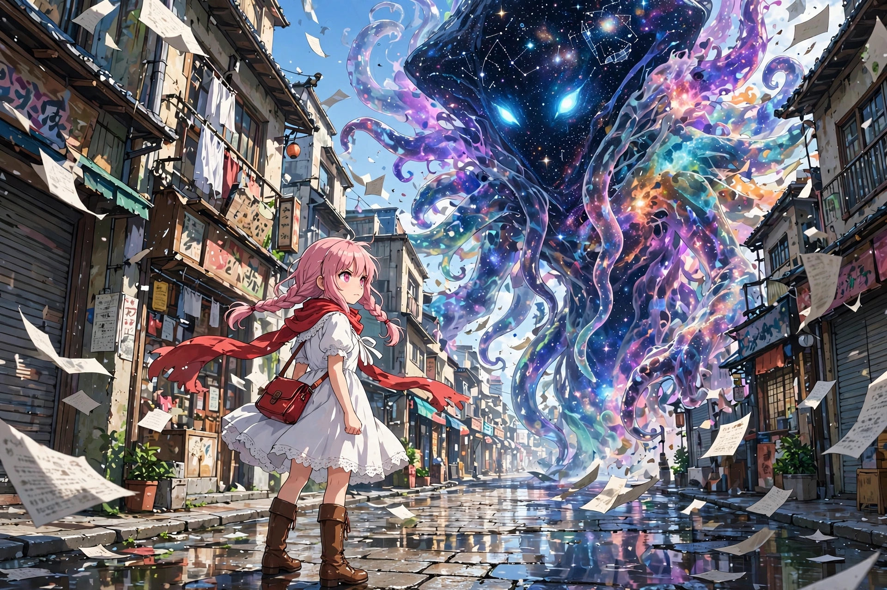
- v2 提示词原文：`Anime illustration, a pink-haired girl with simple long pink hair, wearing a white dress, red scarf, red bag and brown long boots, standing in a NARROW street, turning back to face a tall TRANSLUCENT otherworldly creature whose head is black starry texture with glowing eyes and whose body is colourful nebula and tentacle-like structures, the girl SMALL compared with the giant creature, wet reflective street ground, papers flying in the air, bright daylight, strong depth as the girl confronts the giant creature`
- v2 对比：少女变简单长发、体量变小、街道变窄、巨物更半透明，更接近对峙比例；代价是少女变侧面行走姿态、对峙感变弱，v1 的“回头正面对峙”反而更直接。
- v2 图：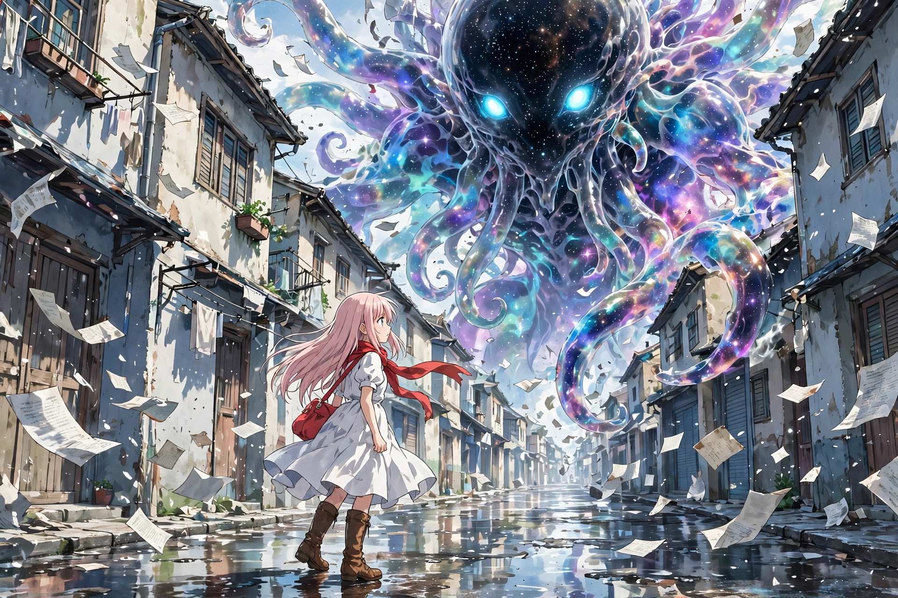
- 可复用规律：人与巨物对峙要写“simple long hair + girl SMALL compared with the giant creature + NARROW street”，只写“粉发少女面对巨物”生成器会给少女加辫子、把街道拉宽、把巨物画成实体压顶；半透明要大写“TRANSLUCENT”，否则星云身体会被画成实色怪物。

## 9 · SeaArt · 燃烧战场女骑士

- 原链接：https://www.seaart.ai/postDetail/d9sh9vle878c739nhau0
- 热度：页面显示 1.4K、544、浏览 200、评论 2，2026-08-10 发布
- 原图拆解：主体为奇幻战场黑发女骑士全身银色板甲、红披风飞扬，高举长剑，站在燃烧的战场中央；构图为低角度仰拍、人物居中突出；光影为落日暖光与火焰；色彩为火橙与灰黑对比；材质为铠甲反光与金属质感；背景为残破拱门、浓烟与落日暖光，远景有士兵与火焰。
- v1 提示词原文：`Fantasy battlefield, a black-haired woman knight in full silver plate armour with a red cloak flying, raising a long sword high, standing in the centre of a burning battlefield, ruined arches, thick smoke and warm sunset light behind her, distant soldiers and flames, clear metallic reflections on the armour, low-angle view looking up, the knight centred and prominent, fiery orange against grey-black colours`
  - 中文解析：奇幻战场 + 黑发女骑士全身银板甲 + 红披风飞扬 + 高举长剑 + 燃烧战场中央 + 残破拱门浓烟落日暖光 + 远景士兵火焰 + 铠甲金属反光 + 低角度仰拍 + 人物居中突出 + 火橙对灰黑。
- v1 对比：像在银板甲、红披风、长剑高举、残破拱门、浓烟落日、远景士兵火焰、火橙灰黑；偏在长剑为斜向高举、红披风在左侧铺开过大；丢了“长剑竖直高举、披风在身后”的利落。
- v1 图：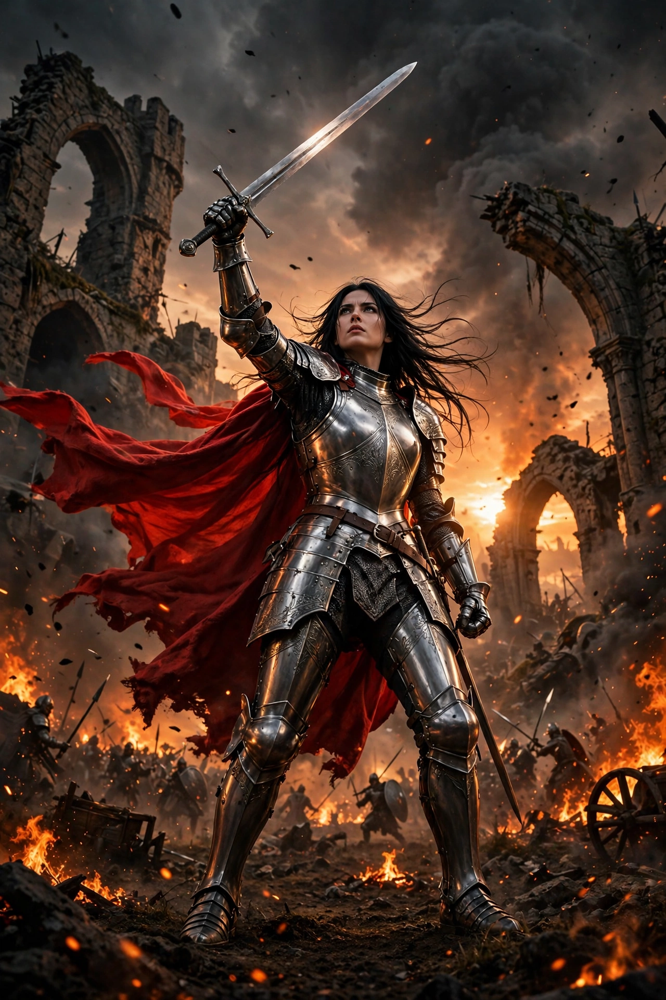
- v2 提示词原文：`Fantasy battlefield, a black-haired woman knight in full silver plate armour with a red cloak flowing BEHIND her, raising a long sword VERTICALLY high above her head with one hand, standing in the centre of a burning battlefield, ruined arches, thick smoke and warm sunset light behind her, distant soldiers and flames, clear metallic reflections on the armour, low-angle view looking up, the knight centred and prominent, fiery orange against grey-black colours`
- v2 对比：长剑变竖直高举、披风收回身后、中央拱门更突出，更接近利落的举剑姿态；代价是人物下半身被裁切、面部更正面，v1 的“全身骑士 + 斜剑动感”反而更完整。
- v2 图：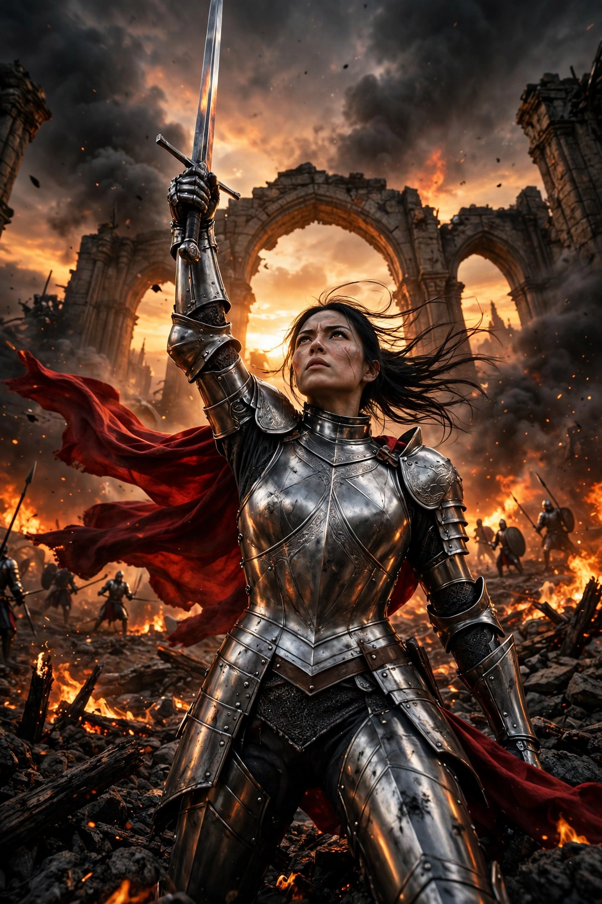
- 可复用规律：举剑姿态要写“raising a long sword VERTICALLY + cloak flowing BEHIND her”，只写“高举长剑、披风飞扬”生成器默认画斜剑与侧面铺开的大披风；全身要写“full body visible”，否则收紧姿态时会把下半身裁掉。

## 10 · PixAI · 哥特死神女性

- 原链接：https://pixai.art/artwork/2073338548770559862
- 热度：点赞 555（详情页）、评论 11，2026-11-01 发布
- 原图拆解：主体为哥特风死神女性，骨白色皮肤、淡紫灰色眼睛、瞳孔极小，戴黑色面纱、穿黑色长裙，胸前为骷髅骨骼结构，背后为骨质翅膀与黑玫瑰；构图为居中全身；光影为顶部聚光灯；色彩为骨白、金天平、黑裙对黑暗背景；材质为骨骼、面纱、黑玫瑰；一手持金色天平、一手靠近骷髅，周围有蜡烛与骷髅墙，画面上下有 MEMENTO MORI 哥特字体，氛围阴森华丽。
- v1 提示词原文：`Gothic illustration of a female death figure, bone-white skin, pale lavender-grey eyes with tiny pupils, black veil, long black dress, skeletal ribcage structure on her chest, bony wings and black roses behind her, one hand holding a golden scale and the other near a skull, candles and a wall of skulls around, gothic MEMENTO MORI lettering at top and bottom, a spotlight from above on the figure, dark background, sinister luxurious atmosphere`
  - 中文解析：哥特插画 + 死神女性 + 骨白皮肤 + 淡紫灰眼极小瞳孔 + 黑面纱 + 黑长裙 + 胸前骷髅骨骼 + 骨质翅膀黑玫瑰 + 一手金天平一手近骷髅 + 蜡烛骷髅墙 + 上下 MEMENTO MORI 哥特字体 + 顶部聚光 + 黑暗背景 + 阴森华丽。
- v1 对比：像在骨白皮肤、黑面纱黑长裙、胸前骷髅、金天平、骷髅手、蜡烛骷髅墙、上下 MEMENTO MORI、顶部聚光、骨质翅膀黑玫瑰；偏在眼睛偏大偏紫、翅膀为网状翼膜、天平偏大；丢了“瞳孔极小、翅膀为骨架、配角天平偏小”的精确。
- v1 图：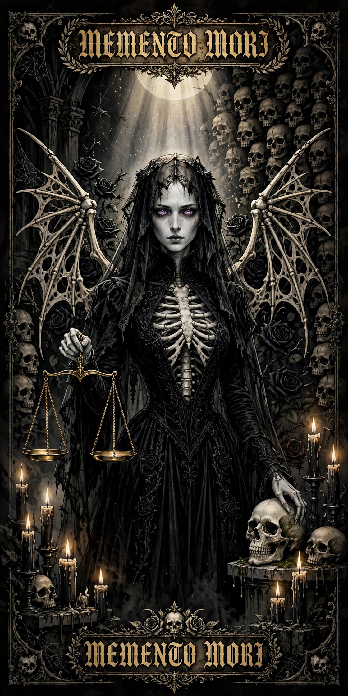
- v2 提示词原文：`Gothic illustration of a female death figure, bone-white skin, pale lavender-grey eyes with TINY pupils, black veil, long black dress, skeletal ribcage structure on her chest, bony wings held closer to her body and black roses behind her, one hand holding a SMALL golden scale and the other near a skull, candles and a wall of skulls around, gothic MEMENTO MORI lettering at top and bottom, a spotlight from above on the figure, dark background, sinister luxurious atmosphere`
- v2 对比：瞳孔变小变淡、天平变小、翅膀收回身侧成骨架长臂，更接近“极小瞳孔 + 小天平”；代价是眼睛变下视苍白、翅膀失去 v1 的翼膜张力，v1 的“直视 + 张开骨翼”反而更有死神压迫感。
- v2 图：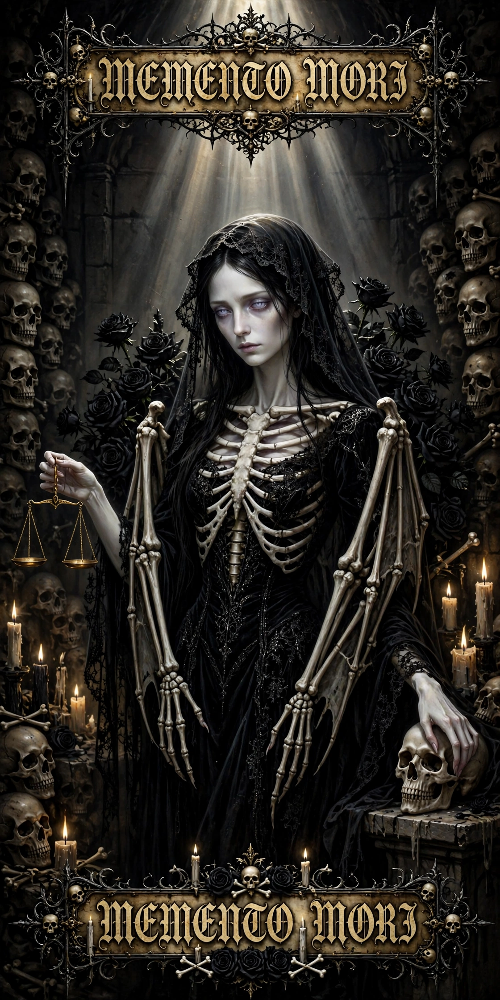
- 可复用规律：哥特配角与瞳孔要写“tiny pupils + SMALL golden scale + wings held closer to her body”，只写“极小瞳孔、金天平、骨翼”生成器会把眼睛画大、把天平推大、把翅膀张满画面；但收紧翅膀会削弱张力，要在“骨架”与“张开”之间二选一写清。

## 11 · PixAI · 万圣节木偶风初音未来胸像

- 原链接：https://pixai.art/artwork/2072756675267802567
- 热度：点赞 941、评论 21，2026-10-30 发布；Halloween Oddities Club 参赛作品
- 原图拆解：主体为万圣节木偶风初音未来胸像特写，蓝绿色双马尾、戴小骷髅帽，面色苍白、蓝绿色眼睛、露出不安笑容，穿红黑条纹袖、荷叶边领与深色领带，身体有提线木偶的关节与细线；构图为倾斜胸像特写；光影为戏剧性顶光与阴影；色彩为蓝绿发、苍白面、红黑条纹对暗红窗帘；画面带录像带式 REC 叠加与 00:57:22 时间码，背景为暗红窗帘，恐怖玩偶质感强。
- v1 提示词原文：`Halloween marionette-style bust portrait of a girl with teal twin-tails and a small skull hat, pale face, teal eyes, uneasy smile, red and black striped sleeves, frilled collar and dark tie, puppet joints and thin strings on her body, camcorder-style REC overlay and 00:57:22 timecode, dark red curtain background, tilted composition, dramatic top light and shadow, creepy doll texture`
  - 中文解析：万圣节木偶风胸像 + 蓝绿双马尾小骷髅帽 + 苍白面 + 蓝绿眼 + 不安笑容 + 红黑条纹袖 + 荷叶边领深色领带 + 木偶关节细线 + 录像带 REC 与 00:57:22 时间码 + 暗红窗帘 + 倾斜构图 + 戏剧顶光阴影 + 恐怖玩偶质感。
- v1 对比：像在蓝绿双马尾、小骷髅帽、苍白面、蓝绿眼、不安笑容、红黑条纹袖、荷叶边领深色领带、木偶关节细线、REC 与时间码、暗红窗帘；偏在面部为写实娃娃皮肤而非插画、细线多达 7 条以上、右下自加了 TAPE 文字；丢了“插画扁平感、细线克制、只有 REC 与时间码”的干净。
- v1 图：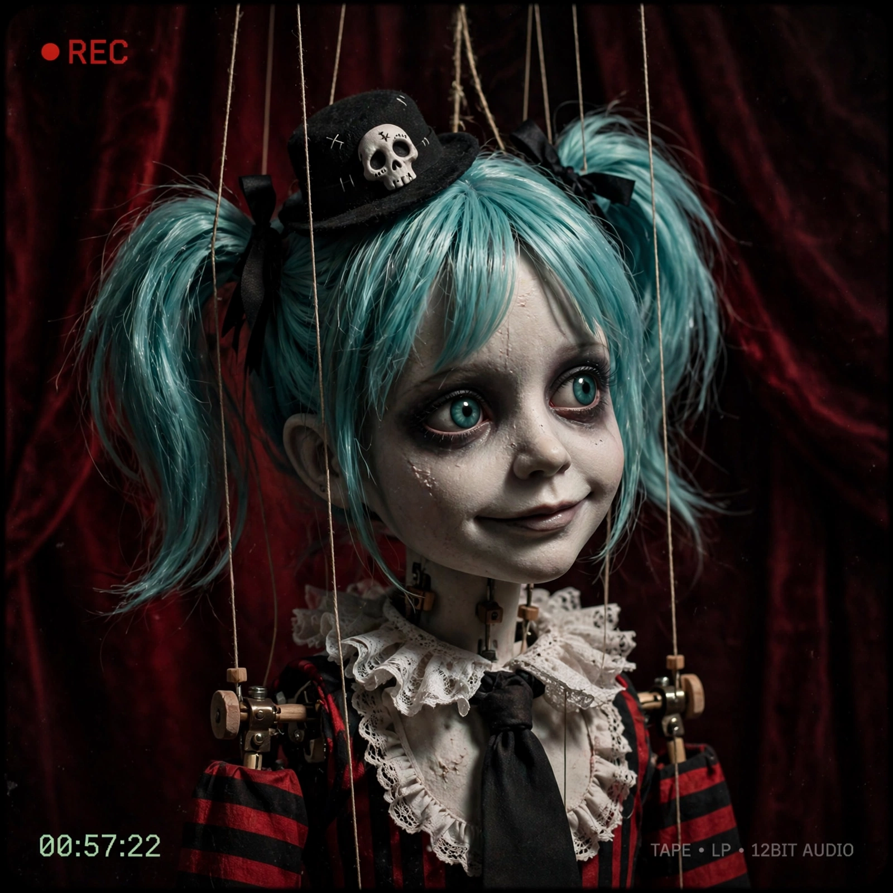
- v2 提示词原文：`Halloween marionette-style illustration bust portrait of a girl with teal twin-tails and a small skull hat, pale face, teal eyes, uneasy smile, red and black striped sleeves, frilled collar and dark tie, only FOUR thin puppet strings, camcorder-style REC overlay and 00:57:22 timecode only with no other on-screen text, dark red curtain background, tilted composition, dramatic top light and shadow, creepy doll texture, flat illustration shading not photorealistic skin`
  - 中文解析：万圣节木偶风插画胸像 + 蓝绿双马尾小骷髅帽 + 苍白面 + 蓝绿眼 + 不安笑容 + 红黑条纹袖 + 荷叶边领深色领带 + 只有 4 条细线 + 只有 REC 与时间码、无其他屏幕文字 + 暗红窗帘 + 倾斜构图 + 戏剧顶光阴影 + 恐怖玩偶质感 + 扁平插画阴影而非写实皮肤。
- v2 对比：变扁平插画、只有 REC 与时间码、面部裂纹与缝线更插画化，更接近“插画 + 干净叠加”；代价是面部变侧向、双眼大小不一、木偶感变卡通，v1 的“写实娃娃面 + 正面不安笑”反而更有恐怖玩偶冲击力。
- v2 图：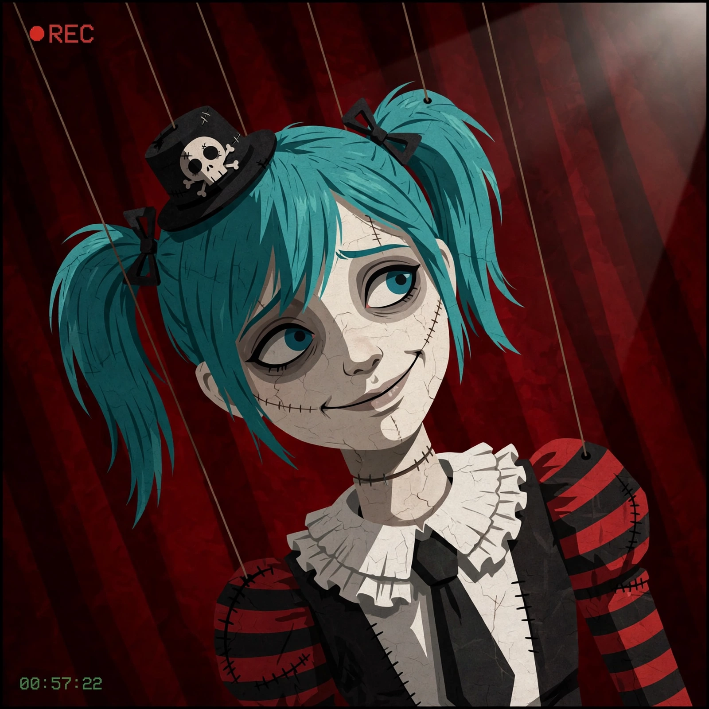
- 可复用规律：录像带叠加要写“REC and timecode only with no other on-screen text + only FOUR thin strings”，只写“REC 叠加、细线”生成器会自加 TAPE 等文字并拉满细线；插画与写实要写“flat illustration shading not photorealistic skin”，否则它默认把木偶画成写实娃娃照片。

## 12 · Reddit r/midjourney · 黑暗奇幻骷髅兜帽人物（未完成）

- 原链接：https://www.reddit.com/r/midjourney/comments/1xlyuah/so_real_surrealism/
- 热度：顶贴 219（详情页；列表页为 214）、评论 7，2026-11-02 22:35 GMT+8 发布；组图共 20 张，只选第 1 张
- 原图拆解：第 1 张为黑暗奇幻，高大骷髅状、兜帽长袍人物立于画面中央、手臂细长下垂，背景为红橙色烈焰天空与漂浮的石块，下方为哥特式拱门建筑，整体为 Beksinski 式超现实、阴暗压抑，笔触厚重、光影对比强烈。
- v1 提示词原文（已尝试生成，但未返回图片）：`Dark surreal fantasy in the style of Beksinski, a tall skeletal hooded robed figure standing in the centre with long thin arms hanging down, red-orange blazing sky and floating rocks behind, gothic arched architecture below, heavy brushwork, strong light and shadow contrast, dark oppressive atmosphere`
- v1 对比：未完成——v1 生成未能返回图片，本报告不以无关图片代替，v1 图缺失。
- v2 提示词原文：未尝试——因 v1 缺失且不重复已失败的生成请求，本期不再为第 12 张补 v2，v2 图缺失。
- 可复用规律：本条无 v1、v2 对照可提炼；仅记录一条流程规律：组图帖只选第 1 张时，报告必须写清“只选第 1 张”，否则读者会把组图其余 19 张的特征误读为第 1 张的特征。

## 13 · Reddit r/aiArt · 印象派幽默人像：猫抓老人

- 原链接：https://www.reddit.com/r/aiArt/comments/1xlvuvl/clawed_monet/
- 热度：顶贴 141、评论 9，2026-11-02 20:28 GMT+8 发布；标签 Image - ChatGPT
- 原图拆解：主体为印象派幽默人像，白须老者戴草帽、穿破旧灰蓝外套，坐在睡莲池边；构图为老人与猫在右侧、池塘与小桥在左侧；光影为日光光斑；色彩为灰蓝外套、粉色花丛、绿柳；材质为松散笔触；背景为日式小桥、柳树与粉色花丛；一只虎斑猫以后腿站立、前爪抓挠老人胸口，老人手臂有抓痕、表情似笑似痛；面部可见但为油画风格、非照片写实。
- v1 提示词原文：`Impressionist oil painting with humour, a white-bearded old man wearing a straw hat and a worn grey-blue coat sitting beside a water-lily pond, a Japanese-style small bridge, willow trees and pink flower bushes in the background, a tabby cat standing on its hind legs scratching the old man's chest with its front paws, scratch marks on the old man's arm, the old man with a pained smile expression, loose brushstrokes, sparkling light spots`
  - 中文解析：印象派油画幽默 + 白须老者草帽破旧灰蓝外套 + 睡莲池边 + 日式小桥柳树粉色花丛 + 虎斑猫后腿站立前爪抓挠老人胸口 + 老人手臂抓痕 + 似笑似痛表情 + 松散笔触 + 闪烁光斑。
- v1 对比：像在白须老者、草帽、灰蓝外套、睡莲池、日式小桥、柳树粉花、虎斑猫后腿站立抓胸口、手臂抓痕、似笑似痛；偏在猫体量过大、光斑被画成满屏闪烁星星；丢了“猫只是点缀、光斑只是松散笔触里的光点”的克制。
- v1 图：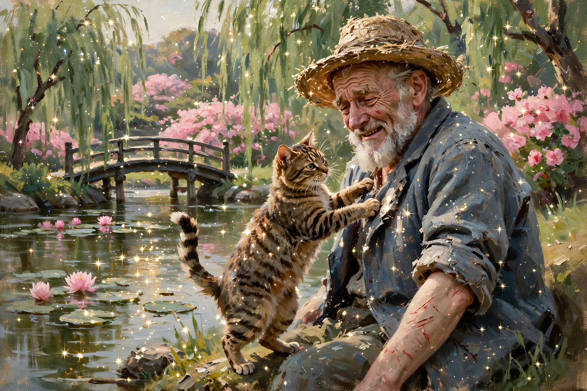
- v2 提示词原文（已尝试生成，但未返回图片）：`Impressionist oil painting with humour and NO sparkling stars, a white-bearded old man wearing a straw hat and a worn grey-blue coat sitting beside a water-lily pond, a Japanese-style small bridge, willow trees and pink flower bushes in the background, a SMALLER tabby cat standing on its hind legs scratching the old man's chest with its front paws, scratch marks on the old man's arm, the old man with a pained smile expression, loose matte brushstrokes, soft dappled light`
- v2 对比：未完成——v2 生成未能返回图片，本报告不以无关图片代替，v2 图缺失；v1 的“猫过大、星星光斑”问题因此在本期未得到修正验证。
- 可复用规律：印象派光斑要写“soft dappled light”而不要写“sparkling light spots”，后者会被画成满屏星星；猫的体量要写“SMALLER cat”，否则“后腿站立抓胸口”会把猫推成与老人等大的主角。

## 14 · PromptHero · 写实意大利男子（写实人物）

- 原链接：https://prompthero.com/prompt/869df0f4100-flux-flux-3-a-masterpiece-cinematic-color-photo-of-a-34-year-old-muscular-italian-man-with-gritty-masculine-and-intense-gaze-sharp
- 热度：浏览 1.8k、收藏 6、评论 0，2026-10-06 发布
- 原图拆解（以热门页缩略图与页面提示词文本为准，详情页大图当时未加载完成）：主体为写实男子照片，面部可见、目光锐利直视镜头，穿黑色皮夹克、白衬衫敞开，胸前与颈部有纹身，身后有狗与石质建筑；构图为近景肖像；光影为阴天自然光；色彩偏冷。写实要素：提示词称右颊有疤、留短须，缩略图未看清疤痕；皮肤毛孔、眼神光、发丝飞散、颗粒与噪点均未确认；镜头焦段数值页面未标注。
- AI 破绽对照：本类最容易破绽是皮肤偏滑、纹身过于工整、疤痕过于对称或戏剧化；原图提示词用“右颊疤 + 短须 + 纹身”作真实感线索，但疤痕在缩略图中未看清，不能写成已验证的细节；v1、v2 的疤痕与纹身均为重生成时的演绎，不是原图核对结果。
- v1 提示词原文：`Photorealistic cinematic colour photograph of a 34-year-old muscular Italian man with an intense gaze looking directly at the camera, short beard, a scar on his right cheek, black leather jacket over an open white shirt, tattoos on his chest and neck, a dog and stone buildings behind him, overcast natural daylight, cool colours, realistic skin texture with pores and slight imperfections, candid, 85mm lens, shallow depth of field, no retouching look`
  - 中文解析：写实电影感彩色照片 + 34 岁肌肉意大利男子 + 锐利目光直视 + 短须 + 右颊疤 + 黑皮夹克敞开白衬衫 + 胸颈纹身 + 身后狗与石质建筑 + 阴天自然光 + 冷色 + 毛孔小瑕疵真实皮肤 + 抓拍 + 85mm + 浅景深 + 无修图感。
- v1 对比：像在锐利直视、短须、右颊疤、黑皮夹克敞开白衬衫、胸颈纹身、身后狗与石质建筑、阴天冷色；偏在疤痕为长分叉伤疤、纹身为大面积带文字的 elaborate 图案；丢了“疤只是一道、纹身只是点缀”的克制。
- v1 图：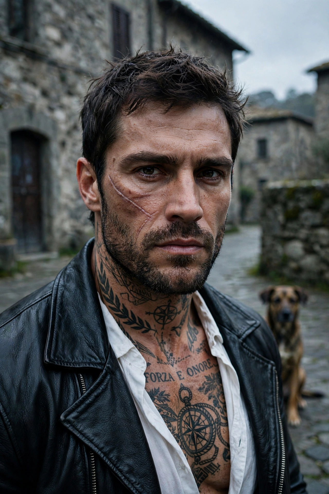
- v2 提示词原文：`Photorealistic cinematic colour photograph of a 34-year-old muscular Italian man with an intense gaze looking directly at the camera, short beard, ONE short thin scar on his right cheek only, black leather jacket over an open white shirt, a FEW simple tattoos on his neck and chest only with no legible words, a dog softly blurred behind him and stone buildings behind, overcast natural daylight, cool colours, realistic skin texture with pores and slight imperfections, candid, 85mm lens, shallow depth of field, no retouching look`
- v2 对比：疤痕变单条细线、纹身变颈部小记号与胸前小箭头圆点、狗变虚化金毛，更接近“单疤 + 少量纹身 + 虚化背景”；代价是人物面部更正面、背景石质建筑更模糊，v1 的“侧向石巷 + 清晰狗”反而更有街景纵深。
- v2 图：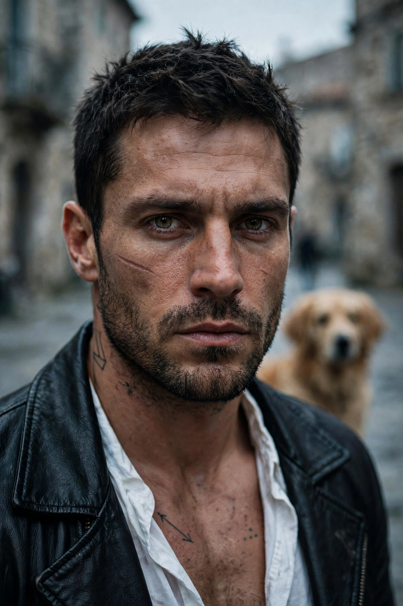
- 可复用规律：写实疤痕与纹身要写“ONE short thin scar only + a FEW simple tattoos with no legible words”，只写“有疤、有纹身”生成器会把疤画成分叉伤疤、把纹身画成带文字的大面积图案；背景狗要写“softly blurred”，否则它会把狗画成与人物等清晰的第二主角。

## 15 · PromptHero · 超写实女性特写（写实人物）

- 原链接：https://prompthero.com/prompt/0b7b879ba91-hero-10-close-up-of-a-stunning-fashion-model-ultra-realistic-portrait-shot-on-a-sony-a7iii-high-quality-ar-3564-stylize
- 热度：浏览 1.1k、收藏 5、评论 0，2026-10-16 发布
- 原图拆解（受限条目，仅按页面提示词与缩略图确认）：按页面提示词为超写实女性特写人像、Sony A7III 拍摄，热门页缩略图显示女性面部特写；除“女性面部特写”外，皮肤纹理与毛孔、瑕疵与不对称、眼神光与眼角纹、发丝飞散、手耳牙齿、自然光阴影细节、镜头焦段与景深、背景虚化、颗粒与噪点均未确认，不作推断。
- AI 破绽对照：本条因原图细节未确认，无法对照原图的破绽；只能对照重生成自身的破绽：v1 自加的雀斑、凌乱发丝、户外虚化背景都不是原图证据，写“v1 像原图”时只能说“像在面部特写这一项”，其余一律是 v1 自加特征。
- v1 提示词原文：`Ultra-realistic close-up portrait of a fashion model, shot on a Sony A7III, face in close-up filling the frame, natural skin texture with pores and slight imperfections, clear catchlights in the eyes, soft natural light, shallow depth of field with a softly blurred background, candid, no retouching look`
  - 中文解析：超写实特写 + 时装模特 + Sony A7III 拍摄 + 面部特写充满画面 + 毛孔小瑕疵自然皮肤 + 眼睛清晰眼神光 + 柔和自然光 + 浅景深柔和虚化背景 + 抓拍 + 无修图感。
- v1 对比：像在面部特写充满画面、眼睛眼神光、柔和自然光、浅景深虚化背景；偏在自加了棕发、绿眼、鼻颊雀斑、凌乱发丝、黑衣、户外背景；丢了“只确认特写，其余不推断”的边界——v1 的其余特征都不是原图特征。
- v1 图：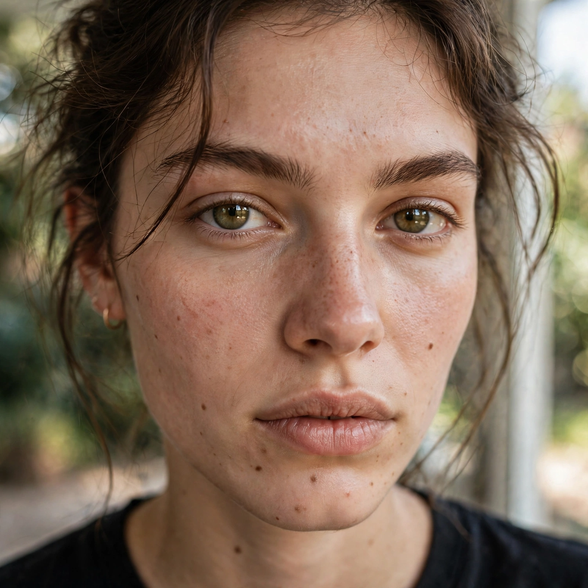
- v2 提示词原文：`Ultra-realistic close-up portrait of a fashion model, shot on a Sony A7III, face in close-up filling the frame, neat hair pulled back with no loose strands, skin with NO freckles, clear catchlights in the eyes, soft natural light, plain softly blurred background, calm neutral expression, shallow depth of field, candid, no retouching look`
- v2 对比：头发变整齐后梳、无雀斑、背景变素色虚化、表情变平静中性，更接近“干净特写”这一通用方向；代价是面部更像证件式正面特写、抓拍感变弱，v1 的“凌乱发丝 + 户外光”反而更有抓拍感。再次说明：v2 的干净与否仍不是原图核对结果，原图除特写外仍未确认。
- v2 图：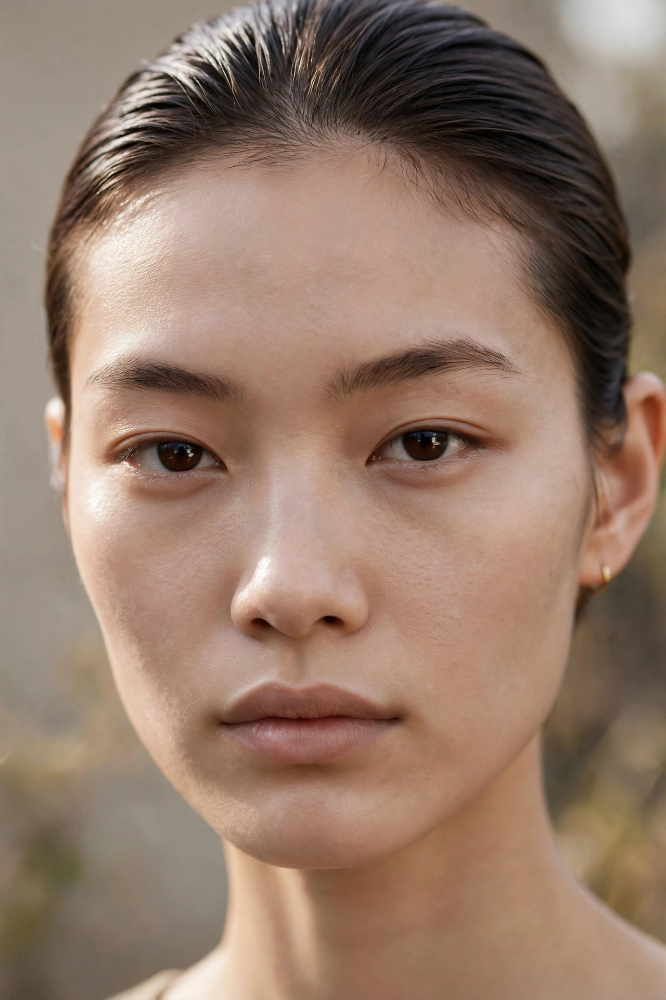
- 可复用规律：原图细节未确认时，提示词要先写“只确认特写”再写通用写实词，并把 v1 自加的特征在报告里逐项标为“自加”，否则读者会把重生成图的发色、雀斑、背景误读为原图特征；干净特写要写“neat hair pulled back + NO freckles + plain background”，只写“超写实特写”生成器会用凌乱发丝与雀斑来冒充真实感。

---

## 共性结论

- “数量词 + 位置词”比形容词更有效：本期几乎所有收紧都靠 ONE / only THREE / a FEW / SMALLER / SMALL / fully in frame / on ONE shoulder only / vertically / behind her 完成，而不是靠“更精致、更真实”这类空词；空词只会让生成器用自己的默认值填画面。
- 生成器默认会“填满画面”：左墙补门窗、地面铺满锥体、天空塞满气球、墓碑刻字、霓虹写字、纹身铺满胸颈，都是同一类默认——不写“不要什么、只有几个、在哪里”，它就用细节填满空白。
- 配角最容易抢主角：手机、手、狗、猫、气球、天平、披风、纹身、霓虹文字，只要不写“小、虚化、在侧面、只有几个”，配角就会被推成前景主角；本期第 2、7、10、14 张都是这个规律的不同版本。
- “像”与“更接近”要分开写：v2 在某一项上更接近描述时，常在另一项上丢掉 v1 的优点（第 1 张丢家具轮廓、第 2 张丢巷子纵深、第 5 张丢花纹细节、第 9 张丢全身、第 11 张丢正面冲击力），报告里把代价写出来，才不是“v2 一定更好”的假结论。
- 原图未确认时，诚实比完整更重要：第 7、14、15 张的详情大图未加载，第 15 张除特写外几乎全未确认；把未确认写成未确认，把 v1 自加特征标为自加，是本期最重要的一条学习，而不是把重生成图反推成原图特征。

## 写实人物小结

- 本期写实人物 3 张：第 4 张（红褐卷发女性，雀斑与飞散卷发为真实感线索）、第 14 张（意大利男子，右颊疤、短须、纹身为真实感线索，但疤痕在缩略图中未看清）、第 15 张（女性特写，除特写与 Sony A7III 外其余未确认）。
- 为什么看起来逼真（按可确认的线索，不编造未确认项）：第 4 张靠鼻颊雀斑、发边飞散卷发、侧向暖光与深色虚化背景；第 14 张靠锐利直视、短须、皮夹克与石质建筑的阴天冷光（疤与纹身只按提示词文本计入，不按缩略图核对）；第 15 张只能说“特写 + 眼神光 + 浅景深虚化”是通用写实词，不能说原图一定有这些细节。
- 常见 AI 破绽对照：皮肤过滑（第 4、15 张的 v1、v2 都靠“pores and slight imperfections + no retouching look”对抗，但 v1 仍自加雀斑来冒充真实感）；五官过对称（第 4 张靠不对称发量对抗，第 15 张 v2 的整齐后梳发反而更对称、更证件感）；手部变形（第 4 张手扶胸前在 v1、v2 中均未变形，是本期手部最稳的一例）；牙齿不自然（3 张均无露齿特写，不计入）；光影不一致（第 14 张阴天冷光最一致，第 15 张 v1 的户外光与 v2 的素色背景光都是自加光，不是原图光）。
- 能避免塑料感的提示词（本期验证过的写法）：`realistic skin texture with pores and slight imperfections`、`no retouching look`、`candid`、`85mm lens`、`shallow depth of field`，以及具体的否定与数量限定：`a FEW flyaway curls only, not voluminous`、`lips closed`、`ONE short thin scar only`、`a FEW simple tattoos with no legible words`、`neat hair pulled back + NO freckles`。只写“真实皮肤”不够，必须把“不要什么、只有几个”写出来。

## GitHub 同步

- 待同步后补记：报告路径 ai-image-learning/2026-11-03.md，图片在 ai-image-learning/images/ 下；同步后重新打开报告页和图片文件夹核对标题、嵌入数量与图片显示情况，再补记链接与核对结果。
