# 每日 AI 图片反推学习 · 2026-11-04

## 选图说明与缺口

- 选图时间：2026-11-04 上午（北京时间），浏览器选图任务 08:58–09:08 完成，全程未登录、未注册、未购买、未下载原图文件。本报告的原图拆解以浏览器任务回传的文字描述为准，未逐像素下载核对原图，因此 v1、v2 对比是“重生成图 vs 浏览器描述的原图特征”，不是与原图文件的逐像素对照；凡描述中未确认的细节，报告里不作推断。
- 本期 15 张构成：SeaArt 2 张 + PixAI 3 张 + NightCafe 4 张 + PromptHero 1 张 + Civitai 3 张 + Reddit r/midjourney 2 张，共 6 个平台；写实人物照片 3 张（第 1、2、9 张，均为面部可见）。第 8、15 张为油彩风格人像，面部可见但非照片写实，不计入写实人物 3 张；第 14 张为黑金面具侧脸，非真人皮肤，不计入写实人物。
- **去重说明：当天共跳过 4 张重复图，未入选、未反推、未生成，见下表。** 选图前已核对以往全部报告（2026-10-29、2026-10-30、2026-10-31、2026-11-01、2026-11-02、2026-11-03）的平台加图片 ID / 原链接；本期 15 张均为全新图片，系跳过重复图后顺延补位凑满。跨平台视觉上明显同一张图的转载，本批未发现可确认的此类重帖。

| 平台 | 原链接 | 首次出现日期 |
|---|---|---|
| PixAI《memento mori》 | https://pixai.art/artwork/2073338548770559862 | 2026-11-03 |
| PromptHero 意大利男子 FLUX 作品 | https://prompthero.com/prompt/869df0f4100-flux-flux-3-a-masterpiece-cinematic-color-photo-of-a-34-year-old-muscular-italian-man-with-gritty-masculine-and-intense-gaze-sharp | 2026-11-03 |
| PromptHero 时装模特 Hero 作品 | https://prompthero.com/prompt/0b7b879ba91-hero-10-close-up-of-a-stunning-fashion-model-ultra-realistic-portrait-shot-on-a-sony-a7iii-high-quality-ar-3564-stylize | 2026-11-03 |
| Civitai 刺绣玩偶风恐怖少年 | https://civitai.com/images/147083617 | 2026-11-03 |

- 另外，SeaArt 的 Rabbit Girl's First Frost 帖（postDetail/dbf9j85e878c73bv21sg）未计入重复，但因详情页显示为 15 秒视频播放器、非静态图片帖而主动排除，未计入 15 张。
- **其他缺口（按实测，不硬编）**：NightCafe Explore Hot 页本次显示“No creations found”，记为 Hot 排序缺口，改用默认 Explore 页补位。ArtStation Trending 页本次打开后跳转 404 / 登录遮罩，未能取得可验证的趋势作品，记为缺口，未入选。LiblibAI、Midjourney Explore、Reddit r/StableDiffusion、r/aiArt 本次因 15 张已由更高优先级渠道补齐而未逐一打开，不记为失败，仅列为未使用。Tensor.art、DeviantArt、Lexica、PromeAI 因首选与次选已满 15 张而未启用，不属于访问失败；OpenArt、Ideogram、Leonardo、Pinterest 全程未作为选图来源。PromptHero Hot 页中途出现可关闭式注册墙，已关闭并在详情页直接验证，未登录。Civitai 入选仍以详情页反应数字核对，非仅凭游客模糊卡片。Reddit 当日可直接访问，未遇到网络安全封锁；多图帖已注明“只选第 1 张”。
- **第 2、5 张的特别说明**：第 2 张详情页大图当时一直显示加载动画、未加载成功，描述仅依据页面标题、标签 #Realistic #Photography 及提示词节选“长直黑发、面带笑容的年轻女性、柔软米色开衫、站在阳光明亮的书店环境中”，除此之外不对书店陈设、面部细节、光影和景深作任何推断，v1、v2 自带的雀斑、植物、书架细节等均为重生成时自加的特征，不是原图特征。第 5 张更细的服饰纹理与背景细节因详情主图在文本视图中未完整呈现，记未确认，不推断。
- 本报告的 v1、v2 均为反推重写，不是照抄原帖提示词。
- 重生成图片保存在本任务目标工作区 `hidden_files/2026-11-04/images/` 下，报告内以图片文件名对应；GitHub 版见 ai-image-learning/2026-11-04.md，图片在 ai-image-learning/images/ 下。
- **生成完成情况：15 张的 v1 共 14 张次生成成功、1 张次未完成；v2 共 14 张次生成成功、1 张次未尝试；合计 28 张次成功。第 7 张 v1 未能返回图片，v2 因此未尝试；未完成项均未用无关图片代替。**

## 一览表

| # | 平台 | 作者 | 原链接 | 热度（快照） |
|---|---|---|---|---|
| 1 | SeaArt（写实人物） | Smile Minty | https://www.seaart.ai/postDetail/da349jte878c73957d10 | 页面无文字标签，仅图标+数字，依次为 571、265、59、4，不推断各数字对应标签；另显示 4 comment，2026-08-20 发布；多图帖 Work Info·4，只选图 1 |
| 2 | SeaArt（写实人物） | Mixz | https://www.seaart.ai/postDetail/da347vte878c739548dg | 页面无文字标签，仅图标+数字，依次为 589、252、93、0，不推断各数字对应标签；另显示 0 comment，2026-08-20 发布；多图帖 Work Info·5，只选图 1；大图未加载，见特别说明 |
| 3 | PixAI | ᯓᯓ 𝙘𝙤𝙘𝙤𝙛𝙡𝙪𝙛𝙛𝙞 | https://pixai.art/artwork/2072845630856237375 | 点赞 504（详情页；首页曾显示 503，以详情页为准）、评论 5，2026-10-30 发布 |
| 4 | PixAI | ichikiki | https://pixai.art/artwork/2071347550122412397 | 点赞 442（详情页；首页曾显示 441，以详情页为准）、评论 2，2026-10-26 发布 |
| 5 | PixAI | ichikiki | https://pixai.art/artwork/2066780919459621280 | 点赞 464、评论 2，2026-10-13 发布 |
| 6 | NightCafe | Kay @KayKar | https://creator.nightcafe.studio/creation/rY6zcCbTULpZb42rWABz | 点赞 773、评论 163，2026-11-02 发布，2026-10-22 创建 |
| 7 | NightCafe | PabloArtStation | https://creator.nightcafe.studio/creation/NV58cUbIsHbyZMaB5Q2R/dreaded | 点赞 667、评论 131，2026-11-02 发布 |
| 8 | NightCafe | Jason2000 @Jason2000 | https://creator.nightcafe.studio/creation/7MVpk8QtbxY4IDQJixcW | 点赞 155（详情页；列表曾显示 154，以详情页为准）、评论 78，2026-11-03 发布 |
| 9 | PromptHero（写实人物） | @chorlo | https://prompthero.com/prompt/b765d8da5ca-seedream-5-seedream-5-pro-a-young-east-asian-woman-posing-in-futuristic-attire-against-a-solid-light-gray-background-she-is-equipped-with-a | 浏览 1.5k、收藏 9，2026-10-05 发布 |
| 10 | Civitai | Joe_BakerAI | https://civitai.com/images/147084007 | 反应 👍1255、❤️458、😂157、😢51，2026-10-28 上传 |
| 11 | Civitai | giminic | https://civitai.com/images/147079336 | 反应 👍1195、❤️394、😂110、😢49，2026-10-28 上传 |
| 12 | Civitai | CosmicSymphony | https://civitai.com/images/147121326 | 反应 👍1038、❤️409、😂149、😢41，2026-10-29 上传 |
| 13 | Reddit r/midjourney | u/Dropdeadlegs84 | https://www.reddit.com/r/midjourney/comments/1xmvuf5/barbarians/ | 顶贴 155、评论 7，2026-11-03 发布；多图帖共 7 张，只选图 1 |
| 14 | Reddit r/midjourney | u/Brianshoe | https://www.reddit.com/r/midjourney/comments/1xn03jw/posthuman_in_black_and_gold/ | 顶贴 67、评论 3，2026-11-04 发布；多图帖共 4 张，只选图 1 |
| 15 | NightCafe | Jason2000 @Jason2000 | https://creator.nightcafe.studio/creation/91i4txmkUMiJKTX2srUM | 点赞 172（详情页；列表曾显示 171，以详情页为准）、评论 91（详情页；列表曾显示 90，以详情页为准），2026-11-03 发布 |

类别分布：写实人物照片 3 张（1、2、9），动漫 4 张（3、4、5、12 的猫为童话插画，计入插画类时共 5 张插画向），动物特写 1 张（6），哥特恐怖 1 张（7，未完成），油彩人像 2 张（8、15），万圣节南瓜 2 张（10、11），野蛮人插画 1 张（13），黑金未来面具 1 张（14）。

---

## 1 · SeaArt · 窗边阳光阅读少女（写实人物）

- 原链接：https://www.seaart.ai/postDetail/da349jte878c73957d10
- 热度：页面无文字标签，仅图标+数字，依次为 571、265、59、4，不推断标签；另显示 4 comment，2026-08-20 发布；多图帖，只选图 1
- 原图拆解：主体为超写实少女蜷坐在洒满阳光的窗边座位上，面向镜头、神情安静微带倦意；深色长发盘起、鬓角有碎发，刘海轻覆额前；身穿白色蕾丝边长袖上衣、深色长裤，腿上搭着花纹薄毯；双手自然捧着一本打开的书，手指形态自然；前景有冒热气的玻璃茶杯、眼镜和摞起的书，背景是满墙彩色书架和明亮窗格；暖金色日光从右侧窗户打入，面部和衣物有柔和明暗过渡，背景书架虚化、景深较浅，整体为暖调居家阅读氛围。
- 写实要素：面部可见，皮肤白皙带腮红，面部光影自然、表情放松；背景虚化与自然窗光已确认。毛孔、眼角细纹、皮肤颗粒、牙齿、手部全部细节在当时截图分辨率下无法逐项确认，记未确认，不推断。
- AI 破绽对照：本类最容易破绽是皮肤偏滑、表情偏摆拍、手指变形；原图用“蜷坐 + 微带倦意的放松表情 + 自然窗光 + 虚化书架”削弱摆拍感，但毛孔与手部细节未确认，不能写成已验证的真实感证据。
- v1 提示词原文：`Photorealistic photo of a young woman curled up reading in a sunny window seat, facing the camera with a calm, slightly tired expression, dark long hair tied up with loose strands at her temples and bangs lightly over her forehead, white long-sleeve top with lace trim, dark trousers, a patterned thin blanket over her legs, both hands naturally holding an open book, in the foreground a glass cup of steaming tea, eyeglasses and a stack of books, background of a wall of colourful bookshelves and bright window panes, warm golden daylight coming from the window on the right, soft light and shadow transitions on her face and clothes, softly blurred bookshelf background, shallow depth of field, warm homely reading atmosphere, realistic skin texture with pores and slight imperfections, candid, no retouching look`
  - 中文解析：写实照片 + 窗边蜷坐阅读少女 + 面向镜头安静微倦 + 深色长发盘起鬓角碎发刘海覆额 + 白蕾丝边长袖深色长裤 + 花纹薄毯 + 双手自然捧打开的书 + 前景冒热气玻璃茶杯眼镜摞书 + 满墙彩色书架明亮窗格 + 右侧暖金日光 + 面部衣物柔和明暗过渡 + 书架虚化浅景深 + 暖调居家阅读氛围 + 毛孔小瑕疵真实皮肤 + 抓拍 + 无修图感。
- v1 对比：像在盘发碎发刘海、白蕾丝长袖、打开的书、花纹薄毯、前景茶杯眼镜摞书、彩色书架、右侧窗光、虚化背景；偏在姿势为前倾捧书举高而非蜷坐、书的位置偏高；丢了“膝盖收起、书低放在腿上”的蜷坐感。

- v2 提示词原文：`Photorealistic photo of a young woman CURLED UP in a sunny window seat, knees drawn up, an open book resting low on her lap, facing the camera with a calm, slightly tired expression and soft relaxed eyes, dark long hair tied up with only a few loose strands at her temples and bangs lightly over her forehead, white long-sleeve top with lace trim, dark trousers, a patterned thin blanket over her legs, in the foreground a glass cup of steaming tea, eyeglasses and a stack of books, background of a wall of colourful bookshelves and bright window panes, warm golden daylight coming from the window on the right, soft light and shadow transitions, softly blurred bookshelf background, shallow depth of field, warm homely reading atmosphere, realistic skin texture with pores and slight imperfections, candid, no retouching look`
- v2 对比：膝盖收起、书低放在腿上、前景茶杯眼镜摞书俱全，更接近“蜷坐阅读”；代价是下巴贴近膝盖、面部更贴近镜头，v1 的“身体舒展 + 书页清晰”反而更从容。

- 可复用规律：蜷坐姿势要写“CURLED UP + knees drawn up + book resting low on her lap”，只写“蜷坐阅读”生成器仍会把人画成前倾捧书；碎发要写“only a few loose strands”，否则盘发会被画成凌乱散发。

## 2 · SeaArt · 书店约会甜笑少女（写实人物，受限条目）

- 原链接：https://www.seaart.ai/postDetail/da347vte878c739548dg
- 热度：页面无文字标签，仅图标+数字，依次为 589、252、93、0，不推断标签；另显示 0 comment，2026-08-20 发布；多图帖，只选图 1
- 原图拆解（受限条目，仅按页面提示词节选与标题确认）：主体为长直黑发、面带笑容的年轻女性，身穿柔软米色开衫，站在阳光明亮的书店环境中，氛围温暖愉快。详情页大图当时未加载成功，除上述内容外，书店内部陈设、面部细节、光影和景深均未确认，不作推断。
- 写实要素：皮肤纹理、毛孔、眼角线、飞发、手/耳/牙齿、背景虚化、颗粒等全部记未确认。
- AI 破绽对照：本条因原图细节未确认，无法对照原图的破绽；只能对照重生成自身的破绽：v1 自加的雀斑、露齿大笑、悬挂植物都不是原图证据，写“v1 像原图”时只能说“像在长直黑发、米色开衫、书店、笑容这几项”，其余一律是 v1 自加特征。
- v1 提示词原文：`Photorealistic photo of a happy young woman with long straight black hair, wearing a cozy cream cardigan, standing in a sunny bookstore, smiling warmly, warm pleasant atmosphere, soft natural daylight, realistic skin texture with pores and slight imperfections, candid, no retouching look`
  - 中文解析：写实照片 + 开心年轻女性 + 长直黑发 + 柔软米色开衫 + 站在阳光明亮书店 + 温暖微笑 + 温暖愉快氛围 + 柔和自然光 + 毛孔小瑕疵真实皮肤 + 抓拍 + 无修图感。
- v1 对比：像在长直黑发、米色开衫、阳光书店、笑容；偏在自加了鼻颊雀斑、露齿大笑、悬挂绿植；丢了“甜笑（sweet smile）只是温和笑意”的克制——v1 的笑偏开怀大笑。

- v2 提示词原文：`Photorealistic photo of a happy young woman with long straight black hair, wearing a cozy cream cardigan, standing in a sunny bookstore with plain wooden bookshelves and no hanging plants, a gentle sweet smile with lips closed and no teeth showing, clear skin with NO freckles, warm pleasant atmosphere, soft natural daylight, realistic skin texture with pores and slight imperfections, candid, no retouching look`
- v2 对比：变闭唇甜笑、无雀斑、无悬挂植物、书架素净，更接近“甜笑”这一通用方向；代价是面部更偏证件式正面、抓拍感变弱，v1 的“露齿开怀 + 绿植书店”反而更有生活气。再次说明：v2 的干净与否仍不是原图核对结果，原图除提示词语义外仍未确认。

- 可复用规律：甜笑要写“gentle sweet smile with lips closed and no teeth showing”，只写“微笑”生成器默认画露齿大笑；无雀斑要写“clear skin with NO freckles”，否则它会用雀斑来填“真实皮肤”。

## 3 · PixAI · 占卜天使少女

- 原链接：https://pixai.art/artwork/2072845630856237375
- 热度：点赞 504（详情页；首页曾显示 503，以详情页为准）、评论 5，2026-10-30 发布
- 原图拆解：主体为动漫风格少女侧身站立，黑长发、闭眼、神情安详；身穿白色长袖长裙，背后展开白色天使羽翼；手持蜡烛，头顶/身旁有新月与月光元素；背景为深色夜空，整体为深蓝黑与白色、暖烛光对比；画面柔焦、光晕柔和，衣料有轻盈透明感，构图为全身侧面站姿。
- v1 提示词原文：`Anime illustration, a girl standing in side view, full body, long black hair, eyes closed, serene expression, wearing a long white long-sleeve dress, large white angel wings spread behind her, holding a candle, crescent moon and moonlight beside her, dark night sky background, deep blue-black contrasted with white and warm candlelight, soft focus, gentle glow, light translucent fabric`
  - 中文解析：动漫插画 + 侧面全身站姿少女 + 黑长发闭眼安详 + 白长袖长裙 + 大白天使羽翼展开 + 手持蜡烛 + 新月月光 + 深色夜空 + 深蓝黑对白与暖烛光 + 柔焦 + 柔和光晕 + 轻盈透明衣料。
- v1 对比：像在侧面全身、黑长发闭眼、白长裙、白羽翼、蜡烛、新月、深蓝夜空、柔焦光晕；偏在羽翼巨大铺满画面、裙摆透明飘散过长、自加了地面草地与月光光束；丢了“羽翼只是背部展开、画面以人物为主”的克制。

- v2 提示词原文：`Anime illustration, a girl standing in side view, full body, long black hair, eyes closed, serene expression, wearing a simple long white long-sleeve dress, SMALLER white angel wings held close behind her, holding a candle, a small crescent moon in a dark night sky, no grass ground, deep blue-black contrasted with white and warm candlelight, soft focus, gentle glow, light translucent fabric`
- v2 对比：羽翼变小收拢身后、裙子变简单、新月变小、无草地，更接近“人物为主的夜空侧身像”；代价是下半身被裁切、只见一侧羽翼，v1 的“全身 + 双翼展开”反而更完整。

- 可复用规律：天使羽翼要写“SMALLER wings held close behind her”，只写“展开羽翼”生成器会把翼展推满画面；地面要写“no grass ground”，否则夜空侧身像会被补上草地前景。

## 4 · PixAI · 与龙同眠

- 原链接：https://pixai.art/artwork/2071347550122412397
- 热度：点赞 442（详情页；首页曾显示 441，以详情页为准）、评论 2，2026-10-26 发布
- 原图拆解：主体为动漫半写实风格，少女闭眼安睡，与龙/云雾元素同框；白天蓝天背景，云层蓬松柔软；少女长发铺散，神情安宁，衣着轻盈；画面为柔和水彩/油彩质感，色彩以蓝白与暖肤色为主，光线明亮均匀，前景云雾缭绕。
- v1 提示词原文：`Anime semi-realistic illustration, a girl sleeping peacefully with eyes closed, long hair spread out, light clothing, together with a dragon and soft clouds, daytime blue sky background, fluffy soft clouds, gentle watercolour and oil-paint texture, colours mainly blue and white with warm skin tones, bright even light, misty clouds in the foreground`
  - 中文解析：动漫半写实 + 闭眼安睡少女 + 长发铺散 + 轻盈衣着 + 与龙同框 + 白天蓝天 + 蓬松柔软云层 + 柔和水彩油彩质感 + 蓝白与暖肤色 + 明亮均匀光 + 前景云雾缭绕。
- v1 对比：像在闭眼安睡、长发铺散、轻盈白衣、蓝天蓬松云、蓝白暖肤色、水彩质感、前景云雾；偏在龙为一只清晰的小蓝龙、少女发丝极长且旋卷铺满画面；丢了“龙与云雾一体、发丝只是铺散”的柔和。

- v2 提示词原文：`Anime semi-realistic illustration, a girl sleeping peacefully with eyes closed, shoulder-length hair spread out simply without swirling strands, light clothing, beside her a dragon half-hidden in soft cloud mist so its body merges with the clouds, daytime blue sky background, fluffy soft clouds, gentle watercolour and oil-paint texture, colours mainly blue and white with warm skin tones, bright even light, misty clouds in the foreground`
- v2 对比：发丝变短且简单铺散、龙半隐于云雾中身体与云相融，更接近“龙/云雾一体”；代价是龙头变大变突出、少女身体被云遮挡更多，v1 的“小蓝龙 + 全身安睡”反而更完整可爱。
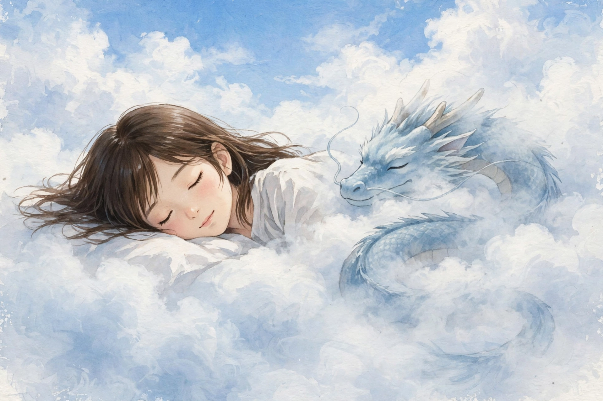
- 可复用规律：云中生物要写“half-hidden in soft cloud mist so its body merges with the clouds”，只写“与龙同框”生成器会画一只清晰独立的小龙；发丝要写“without swirling strands”，否则“铺散”会被画成旋卷长发。

## 5 · PixAI · 玲阳站姿

- 原链接：https://pixai.art/artwork/2066780919459621280
- 热度：点赞 464、评论 2，2026-10-13 发布
- 原图拆解：主体为动漫风格《Wuthering Waves》角色 Lingyang 站姿，带兽耳特征；红眼睛、闭口、神情沉静；长发、衬衫造型并配缎带/配饰，手持姿态；画面为柔和动漫上色，线条干净，色彩明亮，背景简洁突出人物；更细的服饰纹理与背景细节因详情主图在文本视图中未完整呈现，记未确认，不推断。
- v1 提示词原文：`Anime illustration, a character Lingyang from Wuthering Waves standing, with animal ears, red eyes, mouth closed, calm expression, long hair, wearing a shirt with ribbons and accessories, gentle anime colouring, clean lines, bright colours, simple background that highlights the character`
  - 中文解析：动漫插画 + 鸣潮角色玲阳站姿 + 兽耳 + 红眼闭口沉静 + 长发 + 衬衫缎带配饰 + 柔和动漫上色 + 线条干净 + 色彩明亮 + 简洁背景突出人物。
- v1 对比：像在兽耳、红眼闭口、长发、衬衫缎带配饰、干净线条、简洁背景；偏在服装为繁复民族风套装、自加了花朵与尾巴、发色为白色（原描述未确认发色，此为自加）；丢了“衬衫造型简单、背景只有人物”的克制。
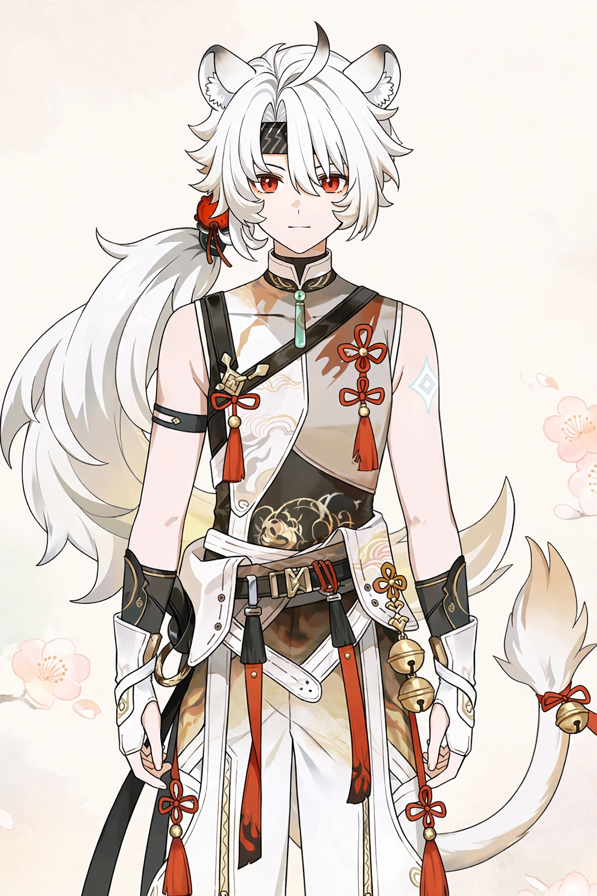
- v2 提示词原文：`Anime illustration, a character Lingyang from Wuthering Waves standing, with animal ears, red eyes, mouth closed, calm expression, long hair, wearing a SIMPLE shirt with only one ribbon, plain background with no flowers and no tail visible, gentle anime colouring, clean lines, bright colours, simple background that highlights the character`
- v2 对比：服装变简单白衬衫加一根红缎带、背景变素色、无花无尾，更接近“简洁站姿”；代价是长发变得极长垂至脚边、表情带浅笑，v1 的“短发 + 沉静正面”反而更像角色立绘。
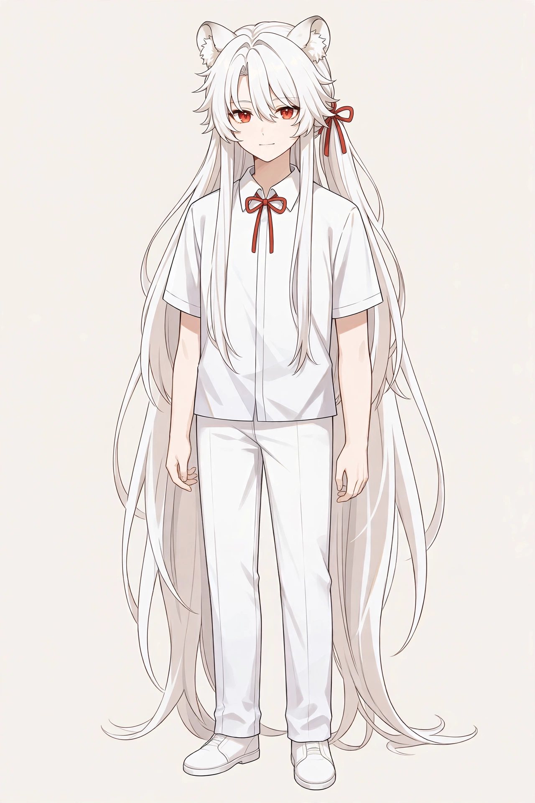
- 可复用规律：角色立绘简化要写“SIMPLE shirt with only one ribbon + plain background with no flowers and no tail visible”，只写“简洁背景”生成器仍会用配饰、花朵、尾巴填满立绘；但收紧服装时要同时写发长，否则“长发”会被推成垂地长发。

## 6 · NightCafe · 酣睡三花猫

- 原链接：https://creator.nightcafe.studio/creation/rY6zcCbTULpZb42rWABz
- 热度：点赞 773、评论 163，2026-11-02 发布，2026-10-22 创建
- 原图拆解：主体为三花猫蜷卧特写，头部贴近画面，眼睛闭合、正在酣睡；被毛为橘、白、黑三色斑块，毛发蓬松柔软有层次；粉色鼻头、白色口鼻部、细长胡须清晰；面部贴着柔软织物/毯面，暖色调柔光，画面温馨安静，水彩/写实混合质感，背景虚化。
- v1 提示词原文：`Close-up of a sleeping calico cat curled up, head close to the camera, eyes closed, orange white and black patchy fluffy fur with layered texture, pink nose, white muzzle, long thin whiskers clearly visible, face resting on soft fabric blanket, warm soft light, warm and quiet atmosphere, mixed watercolour and realistic texture, blurred background`
  - 中文解析：三花猫蜷卧特写 + 头部贴近画面 + 闭眼酣睡 + 橘白黑三色蓬松有层次被毛 + 粉鼻白口鼻 + 细长胡须清晰 + 面贴柔软织物毯面 + 暖色柔光 + 温馨安静 + 水彩写实混合质感 + 背景虚化。
- v1 对比：像在闭眼酣睡、三色斑块、粉鼻白口鼻、细长胡须、柔软毯面、暖调柔光、水彩质感；偏在面部占满画面、一侧耳朵被裁切、背景为水彩晕染而非虚化；丢了“头部完整入画、背景只是虚化”的克制。

- v2 提示词原文：`Close-up of a sleeping calico cat curled up with its WHOLE head and both ears fully in frame, eyes closed, orange white and black patchy fluffy fur, pink nose, white muzzle, long thin whiskers clearly visible, face resting on a plain soft fabric blanket, warm soft light, warm and quiet atmosphere, mixed watercolour and realistic texture, softly blurred background with no watercolour wash over the cat`
- v2 对比：双耳完整入画、正面头部、毯面素净、胡须清晰，更接近“完整头部特写”；代价是面部更正面更对称、水彩晕染仍在画面边缘，v1 的“侧卧贴毯 + 耳朵自然垂落”反而更有酣睡感。

- 可复用规律：动物头部特写要写“WHOLE head and both ears fully in frame”，只写“头部贴近画面”生成器会把耳朵裁出画；背景要写“softly blurred background with no watercolour wash over the cat”，否则水彩质感会漫成满屏晕染。

## 7 · NightCafe · 哥特恐怖缝口女性（未完成）

- 原链接：https://creator.nightcafe.studio/creation/NV58cUbIsHbyZMaB5Q2R/dreaded
- 热度：点赞 667、评论 131，2026-11-02 发布
- 原图拆解：主体为哥特恐怖风女性半脸特写，占据画面大部；皮肤呈灰白龟裂质感，似干裂泥土/灰烬；一只眼睛为鲜红色瞳孔、眼线浓黑，目光直视镜头；面部缠绕粗糙麻绳与网状纱布/渔网，绳结与纤维纹理粗糙；另一侧面部隐入阴影；背景深暗，冷色调与暗红对比强烈，光影硬朗、对比高，氛围阴森压抑。
- v1 提示词原文（已尝试生成，但未返回图片）：`Gothic horror portrait, close-up of half a woman's face filling most of the frame, skin grey-white with cracked texture like dry earth and ash, one eye with bright red pupil and thick black eyeliner looking directly at the camera, face wrapped in coarse rope and net-like gauze, rough rope knots and fibre texture, the other side of her face hidden in shadow, dark background, cold tones contrasted with dark red, hard lighting, high contrast, sinister oppressive atmosphere`
- v1 对比：未完成——v1 生成未能返回图片，本报告不以无关图片代替，v1 图缺失。
- v2 提示词原文：未尝试——因 v1 缺失且不重复已失败的生成请求，本期不再为第 7 张补 v2，v2 图缺失。
- 可复用规律：本条无 v1、v2 对照可提炼；仅记录一条流程规律：恐怖特写类提示词一旦生成失败，不应在本期用改写重试来硬凑 v1、v2 对照，缺口如实记录比补一张无关图更重要。

## 8 · NightCafe · 棕榈树旁的 Eloise

- 原链接：https://creator.nightcafe.studio/creation/7MVpk8QtbxY4IDQJixcW
- 热度：点赞 155（详情页；列表曾显示 154，以详情页为准）、评论 78，2026-11-03 发布
- 原图拆解：主体为油彩厚涂风格女性半身像，倚靠在棕榈树干旁，头向后仰、双眼微闭、嘴唇微张，神情陶醉；深色卷发上缀满红、紫花朵；身穿宝蓝色镶金刺绣紧身胸衣式礼服，肩部有白色蕾丝/薄纱披肩；佩戴蓝色宝石项链、耳环与手镯；背景为地中海式白色宫殿、水面与繁花，棕榈叶与黄色果实点缀；色彩浓艳，笔触颗粒感明显，光线明亮热烈。
- v1 提示词原文：`Thick oil-painting portrait of a woman in half-body, leaning against a palm tree trunk, head tilted back, eyes slightly closed, lips slightly open, enraptured expression, dark curly hair decorated with red and purple flowers, wearing a royal blue corset-style gown with gold embroidery, white lace shawl on her shoulders, blue gemstone necklace, earrings and bracelets, background of a Mediterranean white palace, water and flowers, palm leaves and yellow fruit, rich saturated colours, visible grainy brushstrokes, bright warm light`
  - 中文解析：厚涂油彩半身像 + 倚棕榈树干 + 头后仰微闭眼微张唇陶醉 + 深色卷发红紫花朵 + 宝蓝镶金紧身胸衣礼服 + 白蕾丝披肩 + 蓝宝石项链耳环手镯 + 地中海白宫殿水面繁花 + 棕榈叶黄果实 + 浓艳色彩 + 颗粒笔触 + 明亮热烈光线。
- v1 对比：像在头后仰微闭眼微张唇、深卷发红紫花、宝蓝镶金胸衣、白蕾丝披肩、蓝宝石首饰、白宫殿水面繁花、棕榈叶；偏在花朵密成花冠、前景自加了大颗柠檬、面部偏写实光滑；丢了“花只是点缀、笔触颗粒感覆盖全画”的油彩感。
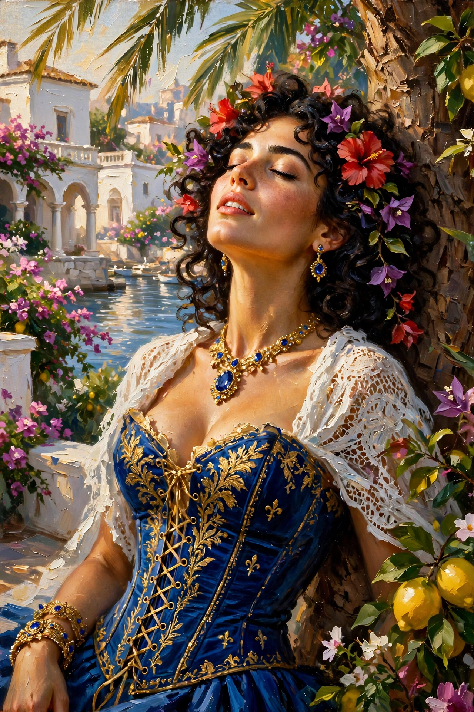
- v2 提示词原文：`Thick oil-painting portrait with visible grainy brushstrokes over the whole image, a woman in half-body, leaning against a palm tree trunk, head tilted back only slightly, eyes slightly closed, lips slightly open, enraptured expression, dark curly hair with only a FEW red and purple flowers, wearing a royal blue corset-style gown with gold embroidery, white lace shawl on her shoulders, blue gemstone necklace, earrings and bracelets, background of a Mediterranean white palace, water and flowers, small yellow fruit in the background only, rich saturated colours, bright warm light`
- v2 对比：花量收敛为几朵、头后仰幅度变小、柠檬变背景小树上的小果、笔触颗粒更明显，更接近“点缀花 + 厚涂感”；代价是项链变小、手镯变细，v1 的“大蓝宝石项链 + 大柠檬前景”反而更有华丽感。
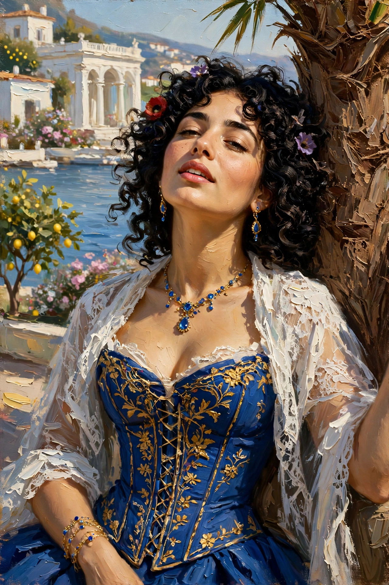
- 可复用规律：发间花朵要写“only a FEW flowers”，只写“缀满花朵”生成器会画成花冠；油彩颗粒要写“visible grainy brushstrokes over the whole image”，只写“厚涂”它仍会把面部画光滑。

## 9 · PromptHero · 未来装束东亚女性（写实人物）

- 原链接：https://prompthero.com/prompt/b765d8da5ca-seedream-5-seedream-5-pro-a-young-east-asian-woman-posing-in-futuristic-attire-against-a-solid-light-gray-background-she-is-equipped-with-a
- 热度：浏览 1.5k、收藏 9，2026-10-05 发布
- 原图拆解：主体为写实真人面部可见（侧面）：年轻东亚女性全身低角度站姿，面向左前方、神情冷静；黑发盘成发髻，面部为侧脸轮廓，嘴唇闭合；身穿白色高领连衣裙配半透明外层薄纱裙摆与白色机械长靴；背部装有大型白色机械翼状装置，上有黑色粗体文字“rog”，左臂有白色赛博护板与字母“vac”；一只手抬起靠近机械翼，另一只手自然下垂；背景为纯浅灰色影棚底，灯光均匀柔和、无强烈阴影，画面干净、机械质感硬朗与织物轻盈对比。
- 写实要素：面部可见但为全身远景侧脸，皮肤光滑均匀、光影柔和；背景无虚化，为纯色影棚背景，已确认。毛孔、眼角细纹、飞发根根细节、牙齿（未露齿）、手部全部指节细节在当时画面距离与分辨率下无法逐项确认，记未确认，不推断。
- AI 破绽对照：本类最容易破绽是皮肤过滑、机械结构不合逻辑、文字拼错；原图用“侧脸远景 + 纯色影棚 + 均匀柔光”削弱面部破绽，但“rog / vac”文字与机械关节在远景下未逐项确认，不能写成已验证的细节；v1、v2 的文字与关节均为重生成时的演绎。
- v1 提示词原文：`Photorealistic full-body photograph, low-angle view, a young East Asian woman standing, facing left in profile, calm expression, lips closed, black hair in a bun, wearing a white high-neck dress with a translucent outer tulle skirt and white mechanical long boots, a large white mechanical wing-like device on her back with bold black text rog on it, a white cyber arm guard with letters vac on her left arm, one hand raised near the mechanical wing and the other hand hanging naturally, solid light grey studio background, even soft lighting with no strong shadows, clean image, hard mechanical texture contrasted with light fabric, realistic skin texture with pores and slight imperfections, candid, no retouching look`
  - 中文解析：写实全身照片 + 低角度 + 年轻东亚女性站姿 + 面向左前方侧脸冷静闭唇 + 黑发发髻 + 白高领连衣裙半透明薄纱裙摆白机械长靴 + 背部大型白机械翼装置黑粗体 rog + 左臂白赛博护板 vac + 一手抬起近机械翼一手自然下垂 + 纯浅灰影棚底 + 均匀柔光无强烈阴影 + 画面干净 + 机械硬朗对织物轻盈 + 毛孔小瑕疵真实皮肤 + 抓拍 + 无修图感。
- v1 对比：像在左侧面冷静闭唇、发髻、白高领连衣裙、薄纱裙摆、白机械长靴、背部机械翼 rog、左臂护板 vac、一手抬起近翼一手下垂、纯浅灰影棚、均匀柔光；偏在薄纱极长飘散、机械翼铺展过大、护板为整条机械臂；丢了“裙摆与机械翼体量克制”的干净。
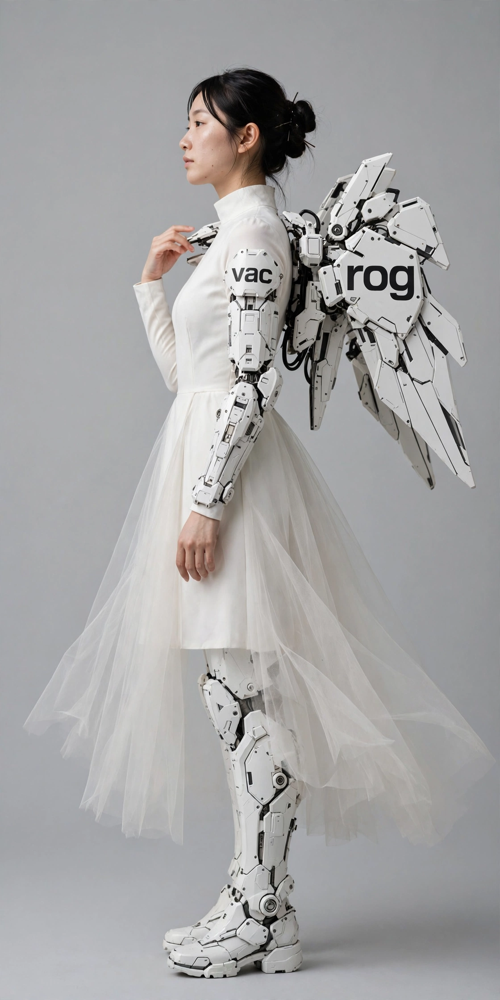
- v2 提示词原文：`Photorealistic full-body photograph, low-angle view, a young East Asian woman standing, facing left in profile, calm expression, lips closed, black hair in a bun, wearing a white high-neck dress with a SHORT translucent tulle skirt ending at the knees and simple white mechanical long boots, a SMALLER white mechanical wing-like device on her back with bold black text rog on it, a white cyber arm guard with letters vac on her left arm only, one hand raised near the mechanical wing and the other hand hanging naturally, solid light grey studio background, even soft lighting with no strong shadows, clean image, hard mechanical texture contrasted with light fabric, realistic skin texture with pores and slight imperfections, candid, no retouching look`
- v2 对比：薄纱变及膝短裙摆、机械翼变小、护板变前臂护板、长靴变简单，更接近“体量克制的影棚全身像”；代价是面部自加了雀斑、抬起的手变到身后，v1 的“长薄纱 + 大翼展开”反而更有未来装束的体量感。
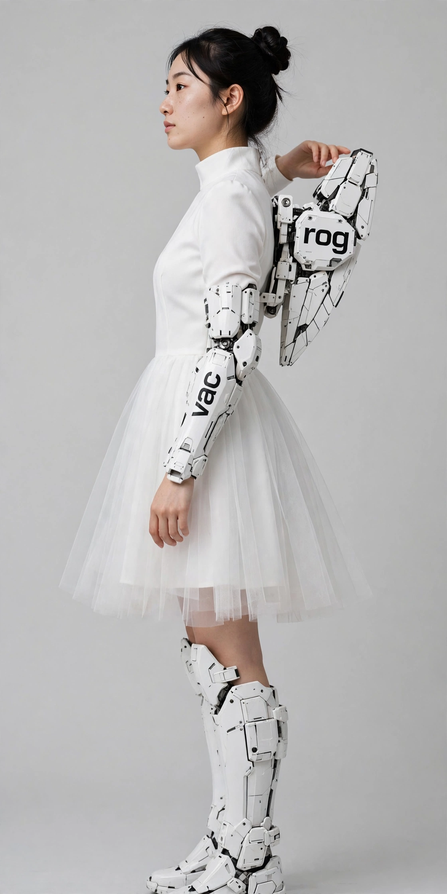
- 可复用规律：未来装束体量要写“SHORT tulle skirt ending at the knees + SMALLER wing device + arm guard on her left arm only”，只写“薄纱裙摆、机械翼、护板”生成器会把裙摆拉长、翼展拉满、护板扩成整臂；机械文字要单独写清字母，否则收紧体量时会把文字拼错或移位。

## 10 · Civitai · 巨型南瓜灯与小木乃伊

- 原链接：https://civitai.com/images/147084007
- 热度：反应 👍1255、❤️458、😂157、😢51，2026-10-28 上传
- 原图拆解：主体为画面中央一只巨大的橙色南瓜灯，占据大半画面，表皮有裂纹、斑点与粗糙凹凸；雕刻出的大眼睛、三角鼻与咧开的大嘴，嘴内牙齿粗大不规则；一个穿白绷带的小木乃伊玩偶坐在南瓜嘴边，黑眼睛圆润；背景深暗，有枯藤、落叶与藤蔓，前景右下角有另一只南瓜局部；暖橙与深黑对比强烈，万圣节氛围浓厚。
- v1 提示词原文：`A huge orange jack-o-lantern filling most of the frame in the centre, its skin cracked, spotted and rough, carved large eyes, triangular nose and a wide grinning mouth with large irregular teeth inside, a small mummy doll wrapped in white bandages sitting beside the pumpkin mouth, with round black eyes, dark background with dead vines, fallen leaves and tendrils, a partial second pumpkin in the lower right foreground, strong warm orange against deep black contrast, strong Halloween atmosphere`
  - 中文解析：中央巨大橙色南瓜灯占大半画面 + 表皮裂纹斑点粗糙凹凸 + 雕刻大眼三角鼻咧开大嘴 + 嘴内粗大不规则牙齿 + 白绷带小木乃伊玩偶坐南瓜嘴边 + 圆润黑眼睛 + 深暗背景枯藤落叶藤蔓 + 右下前景另一只南瓜局部 + 暖橙对深黑 + 万圣节氛围。
- v1 对比：像在巨大南瓜灯、裂纹斑点粗糙表皮、三角鼻、咧开大嘴、木乃伊玩偶、深暗枯藤落叶、右下第二只南瓜局部；偏在眼睛为三角怒目、牙齿为上下尖牙、木乃伊坐在嘴内下唇而非嘴边；丢了“大眼圆润、木乃伊在嘴边外侧”的位置。

- v2 提示词原文：`A huge orange jack-o-lantern filling most of the frame in the centre, its skin cracked, spotted and rough, carved ROUND large eyes, triangular nose and a wide grinning mouth with only a FEW large irregular teeth, a small mummy doll wrapped in white bandages sitting BESIDE the pumpkin mouth on the outer edge, with round black eyes, dark background with dead vines, fallen leaves and tendrils, a partial second pumpkin in the lower right foreground, strong warm orange against deep black contrast, strong Halloween atmosphere`
- v2 对比：眼睛变圆、牙齿变少变钝、木乃伊变大且坐在嘴边外侧，更接近“圆眼 + 嘴边玩偶”；代价是嘴变宽笑而非咧嘴獠牙、第二只南瓜变大，v1 的“三角怒目 + 尖牙大嘴”反而更有万圣节惊悚感。

- 可复用规律：南瓜灯眼睛与玩偶位置要写“ROUND large eyes + mummy sitting BESIDE the mouth on the outer edge + only a FEW teeth”，只写“大眼、嘴边木乃伊、大牙齿”生成器默认画三角怒目、尖牙满口、把玩偶塞进嘴里。

## 11 · Civitai · 宇宙南瓜灯与骷髅战士

- 原链接：https://civitai.com/images/147079336
- 热度：反应 👍1195、❤️394、😂110、😢49，2026-10-28 上传
- 原图拆解：主体为宇宙空间中一只巨大发光南瓜灯悬浮，内部透出炽热橙黄光芒，表皮呈紫橙渐变；前景为两名持剑骷髅战士，骨骼结构清晰，身披破旧斗篷，站在长满白花的草地上；背景为紫粉色星云、多颗行星与星空，左下角有蓝色行星；画面色彩饱和、奇幻史诗感强，远近层次分明。
- v1 提示词原文：`In outer space, a huge glowing jack-o-lantern floating, glowing hot orange-yellow light from inside, skin in a purple-orange gradient, in the foreground two skeleton warriors holding swords, clear bone structure, wearing tattered cloaks, standing on grass covered with white flowers, background of a purple-pink nebula, several planets and a starry sky, a blue planet in the lower left, saturated colours, epic fantasy feeling, clear near and far layers`
  - 中文解析：宇宙空间 + 巨大发光南瓜灯悬浮 + 内部炽热橙黄光 + 紫橙渐变表皮 + 前景两名持剑骷髅战士 + 骨骼清晰 + 破旧斗篷 + 白花草地 + 紫粉星云多颗行星星空 + 左下蓝色行星 + 饱和色彩 + 奇幻史诗感 + 远近层次分明。
- v1 对比：像在发光南瓜灯、紫橙渐变、两名持剑骷髅、破旧斗篷、白花草地、紫粉星云、左下蓝色行星、饱和史诗感；偏在骷髅为背影、一人戴兜帽、剑竖直高举、草地占满前景、自加了环状行星与山地；丢了“骷髅面向南瓜、草地只是前景一层”的层级。

- v2 提示词原文：`In outer space, a huge glowing jack-o-lantern floating, glowing hot orange-yellow light from inside, skin in a purple-orange gradient, in the foreground two skeleton warriors seen from the SIDE holding swords lowered, clear bone structure, wearing tattered cloaks, standing on a narrow strip of grass covered with white flowers at the bottom only, background of a purple-pink nebula and a starry sky, only a blue planet in the lower left and one other planet, saturated colours, epic fantasy feeling, clear near and far layers`
- v2 对比：骷髅变侧身、剑变下垂、草地变底部窄条、行星变两颗，更接近“前景一层草地 + 侧身战士”；代价是南瓜灯变小偏右上、骷髅不再直面南瓜，v1 的“中央巨型南瓜 + 背影仰望”反而更有史诗压迫感。

- 可复用规律：前景人物与巨物关系要写“seen from the SIDE + swords lowered + grass at the bottom only”，只写“前景骷髅战士、白花草地”生成器会把人物画成背影高举剑、把草地铺满前景；行星数量要写“only … and one other planet”，否则它会用多颗行星填满星空。

## 12 · Civitai · 拉小提琴的黑猫与树屋

- 原链接：https://civitai.com/images/147121326
- 热度：反应 👍1038、❤️409、😂149、😢41，2026-10-29 上传
- 原图拆解：主体为暗夜童话风，一只大眼睛黑猫直立拉小提琴，黄色大眼睛圆润，耳朵尖长，胡须细长；猫身旁是一棵大树上的树屋，木门与彩色玻璃窗透出暖黄灯光；树下有白色小猫、野花、蘑菇与岩石，前景为一条小溪；背景为深色夜空与星点，整体为吉卜力式绘本质感，色彩以黑、绿、暖黄为主。
- v1 提示词原文：`Dark night fairy-tale illustration in Ghibli-style painterly texture, a black cat with large round yellow eyes standing upright playing a violin, long pointed ears, long thin whiskers, beside the cat a treehouse in a large tree, wooden door and stained-glass windows glowing warm yellow light, under the tree a small white cat, wildflowers, mushrooms and rocks, a small stream in the foreground, dark night sky with stars in the background, colours mainly black, green and warm yellow`
  - 中文解析：暗夜童话 + 吉卜力绘本感 + 黑猫直立拉小提琴 + 黄色大圆眼 + 尖长耳 + 细长胡须 + 大树树屋 + 木门彩色玻璃窗暖黄灯光 + 树下白色小猫 + 野花蘑菇岩石 + 前景小溪 + 深色夜空星点 + 黑绿暖黄为主。
- v1 对比：像在黑猫直立拉琴、黄大圆眼、尖长耳、细长胡须、树屋木门彩色玻璃暖黄灯、白色小猫、野花蘑菇岩石、前景小溪、夜空星点；偏在自加了绿色围巾、树屋占画面右半、森林茂密、小溪铺满底部；丢了“猫为画面中心、树屋只是身旁、溪只是前景一线”的主次。

- v2 提示词原文：`Dark night fairy-tale illustration in Ghibli-style painterly texture, a LARGER black cat in the centre standing upright playing a violin, with no scarf, large round yellow eyes, long pointed ears, long thin whiskers, a SMALLER treehouse in a large tree behind the cat, wooden door and stained-glass windows glowing warm yellow light, under the tree a small white cat, wildflowers, mushrooms and rocks, a narrow stream along the bottom edge only, dark night sky with stars in the background, colours mainly black, green and warm yellow`
- v2 对比：黑猫变大居中、无围巾、树屋变小在身后、小溪变底部窄线，更接近“猫中心、树屋身旁”；代价是树屋变高、猫的琴位偏右，v1 的“树屋大 + 森林茂密”反而更有童话场景感。
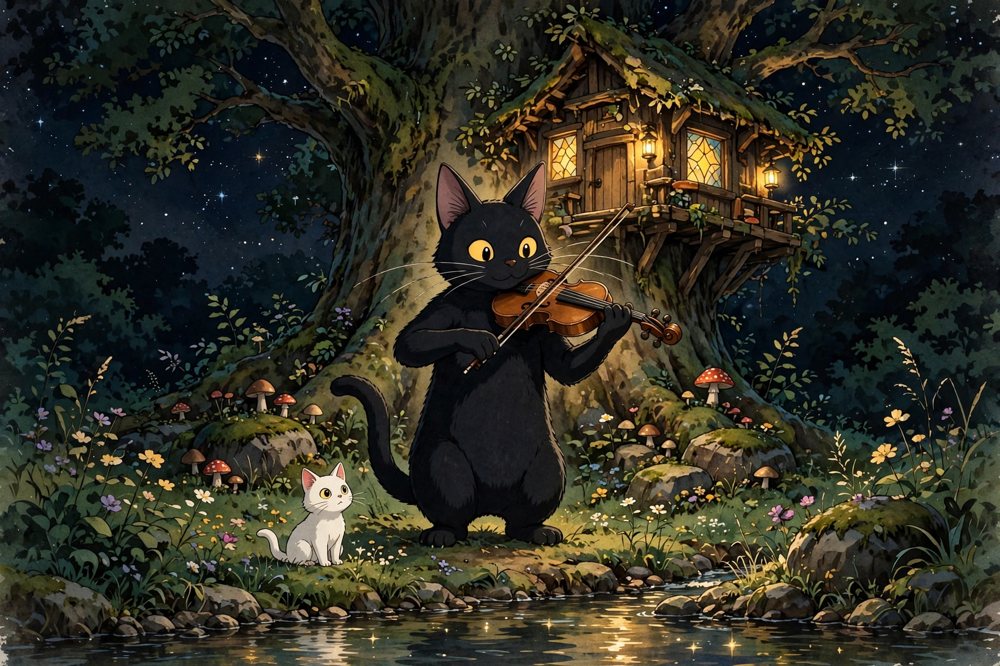
- 可复用规律：童话主角与场景主次要写“LARGER cat in the centre + SMALLER treehouse behind + narrow stream along the bottom edge only”，只写“猫身旁树屋、前景小溪”生成器会把树屋推大、把小溪铺满底部；配饰要写“with no scarf”，否则它会给动物自加围巾来填脖子。

## 13 · Reddit r/midjourney · 野蛮人（多图帖，只选图 1）

- 原链接：https://www.reddit.com/r/midjourney/comments/1xmvuf5/barbarians/
- 热度：顶贴 155、评论 7，2026-11-03 发布；多图帖共 7 张，只选图 1
- 原图拆解（图 1）：主体为肌肉发达的野蛮人战士特写/半身像，头戴带角头盔，面部粗犷、神情凶狠；皮肤呈粉红暖调，披着毛皮斗篷，肩扛/手持战斧；背景为战火橙黄色调与模糊人群/战场，画面为粗犷插画/漫画质感，肌肉线条与毛发纹理突出，色彩以暖橙、棕、暗红为主。
- v1 提示词原文：`Rough illustration in comic style, close-up half-body of a muscular barbarian warrior, wearing a horned helmet, rugged face, fierce expression, pinkish warm skin tones, wearing a fur cloak, carrying a battle axe on his shoulder, background of fiery orange-yellow battlefield tones with blurred crowds and battle, prominent muscle lines and fur texture, colours mainly warm orange, brown and dark red`
  - 中文解析：粗犷漫画插画 + 肌肉野蛮人半身特写 + 带角头盔 + 粗犷面部凶狠表情 + 粉红暖调皮肤 + 毛皮斗篷 + 肩扛战斧 + 战火橙黄背景模糊人群战场 + 肌肉线条毛发纹理突出 + 暖橙棕暗红为主。
- v1 对比：像在带角头盔、粗犷凶狠面部、粉红暖调皮肤、毛皮斗篷、肩扛战斧、战火橙黄背景、粗犷漫画质感；偏在战斧巨大在左、背景人群细节清晰、胸部裸露突出；丢了“背景只是模糊人群、斗篷盖住身体”的克制。
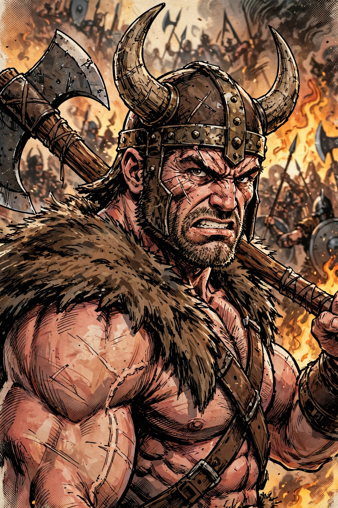
- v2 提示词原文：`Rough illustration in comic style, close-up half-body of a muscular barbarian warrior, wearing a horned helmet, rugged face, fierce expression, pinkish warm skin tones, wearing a fur cloak COVERING his shoulders and chest, holding a SMALLER battle axe resting behind his shoulder only, background of fiery orange-yellow battlefield tones with HEAVILY BLURRED crowds and battle, prominent muscle lines and fur texture, colours mainly warm orange, brown and dark red`
- v2 对比：毛皮斗篷变大盖住肩胸、战斧变小在肩后，更接近“斗篷为主、斧为配角”；代价是表情变龇牙更夸张、背景人群与旗帜仍较清晰，v1 的“闭口凶狠 + 大斧压阵”反而更有战士气势。
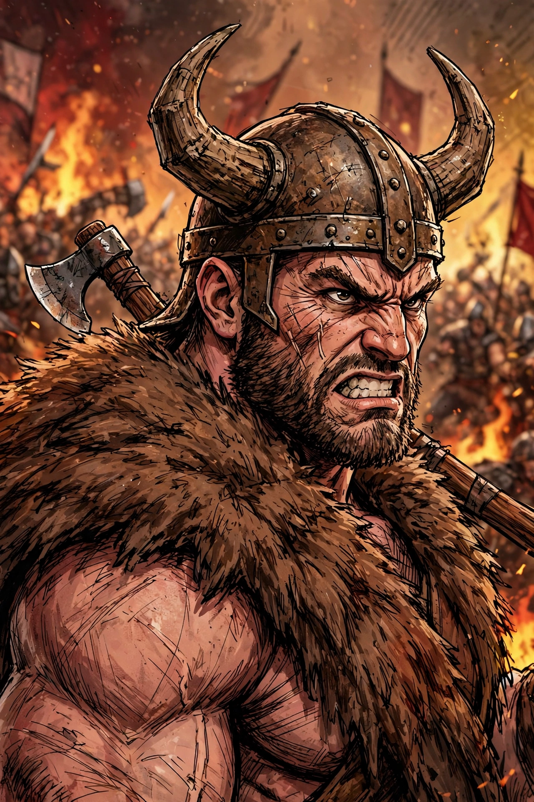
- 可复用规律：战场背景虚化要写“HEAVILY BLURRED crowds”，只写“模糊人群”生成器仍会画出清晰的士兵与旗帜；斗篷覆盖要写“COVERING his shoulders and chest”，否则“披着斗篷”会被画成只搭在肩上的窄条。

## 14 · Reddit r/midjourney · 黑金后人类（多图帖，只选图 1）

- 原链接：https://www.reddit.com/r/midjourney/comments/1xn03jw/posthuman_in_black_and_gold/
- 热度：顶贴 67、评论 3，2026-11-04 发布；多图帖共 4 张，只选图 1
- 原图拆解（图 1）：主体为黑金后人类侧脸特写，面部覆盖光泽黑色面具/头盔，金色细线勾勒面部轮廓与头饰；头顶有复杂的金色机械管线与装饰结构；嘴唇闭合、神情冷峻；背景为灰暗虚化，黑色与金色高对比，金属反光锐利，未来主义雕塑感强。
- v1 提示词原文：`Close-up side profile of a post-human face, face covered by a glossy black mask and helmet, thin gold lines outlining the facial contours and headdress, complex gold mechanical tubes and decorative structures on top of the head, lips closed, cold stern expression, background softly blurred in grey, strong black and gold contrast, sharp metallic reflections, futuristic sculptural feeling`
  - 中文解析：后人类侧脸特写 + 光泽黑面具头盔 + 金色细线勾勒面部轮廓头饰 + 头顶复杂金色机械管线装饰结构 + 闭唇冷峻 + 灰暗虚化背景 + 黑金高对比 + 金属反光锐利 + 未来主义雕塑感。
- v1 对比：像在光泽黑面具、金色细线轮廓、头顶金色管线装饰、闭唇冷峻、灰暗虚化背景、黑金高对比、金属反光；偏在头顶被裁切、管线在左侧后脑密集成团、眼睛为闭合细缝；丢了“头部完整入画、管线分布均匀”的干净。
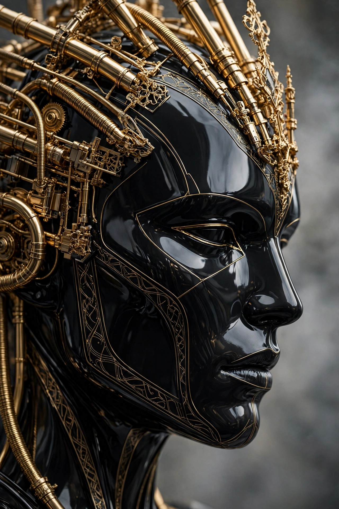
- v2 提示词原文：`Close-up side profile of a post-human face with the WHOLE head fully in frame, face covered by a glossy black mask and helmet, only THIN gold lines outlining the facial contours and headdress, only a FEW simple gold tubes on top of the head with no dense decoration, lips closed, cold stern expression, background softly blurred in grey, strong black and gold contrast, sharp metallic reflections, futuristic sculptural feeling`
- v2 对比：头部完整入画、金色只剩细线与头顶三根短管，更接近“干净的黑金侧脸”；代价是复杂机械装饰全失、面部更像光面人台，v1 的“密管线 + 繁复头饰”反而更有后人类机械感。
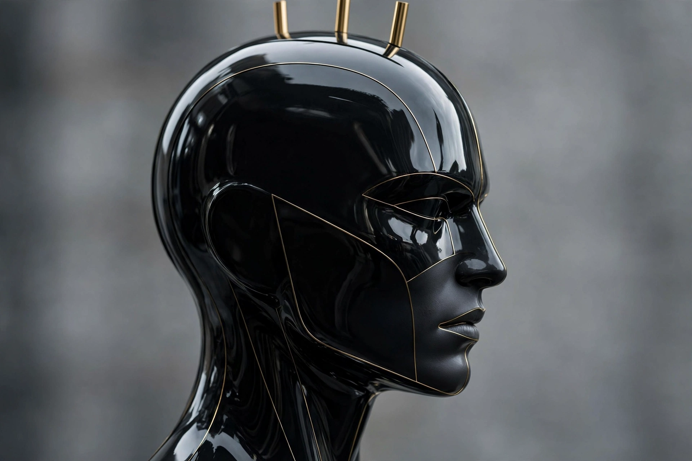
- 可复用规律：复杂头饰的收敛要二选一写清：要“繁复”就写“complex tubes and decorative structures”，要“干净”就写“only THIN lines + a FEW simple tubes”，只写“金色细线 + 复杂管线”生成器会在两者之间摇摆，出现一侧密集成团、一侧空白的不均匀。

## 15 · NightCafe · 歌手 Sara

- 原链接：https://creator.nightcafe.studio/creation/91i4txmkUMiJKTX2srUM
- 热度：点赞 172（详情页；列表曾显示 171，以详情页为准）、评论 91（详情页；列表曾显示 90，以详情页为准），2026-11-03 发布
- 原图拆解：主体为油彩风格女性歌手半身像，金色长辫发，面部朝向镜头微仰、嘴唇微张正在歌唱；一手握黑色话筒贴近嘴边；身穿白色低领上衣，佩戴金色项链、耳环与手链；背景为粉紫霓虹棕榈树与夜色舞台光，色彩艳丽，笔触厚重，氛围热烈、富有舞台感。
- v1 提示词原文：`Thick oil-painting half-body portrait of a female singer, long golden braided hair, face turned slightly up towards the camera, lips slightly open as if singing, one hand holding a black microphone close to her mouth, wearing a white low-neck top, gold necklace, earrings and bracelet, background of pink-purple neon palm trees and night stage lights, vivid colours, heavy brushstrokes, warm lively stage atmosphere`
  - 中文解析：厚涂油彩半身像 + 女性歌手 + 金色长辫发 + 面部微仰朝镜头 + 微张唇歌唱 + 一手握黑话筒贴近嘴边 + 白低领上衣 + 金项链耳环手链 + 粉紫霓虹棕榈树夜色舞台光 + 艳丽色彩 + 厚重笔触 + 热烈舞台氛围。
- v1 对比：像在金色长辫、面部微仰、微张唇歌唱、黑话筒贴嘴边、白低领上衣、金首饰、粉紫霓虹棕榈、夜色舞台光；偏在辫子垂在胸前、话筒斜向大、面部偏写实光滑、右侧自加了圆形舞台光斑；丢了“辫子在身后、笔触覆盖全画”的油彩感。
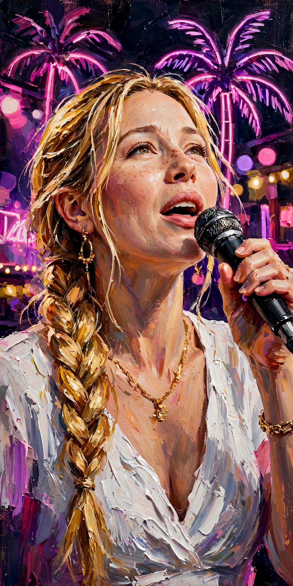
- v2 提示词原文：`Thick oil-painting half-body portrait with very visible heavy brushstrokes over the whole image, a female singer, long golden braided hair falling BEHIND her shoulder, face turned slightly up towards the camera, lips slightly open as if singing, one hand holding a SMALL black microphone vertically close to her mouth, wearing a white low-neck top, gold necklace, earrings and bracelet, background of pink-purple neon palm trees only with no round stage lights, vivid colours, warm lively stage atmosphere`
- v2 对比：辫子变身后、话筒变小竖直、背景只剩霓虹棕榈、笔触更厚重，更接近“油彩歌手”；代价是嘴张得更大露齿、面部更仰，v1 的“微张唇 + 斜话筒”反而更像正在轻声歌唱。
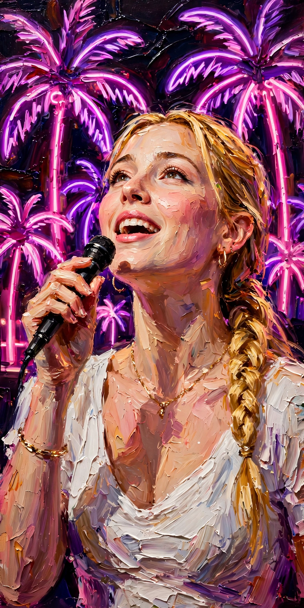
- 可复用规律：歌手辫子位置要写“falling BEHIND her shoulder”，只写“长辫发”生成器默认把辫子垂到胸前；舞台光斑要写“palm trees only with no round stage lights”，否则它会用圆形光斑填满背景。

---

## 共性结论

1. **“只写名词，生成器就用默认量填满”**：本期几乎每张 v1 的偏差都是“量”而不是“物”——羽翼过大、薄纱过长、草地铺满、行星过多、花朵成冠、管线成团、背景人群过清晰。收敛必须用数量词 + 位置词（SMALLER、only a FEW、at the bottom only、BEHIND、fully in frame）同时写清，缺一个维度，另一个维度就会反弹。
2. **“全身/特写”与“完整入画”要分开写**：写“全身”不等于“完整入画”（3 号 v2 下半身被裁、9 号 v1 薄纱溢出），写“特写”不等于“头部完整”（6 号 v1 耳朵被裁、14 号 v1 头顶被裁）。要写“WHOLE head fully in frame”或“fully in frame”才管裁切。
3. **“模糊”要分级**：只写 blurred，生成器仍会给清晰士兵、清晰草地、清晰光斑；要写 HEAVILY BLURRED、softly blurred、at the bottom only 这种程度 + 范围，才管得住背景。
4. **“简单”会连带换掉其他特征**：5 号简化服装换来了垂地长发，14 号简化头饰换来了人台感，2 号简化笑容换来了证件感。收敛一个变量时，必须把不想变的变量（发长、表情、面部质感）也钉住，否则 v2 是“换了一个偏差”，不是“更接近”。
5. **“真实感”在本期写实组里主要靠姿势与光，而非堆细节**：1 号靠蜷坐 + 右侧窗光，9 号靠侧脸远景 + 纯色影棚，2 号（受限）只能靠提示词语义。堆雀斑、堆植物、堆机械关节反而会先暴露自加特征，再暴露 AI 感。

## 写实人物小结

- 本期写实人物 3 张：1 号窗边阅读少女（光与姿势最完整，毛孔与手部细节未确认）、2 号书店甜笑少女（原图大图未加载，只能按提示词语义反推，v1/v2 的雀斑与植物均为自加）、9 号未来装束东亚女性（侧脸远景 + 纯色影棚，文字 rog / vac 与机械关节为重生成演绎，未逐项确认）。
- 共性：三张的“逼真感”都来自可验证的大结构——自然窗光与虚化书架（1 号）、阳光书店与米色开衫（2 号，按提示词）、侧脸轮廓与均匀影棚光（9 号），而不是来自毛孔、眼角纹、飞发根根这些在截图分辨率下无法确认的微观细节；报告里把“已确认”与“未确认”分开写，是本组最重要的一条纪律。
- 避免塑料感的提示词组合（本期验证有效）：`realistic skin texture with pores and slight imperfections` + `candid` + `no retouching look` + 具体姿势（CURLED UP、knees drawn up）+ 具体光位（warm golden daylight from the right、even soft lighting）+ 具体背景控制（softly blurred background、solid light grey studio background）；只写“写实、自然”而不写姿势、光位、背景控制，生成器会默认给摆拍式正面、均匀磨皮、露齿大笑。
- AI 破绽对照（本期三张共同的检查点）：皮肤过滑（用毛孔 + 小瑕疵 + 抓拍对抗，但不可编造已确认的毛孔）、表情过摆拍（用蜷坐微倦、闭唇甜笑、侧脸冷静对抗）、手指与机械/文字细节（1 号手指、9 号关节与 rog / vac 在远景下未确认，写对比时只说“重生成演绎”，不说“与原图一致”）。

## GitHub 同步

- （待浏览器同步任务回传后补记：报告路径、图片数量、提交与核对结果；未改 README、未删文件、未动 reports/ 与 tech-reports/。）
