# 每日 AI 图片反推学习 · 2026-11-05

## 选图说明与缺口

- 选图时间：2026-11-05 上午（北京时间），浏览器选图任务 08:58–09:09 完成，补位任务 09:09–09:11 完成，全程未登录、未注册、未购买、未下载原图文件。本报告的原图拆解以浏览器任务回传的文字描述为准，未逐像素下载核对原图，因此 v1、v2 对比是“重生成图 vs 浏览器描述的原图特征”，不是与原图文件的逐像素对照；凡描述中未确认的细节，报告里不作推断。
- 本期 15 张构成：NightCafe 4 张 + PixAI 3 张 + PromptHero 2 张 + Civitai 3 张 + Reddit r/midjourney 2 张 + SeaArt 1 张，共 6 个平台；写实人物照片 4 张（第 9、10、11、12 张，均为面部可见）。第 1 张为奇幻肖像与照片感结合，不计入严格写实人物 4 张；第 2 张为电影感油画质感、第 4 张为厚涂插画且面纱遮挡下半脸，均不计入写实人物。
- **去重说明：当天共跳过 6 张重复图，未入选、未反推、未生成，见下表。** 选图前已核对以往全部报告（2026-10-29 至 2026-11-04）的平台加图片 ID / 原链接；本期 15 张均为全新图片，系跳过重复图后顺延补位凑满。补位过程特别说明：首轮选图误选了 2 张往期图（PixAI memento mori、PromptHero 意大利男子），经与以往报告核对发现后已换掉，未反推、未生成，最终 15 张不含这两张；下表 6 张均为当天实际跳过的重复图。跨平台视觉上明显同一张图的转载，本批未发现可确认的此类重帖。

| 平台 | 原链接 | 首次出现日期 |
|---|---|---|
| PixAI《the angel of divination》 | https://pixai.art/artwork/2072845630856237375 | 2026-11-03 报告（2026-11-04 已列为跳过） |
| PixAI《Sleeping with a dragon》 | https://pixai.art/artwork/2071347550122412397 | 2026-11-03 报告（2026-11-04 已列为跳过） |
| PixAI《lingyang》 | https://pixai.art/artwork/2066780919459621280 | 2026-11-03 报告（2026-11-04 已列为跳过） |
| PromptHero 未来风东亚女子（@chorlo） | https://prompthero.com/prompt/b765d8da5ca-seedream-5-seedream-5-pro-a-young-east-asian-woman-posing-in-futuristic-attire-against-a-solid-light-gray-background-she-is-equipped-with-a | 2026-11-04 报告 |
| PixAI《memento mori》 | https://pixai.art/artwork/2073338548770559862 | 2026-11-03 报告（首轮误选，补位时换掉） |
| PromptHero 意大利男子 FLUX 写真 | https://prompthero.com/prompt/869df0f4100-flux-flux-3-a-masterpiece-cinematic-color-photo-of-a-34-year-old-muscular-italian-man-with-gritty-masculine-and-intense-gaze-sharp | 2026-11-03 报告（首轮误选，补位时换掉） |

- **其他缺口（按实测，不硬编）**：NightCafe 直接点击图片曾弹出登录提示，改用标题链接在新标签打开详情页后可正常公开浏览；Rockin' Robin 因详情页同时带有视频元素，按只选静态图规则未选用。PixAI 首页前排连续出现已知重复图，已顺延补位。PromptHero 注册墙弹窗可关闭，详情页可公开浏览；Hero 时装特写（@mariechantalmid，2026-10-06）与另一热门候选 high-end portrait photography（@userhwy31，2026-10-23）详情大图未加载，按规则未选用。Civitai 详情大图初次加载为黑屏，重新查看后加载成功，方计入选图；反应数按图标原样记录，未标注含义的页面数字不推断。Reddit r/midjourney 热门页可公开浏览，未使用 r/StableDiffusion、r/aiArt 补图，因名额已满；帖内除第 1 张外的其余图片未计入。SeaArt 直接访问 /explore 会重定向回首页，改经首页“Explore More”进入 /post 社区页后可正常浏览；Dragon and the Gardener 详情大图初次为加载动画，重新查看后加载成功，方计入选图。次选渠道 LiblibAI、ArtStation、Midjourney Explore 本次未再扩展，因 15 张名额已由上述 6 个平台补满；OpenArt、Ideogram、Leonardo、Pinterest 全程未作为选图来源。
- 本报告的 v1、v2 均为反推重写，不是照抄原帖提示词。
- 重生成图片保存在本任务目标工作区 `hidden_files/2026-11-05/images/` 下，报告内以图片文件名对应；GitHub 版见 ai-image-learning/2026-11-05.md，图片在 ai-image-learning/images/ 下。
- **生成完成情况：15 张的 v1 共 15 张次全部生成成功；v2 共 14 张次生成成功、1 张次未完成；合计 29 张次成功。第 10 张 v2 未能返回图片，未用无关图片代替，也未重复尝试。**

## 一览表

| # | 平台 | 作者 | 原链接 | 热度（快照） |
|---|---|---|---|---|
| 1 | NightCafe | D Rivers | https://creator.nightcafe.studio/creation/hdd0CLQQ8dhjzPhzgh01/cheryl | 详情页 148 likes，热门页 25 comments，2026-11-04 发布（创建于 2026-10-24），单张主图 |
| 2 | NightCafe | Justine the Scottish Soul | https://creator.nightcafe.studio/creation/ZsxxLMmTz8l7lhrBS10c/time-for-breakfast | 162 likes，39 comments，2026-11-05 发布（创建于 2026-11-04），单张主图 |
| 3 | NightCafe | Shywolf | https://creator.nightcafe.studio/creation/74WIoTKUAR5OiSooweKe/a-bond-beyond-words | 详情页 317 likes，113 comments；热门页另显示收藏类数字 2（未标注文字含义，不推断），2026-11-04 发布（创建于 2026-11-02），单张主图 |
| 4 | NightCafe | Nikko P | https://creator.nightcafe.studio/creation/sWKWmi5lwuDOv8VksWEj/the-silent-arrow | 718 likes，89 comments，Daily 5%，模型 GPT Image 2 Low，画幅 3:4，2026-11-04 发布（创建于 2026-11-02），单张主图 |
| 5 | PixAI（补位） | st4rlight | https://pixai.art/artwork/2071920512426472565 | 详情页 701 likes、7 comments（首页显示 700 likes，系浏览时计数变化），2026-10-27 发布，单张静态图，提示词作者隐藏，模型 PixAI DiT.2 Tsubaki.2 |
| 6 | PixAI | TXL | https://pixai.art/artwork/2073334480740312561 | 640 likes，2 comments，2026-10-31 发布，单张 |
| 7 | PixAI | aricat | https://pixai.art/artwork/2070145063809646344 | 900 likes，13 comments，2026-10-22 发布，单张 |
| 8 | PromptHero（补位） | @userggc94 | https://prompthero.com/prompt/98d46e68541-hero-10-pain-the-six-paths-of-pain-konan-landscape-format-ai-image-generation-prompt-create-a-highly-detailed-cinematic-2d-anime | 1.3k views，11 favorites，模型 Hero 1.0，2026-10-01 发布，单张静态图 |
| 9 | PromptHero（写实人物） | @miladlotfalii | https://prompthero.com/prompt/658447a57a8-chatgpt-image-gpt-image-25-scene-type-fashion-editorial-theme-gucci-vintage-luxury-setting-environment-interior-fashion-set-background-wallpaper-pattern-ornate-looped-gold-and | 1.3k views，9 favorites，模型 ChatGPT Image gpt-image-2.5，2026-10-24 发布，单张 |
| 10 | Civitai（写实人物） | TheP3NGU1N | https://civitai.com/images/147876490 | 反应 👍113、❤️46、😂16、😢8；页面另有数字 61 的按钮，未标注含义，不推断，2026-11-04 上传，单张 |
| 11 | Civitai（写实人物） | tianhuodao | https://civitai.com/images/147868242 | 反应 👍58、❤️18、😂2；页面另有数字 20 的按钮，未标注含义，不推断，2026-11-04 上传，单张 |
| 12 | Civitai（写实人物） | tehalex86 | https://civitai.com/images/147860226 | 反应 👍86、❤️24、😢4；页面另有数字 0 的按钮，未标注含义，不推断，2026-11-04 上传，单张 |
| 13 | Reddit r/midjourney | u/Mordrat_The_Grey | https://www.reddit.com/r/midjourney/comments/1xnpxtl/the_emperors_watch/ | 188 upvotes，3 comments，2026-11-04 发布；多图帖共 20 张，只选第 1 张 |
| 14 | Reddit r/midjourney | u/Zaicab | https://www.reddit.com/r/midjourney/comments/1xna5pg/notredame/ | 433 upvotes，9 comments，2026-11-04 发布；多图帖共 3 张，只选第 1 张 |
| 15 | SeaArt | Stellaris | https://www.seaart.ai/postDetail/dajjiqte878c73dfb030?pt=lg-cluster-56 | 页面底部依次显示 880、346、浏览 38、评论 2（前两项图标为点赞与爱心，页面未用文字标注其含义，按图标记录），2026-09-14 发布，单张作品（Work Info · 1） |

类别分布：写实人物照片 4 张（9、10、11、12），奇幻肖像 1 张（1），电影感油画厨房 1 张（2），奇幻插画 3 张（3、4、15），动漫 4 张（5、6、7、8），黑暗奇幻画框 1 张（13），幻想建筑插画 1 张（14）。

---

## 1 · NightCafe · Cheryl

- 原链接：https://creator.nightcafe.studio/creation/hdd0CLQQ8dhjzPhzgh01/cheryl
- 热度：详情页 148 likes，热门页 25 comments，2026-11-04 发布（创建于 2026-10-24），单张主图
- 原图拆解：正面特写金发女子，头顶中分编发与蓬松卷发交织，发丝飞散，浅蓝眼睛直视镜头，淡妆、唇色柔和，脸颊带自然红晕；身后为大面积朦胧月亮与枯枝藤蔓构成的光晕，背景深绿灰蓝、虚化明显；风格为奇幻肖像与照片感结合，皮肤偏光滑磨皮感，毛孔与瑕疵在本页分辨率下不明显，未确认；眼神光清晰，眼角纹不明显，未确认；整体柔光、面部受光均匀，背景光晕为画面第二光源感。
- v1 提示词原文：`Fantasy portrait photograph, close-up of a blonde woman facing the camera, braided hair on top of her head mixed with voluminous loose curls and flyaway strands, light blue eyes looking directly at the camera, soft makeup, gentle lip colour, natural blush on her cheeks, behind her a large blurred moon and bare branches forming a halo, deep green-grey-blue background, strongly blurred background, soft even light on her face, smooth skin`
  - 中文解析：奇幻肖像照片 + 正面特写金发女子 + 头顶编发混蓬松卷发飞散发丝 + 浅蓝眼睛直视镜头 + 淡妆柔和唇色自然腮红 + 身后大面积朦胧月亮与枯枝光晕 + 深绿灰蓝背景强烈虚化 + 面部柔和均匀光 + 光滑皮肤。
- v1 对比：像在头顶编发、蓬松卷发、浅蓝眼睛直视、柔和唇色腮红、身后月亮枯枝、深绿灰蓝虚化背景；偏在画面为更紧的面部特写、枯枝形成更明显的枝条花环、皮肤自加了鼻部雀斑感；丢了“月亮只是身后大面积光晕、皮肤偏磨皮光滑”的克制。
- v1 图：

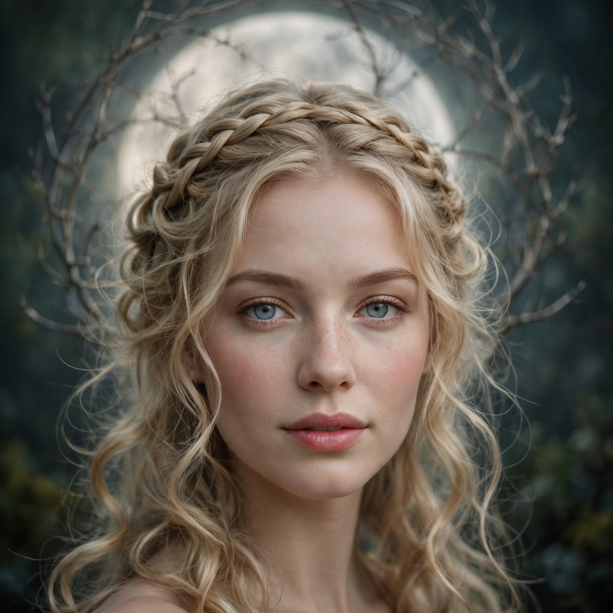
- v2 提示词原文：`Fantasy portrait photograph, head-and-shoulders view, not a tight face crop, of a blonde woman facing the camera, braided hair on top of her head mixed with soft loose curls and only a few flyaway strands, light blue eyes looking directly at the camera, soft makeup, gentle lip colour, natural blush, clear matte skin with NO freckles, behind her one large softly blurred moon and only a few sparse bare branches, deep green-grey-blue background, strongly blurred background, soft even light on her face`
- v2 对比：皮肤变干净无雀斑、取景变为头肩、枯枝变稀疏，更接近“光滑肖像”；代价是月亮移到右上、不再位于头后正中央，v1 的“月亮在头后成光晕”反而更贴合原描述。
- v2 图：

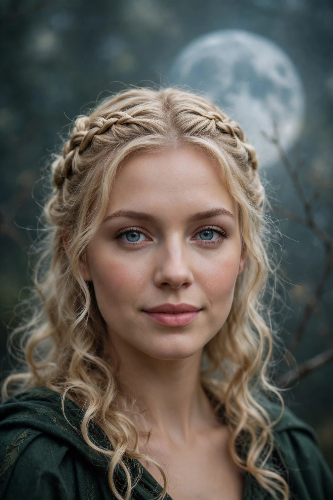
- 可复用规律：无雀斑要写“clear matte skin with NO freckles”，只写“光滑皮肤”生成器仍会用雀斑填真实感；月亮位置要写“behind her”，否则它会把月亮移到画面一角。

## 2 · NightCafe · Time for breakfast

- 原链接：https://creator.nightcafe.studio/creation/ZsxxLMmTz8l7lhrBS10c/time-for-breakfast
- 热度：162 likes，39 comments，2026-11-05 发布（创建于 2026-11-04），单张主图
- 原图拆解：厨房中景，黑发女子系红发带、穿黑白围裙式服装，低头微笑煎蛋，右手持锅铲；左侧彩色玻璃窗透入暖光，窗外可见远景建筑，右侧红黄吊灯、木柜与画框，桌边有两个小孩；风格为电影感油画质感，非严格照片，笔触与暖色氛围明显，色彩以红、棕、金为主，光影为窗光加室内暖灯的混合暖调。
- v1 提示词原文：`Cinematic oil-painting style scene in a kitchen, a black-haired woman wearing a red headband and a black-and-white apron dress, looking down and smiling while frying an egg, holding a spatula in her right hand, on the left a colourful stained-glass window letting in warm light with distant buildings outside, on the right red and yellow pendant lamps, wooden cabinets and framed pictures, two small children at the edge of the table, warm red, brown and gold colours, mixed window light and warm indoor lamps`
  - 中文解析：电影感油画厨房 + 黑发红发带黑白围裙女子 + 低头微笑煎蛋右手锅铲 + 左侧彩色玻璃窗暖光远景建筑 + 右侧红黄吊灯木柜画框 + 桌边两个小孩 + 红棕金暖色 + 窗光与室内暖灯混合。
- v1 对比：像在红发带黑白格围裙、低头微笑煎蛋、左侧彩色玻璃窗、右侧红黄吊灯木柜画框、桌边小孩、红棕金暖调；偏在煎锅推到前景正中、前景自加了陶罐柠檬蒜头等杂物；丢了“女子在灶边中景、前景简洁”的位置感。
- v1 图：

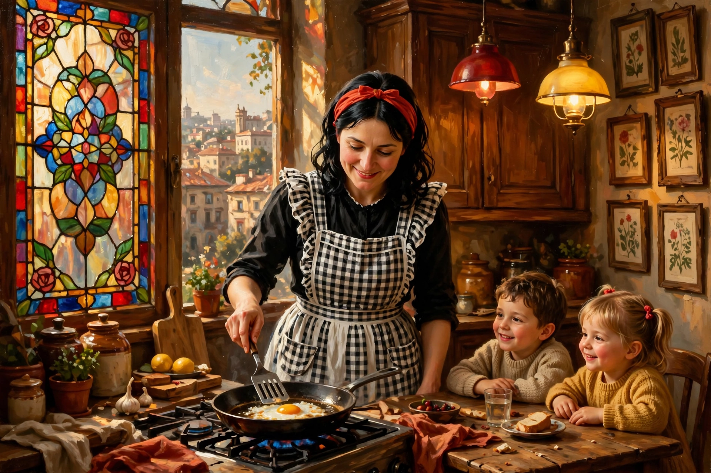
- v2 提示词原文：`Cinematic oil-painting style kitchen scene, medium shot, a black-haired woman wearing a red headband and a black-and-white apron dress standing at the side of the stove, looking down and smiling while frying an egg in a pan, two small children seen in profile at the edge of a table, not facing the camera, on the left a colourful stained-glass window letting in warm light with distant buildings outside, on the right red and yellow pendant lamps, wooden cabinets and framed pictures, warm red, brown and gold colours, mixed window light and warm indoor lamps, simple foreground with no jars or lemons in front`
- v2 对比：小孩变为桌边侧面、不再正对镜头笑，女子移到灶边、前景变简洁，更接近“中景厨房生活”；代价是女子面部朝向更偏侧面，v1 的“正面低头微笑 + 前景煎锅”反而更生动。
- v2 图：

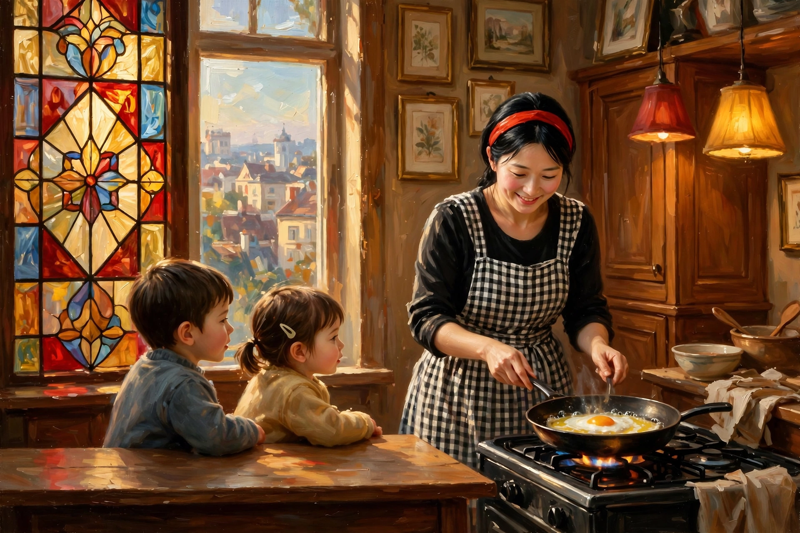
- 可复用规律：配角不要正对镜头要写“seen in profile, not facing the camera”，只写“桌边有两个小孩”生成器会把小孩画成正对镜头的主角；前景杂物要写“simple foreground with no jars or lemons”，否则厨房会被陶罐蔬果填满。

## 3 · NightCafe · A Bond Beyond Words

- 原链接：https://creator.nightcafe.studio/creation/74WIoTKUAR5OiSooweKe/a-bond-beyond-words
- 热度：详情页 317 likes，113 comments；热门页另显示收藏类数字 2（未标注文字含义，不推断），2026-11-04 发布（创建于 2026-11-02），单张主图
- 原图拆解：横构图，左侧黑白巨翼巨兽（龙/狮鹫感）展翅俯向右侧金发精灵女子，女子伸手、仰脸对视，尖耳与编发带红饰；背景为雾中山林与红花绿叶，羽毛黑白分明、爪尖锐利；光线为自然散射日光，色彩以黑、白、绿、红点缀为主，奇幻写实风格，人物面部为侧脸，未按写实人物照片标准计入。
- v1 提示词原文：`Fantasy realistic illustration, horizontal composition, on the left a huge black-and-white winged beast with sharp claws spreading its wings and leaning down toward a blonde elf woman on the right, the woman with pointed ears and braided hair with a red ornament reaches up and looks up at the beast, misty forest background with red flowers and green leaves, black, white, green and red accents, natural diffused daylight, detailed black-and-white feathers`
  - 中文解析：奇幻写实插画 + 横构图 + 左侧黑白巨翼巨兽展翅俯向右侧精灵女子 + 女子尖耳编发红饰伸手仰脸 + 雾中山林红花绿叶 + 黑白绿红点缀 + 自然散射日光 + 黑白羽毛细节。
- v1 对比：像在左侧黑白巨翼、右侧金发精灵侧脸、编发红饰、伸手仰脸、雾中山林红花；偏在巨兽张口露齿、表情偏凶猛，女子手离巨兽较远；丢了“俯身对视的温和羁绊感”。
- v1 图：

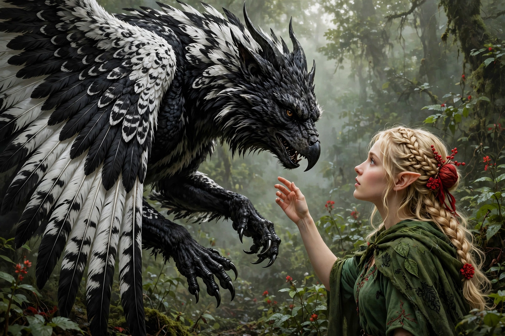
- v2 提示词原文：`Fantasy realistic illustration, horizontal composition, on the left a huge black-and-white winged beast with sharp claws and its mouth CLOSED, calm expression, leaning down gently toward a blonde elf woman on the right, the woman with pointed ears and braided hair with a red ornament reaches up with her hand close to the beast, misty forest background with red flowers and green leaves, black, white, green and red accents, natural diffused daylight, detailed black-and-white feathers, gentle mood, no open snarling mouth`
- v2 对比：巨兽闭口、表情平静、女子指尖几乎触到兽喙，羁绊感明显更接近原描述；代价是巨兽头部更大、身体裁切更多，v1 的“全身巨翼 + 完整对视距离”反而构图更完整。
- v2 图：

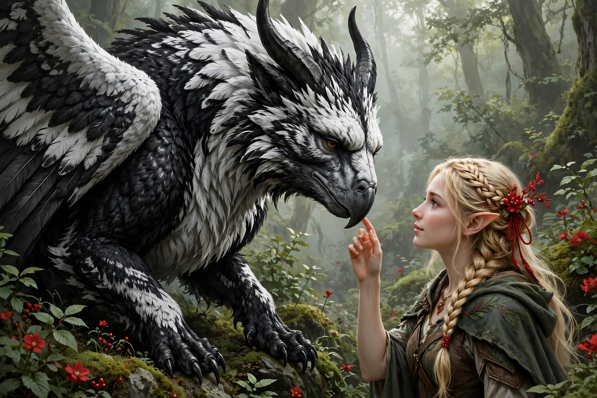
- 可复用规律：温和巨兽要写“mouth CLOSED, calm expression, no open snarling mouth”，只写“俯向女子”生成器默认画张口咆哮；接触感要写“hand close to the beast”，否则伸手只会停在半空。

## 4 · NightCafe · The Silent Arrow

- 原链接：https://creator.nightcafe.studio/creation/sWKWmi5lwuDOv8VksWEj/the-silent-arrow
- 热度：718 likes，89 comments，Daily 5%，模型 GPT Image 2 Low，画幅 3:4，2026-11-04 发布（创建于 2026-11-02），单张主图
- 原图拆解：戴宝石面纱与华丽头巾的女弓箭手正面拉弓，箭尖带金色光芒，眼睛直视镜头；右侧为月夜下的哥特城堡群与大月亮，画面带厚涂肌理与金箔感，黑、金、白为主色；构图为人物居中偏左、城堡与月亮在右上形成对比，风格为奇幻厚涂插画，面纱遮挡下半脸，故不计入写实人物照片。
- v1 提示词原文：`Fantasy thick-paint illustration, a woman archer in the centre-left wearing a jewelled veil and an ornate headdress, drawing a bow, the arrow tip glowing gold, her eyes looking directly at the camera, on the right a moonlit gothic castle group under a large moon, thick impasto texture with gold-leaf feeling, black, gold and white as main colours, night moonlight`
  - 中文解析：奇幻厚涂插画 + 居中偏左女弓箭手宝石面纱华丽头饰拉弓 + 箭尖金光 + 眼睛直视镜头 + 右侧月夜哥特城堡群大月亮 + 厚涂金箔感 + 黑金白主色 + 夜月光。
- v1 对比：像在正面拉弓、金色箭尖、眼睛直视、右侧城堡大月亮、厚涂金箔黑金白；偏在头饰被画成繁复大王冠、弓竖直巨大；丢了“面纱轻纱感、头饰只是点缀”的克制。
- v1 图：

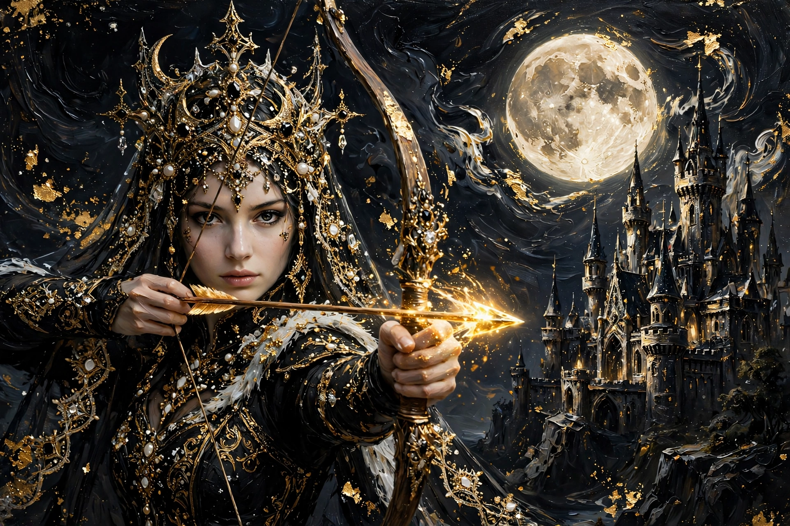
- v2 提示词原文：`Fantasy thick-paint illustration, a woman archer wearing a sheer jewelled veil and a SMALL jewel headpiece, not a large crown, drawing a smaller bow, the arrow tip glowing gold, her eyes looking directly at the camera, on the right a moonlit gothic castle group under a large moon, thick impasto texture with gold-leaf feeling, black, gold and white as main colours, night moonlight`
- v2 对比：轻纱面纱清晰、头饰变小、弓仍大但人物更突出，更接近“面纱弓箭手”；代价是城堡变小、位置更偏右下，v1 的“城堡与月亮右上对比”反而更醒目。
- v2 图：

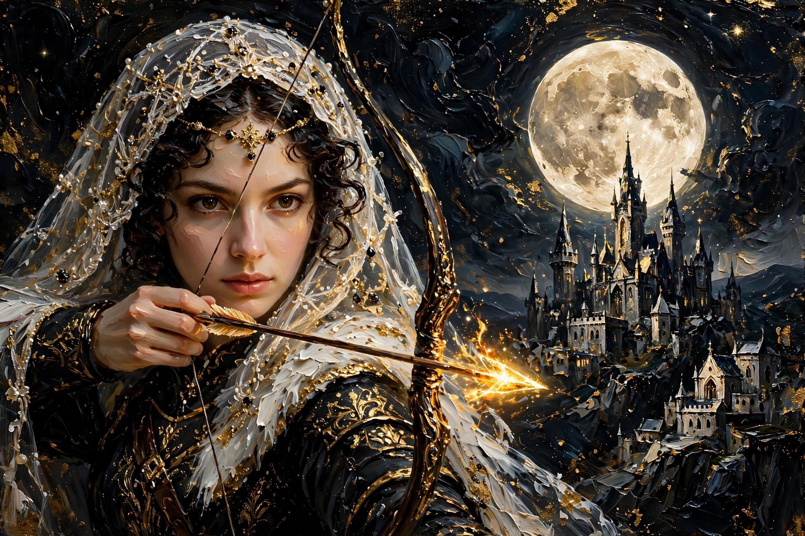
- 可复用规律：面纱要写“sheer jewelled veil”，只写“宝石面纱”生成器会把它画成王冠；头饰大小要写“SMALL jewel headpiece, not a large crown”，否则华丽头饰会被推成王冠。

## 5 · PixAI · 餐桌大小反差（补位）

- 原链接：https://pixai.art/artwork/2071920512426472565
- 热度：详情页 701 likes、7 comments（首页显示 700 likes，系浏览时计数变化），2026-10-27 发布，单张静态图，提示词作者隐藏，模型 PixAI DiT.2 Tsubaki.2
- 原图拆解：横构图“大小反差”餐桌场景。前景中央是一名穿白衬衫、黑马甲、黑领带的小男孩，盘腿坐在大餐盘上，周围摆满红色圆果（石榴/樱桃感），餐盘两侧有放大比例的刀叉；背景是一名金发巨人少女，头戴大黑蝴蝶结，闭眼、单手托腮俯视男孩，另一手持餐叉靠近画面右侧；左右各有一座银色烛台与白蜡烛，背景为深色华丽室内纹饰；色彩以白、黑、红、银灰为主，烛光暖调与背景冷暗对比，动漫插画风格，线条柔和、光影带高光描边感。非写实人物照片，不计入写实人物数。
- v1 提示词原文：`Anime illustration, horizontal composition with a size contrast at a dinner table, in the foreground centre a small boy wearing a white shirt, black waistcoat and black tie, sitting cross-legged on a large dinner plate surrounded by red round fruits, oversized knife and fork on the sides of the plate, in the background a giant blonde girl wearing a large black bow, eyes closed, one hand on her cheek looking down at the boy, her other hand holding a fork near the right side, silver candlesticks with white candles on both sides, dark ornate interior background, white, black, red and silver-grey colours, warm candlelight against a dark background, soft lines, highlighted edges`
  - 中文解析：动漫插画 + 横构图餐桌大小反差 + 前景中央小男孩白衬衫黑马甲黑领带盘腿坐大餐盘红圆果 + 两侧放大刀叉 + 背景金发巨人少女大黑蝴蝶结闭眼托腮俯视 + 另一手持叉近右侧 + 两侧银烛台白蜡烛 + 深色华丽室内 + 白黑红银灰 + 烛光暖调对冷暗背景 + 柔和线条高光描边。
- v1 对比：像在盘腿男孩、红圆果餐盘、放大刀叉、金发少女大黑蝴蝶结闭眼托腮、右侧持叉、两侧烛台、深色华丽室内；偏在少女头部占满画面上半、男孩被压到画面底部；丢了“男孩与餐盘在前景占主导、少女在后方远处”的大小反差层级。
- v1 图：

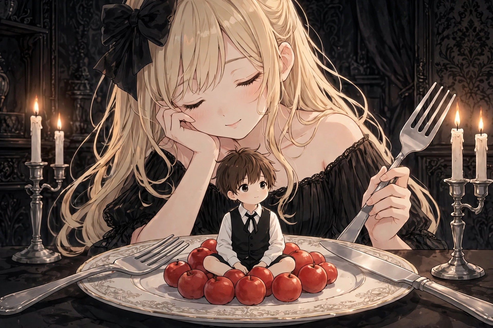
- v2 提示词原文：`Anime illustration, horizontal composition with a size contrast at a dinner table, wide shot, the large dinner plate with a small boy in the foreground taking up the lower half, the boy wearing a white shirt, black waistcoat and black tie, sitting cross-legged on the plate surrounded by red round fruits, oversized knife and fork on the sides of the plate, in the background, SMALLER and farther away, a giant blonde girl wearing a large black bow, eyes closed, one hand on her cheek looking down at the boy, her other hand holding a fork, silver candlesticks with white candles on both sides, dark ornate interior background, white, black, red and silver-grey colours, warm candlelight against a dark background, the girl does NOT fill the top of the frame`
- v2 对比：男孩与餐盘占下半前景、少女退到远处餐桌尽头，大小反差更接近原描述；代价是少女变小、持叉不明显、背景烛台变多，v1 的“少女近景托腮 + 叉子特写”反而更有压迫感。
- v2 图：

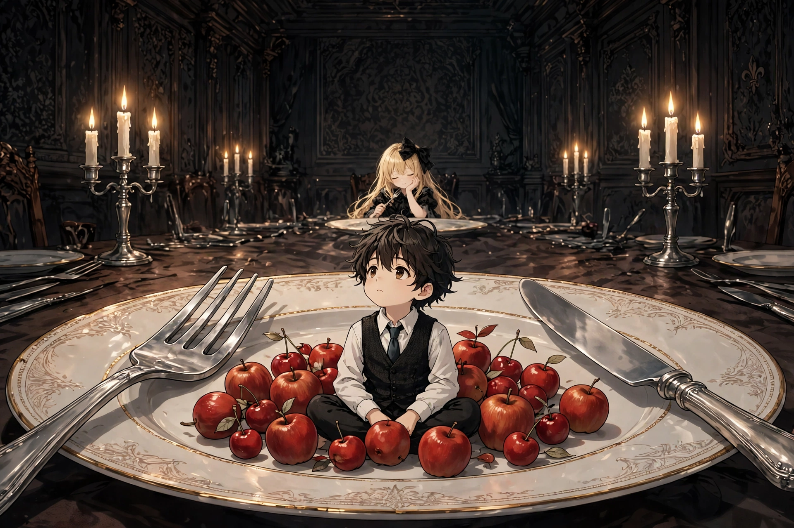
- 可复用规律：大小反差要写“wide shot + foreground taking up the lower half + background SMALLER and farther away + does NOT fill the top”，只写“前景男孩、背景少女”生成器仍会把少女放大到占满画面。

## 6 · PixAI · Halloween Miku

- 原链接：https://pixai.art/artwork/2073334480740312561
- 热度：640 likes，2 comments，2026-10-31 发布，单张
- 原图拆解：竖构图，初音未来万圣节造型：绿色双马尾、黑白女仆风短裙配南瓜灯、蝙蝠与蜘蛛网元素，背景为深紫夜色与南瓜灯光；人物居中全身，裙摆与发丝动态飘动，色彩以绿、黑、橙、紫为主，动漫插画风格，线条清晰、阴影柔和。
- v1 提示词原文：`Anime illustration, vertical composition, a girl with green twin-tails in a Halloween costume, black-and-white maid-style short dress, pumpkin lanterns, bats and spider webs, deep purple night background with pumpkin light, full body centred, skirt and hair moving dynamically, green, black, orange and purple colours, clear lines, soft shadows`
  - 中文解析：动漫插画 + 竖构图 + 绿双马尾万圣节造型 + 黑白女仆短裙 + 南瓜灯蝙蝠蜘蛛网 + 深紫夜色南瓜灯光 + 居中全身 + 裙摆发丝动态飘动 + 绿黑橙紫 + 线条清晰阴影柔和。
- v1 对比：像在绿双马尾、黑白女仆裙、南瓜灯蝙蝠蜘蛛网、深紫夜色、居中全身、动态裙摆发丝；偏在自加了手持南瓜、条纹裙摆、过膝袜、地面堆满南瓜；丢了“短裙造型简洁、背景元素点缀而非铺满”的克制。
- v1 图：

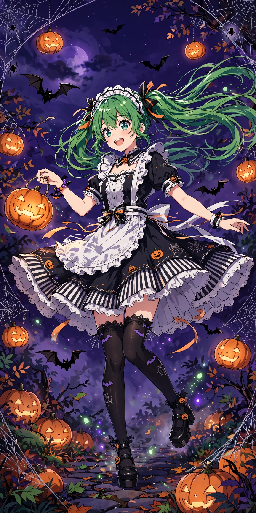
- v2 提示词原文：`Anime illustration, vertical composition, a girl with green twin-tails of EQUAL length, black-and-white maid-style short dress with a plain skirt, no striped skirt, no thigh-high stockings, hands empty, no pumpkin held in her hand, a few pumpkin lanterns, bats and spider webs in the background, deep purple night background with pumpkin light, full body centred, skirt and hair moving dynamically, green, black, orange and purple colours, clear lines, soft shadows, no pumpkins piled on the ground`
- v2 对比：裙子变素色、手空、无过膝袜、无地面南瓜堆，更接近“简洁万圣节全身像”；代价是双马尾仍一长一短、裙子变长围裙式，v1 的“短裙 + 手持南瓜”反而更万圣节。
- v2 图：

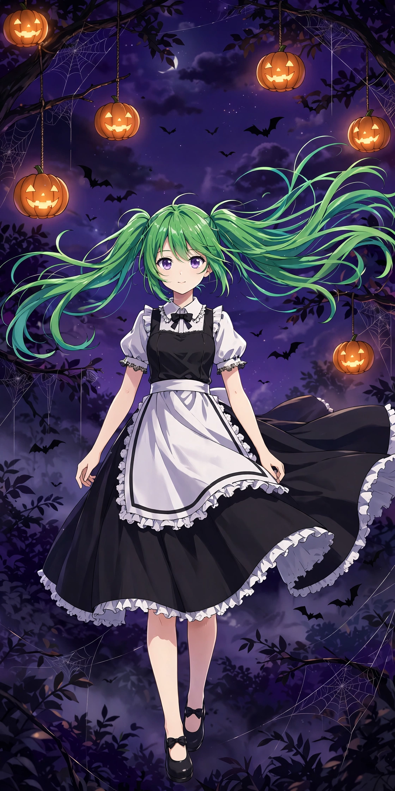
- 可复用规律：节日全身像的配饰要逐项写“no striped skirt, no thigh-high stockings, hands empty, no pumpkins piled on the ground”，只写“短裙”生成器会用条纹、过膝袜、手持道具把造型填满；双马尾等长要写“of EQUAL length”，否则一侧会被拉得很长。

## 7 · PixAI · 蝴蝶双人图

- 原链接：https://pixai.art/artwork/2070145063809646344
- 热度：900 likes，13 comments，2026-10-22 发布，单张
- 原图拆解：竖构图，两位长发少女并肩站立，左侧黄发、右侧黑发，白色与浅色服装上有蝴蝶翅膀纹样，画面下方有大面积蝴蝶；背景为浅色虚化，人物面部柔和、眼睛大而明亮，动漫风格，色彩明亮干净，构图对称、视线向下，氛围温柔梦幻。
- v1 提示词原文：`Anime illustration, vertical composition, two long-haired girls standing side by side, the left girl with yellow hair and the right girl with black hair, wearing white and light-coloured clothes with butterfly-wing patterns, a large area of butterflies below them, light blurred background, soft faces with large bright eyes, symmetrical composition, eyes looking down, gentle dreamy atmosphere, bright clean colours`
  - 中文解析：动漫插画 + 竖构图 + 黄发黑发两位长发少女并肩 + 白与浅色服装蝴蝶翅膀纹样 + 下方大面积蝴蝶 + 浅色虚化背景 + 面部柔和大而明亮眼睛 + 对称构图视线向下 + 温柔梦幻 + 明亮干净色彩。
- v1 对比：像在黄发黑发并肩、蝴蝶纹样服装、下方大面积蝴蝶、对称视线向下、温柔梦幻；偏在背景被画成花园、服装带黄蓝 tint、下方蝴蝶铺满整个下三分之一；丢了“浅色虚化素背景、服装以白为主”的干净。
- v1 图：

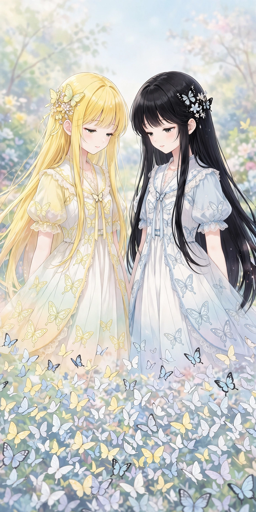
- v2 提示词原文：`Anime illustration, vertical composition, two long-haired girls standing side by side, the left girl with yellow hair and the right girl with black hair, wearing PLAIN WHITE dresses with only small butterfly-wing patterns, a plain light blurred background with no flower garden, a small group of butterflies below them only, not covering the whole lower third, soft faces with large bright eyes, symmetrical composition, eyes looking down, gentle dreamy atmosphere, bright clean colours`
- v2 对比：服装变纯白小蝴蝶纹样、背景变素色虚化、下方蝴蝶只剩一小群，更接近“干净双人像”；代价是蝴蝶存在感变弱，v1 的“下方蝴蝶海”反而更有原描述的大面积感。
- v2 图：

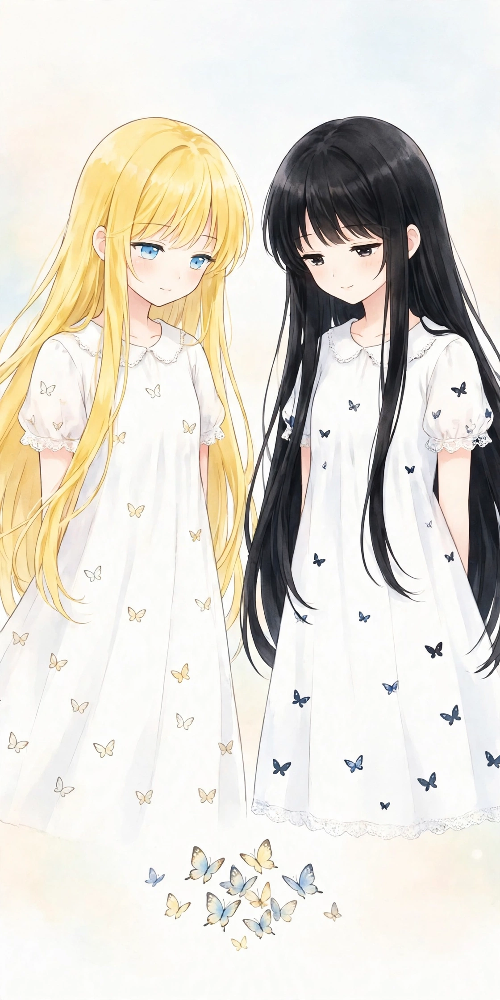
- 可复用规律：素背景要写“plain light blurred background with no flower garden”，只写“浅色虚化”生成器会补上花园；下方元素面积要写“a small group only, not covering the whole lower third”，否则“大面积”会被推满画面。

## 8 · PromptHero · Pain 六道（补位）

- 原链接：https://prompthero.com/prompt/98d46e68541-hero-10-pain-the-six-paths-of-pain-konan-landscape-format-ai-image-generation-prompt-create-a-highly-detailed-cinematic-2d-anime
- 热度：1.3k views，11 favorites，模型 Hero 1.0，2026-10-01 发布，单张静态图
- 原图拆解：横构图电影感 2D 动漫场景。中央最前方为天道佩恩：橙色竖立短发、护额、紫色轮回眼，穿黑底红云晓组织长袍，双脚分开站立、表情冷峻；其后呈浅半圆形错落站立其余五道，均穿同款黑红云袍、橙发，姿态各异但整体克制；左侧远景另有一名较小人物，提示词称其为小南，但画面中辨识度有限，未确认；背景为雨中被毁的木叶废墟、破损房屋与升起的烟尘，上方为深蓝灰近黑的暴风雨云层，雨丝清晰；机位为略低于眼平的低角度中远景，突出中央人物的压迫感；色彩以黑、炭灰、深蓝、冷灰为主，红云为唯一高饱和点缀，光线为阴天漫射光、明暗克制，无闪电、无落日、无神光。非写实人物照片，不计入写实人物数。
- v1 提示词原文：`Cinematic 2D anime scene, horizontal composition, in the centre front a man with orange spiky short hair, a headband and purple Rinnegan eyes, wearing a black robe with red clouds, standing with feet apart and a cold expression, behind him in a shallow semicircle the other five figures in the same black red-cloud robes with orange hair, restrained varied poses, a small distant figure on the left, background of a rain-ruined village with broken houses and rising smoke, dark blue-grey near-black storm clouds, clear rain streaks, slightly below eye level, medium-long shot, black, charcoal, dark blue and cold grey colours, red clouds as the only highly saturated accent, overcast diffused light, no lightning, no sunset, no god rays`
  - 中文解析：电影感 2D 动漫 + 横构图 + 中央最前方橙色竖立短发护额紫色轮回眼黑红云袍双脚分开冷峻 + 其后浅半圆形其余五道同款袍橙发克制姿态 + 左侧远景小人物 + 雨中被毁村庄破损房屋烟尘 + 深蓝灰近黑暴风雨云雨丝清晰 + 略低于眼平中远景 + 黑炭灰深蓝冷灰 + 红云唯一高饱和点缀 + 阴天漫射光 + 无闪电落日神光。
- v1 对比：像在中央橙发护额紫眼黑红云袍、其余五道同款、雨中废墟烟尘、暴风雨云雨丝、黑灰蓝冷调红云点缀；偏在其余五道被画成跪地捆绑状、背景自加了燃烧火焰；丢了“其余五道站立半圆形、只有烟尘没有明火”的克制。
- v1 图：

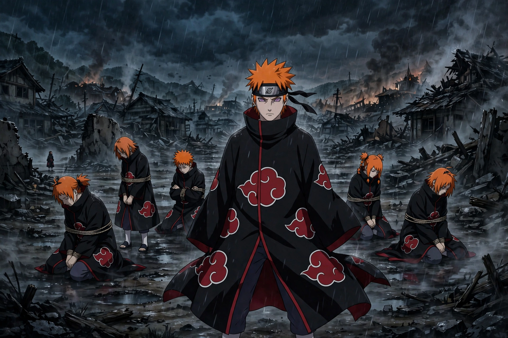
- v2 提示词原文：`Cinematic 2D anime scene, horizontal composition, in the centre front a man with orange spiky short hair, a headband and purple Rinnegan eyes, wearing a black robe with red clouds, standing with feet apart and a cold expression, behind him in a shallow semicircle FIVE other figures ALL STANDING, in the same black red-cloud robes with orange hair, restrained varied standing poses, NO kneeling, NO ropes, a small distant figure on the left, background of a rain-ruined village with broken houses and rising smoke, NO fires, NO burning buildings, dark blue-grey near-black storm clouds, clear rain streaks, slightly below eye level, medium-long shot, black, charcoal, dark blue and cold grey colours, red clouds as the only highly saturated accent, overcast diffused light, no lightning, no sunset, no god rays`
- v2 对比：其余五道全部站立半圆形、无跪地无绳索、无火焰只有烟尘，更接近原描述；代价是后排只有四人清晰加左侧远景一人，v1 的“废墟纵深 + 雨势”反而更浓。
- v2 图：

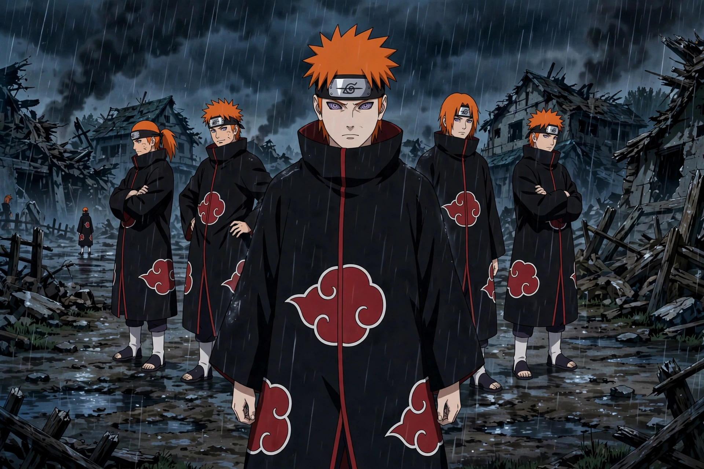
- 可复用规律：群像姿态要写“ALL STANDING, NO kneeling, NO ropes”，只写“站立”生成器仍可能把后排画成跪地受缚；废墟光源要写“NO fires, NO burning buildings”，只写“烟尘”生成器会补上燃烧火焰。

## 9 · PromptHero · Gucci 复古时装女子（写实人物）

- 原链接：https://prompthero.com/prompt/658447a57a8-chatgpt-image-gpt-image-25-scene-type-fashion-editorial-theme-gucci-vintage-luxury-setting-environment-interior-fashion-set-background-wallpaper-pattern-ornate-looped-gold-and
- 热度：1.3k views，9 favorites，模型 ChatGPT Image gpt-image-2.5，2026-10-24 发布，单张
- 原图拆解：中景时装大片，女子坐于红色天鹅绒古董沙发，穿 Gucci 老花西装套装、金色缎面蝴蝶结衬衫、金属高跟鞋，戴超大圆墨镜与金耳环，手持老花手袋；背景为绿金花纹壁纸、深红地毯与暖色台灯，红、金、绿、米色构成复古奢华色板，眼平机位、半身裁切。
- 写实要素：面部可见但墨镜遮挡眼睛，眼神光与眼角纹均未确认；皮肤光滑、瑕疵与毛孔在本页分辨率下不明显，未确认；深棕波浪长发分层自然，少量飞散发丝可见；手部持包姿态自然，耳部被头发部分遮挡，未确认；牙齿未露出，未确认；室内暖光柔和、阴影过渡自然，背景壁纸与沙发虚化有限，镜头焦段未确认；颗粒不明显，未确认；表情为自信、唇微张的摆拍感，非抓拍放松感。
- AI 破绽对照：本张最容易破绽是墨镜遮眼后“眼睛不存在”的空洞感、老花图案重复错位、手袋五金与logo变形；原图用“墨镜 + 金耳环 + 老花套装 + 红丝绒沙发”的强造型压住细节，但眼神光、毛孔、耳部均未确认，不能写成已验证的真实感证据。
- v1 提示词原文：`Photorealistic fashion editorial photograph, medium shot, eye-level, half-body crop, a woman sitting on a red velvet antique sofa, wearing a Gucci monogram suit, a gold satin bow blouse and metallic high heels, oversized round sunglasses and gold earrings, holding a monogram handbag, background of green and gold patterned wallpaper, dark red carpet and a warm lamp, red, gold, green and beige vintage luxury colour palette, soft warm indoor light, natural shadow transitions, realistic skin texture with pores and slight imperfections, no retouching look`
  - 中文解析：写实时装大片 + 中景眼平半身裁切 + 红天鹅绒古董沙发女子 + 老花西装套装金色缎面蝴蝶结衬衫金属高跟鞋 + 超大圆墨镜金耳环 + 手持老花手袋 + 绿金花纹壁纸深红地毯暖色台灯 + 红金绿米复古奢华色板 + 室内暖光柔和阴影自然过渡 + 毛孔小瑕疵真实皮肤 + 无修图感。
- v1 对比：像在红丝绒沙发、老花套装、金缎蝴蝶结、手袋、绿金壁纸、暖灯、红金绿米色板；偏在女子面部为四分之三侧向、皮肤自加了雀斑与斑点；丢了“正面时装大片、皮肤光滑”的原描述方向。
- v1 图：

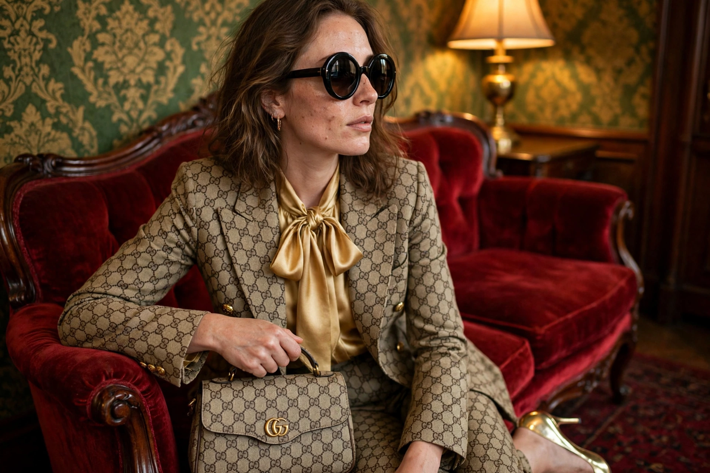
- v2 提示词原文：`Photorealistic fashion editorial photograph, medium shot, eye-level, half-body crop, a woman facing the camera, sitting on a red velvet antique sofa, wearing a Gucci monogram suit, a gold satin bow blouse and metallic high heels, oversized round sunglasses and gold earrings, holding a monogram handbag, background of green and gold patterned wallpaper, dark red carpet and a warm lamp, red, gold, green and beige vintage luxury colour palette, soft warm indoor light, natural shadow transitions, smooth clear skin with NO freckles and NO spots, no retouching look`
- v2 对比：女子正对镜头、皮肤变干净无雀斑斑点，更接近“正面时装大片”；代价是墨镜变玳瑁色、台灯变双灯，v1 的“黑色圆墨镜 + 单灯”反而更贴合原描述配饰。
- v2 图：

- 可复用规律：墨镜时装照的面部朝向要写“facing the camera”，只写“中景时装”生成器会画成侧脸；光滑皮肤要写“smooth clear skin with NO freckles and NO spots”，否则“真实皮肤”会被翻译成雀斑斑点。

## 10 · Civitai · 夜窗女子（写实人物）

- 原链接：https://civitai.com/images/147876490
- 热度：反应 👍113、❤️46、😂16、😢8；页面另有数字 61 的按钮，未标注含义，不推断，2026-11-04 上传，单张
- 原图拆解：竖构图，女子站于夜间车窗/玻璃前，双臂交叉，穿白色蕾丝吊带裙，棕色长卷发披肩；玻璃上叠加城市灯光倒影与光斑，背景为夜色街道与红色车灯光斑，暖冷对比明显；提示词片段标注 35mm 胶片照片、重颗粒。
- 写实要素：皮肤在暖光下有自然光泽，毛孔与细小瑕疵在本页分辨率下不明显，未确认；面部略带不对称的自然神态，眼睛直视镜头、眼神光来自窗外灯光反射；发丝飞散与光晕交织；手臂交叉的皮肤褶皱自然；牙齿未露出，未确认；背景城市灯光呈圆形虚化光斑，前景玻璃反射强化纵深；胶片颗粒明显，是本张最强的照片感线索；表情平静微张唇，偏摆拍而非抓拍。
- AI 破绽对照：本张最容易破绽是玻璃反射与人物光影不一致、卷发发丝粘连成片、手臂交叉处手指数量与比例；原图用“玻璃反射 + 圆形虚化光斑 + 重颗粒”转移对皮肤细节的注意力，但毛孔、手部、牙齿均未确认，不能写成已验证的真实感证据。
- v1 提示词原文：`Photorealistic 35mm film photograph with heavy grain, vertical composition, a woman standing before a night car window and glass, arms crossed, wearing a white lace camisole dress, long brown curly hair over her shoulders, city lights reflected on the glass and bokeh spots, night street background with red car light bokeh, warm and cold light contrast, calm expression with lips slightly open, eyes looking at the camera, realistic skin texture with pores and slight imperfections, candid, no retouching look`
  - 中文解析：写实 35mm 胶片重颗粒照片 + 竖构图 + 夜窗玻璃前双臂交叉女子 + 白蕾丝吊带裙 + 棕色长卷发披肩 + 玻璃城市灯光倒影光斑 + 夜街红车灯光斑 + 暖冷对比 + 平静微张唇 + 眼睛直视镜头 + 毛孔小瑕疵真实皮肤 + 抓拍 + 无修图感。
- v1 对比：像在夜窗玻璃、双臂交叉、白蕾丝吊带裙、棕色长卷发、城市灯光倒影光斑、红车灯光斑、暖冷对比、平静微张唇；偏在玻璃上自加了雨滴与水痕、发丝偏湿；丢了“干燥玻璃只有倒影与光斑”的原描述方向。
- v1 图：

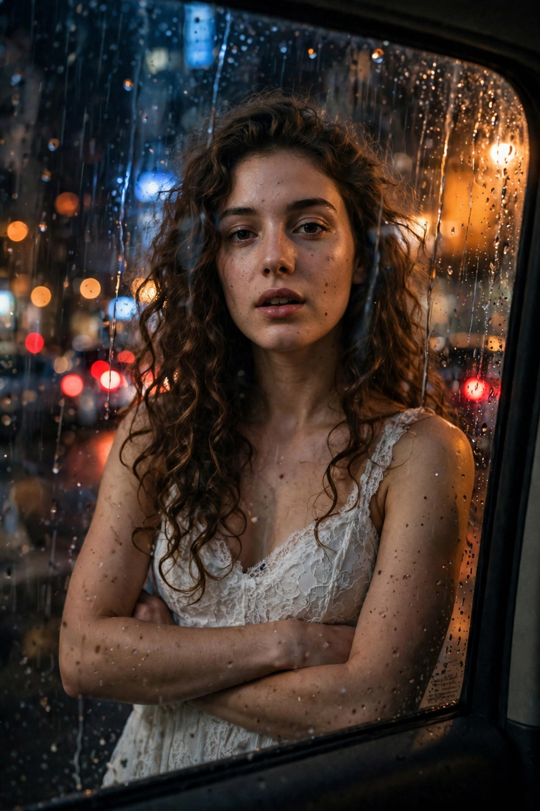
- v2 提示词原文（已尝试生成，但未返回图片，见生成完成情况）：`Photorealistic 35mm film photograph with heavy grain, vertical composition, a woman standing before a night car window and glass, arms crossed, wearing a white lace camisole dress, long brown curly DRY hair over her shoulders, city lights reflected on the DRY glass and bokeh spots, NO rain, NO water droplets on the glass, NO wet hair, night street background with red car light bokeh, warm and cold light contrast, calm expression with lips slightly open, eyes looking at the camera, realistic skin texture with pores and slight imperfections, candid, no retouching look`
- v2 对比：未完成，无 v2 图可对比；v2 方向本应是去掉雨滴水痕与湿发、只留干燥玻璃倒影与光斑。本项不嵌入图片、不替代。
- v2 图：未生成。
- 可复用规律：干燥玻璃要写“DRY glass, NO rain, NO water droplets, NO wet hair”，只写“玻璃倒影”生成器会默认加雨夜水痕；夜窗照片的真实感主要靠“玻璃反射 + 圆形光斑 + 重颗粒”三件套，而不是只写“真实皮肤”。

## 11 · Civitai · 雪夜街头女子（写实人物）

- 原链接：https://civitai.com/images/147868242
- 热度：反应 👍58、❤️18、😂2；页面另有数字 20 的按钮，未标注含义，不推断，2026-11-04 上传，单张
- 原图拆解：竖构图，黑发女子穿深色大衣、浅灰围巾、挎浅色布包，闭眼低头走在傍晚繁华街道，前景有虚化行人肩背，背景为灯牌、信号灯与人群，雪花/飘尘在逆光中可见，暖金夕阳与冷蓝阴影交织。
- 写实要素：闭眼低头的瞬间感强，抓拍感为本组最自然的一张；皮肤柔和、毛孔与瑕疵在本页分辨率下不明显，未确认；发丝被风吹散、脸颊两侧有飞散碎发；眼神光因闭眼未确认，眼角纹未确认；手耳牙齿均未清晰露出，未确认；背景人群与灯牌大幅虚化，主体突出，焦段与光圈未确认；画面有轻微颗粒与暖色溢光，氛围为黄昏街头纪实感。
- AI 破绽对照：本张最容易破绽是闭眼面部表情僵硬、背景灯牌文字乱码、人群虚化成色块；原图用“闭眼低头瞬间 + 前景虚化肩背 + 逆光雪尘”制造纪实感，但灯牌文字、手耳牙齿均未确认，不能写成已验证的真实感证据。
- v1 提示词原文：`Photorealistic street photograph, vertical composition, a black-haired woman wearing a dark coat, a light grey scarf and a light cloth bag, eyes closed and head lowered, walking in an evening busy street, a blurred passerby shoulder in the foreground, background of signboards, traffic lights and crowds, snow and dust visible in backlight, warm golden sunset light mixed with cold blue shadows, slight grain and warm flare, realistic skin texture with pores and slight imperfections, candid, no retouching look`
  - 中文解析：写实街头照片 + 竖构图 + 黑发女子深色大衣浅灰围巾浅色布包 + 闭眼低头行走 + 前景虚化行人肩背 + 背景灯牌信号灯人群 + 逆光雪尘 + 暖金夕阳冷蓝阴影 + 轻微颗粒暖色溢光 + 毛孔小瑕疵真实皮肤 + 抓拍 + 无修图感。
- v1 对比：像在闭眼低头、深色大衣浅灰围巾布包、前景虚化肩背、灯牌信号灯人群、逆光雪尘、暖金冷蓝；偏在前景肩背占画面左侧过大、背景灯牌自加了可读文字；丢了“前景只是肩背一角、灯牌只是虚化色块”的纪实克制。
- v1 图：

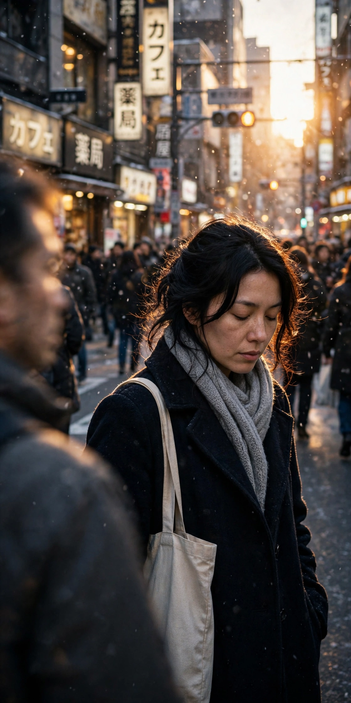
- v2 提示词原文：`Photorealistic street photograph, vertical composition, a black-haired woman wearing a dark coat, a light grey scarf and a light cloth bag, eyes closed and head lowered, walking in an evening busy street, a SMALL blurred passerby shoulder in the foreground corner only, background of BLURRED ILLEGIBLE signboards, traffic lights and crowds, NO readable text, snow and dust visible in backlight, warm golden sunset light mixed with cold blue shadows, slight grain and warm flare, realistic skin texture with pores and slight imperfections, candid, no retouching look`
- v2 对比：前景肩背缩到左下角、背景灯牌变虚化不可读，更接近“黄昏街头抓拍”；代价是背景人群更模糊、街道纵深变弱，v1 的“灯牌街道纵深”反而更有繁华感。
- v2 图：

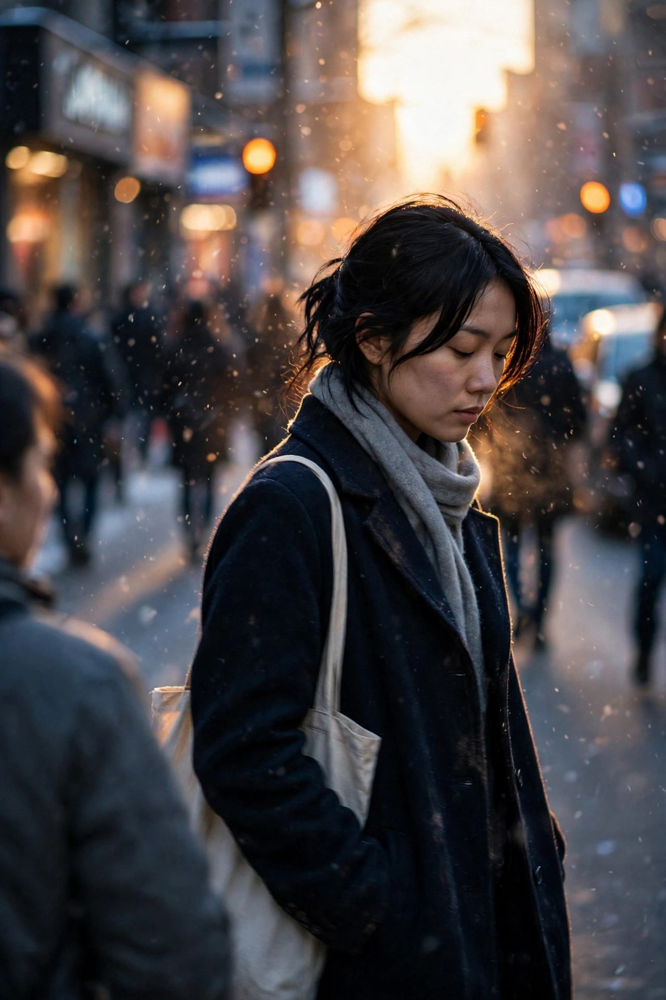
- 可复用规律：街头抓拍的前景要写“SMALL blurred shoulder in the foreground corner only”，只写“前景行人肩背”生成器会把肩背放大成半个人；灯牌要写“BLURRED ILLEGIBLE signboards, NO readable text”，否则它会生成可读但错误的文字。

## 12 · Civitai · 金发纹身女子（写实人物）

- 原链接：https://civitai.com/images/147860226
- 热度：反应 👍86、❤️24、😢4；页面另有数字 0 的按钮，未标注含义，不推断，2026-11-04 上传，单张
- 原图拆解：近景，浅金长发女子穿深色 T 恤，俯身微笑看向镜头，双臂布满彩色纹身，面部有少量雀斑感斑点，背景为室内虚化暖调。
- 写实要素：皮肤纹理与面部斑点较自然，不对称微笑增加真实感；眼睛直视镜头、眼神光清晰，眼角纹在本页分辨率下不明显，未确认；长发大量飞散、遮挡部分面部，发丝分层自然；牙齿未露出，未确认；手臂纹身细节丰富、色彩过渡自然；背景虚化明显、主体锐利，焦段未确认；颗粒轻微，未确认；表情放松自然，接近抓拍。
- AI 破绽对照：本张最容易破绽是纹身图案在手臂转折处断裂变形、飞散发丝穿过面部不合逻辑、微笑两侧不对称过度；原图用“彩色纹身 + 飞散发丝 + 不对称微笑”堆真实感线索，但眼角纹、牙齿、焦段均未确认，不能写成已验证的真实感证据。
- v1 提示词原文：`Photorealistic close-up photograph, a light blonde long-haired woman wearing a dark T-shirt, leaning forward and smiling at the camera, both arms covered with colourful tattoos, a few freckle-like spots on her face, indoor background blurred in warm tones, eyes looking directly at the camera with clear catchlights, hair strands flying and partly covering her face, realistic skin texture with pores and slight imperfections, candid, no retouching look`
  - 中文解析：写实近景照片 + 浅金长发女子深色 T 恤 + 俯身微笑看向镜头 + 双臂彩色纹身 + 面部少量雀斑感斑点 + 室内虚化暖调背景 + 眼睛直视清晰眼神光 + 发丝飞散部分遮面 + 毛孔小瑕疵真实皮肤 + 抓拍 + 无修图感。
- v1 对比：像在浅金长发、深色 T 恤、俯身、双臂彩色纹身、飞散发丝遮面、室内虚化暖调；偏在笑容为露齿大笑、雀斑偏重；丢了“俯身微笑的克制、牙齿未露出”的原描述方向。
- v1 图：

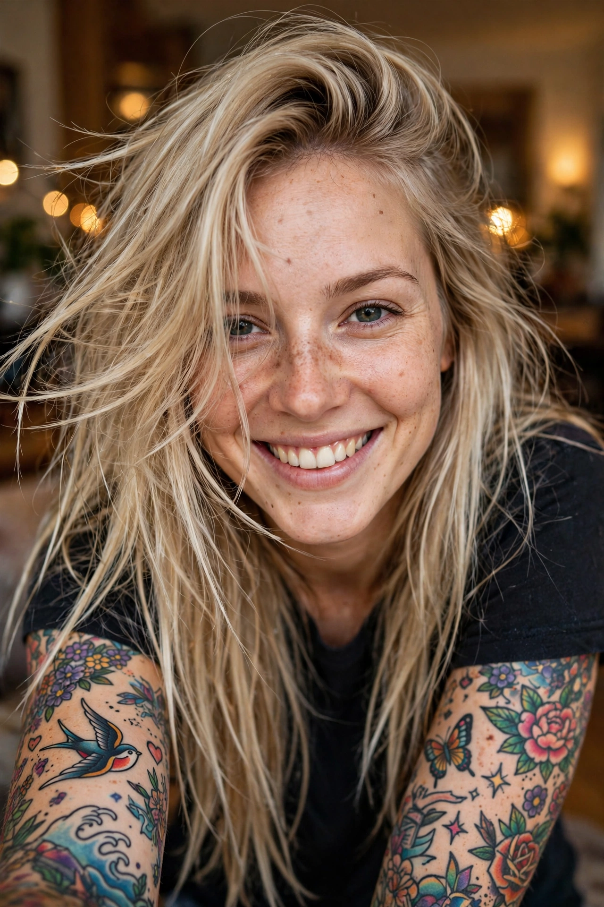
- v2 提示词原文：`Photorealistic close-up photograph, a light blonde long-haired woman wearing a dark T-shirt, leaning forward with a GENTLE CLOSED-LIP smile, NO teeth showing, looking at the camera, both arms covered with colourful tattoos, only a few light freckle-like spots on her face, indoor background blurred in warm tones, eyes looking directly at the camera with clear catchlights, hair strands flying and partly covering her face, realistic skin texture with pores and slight imperfections, candid, no retouching look`
- v2 对比：笑容变闭唇温和、无露齿、雀斑变轻，更接近“俯身微笑”；代价是面部更偏证件式正面，v1 的“露齿开怀”反而更有生活气。
- v2 图：

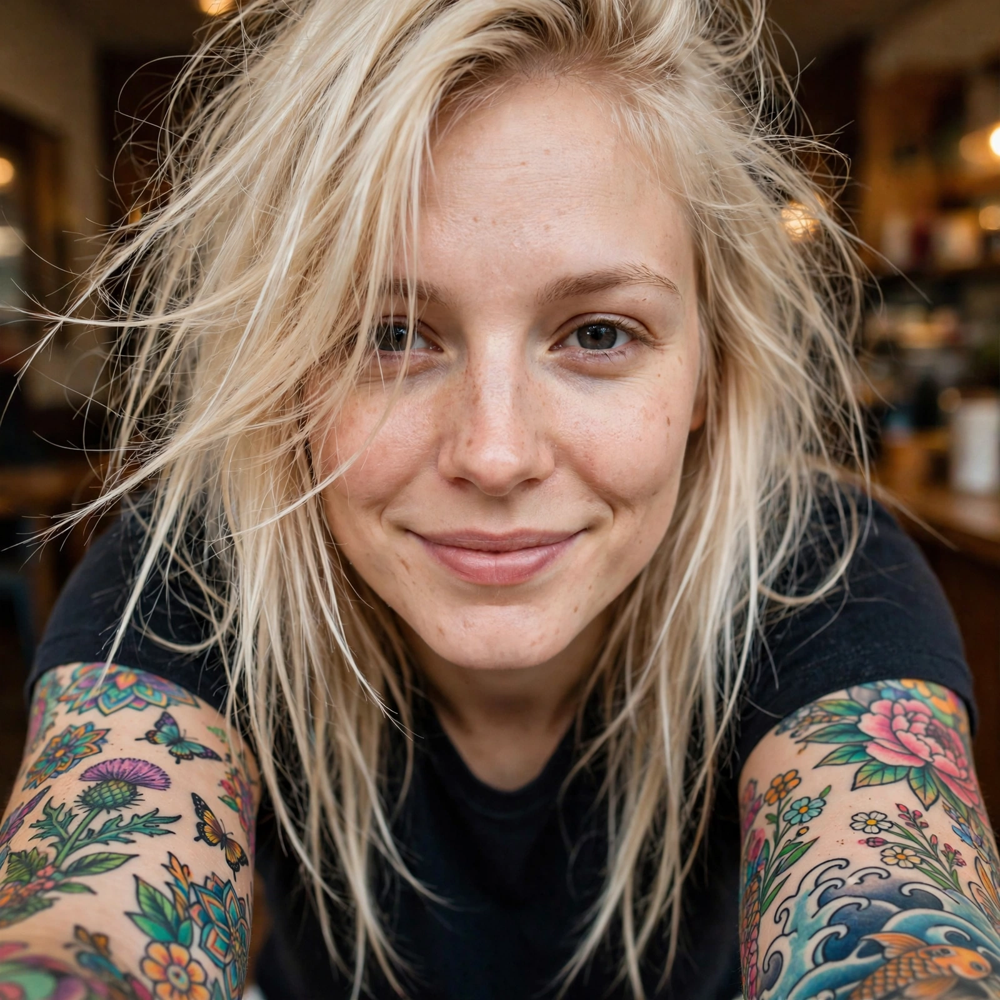
- 可复用规律：微笑要写“GENTLE CLOSED-LIP smile, NO teeth showing”，只写“微笑”生成器默认画露齿大笑；雀斑要写“only a few light freckle-like spots”，否则“真实皮肤”会被推成满脸雀斑。

## 13 · Reddit r/midjourney · The Emperor's Watch

- 原链接：https://www.reddit.com/r/midjourney/comments/1xnpxtl/the_emperors_watch/
- 热度：188 upvotes，3 comments，2026-11-04 发布；多图帖共 20 张，只选第 1 张
- 原图拆解：第 1 张为竖构图华丽画框内作品：戴尖刺王冠、面部为骷髅的帝王侧身托起一颗滴落金液的发光橙色圆球，身后为巨大橙色太阳与紫色裂纹天空，衣袍为银灰与深紫的繁复织锦，画框四角有骷髅与金色纹饰；色彩以橙、紫、金、黑为主，奇幻黑暗风格，光源为太阳与手中光球的双光源感。
- v1 提示词原文：`Dark fantasy illustration inside an ornate vertical frame, a skeleton emperor in side profile wearing a spiked crown, holding up a glowing orange orb dripping gold liquid, behind him a huge orange sun and a purple cracked sky, his robe in silver-grey and deep purple ornate brocade, the frame corners decorated with skulls and gold ornaments, orange, purple, gold and black colours, dual light from the sun and the glowing orb`
  - 中文解析：黑暗奇幻插画 + 竖构图华丽画框 + 骷髅帝王侧身尖刺王冠托起滴落金液发光橙色圆球 + 身后巨大橙色太阳紫色裂纹天空 + 银灰深紫繁复织锦衣袍 + 画框四角骷髅金色纹饰 + 橙紫金黑 + 太阳与光球双光源。
- v1 对比：像在骷髅帝王侧身、尖刺王冠、滴落金液橙色圆球、橙色太阳紫色裂纹天空、银灰深紫织锦、画框骷髅金饰；偏在画框占满画面、骷髅装饰过多、光球与太阳在画面中重叠；丢了“画框只是四角装饰、太阳与光球分开”的层级。
- v1 图：

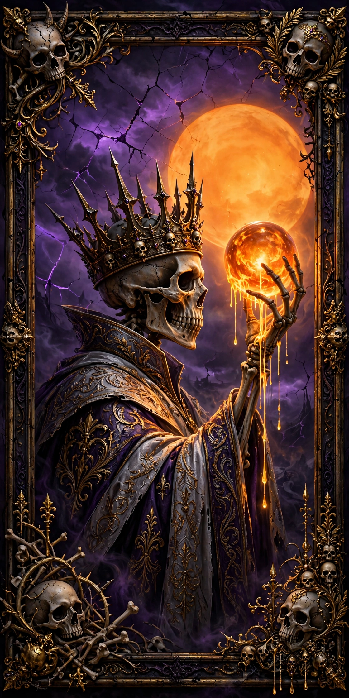
- v2 提示词原文：`Dark fantasy illustration inside a THIN ornate vertical frame with skulls and gold ornaments only at the four corners, a skeleton emperor in side profile taking up the upper body, wearing a spiked crown, holding up a glowing orange orb dripping gold liquid in his right hand at chest height, behind him a huge orange sun in the upper right, SEPARATE from the orb and not overlapping it, a purple cracked sky, his robe in silver-grey and deep purple ornate brocade, orange, purple, gold and black colours, dual light from the sun and the glowing orb`
- v2 对比：画框变细、四角骷髅金饰、太阳与光球分开不重叠，更接近“画框内作品”；代价是帝王头部更大、王冠仍带骷髅装饰，v1 的“全身织锦 + 满框装饰”反而更华丽。
- v2 图：

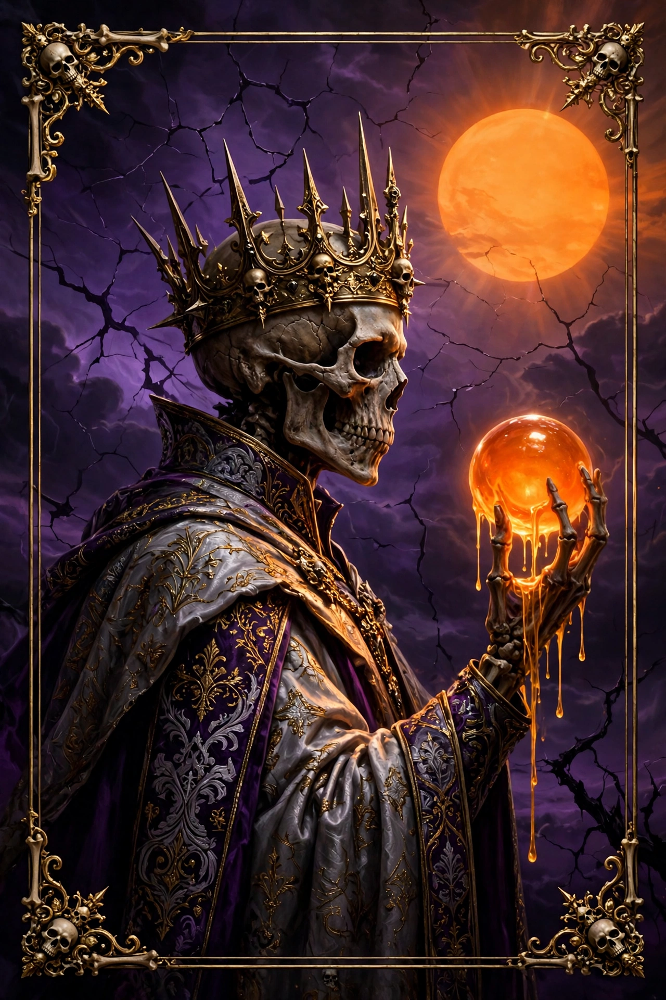
- 可复用规律：画框内作品要写“THIN frame with ornaments only at the four corners”，只写“华丽画框”生成器会把画框铺满画面；双光源要写“SEPARATE from the orb and not overlapping it”，否则太阳与光球会被画成重叠的一个光斑。

## 14 · Reddit r/midjourney · Notre-Dame

- 原链接：https://www.reddit.com/r/midjourney/comments/1xna5pg/notredame/
- 热度：433 upvotes，9 comments，2026-11-04 发布；多图帖共 3 张，只选第 1 张
- 原图拆解：第 1 张为竖构图插画：巴黎圣母院高耸哥特式双塔与脚手架、尖塔冒烟，前景为塞纳河桥与河岸小人物、房屋群，远景烟雾缭绕；色调为灰绿、米白与淡蓝的柔和水彩感，建筑线条细腻、透视纵深强，风格为幻想建筑插画，非照片。
- v1 提示词原文：`Fantasy architectural illustration, vertical composition, Paris Notre-Dame with tall twin Gothic towers, scaffolding and a smoking spire, in the foreground a Seine river bridge, riverside small people and houses, distant smoke in the background, grey-green, off-white and pale blue soft watercolour tones, fine architectural lines, strong perspective depth`
  - 中文解析：幻想建筑插画 + 竖构图 + 巴黎圣母院高耸哥特双塔脚手架冒烟尖塔 + 前景塞纳河桥河岸小人物房屋群 + 远景烟雾 + 灰绿米白淡蓝柔和水彩 + 建筑线条细腻透视纵深强。
- v1 对比：像在哥特双塔、脚手架冒烟尖塔、塞纳河桥、河岸小人物房屋群、水彩灰绿米白淡蓝；偏在机位为高空俯瞰、桥占下三分之一、教堂为侧面带扶壁；丢了“教堂高耸正面、桥只是前景点缀”的主次。
- v1 图：

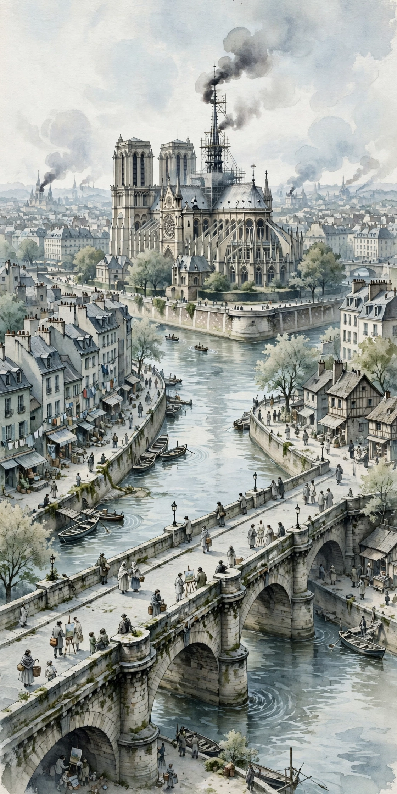
- v2 提示词原文：`Fantasy architectural illustration, vertical composition, LOWER viewpoint, Paris Notre-Dame LARGE in the centre with tall twin Gothic towers, scaffolding and a smoking spire, a SMALL Seine river bridge only at the bottom foreground, riverside small people and houses at the sides, distant smoke in the background, grey-green, off-white and pale blue soft watercolour tones, fine architectural lines, strong perspective depth, no aerial view, no large bridge dominating the lower third`
- v2 对比：教堂变大居中正面双塔、桥缩到画面底部、河岸房屋在两侧，更接近“高耸教堂插画”；代价是桥的存在感过弱，v1 的“桥与河道纵深”反而更有塞纳河氛围。
- v2 图：

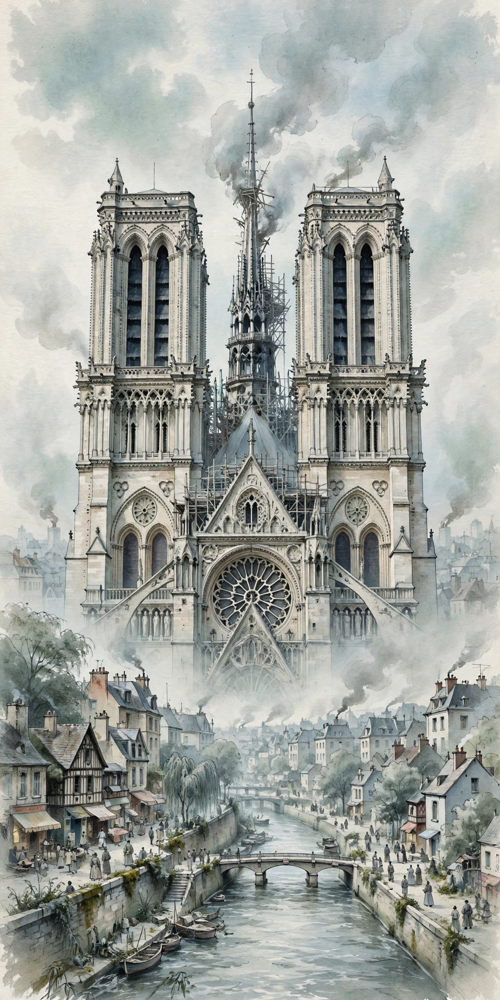
- 可复用规律：建筑主次要写“LARGE in the centre + SMALL bridge only at the bottom foreground + no aerial view”，只写“前景有桥”生成器会把桥画成下三分之一的主角；高耸感要写“LOWER viewpoint”，否则默认高空俯瞰会压矮教堂。

## 15 · SeaArt · The Dragon and the Gardener

- 原链接：https://www.seaart.ai/postDetail/dajjiqte878c73dfb030?pt=lg-cluster-56
- 热度：页面底部依次显示 880、346、浏览 38、评论 2（前两项图标为点赞与爱心，页面未用文字标注其含义，按图标记录），2026-09-14 发布，单张作品（Work Info · 1）
- 原图拆解：竖构图，左侧巨型绿龙低头伸爪，爪尖托着一颗金色光球，右下方矮小园丁仰头伸手接球；中央为金色巨树与阳光，背景有空中浮岛与远处城堡，地面花丛、兔子与蝴蝶点缀；色彩以绿、金、粉、蓝为主，光线为逆光金色暖阳，奇幻童话风格，细节丰富、层次清晰。
- v1 提示词原文：`Fairy-tale fantasy illustration, vertical composition, on the left a huge green dragon lowering its head and extending a claw holding a golden glowing orb, on the lower right a small gardener looking up and reaching out a hand toward the orb, in the centre a golden giant tree and sunlight, background of floating islands and a distant castle, ground with flower bushes, a rabbit and butterflies, green, gold, pink and blue colours, backlit golden sunlight, rich detail, clear layers`
  - 中文解析：奇幻童话插画 + 竖构图 + 左侧巨型绿龙低头伸爪托金色光球 + 右下方矮小园丁仰头伸手接球 + 中央金色巨树阳光 + 背景空中浮岛远处城堡 + 地面花丛兔子蝴蝶 + 绿金粉蓝 + 逆光金色暖阳 + 细节丰富层次清晰。
- v1 对比：像在左侧绿龙低头伸爪金色光球、中央金色巨树、浮岛城堡、右下方园丁仰头伸手、花丛兔子蝴蝶、逆光金阳；偏在龙头巨大占左半、园丁为成年男子偏大、背景出现多座城堡；丢了“园丁矮小、远处只有一座城堡”的比例克制。
- v1 图：

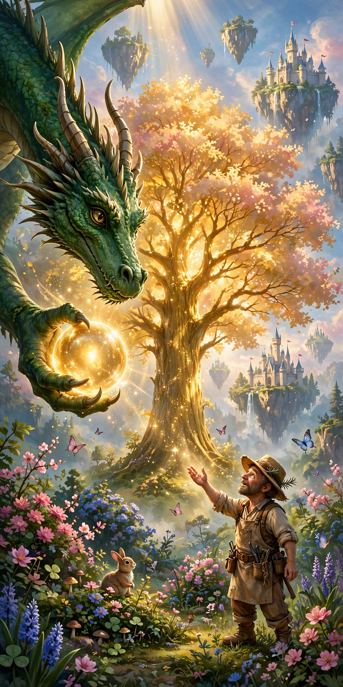
- v2 提示词原文：`Fairy-tale fantasy illustration, vertical composition, on the left a green dragon with a SMALLER head lowering and extending a claw holding a golden glowing orb, on the lower right a SMALL gardener, much smaller than the dragon, looking up and reaching out a hand toward the orb, in the centre a golden giant tree and sunlight, background of floating islands and ONLY ONE distant castle, ground with flower bushes, a rabbit and butterflies, green, gold, pink and blue colours, backlit golden sunlight, rich detail, clear layers`
- v2 对比：园丁变小孩子、龙头变小、金色巨树居中，更接近“巨龙与矮小园丁”的比例；代价是背景仍出现两座城堡、龙眼闭合变温顺，v1 的“龙眼直视 + 成年园丁”反而更有对视感。
- v2 图：

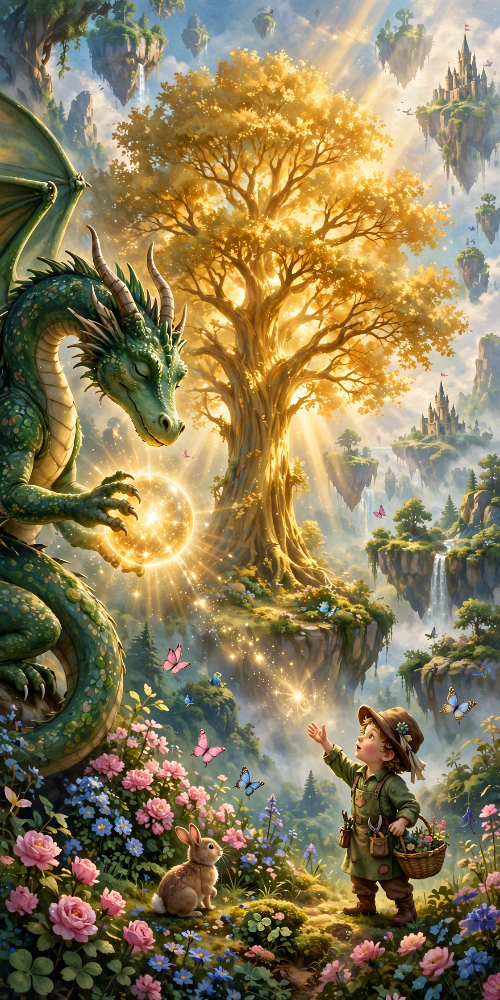
- 可复用规律：大小比例要写“SMALL gardener, much smaller than the dragon + SMALLER head”，只写“矮小园丁”生成器仍会把园丁画成成年人；远景数量要写“ONLY ONE distant castle”，否则浮岛背景会被补上多座城堡。

---

## 共性结论

1. **“只写名词，生成器就填满”**：本期反复出现同一模式——只写“短裙、站立、画框、前景桥、光滑皮肤、微笑”时，生成器会用条纹、过膝袜、跪地、满框装饰、下三分之一大桥、雀斑、露齿大笑把画面填满；收紧必须逐项写否定（no striped skirt、NO kneeling、NO fires、NO freckles、NO teeth showing）。
2. **“大小与位置要写在画面坐标里”**：大小反差、画框内作品、建筑主次、餐桌前景都不是靠“前景/背景”两个词就能定的，要写 wide shot、lower half、only at the four corners、only at the bottom foreground、much smaller than 这种可执行的画面坐标。
3. **“温和感要写否定情绪”**：巨兽、群像、微笑的温和感都不是靠“温柔”一个词，而是靠 mouth CLOSED、ALL STANDING、GENTLE CLOSED-LIP smile 这种把默认凶猛/跪地/大笑关掉的写法。
4. **“背景元素面积要封顶”**：蝴蝶、下方元素、前景肩背、地面南瓜都容易从“点缀”变成“铺满”，要写 a small group only、not covering the whole lower third、in the foreground corner only。
5. **“v2 更接近原描述，但常丢 v1 的生动”**：本期多张 v2 在收紧后更接近原描述（第 3、8、11、12、13、15 张），但代价是构图变完整度下降、人物变证件式、背景变弱；反推不是越收紧越好，收紧一项时要同时守住另一项（例如收紧服装时同时写发长，收紧背景时同时写主体大小）。

## 写实人物小结（第 9、10、11、12 张）

- **本组最强的真实感线索不是皮肤，而是“瞬间 + 光斑 + 颗粒”**：第 11 张闭眼低头瞬间 + 前景虚化肩背 + 逆光雪尘，第 10 张玻璃反射 + 圆形虚化光斑 + 重颗粒，第 12 张彩色纹身 + 飞散发丝 + 不对称微笑，第 9 张墨镜 + 老花套装 + 红丝绒沙发的强造型——皮肤本身在原描述中多为“未确认”，不能只靠“真实皮肤”一句话撑起照片感。
- **避免塑料感的提示词组合（本期验证有效）**：`realistic skin texture with pores and slight imperfections` + `candid` + `no retouching look`，再加具体约束：`GENTLE CLOSED-LIP smile, NO teeth showing`、`only a few light freckle-like spots`、`BLURRED ILLEGIBLE signboards, NO readable text`、`DRY glass, NO water droplets`。本组原描述仅第 10 张提示词片段提及 35mm 胶片照片，焦段未作全组通用验证，不写成通用规律。
- **本组常见 AI 破绽对照**：皮肤过滑（第 9 张原描述皮肤光滑，v1 反而自加雀斑）、五官过对称（第 12 张 v1 露齿大笑后对称感更强）、手部变形（第 10 张手臂交叉处为高风险区）、牙齿不自然（第 12 张露齿是 v1 自加）、光影不一致（第 10 张玻璃反射与人物光影、雨滴与干燥玻璃的矛盾）、背景文字乱码（第 11 张灯牌）。
- **一句话规律**：写实人物要先定“瞬间、光斑、颗粒、遮挡”四件事，再写皮肤；只写皮肤，生成器会用雀斑、露齿、雨滴、文字来假装真实。
