# 每日 AI 图片反推学习 · 2026-11-06

## 选图说明与缺口

- 选图时间：2026-11-06 上午（北京时间），浏览器选图任务 08:59–09:19 完成，全程未登录、未注册、未购买、未下载原图文件。本报告的原图拆解以浏览器任务回传的文字描述为准，未逐像素下载核对原图，因此 v1、v2 对比是“重生成图 vs 浏览器描述的原图特征”，不是与原图文件的逐像素对照；凡描述中未确认的细节，报告里不作推断。
- 本期 15 张构成：Civitai 3 张 + NightCafe 3 张 + Reddit 3 张 + PromptHero 3 张 + LiblibAI 2 张 + Tensor.art 1 张，共 6 个渠道、7 个子版块；写实人物照片 4 张（第 7、8、12、14 张，均为面部可见）。
- **去重说明：当天共跳过 5 张已核实的重复图，未入选、未反推、未生成，见下表。** 选图前已核对以往全部报告（2026-10-29 至 2026-11-05）的平台加图片 ID / 原链接；本期 15 张均为全新图片，系跳过重复图后顺延补位凑满。另有 PromptHero Hot 榜 4 张卡片，其标题/模型与基线链接 slug 高度吻合，但未点开详情核对、未入选，仅作记录，不计入已核实的 5 张。跨平台视觉上明显同一张图的转载，本批未发现可确认的此类重帖；NightCafe「First-Year Dragon Summoning」与「Caught in a heavy sand Storm」均为金黄沙漠中的少女与龙/翅膀题材，但人物、构图与场景不同，不按重复处理。

| 平台 | 原链接 | 首次出现日期 |
|---|---|---|
| PixAI《memento mori》 | https://pixai.art/artwork/2073338548770559862 | 2026-11-03 报告 |
| PixAI《the angel of divination》 | https://pixai.art/artwork/2072845630856237375 | 2026-11-04 报告 |
| PixAI《PLAY WITH ME?》 | https://pixai.art/artwork/2072756675267802567 | 2026-11-03 报告 |
| NightCafe《A Bond Beyond Words》 | https://creator.nightcafe.studio/creation/74WIoTKUAR5OiSooweKe/a-bond-beyond-words | 2026-11-05 报告 |
| Civitai SteinPilz | https://civitai.com/images/147533640 | 2026-11-03 报告 |

未点开核对、未入选的 PromptHero Hot 榜疑似重复卡片（仅记录）：肌肉意大利男子（基线 https://prompthero.com/prompt/869df0f4100-flux-flux-3-a-masterpiece-cinematic-color-photo-of-a-34-year-old-muscular-italian-man-with-gritty-masculine-and-intense-gaze-sharp，首次出现 2026-11-03）、Seedream 5 东亚女子（基线 https://prompthero.com/prompt/b765d8da5ca-seedream-5-seedream-5-pro-a-young-east-asian-woman-posing-in-futuristic-attire-against-a-solid-light-gray-background-she-is-equipped-with-a，首次出现 2026-11-04）、Gucci 复古奢华时尚大片（基线 https://prompthero.com/prompt/658447a57a8-chatgpt-image-gpt-image-25-scene-type-fashion-editorial-theme-gucci-vintage-luxury-setting-environment-interior-fashion-set-background-wallpaper-pattern-ornate-looped-gold-and，首次出现 2026-11-05）、Hero 10 时尚模特特写（基线 https://prompthero.com/prompt/0b7b879ba91-hero-10-close-up-of-a-stunning-fashion-model-ultra-realistic-portrait-shot-on-a-sony-a7iii-high-quality-ar-3564-stylize，首次出现 2026-11-03）。

- **其他缺口（按实测，不硬编）**：SeaArt 社区页与首页均只加载页头、内容区为空白，未能看到作品流，本次 SeaArt 入选 0 张。PixAI 首页“为你推荐”流前 3 张高点赞图全部在基线清单内，顺延后未再找到可核对的新高热图，本次 PixAI 入选 0 张。Civitai 接口参数 nsfw=None 返回的列表中仍有成人内容，3 个详情页打开后跳转至 civitai.red 成人内容提示页，未核对原图、未入选；另 1 张首饰产品照详情页主图加载失败（0x0），未入选；Civitai 最终仅入选接口列表前 3 张 PG 内容。NightCafe「Hold Your Horses」详情页主媒体疑似视频（Kling 4.0 Flash 视频版本），静态主图未能清晰核对，未入选。Reddit「Arcadia」详情页未显示顶贴数，热度无法核对，未入选。ArtStation Trending 注册/调查弹窗遮挡，作品流无热度数字且作品是否 AI 生成无法确认，未入选。Lexica 首页仅有搜索框，无热门/趋势排序，未入选。Midjourney Explore Top day、DeviantArt、PromeAI 本次未访问，改用 Reddit 热门帖与 Tensor.art Trending Today 补足。OpenArt、Ideogram、Leonardo、Pinterest 全程未作为选图来源。
- 本报告的 v1、v2 均为反推重写，不是照抄原帖提示词。
- 重生成图片保存在本任务目标工作区 `hidden_files/2026-11-06/images/` 下，报告内以图片文件名对应；GitHub 版见 ai-image-learning/2026-11-06.md，图片在 ai-image-learning/images/ 下。
- **生成完成情况：15 张的 v1 共 15 张次全部生成成功；v2 共 15 张次全部生成成功；合计 30 张次全部成功，无未完成项。**

## 一览表

| # | 平台 | 作者 | 原链接 | 热度（快照） |
|---|---|---|---|---|
| 1 | Civitai | purplelady | https://civitai.com/images/147348096 | 接口：点赞 1423、❤️534、😂179、😢72、评论 14；详情页另显示 1.2K（含义未标注） |
| 2 | Civitai | AbstralCat | https://civitai.com/images/147312553 | 接口：点赞 1226、❤️444、😂153、😢54、评论 3；详情页点赞显示 1227 |
| 3 | Civitai | haova | https://civitai.com/images/147354067 | 接口：点赞 1171、❤️465、😂154、😢60、评论 7 |
| 4 | NightCafe | Julie | https://creator.nightcafe.studio/creation/26dgoBCD7cEsjnDvt5z4/first-year-dragon-summoning | Hot 榜：❤️555、评论 203、图集数 2（第三个数字为页面图标旁数字，照录） |
| 5 | NightCafe | Kay | https://creator.nightcafe.studio/creation/y9a2QQDW3BpZCVkoISVk/botanical-harmony | Hot 榜：❤️788、评论 197 |
| 6 | NightCafe | Jarka Carta | https://creator.nightcafe.studio/creation/xlZxiCRB0MU2o4buJy7z/caught-in-a-heavy-sand-storm | 详情页：点赞 292、评论 96、收藏 6、页面显示“🪙💰5”（含义未确认）；Hot 榜当时为 288/96/2 |
| 7 | Reddit r/midjourney（写实人物） | u/Ok-Friendship-3849 | https://www.reddit.com/r/midjourney/comments/1xoo9ah/thanksgiving_1987/ | 顶贴 79、评论 18；多图帖，只取第 1 张 |
| 8 | Reddit r/aiArt（写实人物） | u/HotAir2292 | https://www.reddit.com/r/aiArt/comments/1xoxuuw/i_asked_my_ai_gpt_what_it_wanted_to_look_like/ | 顶贴 20、评论 9；发布于 2026-11-06 07:37 GMT+8，2 小时前 |
| 9 | Reddit r/aiArt | u/differentguyscro | https://www.reddit.com/r/aiArt/comments/1xom6vv/in_her_own_world/ | 顶贴 40、评论 3；发布于 2026-11-05 23:54 GMT+8 |
| 10 | PromptHero | @amir | https://prompthero.com/prompt/fd2cb38309c-flux-flux-3-a-flat-bright-red-poster-background-with-nothing-else-in-it-from-the-bottom-of-the-frame-a-violet-purple | Hot 榜：浏览 4928、收藏 16、评论 0；详情页 4.9k views、16 favorites，模型 FLUX flux-3 |
| 11 | PromptHero | @jp | https://prompthero.com/prompt/e8e092684c5-nano-banana-nano-banana-2 | Hot 榜：浏览 2777、收藏 4、评论 0；详情页 2.8k views、4 favorites，模型 Nano Banana nano-banana-2 |
| 12 | PromptHero（写实人物） | @gabrielleiras | https://prompthero.com/prompt/72bfc9c1849-hero-10-a-giant-attractive-woman-looking-down-on-a-tiny-man | Hot 榜：浏览 1084、收藏 10、评论 0；详情页 1.1k views、10 favorites，模型 Hero 1.0 |
| 13 | LiblibAI | 魔绘工坊 | https://www.liblib.art/imageinfo/54da3993fc70497faaeb0bb674cfb98a?from=feed | 灵感页：1.3k；详情页点赞按钮显示 999+（上限显示）；页面日期 2025-12-07 |
| 14 | LiblibAI（写实人物） | 尤音UIN | https://www.liblib.art/imageinfo/0555e49bdc4946ad9f680335c4028015?from=feed | 详情页：点赞 223、评论 0（“暂无评论”）；页面日期 2025-12-11；尺寸 1136x2048，Qwen-Image_1.0 |
| 15 | Tensor.art | Tinchisx | https://tensor.art/images/1063311185878770619?post_id=1063311163330175944 | Trending Today 首帖：点赞 16、评论 0；发布 2026-11-05 09:50；该帖为 2 图轮播，只取第 1 张 |

类别分布：写实人物照片 4 张（7、8、12、14），奇幻插画 5 张（1、3、4、6、15），动漫 2 张（9、13），植物插画 1 张（5），万圣节插画 1 张（2），超现实海报拼贴 1 张（10），末日科幻电影剧照 1 张（11）。

---

## 1 · Civitai · 红斗篷女子与巨龙

- 原链接：https://civitai.com/images/147348096
- 热度：接口点赞 1423、❤️534、😂179、😢72、评论 14；详情页另显示 1.2K（含义未标注）
- 原图拆解：中央偏右站立的红帽斗篷女子，兜帽遮住大半张脸，仅露下颌与嘴唇；身后一条深色巨龙盘绕，龙头在画面左上俯视；女子脚边一只黑猫，前方地面点缀蓝色百合与紫色小花。构图为竖幅、女子全身居中偏右、龙身呈 S 形环绕形成画框感，视线自龙头向下引至女子与黑猫。光影为冷调主光自左上洒落，斗篷边缘有薄薄轮廓光，龙鳞与金属甲片有高光点，地面有柔和投影。色彩为深红斗篷、墨绿与黑的龙身、冰蓝花朵与金色点缀，整体暗底亮花。材质为斗篷厚重布料与皮革、金属铠甲磨砂与反光、龙鳞釉质光泽、百合花瓣半透明。风格为高奇幻数字插画、写实渲染、电影海报感。手藏于斗篷内，面部基本被遮挡。
- v1 提示词原文：`High fantasy digital illustration, cinematic poster style, a woman in a deep red hooded cloak standing slightly right of centre, her hood shadowing most of her face, only her chin and lips visible, a huge dark dragon coiled behind her in an S shape, its head looking down from the upper left, a black cat at her feet, blue lilies and small purple flowers on the ground, cold light from the upper left, thin rim light on the cloak edge, glossy dragon scales and worn metal armour highlights, deep red, dark green and black palette with ice-blue flowers and gold accents, heavy fabric and leather cloak, thick painterly detail, vertical composition`
  - 中文解析：高奇幻数字插画电影海报风 + 深红兜帽斗篷女子居中偏右 + 兜帽遮脸仅露下颌嘴唇 + 深色巨龙 S 形盘绕身后、龙头左上俯视 + 脚边黑猫 + 地面蓝色百合紫色小花 + 左上冷调主光 + 斗篷边缘薄轮廓光 + 龙鳞与磨损金属甲高光 + 深红墨绿黑配冰蓝花朵金色点缀 + 厚重布料皮革斗篷 + 厚涂细节 + 竖幅。
- v1 对比：像在红斗篷女子、兜帽遮脸仅露下颌嘴唇、龙头左上俯视、脚边黑猫、地面蓝百合、深红墨绿黑配色、冷调主光；偏在龙身只在画面上方成弧形、未形成完整 S 形画框，女子为四分之三侧身而非正面站立，背景自加了雾林；丢了“龙身 S 形环绕成框、视线自龙头向下引至女子与黑猫”的引导感。
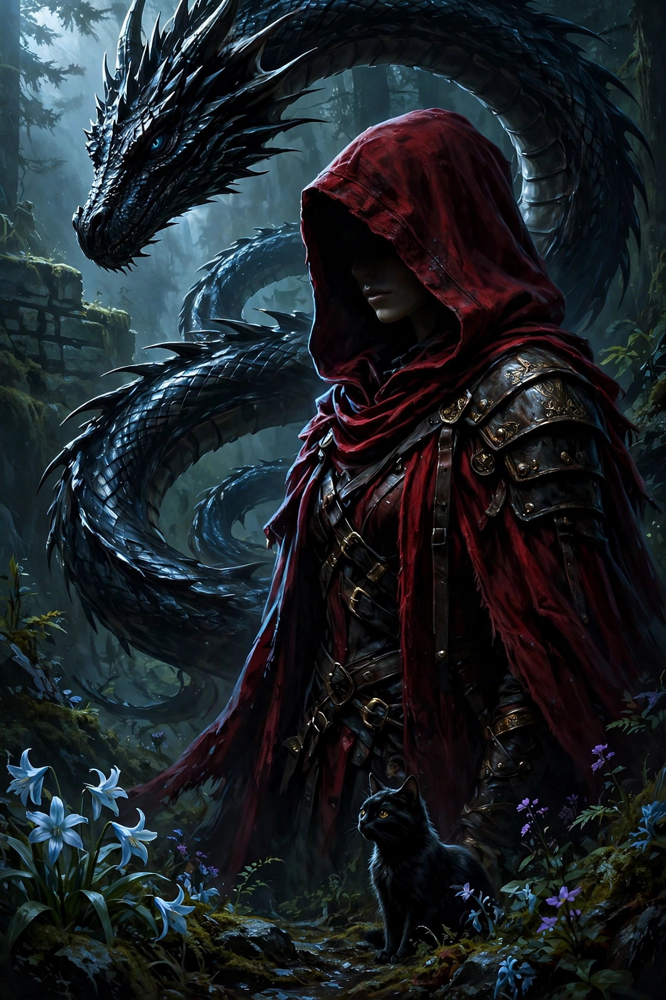
- v2 提示词原文：`High fantasy digital illustration, cinematic poster style, a woman in a deep red hooded cloak standing full body slightly right of centre, facing forward, her face shadowed by the hood with only her chin and lips visible, a huge dark dragon coiled in a full S shape around her forming a frame, its head at the upper left looking down at her, a black cat at her feet, blue lilies and small purple flowers on the ground in front, misty dark forest background, cold light from the upper left, thin rim light on the cloak edge, glossy dragon scales and worn metal armour highlights, deep red, dark green and black palette with ice-blue flowers and gold accents, heavy fabric and leather cloak, thick painterly detail, vertical composition`
- v2 对比：龙身变为完整 S 形环绕成框、女子转为正面全身、面部仍只露下颌嘴唇、黑猫与蓝百合都在前景，更接近原描述的画框引导感；代价是龙身占比更大、画面更满，v1 的“龙头特写 + 女子侧身剪影”反而更简洁有力。
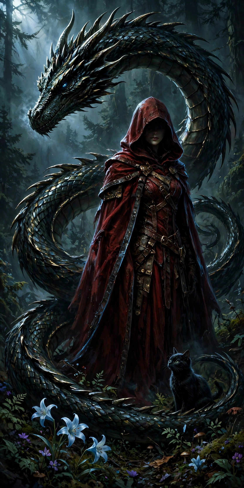
- 可复用规律：巨龙环绕成框要写“coiled in a full S shape around her forming a frame”，只写“盘绕身后”生成器只会画一段弧形龙身；兜帽遮脸要写“only her chin and lips visible”，否则它会把整张脸露出来。

## 2 · Civitai · 万圣节南瓜灯与鬼屋

- 原链接：https://civitai.com/images/147312553
- 热度：接口点赞 1226、❤️444、😂153、😢54、评论 3；详情页点赞显示 1227
- 原图拆解：画面中央一只巨大的雕刻南瓜灯，占据画面大部，橙黄发光的三角眼与锯齿嘴；南瓜后方一座尖顶鬼屋，周围枯树、墓碑与蝙蝠。构图为竖幅、南瓜灯近景居中、鬼屋与月亮在后方中景，形成近大远小的纵深。光影为南瓜内部暖橙光向外透出，照亮南瓜纹理与前方地面；背景为深蓝紫夜色，月光为冷色背光，暖冷对比强烈。色彩为橙、黑、深紫、暗蓝为主，点缀幽绿。材质为南瓜表皮粗糙带纵向棱纹与泥土感，鬼屋木质破旧，枯枝干硬。风格为万圣节奇幻插画、卡通与写实之间的渲染。未见人物。
- v1 提示词原文：`Halloween fantasy illustration, a giant carved jack-o'-lantern in the centre filling most of the frame, glowing orange triangular eyes and jagged mouth, warm orange light shining out from inside, behind it a pointed-roof haunted house, dead trees, tombstones and bats, deep blue-purple night sky with a cold moon, warm orange against cold blue-purple contrast, rough pumpkin skin with vertical ridges and earthy texture, old worn wooden house, cartoon-realistic rendering, vertical composition`
  - 中文解析：万圣节奇幻插画 + 居中巨大南瓜灯占满画面 + 橙黄发光三角眼锯齿嘴 + 内部暖橙光外透 + 身后尖顶鬼屋 + 枯树墓碑蝙蝠 + 深蓝紫夜空冷月 + 暖橙对冷蓝紫 + 南瓜表皮粗糙纵向棱纹泥土感 + 破旧木屋 + 卡通写实间渲染 + 竖幅。
- v1 对比：像在南瓜灯居中占满画面、三角眼锯齿嘴、内部暖橙光、身后鬼屋、枯树墓碑蝙蝠、深蓝紫夜空、暖冷对比；偏在月亮画得又大又亮、位于右上抢眼，前景自加了一片墓园与小南瓜；丢了“月亮只在鬼屋后的中景作冷色背光、前景简洁”的层级。

- v2 提示词原文：`Halloween fantasy illustration, a giant carved jack-o'-lantern in the centre filling most of the frame, glowing orange triangular eyes and jagged mouth, warm orange light shining out from inside, behind it a pointed-roof haunted house with a SMALL cold moon behind the house, dead trees and bats, deep blue-purple night sky, warm orange against cold blue-purple contrast, rough pumpkin skin with vertical ridges and earthy texture, old worn wooden house, only a few tombstones in the foreground, cartoon-realistic rendering, vertical composition`
- v2 对比：月亮变为屋后的小月牙、不再抢眼，鬼屋更大更清晰、南瓜仍占主导，更接近“南瓜近景、鬼屋月亮中景”的纵深；代价是南瓜自加了三角鼻子（原描述只有三角眼与锯齿嘴，未提鼻子），v1 的“无鼻南瓜脸”反而更贴合原描述。

- 可复用规律：月亮别抢主角要写“SMALL cold moon behind the house”，只写“冷月”生成器会把它画成又大又亮的满月；前景墓碑数量要写“only a few tombstones”，否则墓园会自己长满前景。

## 3 · Civitai · 黑猫与橙月

- 原链接：https://civitai.com/images/147354067
- 热度：接口点赞 1171、❤️465、😂154、😢60、评论 7
- 原图拆解：画面下方两只黑猫并排坐立，一只抬头、一只侧脸，头顶一只大橙月，周围环绕蝴蝶与落叶。构图为竖幅、双猫居下三分之一、橙月居上居中，蝴蝶斜向飞散，上下呼应。光影为橙月是主要光源，猫身边缘带暖色轮廓光，背景夜色深暗、星点微光。色彩为橙、黑、墨蓝、淡金，蝴蝶翅膀带淡蓝与白。材质为墨水笔触与水彩晕染结合，猫毛柔软、月面有颗粒质感。风格为奇幻水墨插画、童话感。未见人物。
- v1 提示词原文：`Fantasy ink and watercolour illustration, two black cats sitting side by side in the lower third of the frame, one looking up, one in profile, a large orange moon centred above them, butterflies and falling leaves scattered around, the orange moon as the main light source, warm rim light on the cats' edges, dark night background with faint stars, orange, black, ink blue and pale gold palette, butterflies with pale blue and white wings, soft cat fur, grainy moon surface, fairy-tale mood, vertical composition`
  - 中文解析：奇幻墨水水彩插画 + 下三分之一两只黑猫并排坐立、一只抬头一只侧脸 + 头顶大橙月居中 + 蝴蝶落叶环绕 + 橙月为主光源 + 猫身暖色轮廓光 + 深暗夜色微星 + 橙黑墨蓝淡金 + 蝴蝶淡蓝白翅 + 柔软猫毛 + 月面颗粒 + 童话感 + 竖幅。
- v1 对比：像在双猫下三分之一、一只抬头一只侧脸、头顶大橙月、蝴蝶落叶、暖色轮廓光、深暗夜色；偏在月亮占了上半个画面、过大过亮，底部自加了白色小花边框，猫画得偏写实渲染、墨水感不足；丢了“月亮只在头顶、夜空留白更多、水彩晕染”的克制。
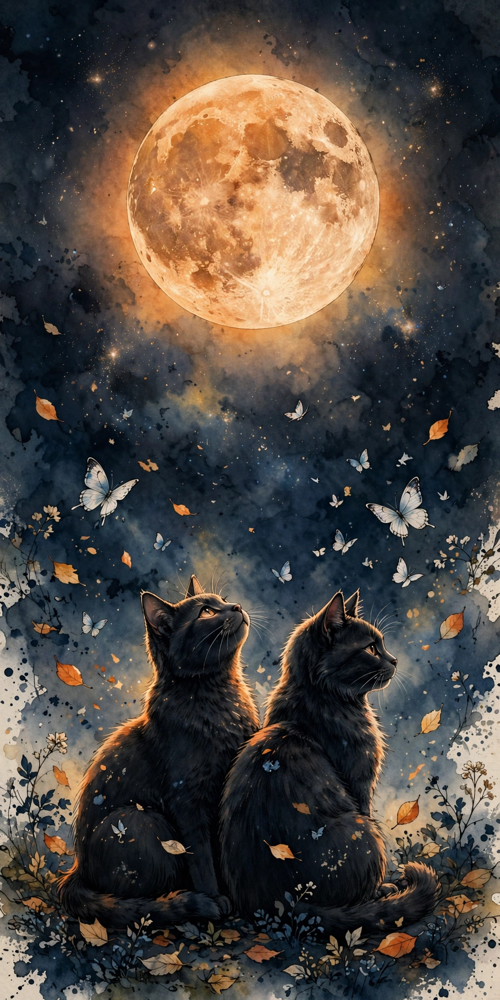
- v2 提示词原文：`Fantasy ink and watercolour illustration, two black cats sitting side by side in the lower third of the frame, one looking up, one in profile, a large orange moon centred above them, about one third of the frame wide, more dark night sky visible with faint stars, butterflies with pale blue and white wings and falling leaves scattered around, the orange moon as the main light source, warm rim light on the cats' edges, strong ink-wash edges and watercolour bleeding on the cats, soft cat fur, grainy moon surface, no decorative flower border at the bottom, fairy-tale mood, vertical composition`
- v2 对比：月亮缩小到约三分之一画幅宽、夜空留白变多、底部花边消失、双猫姿态与蝴蝶分布更接近原描述；代价是猫仍偏插画渲染、墨水晕染感只略有加强，v1 的“月面颗粒与暖色轮廓光”反而更浓。
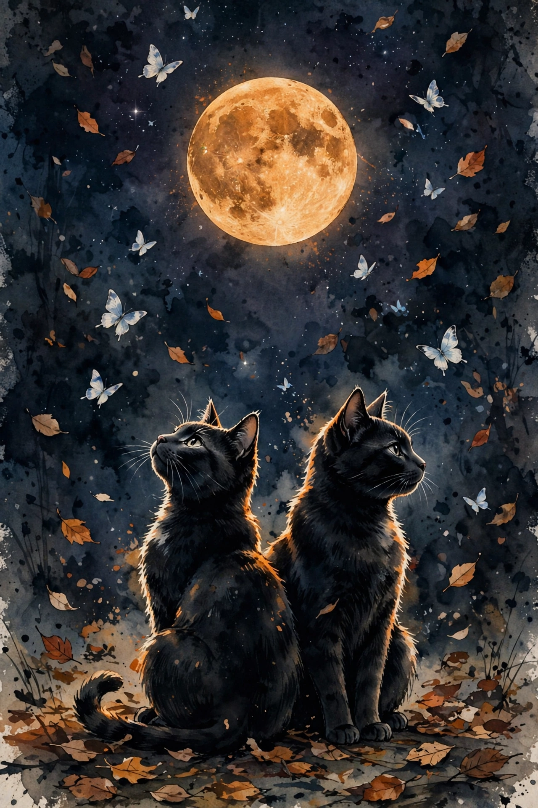
- 可复用规律：月亮大小要写死“about one third of the frame wide”，只写“大橙月”生成器会把它画到占满上半个画面；不要的装饰要写“no decorative flower border”，否则它会在画面边缘自己加花边。

## 4 · NightCafe · First-Year Dragon Summoning

- 原链接：https://creator.nightcafe.studio/creation/26dgoBCD7cEsjnDvt5z4/first-year-dragon-summoning
- 热度：Hot 榜 ❤️555、评论 203、图集数 2（第三个数字为页面图标旁数字，照录）
- 原图拆解：右侧一匹金棕色小龙张开双翼，左侧一名披斗篷的少女张开双臂面向巨龙，身后是荒漠山丘与古城轮廓。构图为横幅、少女与小龙左右对峙、视线交汇于画面中央，远景山丘与云层压低地平线。光影为黄昏暖光自右侧洒入，少女斗篷边缘与龙翼透光，地面有长影，尘土飞扬处有光晕。色彩为金黄、赭石、沙色为主，点缀暗红与灰蓝。材质为斗篷布料粗糙飘动、龙鳞有皮革光泽、沙土颗粒感强。风格为奇幻故事书插画、电影感。少女为插画造型，非写实照片。
- v1 提示词原文：`Fantasy storybook illustration, cinematic, a cloaked girl on the left with arms spread open facing a small golden-brown dragon with spread wings on the right, the two facing each other across the centre of the frame, desert hills and an ancient city silhouette behind them, golden evening light from the right, translucent light through the dragon's wings, long shadows on the ground, dust glowing in the light, gold, ochre and sand colours with dark red and grey-blue accents, rough flowing cloak fabric, leathery dragon scales, gritty sand texture, horizontal composition`
  - 中文解析：奇幻故事书插画电影感 + 左侧披斗篷少女张开双臂 + 右侧金棕小龙展翼 + 两者隔画面中央对视 + 身后荒漠山丘古城轮廓 + 右侧黄昏暖光 + 龙翼透光 + 地面长影 + 尘土光晕 + 金黄赭石沙色配暗红灰蓝 + 粗糙飘动斗篷 + 皮革龙鳞 + 沙土颗粒 + 横幅。
- v1 对比：像在左侧少女张开双臂、右侧金棕小龙展翼、黄昏暖光、龙翼透光、尘土光晕、荒漠古城、金黄赭石沙色；偏在少女为背侧面、脸朝外而非正对小龙，小龙站在右侧岩石上、个头更小；丢了“少女与小龙左右对峙、视线交汇于画面中央”的正面感。
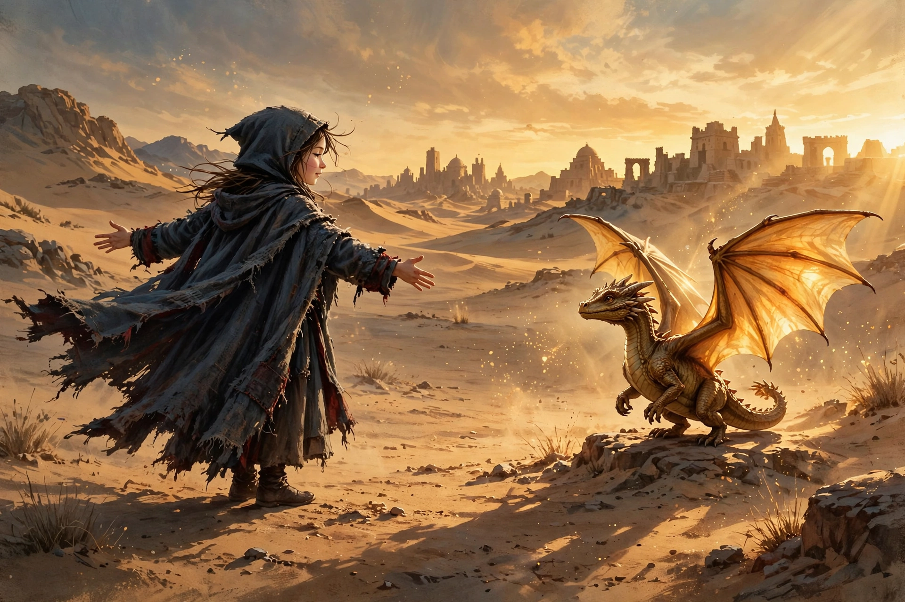
- v2 提示词原文：`Fantasy storybook illustration, cinematic, medium-wide shot, a cloaked girl on the left seen from the side, her face in profile looking toward a small golden-brown dragon on the right, both her arms spread open toward the dragon, the dragon with spread wings facing her, the two facing each other across the centre of the frame, desert hills and an ancient city silhouette behind them, golden evening light from the right, translucent light through the dragon's wings, long shadows on the ground, dust glowing in the light, gold, ochre and sand colours with dark red and grey-blue accents, rough flowing cloak fabric, leathery dragon scales, gritty sand texture, horizontal composition`
- v2 对比：少女转为侧面正对小龙、双臂张开、视线交汇于中央，更接近“左右对峙”的原描述；代价是少女兜帽落下、露出编发，风格转为更轻的水彩故事书，v1 的“兜帽背影 + 电影感黄昏”反而在氛围上更贴合。
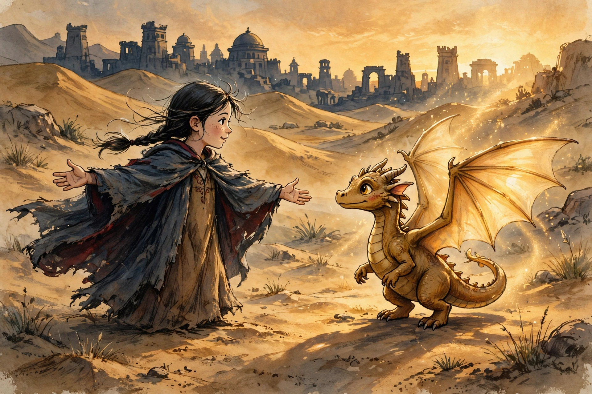
- 可复用规律：对峙感要写“her face in profile looking toward the dragon + the two facing each other across the centre”，只写“面向小龙”生成器会画成背影；兜帽要写死“hood UP”，只写“披斗篷”它可能把兜帽画落下。

## 5 · NightCafe · Botanical Harmony

- 原链接：https://creator.nightcafe.studio/creation/y9a2QQDW3BpZCVkoISVk/botanical-harmony
- 热度：Hot 榜 ❤️788、评论 197
- 原图拆解：画面中央两朵巨大的紫红与金黄渐变罂粟花，花蕊金色密集，周围配以小花苞与细长草叶。构图为竖幅、双花对角错落、充满画面，背景为淡绿与米色的旧墙面质感。光影为柔和漫射光，花瓣边缘有薄光，阴影很淡，整体明亮通透。色彩为紫红、品红、金黄、淡绿，饱和度高但过渡柔和。材质为花瓣如丝绸与薄纱，带半透明脉络；花蕊为细密颗粒；背景有旧纸与水彩晕染纹理。风格为植物学插画与油画结合、装饰性强。未见人物。
- v1 提示词原文：`Botanical illustration mixed with oil painting, two huge poppies in purple-red and golden yellow gradients in the centre, dense golden stamens, small buds and thin grass blades around them, the flowers filling the frame on a diagonal, pale green and cream old wall background, soft diffused light, thin light on petal edges, very light shadows, bright and airy, silk and sheer petal texture with translucent veins, fine granular stamens, old paper and watercolour wash texture in the background, decorative, high saturation with soft transitions, vertical composition`
  - 中文解析：植物学插画混油画 + 中央两朵巨大紫红金黄渐变罂粟花 + 金色密集花蕊 + 小花苞细长草叶 + 双花对角充满画面 + 淡绿米色旧墙背景 + 柔和漫射光 + 花瓣边缘薄光 + 阴影极淡明亮通透 + 丝绸薄纱花瓣半透明脉络 + 细密颗粒花蕊 + 旧纸水彩晕染背景 + 装饰性 + 高饱和柔和过渡 + 竖幅。
- v1 对比：像在双花紫红金黄渐变、金色密集花蕊、小花苞草叶、淡绿米色旧墙、柔和漫射光、丝绸薄纱花瓣、旧纸水彩背景；偏在两朵花重叠成一团、边界不清，花苞画得偏多；丢了“双花对角错落、各自完整”的清晰感。
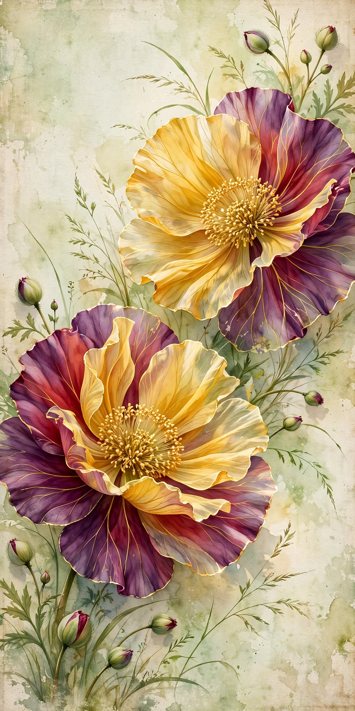
- v2 提示词原文：`Botanical illustration mixed with oil painting, two poppies clearly separated on a diagonal, one upper right and one lower left, each flower whole and distinct, purple-red and golden yellow gradients, dense golden stamens, only a few small buds, thin grass blades around them, pale green and cream old wall background, soft diffused light, thin light on petal edges, very light shadows, bright and airy, silk and sheer petal texture with translucent veins, fine granular stamens, old paper and watercolour wash texture in the background, decorative, high saturation with soft transitions, vertical composition`
- v2 对比：双花在对角线上完全分开、各自完整、花苞变少，更接近“对角错落”的原描述；代价是花变小、墙面留白变多，v1 的“双花充满画面”反而更贴合原描述的饱满感。
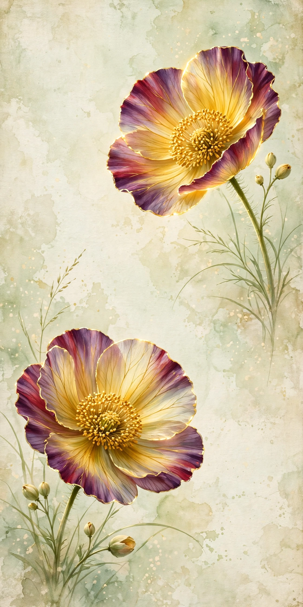
- 可复用规律：双花分离要写“clearly separated on a diagonal, one upper right and one lower left, each flower whole and distinct”，只写“两朵花”生成器会把它们叠成一团；但分离与充满画面是矛盾要求，写分离就要接受留白变多。

## 6 · NightCafe · Caught in a heavy sand Storm

- 原链接：https://creator.nightcafe.studio/creation/xlZxiCRB0MU2o4buJy7z/caught-in-a-heavy-sand-storm
- 热度：详情页点赞 292、评论 96、收藏 6、页面显示“🪙💰5”（含义未确认）；Hot 榜当时为 288/96/2
- 原图拆解：画面中央一名长发精灵少女，头戴破旧兜帽、身披斗篷，左手扶住兜帽、右手握物，背后一对半透明薄纱翅膀在沙暴中展开；远景为沙漠岩柱与落日。构图为横幅（4:3）、少女居中偏右、翅膀向左上方伸展，沙暴斜向流动，岩柱在右侧形成纵深。光影为落日暖光自右后方照来，少女面部与翅膀边缘透光，沙尘中光束朦胧，阴影柔和。色彩为金黄、赭红、沙色为主，翅膀带淡青透明感。材质为斗篷粗布磨损、发丝被风吹散、翅膀如蜻蜓翼膜、沙粒飞扬。风格为奇幻故事书现实主义（页面标注 Whimsical Heirloom Storybook Realism），模型 GPT Image 2.5 Sunburst。少女面部为插画感，非写实照片。
- v1 提示词原文：`Fantasy storybook realism illustration, a long-haired elf girl in the centre-right wearing a worn hooded cloak, one hand holding her hood, the other hand holding a small object, a pair of translucent gauzy wings spread behind her in a sandstorm, desert rock pillars and a setting sun in the distance, warm sunset light from the right behind her, light glowing through her face and wing edges, hazy light beams in the dust, soft shadows, gold, ochre-red and sand colours, wings with pale cyan transparency, worn rough cloak fabric, wind-blown hair strands, dragonfly-wing-like wing membrane, flying sand grains, horizontal 4:3 composition`
  - 中文解析：奇幻故事书现实主义插画 + 居中偏右长发精灵少女破旧兜帽斗篷 + 一手扶兜帽一手握物 + 身后半透明薄纱翅膀沙暴中展开 + 远景沙漠岩柱落日 + 右后方落日暖光 + 面部翅膀边缘透光 + 沙尘朦胧光束 + 柔和阴影 + 金黄赭红沙色 + 翅膀淡青透明 + 粗布磨损斗篷 + 风吹发丝 + 蜻蜓翼膜 + 飞扬沙粒 + 横幅 4:3。
- v1 对比：像在兜帽斗篷精灵少女、风吹长发、半透明蜻蜓翅膀、沙漠岩柱、落日暖光、沙尘光束、金黄赭红沙色；偏在画面为近景人像特写、翅膀向右上方伸展、岩柱在左侧，右手握的“小物件”被画成蓝色水晶；丢了“翅膀向左上、岩柱在右、落日在右”的左右方位。
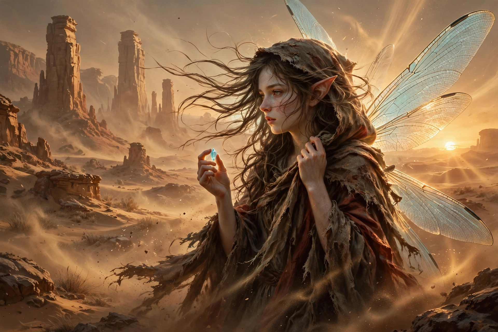
- v2 提示词原文：`Fantasy storybook realism illustration, wider medium shot, a long-haired elf girl in the centre-right seen from the side, her face in profile, wearing a worn hooded cloak with the hood UP, one hand holding her hood, the other hand holding a small glowing blue stone, her translucent dragonfly wings spreading to the UPPER LEFT, desert rock pillars on the RIGHT, the setting sun low on the right horizon, warm sunset light from the right behind her, light glowing through her face and wing edges, sandstorm with flying sand grains and hazy light beams, soft shadows, gold, ochre-red and sand colours, wings with pale cyan transparency, worn rough cloak fabric, wind-blown hair strands, horizontal 4:3 composition`
- v2 对比：翅膀改向左上方、岩柱移到右侧、落日在右地平线、兜帽戴好、侧面人像，左右方位全部修正，更接近原描述；代价是少女仍占画面较大、未完全拉成中景，v1 的“面部特写 + 翅膀透光”反而在面部细节上更动人。
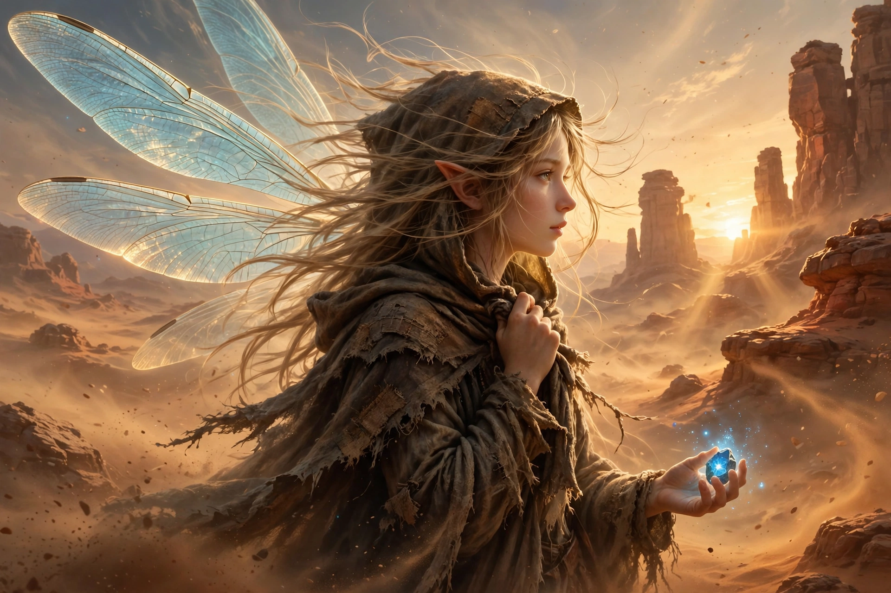
- 可复用规律：翅膀与景物的左右方位要写死“wings spreading to the UPPER LEFT + rock pillars on the RIGHT”，只写“翅膀展开、远景岩柱”生成器会自己决定左右，十有八九与原图相反。

## 7 · Reddit r/midjourney · Thanksgiving 1987（写实人物）

- 原链接：https://www.reddit.com/r/midjourney/comments/1xoo9ah/thanksgiving_1987/
- 热度：顶贴 79、评论 18；多图帖，只取第 1 张
- 原图拆解：感恩节餐桌旁，一名白发老妇人站在桌边切火鸡，桌旁围坐多名家人（男女老少），桌上摆满火鸡、菜肴与餐具，背景为 1980 年代家庭餐厅。构图为横幅、餐桌横向贯穿画面、老妇人居中偏左为视觉焦点，家人分列两侧，景深由近桌延至后方厨房。光影为暖黄室内灯光为主，窗光较弱，人物面部与火鸡表面有柔和暖色高光，阴影不硬，呈现旧照片的暖调。色彩为暖棕、米黄、暗红、木色，带 1980 年代胶片的褪色感。材质为木桌、瓷盘、玻璃杯、织物桌布与衣物均有日常质感。风格为 1987 年家庭快照、胶片照片感。写实细节：老妇人面部皱纹与老年斑可见、发丝灰白稀疏、表情专注自然；家人姿态放松、有人看向镜头、有人低头用餐，抓拍感强；镜头焦段未标注，画面为中景、背景轻微虚化但仍可辨认；颗粒与噪点为轻微胶片颗粒，画面略带柔焦。AI 破绽：截图分辨率下，个别家人面部较模糊、手部与餐具边缘细节不清晰，未见明显手部变形；未见明显破绽（以可见画面为准，细节处未确认）。
- v1 提示词原文：`Candid family snapshot photograph from 1987, a white-haired old woman standing at a dining table carving a turkey, family members of all ages seated around the table, roast turkey, dishes and tableware on the table, 1980s family dining room in the background, warm yellow indoor lighting, soft warm highlights on faces and the turkey, gentle shadows, warm brown, cream, dark red and wood colours, faded 1980s film colours, wood table, ceramic plates, glass cups, fabric tablecloth, realistic skin texture with wrinkles and age spots on the old woman, thin grey-white hair, focused natural expression, relaxed candid poses, some family members looking at the camera, some looking down at their food, medium shot, background slightly blurred, subtle film grain, slightly soft focus, shot on 35mm film`
  - 中文解析：1987 年家庭抓拍照片 + 白发老妇人桌边切火鸡 + 各年龄家人围坐 + 火鸡菜肴餐具 + 1980 年代家庭餐厅背景 + 暖黄室内灯 + 面部火鸡柔和暖色高光 + 阴影不硬 + 暖棕米黄暗红木色 + 1980 年代胶片褪色感 + 木桌瓷盘玻璃杯织物桌布 + 老妇人皱纹老年斑真实皮肤 + 灰白稀疏发丝 + 专注自然表情 + 放松抓拍姿态 + 有人看镜头有人低头用餐 + 中景 + 背景轻微虚化 + 轻微胶片颗粒 + 略带柔焦 + 35mm 胶片。
- v1 对比：像在白发老妇人切火鸡、家人围坐、暖黄室内灯、火鸡菜肴餐具、暖棕米黄色调、木桌瓷盘、有人看镜头有人低头用餐、中景；偏在画面偏锐偏亮、胶片颗粒与柔焦感不足、更像现代高清照片而非 1987 年旧快照；丢了“轻微颗粒、略带柔焦、褪色感”的年代味。

- v2 提示词原文：`Candid family snapshot photograph from 1987, strong 1980s film look, visible film grain, softer focus, slightly faded and muted warm colours, a white-haired old woman standing at a dining table carving a turkey, family members of all ages seated around the table, roast turkey, dishes and tableware on the table, 1980s family dining room in the background, warm yellow indoor lighting, soft warm highlights on faces and the turkey, gentle shadows, warm brown, cream, dark red and wood colours, wood table, ceramic plates, glass cups, fabric tablecloth, realistic skin texture with wrinkles and age spots on the old woman, thin grey-white hair, focused natural expression, relaxed candid poses, some family members looking at the camera, some looking down at their food, medium shot, background slightly blurred, shot on 35mm film, no retouching look`
- v2 对比：胶片颗粒明显、色彩更褪更暖、家人增至 6 人、花墙纸与吊兰强化了 1980 年代家庭感，更接近“旧照片”；代价是多人看向镜头、姿态偏摆拍，v1 的“低头用餐 + 侧脸交谈”反而抓拍感更强。
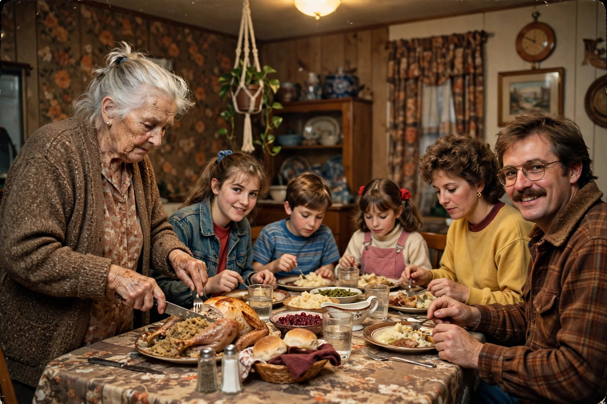
- 可复用规律：年代胶片感要写“visible film grain, softer focus, slightly faded and muted warm colours”，只写“subtle film grain”生成器会出高清现代照片；抓拍感要写“some looking down at their food, candid”，否则全家人都会看向镜头摆拍。

## 8 · Reddit r/aiArt · AI 自画像精灵女子（写实人物）

- 原链接：https://www.reddit.com/r/aiArt/comments/1xoxuuw/i_asked_my_ai_gpt_what_it_wanted_to_look_like/
- 热度：顶贴 20、评论 9；发布于 2026-11-06 07:37 GMT+8，2 小时前
- 原图拆解：一名银白卷发的精灵女子近景肖像，左绿右蓝异色瞳，尖耳，脸颊与鼻尖有细小雀斑与星星亮片，右手托腮，手腕戴多串手链与戒指；怀中一只黑猫，背景为捕梦网、月亮挂饰、紫色水晶与暖黄灯球。构图为竖幅、人物面部居中偏上、右手托腮形成三角支撑，背景挂饰层层叠叠。光影为暖黄灯球与紫色水晶光交错，面部左右明暗对比柔和，眼中有明显眼神光，皮肤有暖色反光。色彩为银白、紫、暖黄、深黑为主，冷暖交织。材质为针织毛衣粗针纹理、金属项链与戒指、猫毛柔软、捕梦网羽毛轻盈。风格为奇幻写实肖像、ChatGPT 生成（帖子标签 Image - ChatGPT）。写实细节：皮肤有细腻纹理与雀斑、眼角有淡淡纹路、发丝蓬松飞散、唇色自然、表情放松带浅笑；手部托腮的手指自然弯曲，戒指与手链清晰，截图中未见明显手指变形；尖耳为刻意奇幻设定而非破绽。AI 破绽：五官高度对称、皮肤过于光滑、双眼异色且瞳孔过于明亮、背景挂饰细节略显杂乱；未见手部明显变形。
- v1 提示词原文：`Fantasy realistic portrait photograph, close-up of a young woman with voluminous silver-white curly hair, heterochromia with one green eye and one blue eye, pointed elf ears, tiny freckles and star glitter on her cheeks and nose tip, her right hand resting against her cheek, multiple bracelets and rings on her wrist, holding a black cat, background of dreamcatchers, moon ornaments, purple crystals and warm yellow string lights, warm yellow lights mixed with purple crystal light, soft light and shadow contrast on her face, clear catchlights in her eyes, silver-white, purple, warm yellow and deep black palette, chunky knit sweater texture, metal necklaces and rings, soft cat fur, light feathers on the dreamcatcher, relaxed expression with a faint smile, fine skin texture with freckles, faint lines at the corners of her eyes, flyaway hair strands, natural lip colour, vertical composition`
  - 中文解析：奇幻写实肖像照片 + 银白蓬松卷发近景 + 左绿右蓝异色瞳 + 尖耳 + 脸颊鼻尖细小雀斑星星亮片 + 右手托腮 + 多串手链戒指 + 怀抱黑猫 + 背景捕梦网月亮挂饰紫水晶暖黄灯球 + 暖黄灯光混紫水晶光 + 面部柔和明暗对比 + 明显眼神光 + 银白紫暖黄深黑 + 粗针毛衣 + 金属项链戒指 + 柔软猫毛 + 捕梦网轻盈羽毛 + 放松浅笑 + 细腻皮肤雀斑 + 眼角淡淡纹路 + 飞散发丝 + 自然唇色 + 竖幅。
- v1 对比：像在银白卷发、异色瞳、尖耳、右手托腮、手链戒指、黑猫、捕梦网月亮挂饰紫水晶暖黄灯球、粗针毛衣、放松浅笑；偏在脸颊星星亮片画得过密过重、皮肤过于光滑对称，几乎复刻了原图的 AI 破绽；丢了“细小雀斑为主、星星亮片只是点缀、皮肤有真实纹理”的克制。
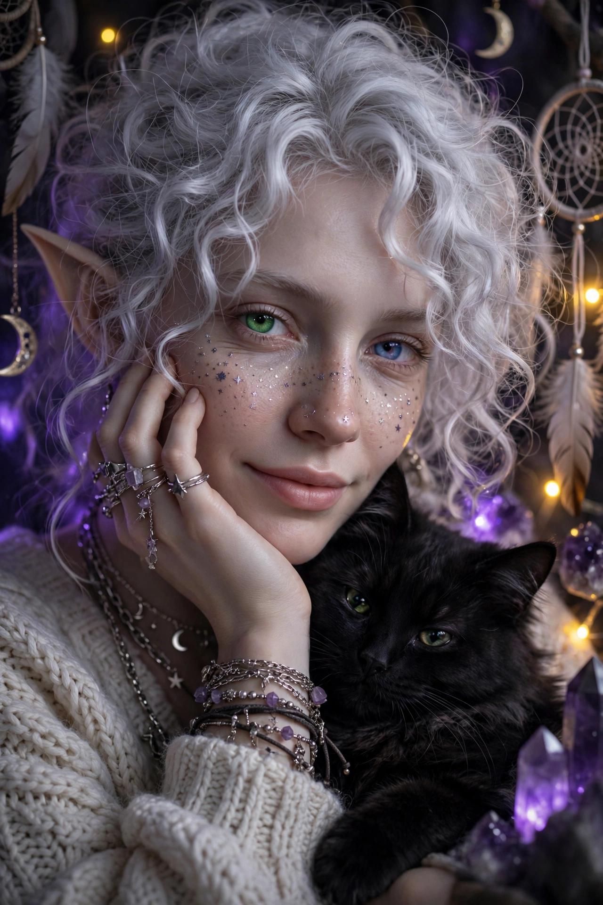
- v2 提示词原文：`Fantasy realistic portrait photograph, close-up of a young woman with voluminous silver-white curly hair, heterochromia with one green eye and one blue eye, pointed elf ears, only a few tiny star sparkles among natural freckles on her cheeks and nose tip, visible realistic skin texture with pores and slight imperfections, slight facial asymmetry, clear catchlights in her eyes, faint lines at the corners of her eyes, flyaway hair strands, natural lip colour, her right hand resting against her cheek with rings and bracelets, holding a black cat, background of dreamcatchers, moon ornaments, purple crystals and warm yellow string lights, warm yellow lights mixed with purple crystal light, soft light and shadow contrast on her face, chunky knit sweater texture, metal necklaces and rings, soft cat fur, relaxed expression with a faint smile, vertical composition`
- v2 对比：皮肤出现可见毛孔、雀斑与小痣、星星亮片减为几颗点缀，更接近真实皮肤；代价是卷发蓬松度略降、捕梦网在背景中变少，v1 的“蓬松卷发 + 层叠挂饰背景”反而更贴合原描述的画面密度。
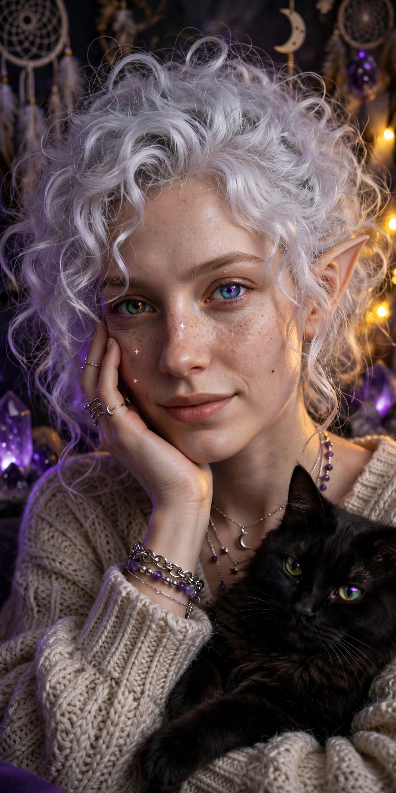
- 可复用规律：去塑料感要写“visible realistic skin texture with pores and slight imperfections + slight facial asymmetry”，只写“细腻皮肤”生成器会出磨皮对称脸；亮片要写“only a few tiny star sparkles among natural freckles”，只写“星星亮片”它会铺满整张脸。

## 9 · Reddit r/aiArt · In her own world

- 原链接：https://www.reddit.com/r/aiArt/comments/1xom6vv/in_her_own_world/
- 热度：顶贴 40、评论 3；发布于 2026-11-05 23:54 GMT+8
- 原图拆解：地铁车厢内，一名金发猫耳少女戴粉色耳机、穿荧光绿外套与蓝格裙，闭眼听音乐、怀抱手机坐在座位上；车厢其余乘客为黑白素描，唯少女与粉色电流线条为彩色。构图为横幅、少女居右三分之一、车厢纵深向左后方延伸，粉色闪电状线条横贯画面三层，形成节奏感。光影为车厢顶灯冷白，少女身上有暖色反光，黑白乘客区域阴影较重，彩色区域明亮。色彩为黑白灰底色上跳出荧光粉、荧光绿、亮蓝，撞色强烈。材质为动漫线条与水彩结合，耳机与运动鞋有塑料与织物质感，车厢金属扶手有反光。风格为动漫插画与黑白素描拼贴、ChatGPT 生成（帖子标签 Image - ChatGPT）。未见写实人物。
- v1 提示词原文：`Anime illustration mixed with black-and-white sketch collage, inside a subway carriage, a blonde girl with cat ears wearing pink headphones, a neon green jacket and a blue plaid skirt, eyes closed listening to music, holding a phone, sitting on a seat in the right third of the frame, the other passengers drawn as black-and-white sketches, only the girl and pink electric lines in colour, pink lightning-shaped lines running across the frame in three layers, carriage receding to the left background, cold white ceiling light, warm reflected light on the girl, heavier shadows in the black-and-white areas, black, white and grey base with neon pink, neon green and bright blue accents, anime linework with watercolour, plastic headphones and fabric sneakers, reflective metal handrails, horizontal composition`
  - 中文解析：动漫插画混黑白素描拼贴 + 地铁车厢 + 金发猫耳少女粉色耳机荧光绿外套蓝格裙 + 闭眼听音乐怀抱手机 + 坐右三分之一座位 + 其余乘客黑白素描 + 唯少女与粉色电流线条为彩色 + 粉色闪电线横贯三层 + 车厢向左后方纵深 + 顶灯冷白 + 少女暖色反光 + 黑白区阴影重 + 黑白灰底跳荧光粉绿亮蓝 + 动漫线条水彩 + 塑料耳机织物运动鞋 + 金属扶手反光 + 横幅。
- v1 对比：像在金发猫耳少女、粉色耳机、荧光绿外套、蓝格裙、闭眼听音乐、黑白素描乘客、粉色闪电三层、车厢左后方纵深、撞色强烈；偏在个别乘客的牛仔裤带了蓝色、少女外套带了橙色暖光，彩色从少女身上“漏”到了乘客区；丢了“除少女与粉线外全车厢严格黑白”的干净。
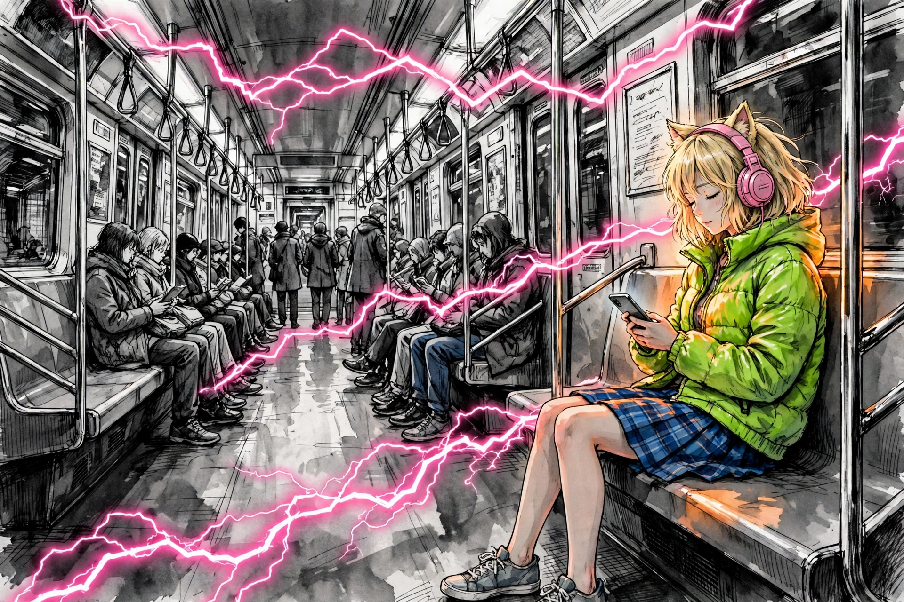
- v2 提示词原文：`Anime illustration mixed with black-and-white sketch collage, inside a subway carriage, a blonde girl with cat ears wearing pink headphones, a neon green jacket and a blue plaid skirt, eyes closed listening to music, holding a phone, sitting on a seat in the right third of the frame, ALL other passengers strictly black-and-white pencil sketch with NO colour at all, only the girl and the pink electric lines in colour, pink lightning-shaped lines running across the frame in three layers, carriage receding to the left background, cold white ceiling light, warm reflected light on the girl, heavier shadows in the black-and-white areas, black, white and grey base with neon pink, neon green and bright blue only on the girl and the lightning lines, anime linework with watercolour, plastic headphones and fabric sneakers, reflective metal handrails, horizontal composition`
- v2 对比：全部乘客严格黑白素描、再无彩色渗漏，少女外套的橙色暖光消失，黑白与彩色的分界更干净，更接近原描述；代价是少女的运动鞋变为蓝色（仍在“少女彩色”规则内），v1 的“乘客区暖色反光”反而在光影层次上更丰富。
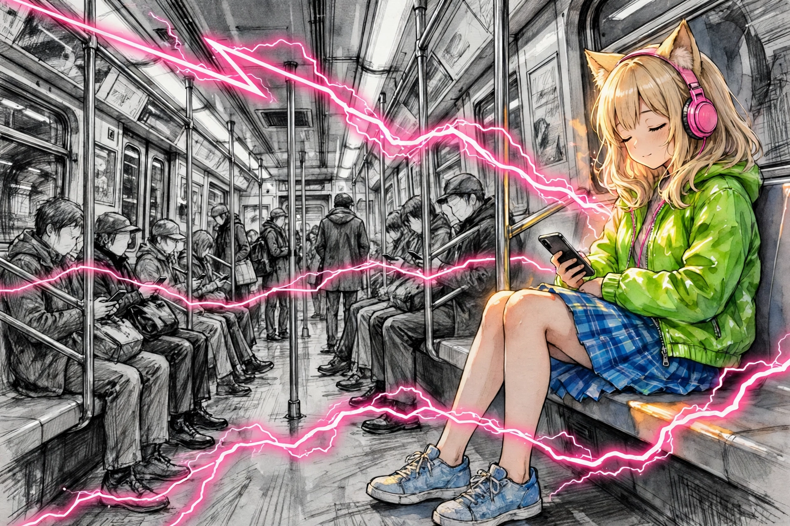
- 可复用规律：黑白与彩色分界要写“ALL other passengers strictly black-and-white pencil sketch with NO colour at all”，只写“其余乘客黑白素描”生成器仍会给乘客偷偷上色；彩色范围要写死“only on the girl and the lightning lines”。

## 10 · PromptHero · 红色海报拼贴

- 原链接：https://prompthero.com/prompt/fd2cb38309c-flux-flux-3-a-flat-bright-red-poster-background-with-nothing-else-in-it-from-the-bottom-of-the-frame-a-violet-purple
- 热度：Hot 榜浏览 4928、收藏 16、评论 0；详情页 4.9k views、16 favorites，模型 FLUX flux-3
- 原图拆解：纯红海报背景上，一只紫色大手自下而上托起一张撕碎的旧照片碎片，碎片上仅露出一双深色眼睛与鼻梁，手指从碎片中部的裂口穿出。构图为竖幅 2:3、上方大面积留白红底、手与照片居下半部，视线被眼睛锁定。光影为硬质霓虹光，手部皮肤有强高光与深阴影，照片碎片为冷蓝灰调，形成红紫蓝三色对比。色彩为仅红、紫、淡蓝三色，双色调强烈。材质为手部皮肤有细腻纹理与哑光印刷颗粒，照片纸张边缘粗糙撕裂、带白边。风格为大胆平面拼贴、超现实海报。人物仅为照片碎片中的双眼，非完整写实人物肖像。
- v1 提示词原文：`Bold surreal collage poster, a flat bright red poster background with nothing else in it, from the bottom of the frame a large violet-purple hand reaching up, holding a torn old photograph fragment, only a pair of dark eyes and a nose bridge visible on the fragment, fingers poking through a tear in the middle of the photo, large empty red space in the upper half, the eyes as the focal point, hard neon light, strong highlights and deep shadows on the hand skin, the photo fragment in cold blue-grey tones, only red, purple and pale blue colours, fine skin texture with matte print grain, rough torn paper edges with white borders, vertical 2:3 composition`
  - 中文解析：大胆超现实拼贴海报 + 纯红海报背景别无他物 + 下方紫色大手托起撕碎旧照片 + 碎片仅露一双深色眼睛与鼻梁 + 手指从中部裂口穿出 + 上半大面积留白红底 + 眼睛为焦点 + 硬质霓虹光 + 手部强高光深阴影 + 照片冷蓝灰调 + 仅红紫淡蓝三色 + 手部细腻纹理哑光印刷颗粒 + 照片边缘粗糙撕裂带白边 + 竖幅 2:3。
- v1 对比：像在纯红背景、上半大面积留白、紫色大手自下托起、照片碎片双眼与鼻梁、手指从裂口穿出、硬质霓虹光、冷蓝灰照片、红紫蓝三色；偏在照片碎片被撕成多块、手指穿过多处裂口；丢了“一张碎片、中间一道裂口”的单一感。
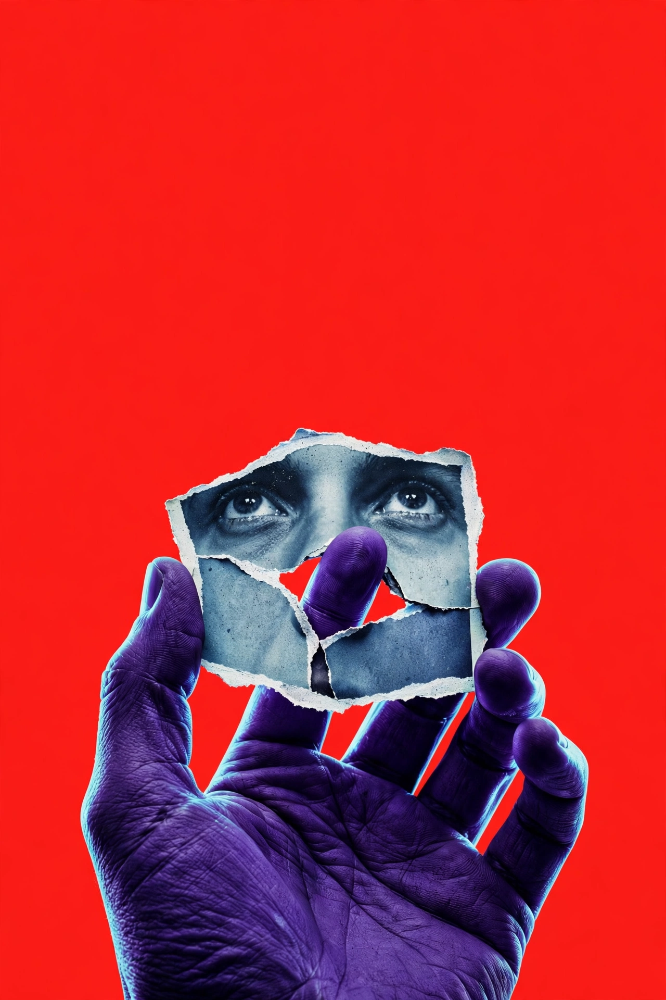
- v2 提示词原文：`Bold surreal collage poster, a flat bright red poster background with nothing else in it, from the bottom of the frame a large violet-purple hand reaching up, holding ONE single torn old photograph fragment, not several pieces, with a single vertical tear in the middle, one purple finger poking through the tear, the fragment showing only a pair of dark eyes and a nose bridge, large empty red space in the upper half, the eyes as the focal point, hard neon light, strong highlights and deep shadows on the hand skin, the photo fragment in cold blue-grey tones, only red, purple and pale blue colours, fine skin texture with matte print grain, rough torn paper edges with white borders, vertical 2:3 composition`
- v2 对比：v2 未能达成修正目标——照片仍是两块分开的碎片、手指夹在两片之间，鼻梁也被手指挡住不见；v1 的“一张碎片 + 手指穿过中部裂口 + 双眼鼻梁完整”反而更接近原描述。v2 仅在手部特写与留白上与 v1 相当，本张 v2 判定为未更接近。
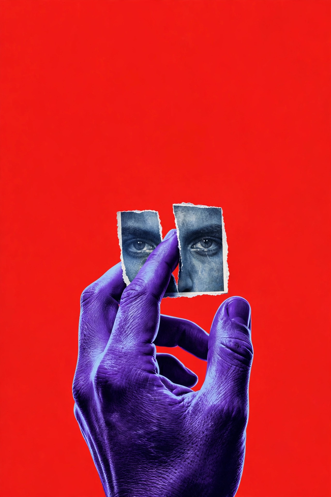
- 可复用规律：单张碎片要写“ONE single torn photograph fragment, not several pieces, with a single vertical tear”，但本张证明即使这样写，生成器仍可能把碎片拆成两块——“一张”这个数量词对撕纸类主体约束很弱，须在对比中如实记录而不是假装已修正。

## 11 · PromptHero · Welcome to the Olympic Exclusion Zone

- 原链接：https://prompthero.com/prompt/e8e092684c5-nano-banana-nano-banana-2
- 热度：Hot 榜浏览 2777、收藏 4、评论 0；详情页 2.8k views、4 favorites，模型 Nano Banana nano-banana-2
- 原图拆解：前景一辆锈迹斑斑的旅行车停在泥泞林间小路，车顶绑着行李、尾灯亮红灯；右侧一块木质路牌写着“WELCOME TO THE OLYMPIC EXCLUSION ZONE”；远景天空悬浮着一段断裂的高架公路，中央一道光柱直通地面。构图为横幅、车与路牌左右呼应、光柱居中偏上，森林向两侧收拢形成纵深。光影为阴云密布的冷调天光，光柱为唯一强光源，车尾红灯在暗调中醒目，地面水洼有反光。色彩为暗青、灰绿、锈红、暖橙尾灯，低明度高对比。材质为车身锈蚀剥落、泥泞路面湿滑、松树针叶细密、路牌木质风化。风格为末日科幻电影剧照、写实渲染。未见人物。
- v1 提示词原文：`Apocalyptic sci-fi movie still, realistic rendering, a rusty camper van in the foreground parked on a muddy forest road, luggage tied on the roof, red tail lights glowing, on the right a weathered wooden sign reading 'WELCOME TO THE OLYMPIC EXCLUSION ZONE', in the distant sky a broken elevated highway floating in the air, a beam of light in the centre reaching down to the ground, the van and the sign balancing left and right, the light beam slightly above centre, forest closing in on both sides, overcast cold daylight, the light beam as the only strong light source, red tail lights vivid in the dark tones, puddles reflecting light on the ground, dark teal, grey-green, rust red and warm orange tail lights, low brightness high contrast, rusted peeling van body, wet muddy road, dense pine needles, weathered wooden sign, horizontal composition`
  - 中文解析：末日科幻电影剧照写实渲染 + 前景锈迹旅行车停泥泞林间小路 + 车顶行李 + 尾灯亮红灯 + 右侧风化木路牌 + 远景天空悬浮断裂高架公路 + 中央光柱直通地面 + 车与路牌左右呼应 + 光柱居中偏上 + 森林两侧收拢纵深 + 阴云冷调天光 + 光柱唯一强光源 + 尾灯暗调中醒目 + 地面水洼反光 + 暗青灰绿锈红暖橙尾灯 + 低明度高对比 + 车身锈蚀剥落 + 泥泞湿滑路面 + 松树针叶细密 + 路牌木质风化 + 横幅。
- v1 对比：像在锈迹旅行车、车顶行李、红尾灯、右侧木路牌文字完整、断裂高架公路、中央光柱、泥泞水洼、阴云冷调、森林纵深；偏在高架公路画得过大过近、几乎占了半个天空，整体偏亮；丢了“高架在远景天空、画面低明度”的距离感与暗调。

- v2 提示词原文：`Apocalyptic sci-fi movie still, realistic rendering, darker overall mood, low brightness high contrast, a rusty camper van in the foreground parked on a muddy forest road, luggage tied on the roof, red tail lights glowing, on the right a weathered wooden sign reading 'WELCOME TO THE OLYMPIC EXCLUSION ZONE', in the distant sky a broken elevated highway floating in the air, SMALLER and farther away, a beam of light in the centre reaching down to the ground, the van and the sign balancing left and right, forest closing in on both sides, overcast cold daylight, the light beam as the only strong light source, red tail lights vivid in the dark tones, puddles reflecting light on the ground, dark teal, grey-green, rust red and warm orange tail lights, rusted peeling van body, wet muddy road, dense pine needles, weathered wooden sign, horizontal composition`
- v2 对比：高架公路推远变小、整体变暗、光柱仍居中，距离感与暗调更接近原描述；代价是路牌文字多了一个 THE（“WELCOME TO THE / THE / OLYMPIC EXCLUSION ZONE”），v1 的路牌文字反而完全正确。
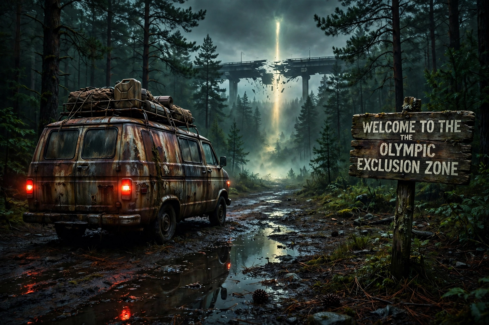
- 可复用规律：远景物体要写“SMALLER and farther away”，只写“在远景天空”生成器会把它画到半个画面大；但路牌文字每改一版都可能多字少字，文字准确性要逐版目视核对，不能只看构图。

## 12 · PromptHero · 巨人女子与小人（写实人物）

- 原链接：https://prompthero.com/prompt/72bfc9c1849-hero-10-a-giant-attractive-woman-looking-down-on-a-tiny-man
- 热度：Hot 榜浏览 1084、收藏 10、评论 0；详情页 1.1k views、10 favorites，模型 Hero 1.0
- 原图拆解：城市街道上，一名穿淡粉连衣裙的巨型女子俯身低头、面带微笑看向地面，右手扶在一栋砖楼顶沿；街面上一名穿浅蓝衬衫的男子仰头伸手，周围有行人、汽车与长椅。构图为横幅、女子占据画面上半部与右侧、男子在下方中央形成巨大比例反差，街道向远方延伸。光影为白天自然光，女子面部与裙身受光均匀，楼体阴影柔和，地面有淡淡投影。色彩为淡粉、砖红、米白、绿树，日常城市色调。材质为砖墙、玻璃窗、金属路灯、织物裙身均有写实质感。风格为超现实比例错置的写实照片、Hero 1.0 生成。写实细节：女子面部皮肤光滑带淡淡红晕、眼角有轻微笑纹、长发棕色自然垂落、几缕发丝贴在脸颊；牙齿在微笑中可见、排列自然；手部扶楼的手指自然弯曲、指甲短而干净，截图中未见明显手指变形；表情放松自然，抓拍感强；镜头焦段未标注，画面为中景、背景建筑与行人轻微虚化。AI 破绽：女子下半身与裙摆被楼体遮挡、脚部不可见，比例上裙摆与街道的衔接略显不自然；皮肤偏光滑、毛孔不明显；其余未见明显破绽。
- v1 提示词原文：`Surreal realistic photograph with a size contrast, on a city street a giant woman in a pale pink dress leaning down and smiling at the ground, her right hand resting on the roof edge of a brick building, below on the street a man in a light blue shirt looking up and reaching out, pedestrians, cars and benches around, the woman filling the upper half and right side of the frame, the man small in the lower centre, the street receding into the distance, natural daylight, even light on the woman's face and dress, soft shadows on the building, faint shadows on the ground, pale pink, brick red, cream white and green trees, everyday city colours, realistic textures of brick wall, glass windows, metal street lamps and fabric dress, the woman's skin smooth with a faint blush, slight smile lines at the corners of her eyes, long brown hair falling naturally with a few strands on her cheek, teeth visible in her smile, natural arrangement, her hand fingers naturally curved with short clean nails, relaxed natural expression, candid feeling, medium shot, background buildings and pedestrians slightly blurred, shot on 85mm lens, realistic skin texture with pores and slight imperfections`
  - 中文解析：超现实写实照片比例反差 + 城市街道淡粉连衣裙巨型女子俯身低头微笑看地面 + 右手扶砖楼顶沿 + 下方浅蓝衬衫男子仰头伸手 + 行人汽车长椅 + 女子占上半部与右侧 + 男子下方中央 + 街道向远方延伸 + 白天自然光 + 面部裙身受光均匀 + 楼体柔和阴影 + 地面淡淡投影 + 淡粉砖红米白绿树日常城市色 + 砖墙玻璃窗金属路灯织物裙写实质感 + 女子皮肤光滑淡淡红晕 + 眼角轻微笑纹 + 棕色长发自然垂落几缕贴脸颊 + 微笑露齿排列自然 + 扶楼手指自然弯曲指甲短干净 + 放松自然表情抓拍感 + 中景 + 背景建筑行人轻微虚化 + 85mm 镜头 + 真实皮肤毛孔轻微瑕疵。
- v1 对比：像在淡粉连衣裙巨型女子俯身微笑、浅蓝衬衫男子下方仰头伸手、街道向远方延伸、砖楼玻璃窗路灯、淡粉砖红米白绿树、微笑露齿、发丝贴脸颊、背景轻微虚化；偏在女子的手扶的是一处石质窗沿而非红砖楼顶沿，女子身体在右缘被裁切；丢了“右手扶砖楼顶沿”的材质点。
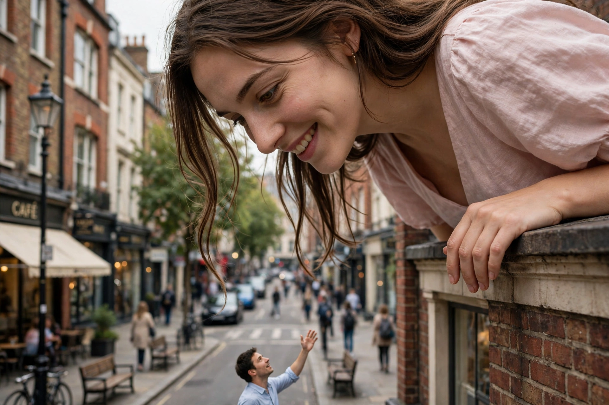
- v2 提示词原文：`Surreal realistic photograph with a size contrast, on a city street a giant woman in a pale pink dress leaning down from the upper right, smiling at the ground, her right hand resting on the red brick roof edge of a brick building, more of her pale pink dress and shoulder visible, below on the street a man in a light blue shirt looking up and reaching out, pedestrians, cars and benches around, the woman filling the upper half and right side of the frame, the man small in the lower centre, the street receding into the distance, natural daylight, even light on the woman's face and dress, soft shadows on the building, faint shadows on the ground, pale pink, brick red, cream white and green trees, everyday city colours, realistic textures of brick wall, glass windows, metal street lamps and fabric dress, the woman's skin with a faint blush and slight smile lines at the corners of her eyes, long brown hair falling naturally with a few strands on her cheek, teeth visible in her smile, natural arrangement, her hand fingers naturally curved with short clean nails, relaxed natural expression, candid feeling, medium shot, background buildings and pedestrians slightly blurred, shot on 85mm lens, realistic skin texture with pores and slight imperfections`
- v2 对比：右手改扶红砖楼顶沿、裙身与肩部露出更多，比例反差与街道纵深保持，更接近原描述；代价是女子面部更贴近镜头、笑容更开、牙齿更显眼，v1 的“含蓄微笑 + 侧脸俯视”反而在表情克制度上更贴合。
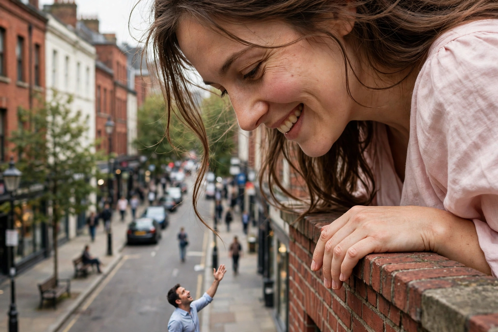
- 可复用规律：比例反差要写“the woman filling the upper half and right side + the man small in the lower centre”，只写“巨型女子与小人”生成器会把两人画成差不多大；手扶物的材质要写死“red brick roof edge”，只写“楼顶沿”它会画成石质窗沿。

## 13 · LiblibAI · 购物车里的蓝发猫耳少女

- 原链接：https://www.liblib.art/imageinfo/54da3993fc70497faaeb0bb674cfb98a?from=feed
- 热度：灵感页 1.3k；详情页点赞按钮显示 999+（上限显示）；页面日期 2025-12-07
- 原图拆解：画面中央一名蓝发猫耳少女坐在购物车里，身穿蓝白洛丽塔裙、手持棒棒糖与红色零食包，怀抱一只白猫玩偶，周围散落糖果与甜点；背景上方有大字“FHA UN NEWS”（页面提示词中含 shopping cart、sweets 等，图中文字为 AI 生成的乱码式字母）。构图为竖幅 1024x1536、少女居中、购物车斜向，糖果向四周散落，画面饱满。光影为明亮漫射光，少女面部与裙身有柔和阴影，背景红底渐变。色彩为蓝、白、红为主，糖果点缀粉黄。材质为二次元平涂、发丝顺滑、裙摆褶皱清晰、玩偶毛绒感。风格为亚洲动漫、2D 平涂、神话幻想标签，模型 illustrious_v20。未见写实人物；图中大字字母拼写错乱，是可见的 AI 文字破绽。
- v1 提示词原文：`Asian anime illustration, 2D flat colouring, a blue-haired girl with cat ears sitting in a shopping cart in the centre, wearing a blue and white Lolita dress, holding a lollipop and a red snack bag, hugging a white cat plush toy, candies and desserts scattered around, the shopping cart angled diagonally, a red gradient background, large garbled decorative letters at the top of the background, bright diffused light, soft shadows on her face and dress, blue, white and red main colours with pink and yellow candy accents, smooth flat hair, clear pleats on the dress skirt, fluffy plush toy, vertical composition 1024x1536`
  - 中文解析：亚洲动漫 2D 平涂 + 中央蓝发猫耳少女坐购物车 + 蓝白洛丽塔裙 + 棒棒糖与红色零食包 + 怀抱白猫玩偶 + 糖果甜点散落 + 购物车斜向 + 红底渐变背景 + 背景上方大字乱码装饰字母 + 明亮漫射光 + 面部裙身柔和阴影 + 蓝白红主色糖果粉黄点缀 + 顺滑平涂发丝 + 裙摆褶皱清晰 + 毛绒玩偶 + 竖幅 1024x1536。
- v1 对比：像在蓝发猫耳少女、购物车、蓝白洛丽塔裙、棒棒糖、红色零食包、白猫玩偶、糖果散落、红底、平涂风格；偏在上方大字被画成通顺的日文片假名“スウィート♥デー！”、零食包文字也被画通顺，画面比原图“更正确”；丢了原图最明显的特征——“图中大字是 AI 生成的乱码字母”这一破绽本身。

- v2 提示词原文：`Asian anime illustration, 2D flat colouring, a blue-haired girl with cat ears sitting in a shopping cart in the centre, wearing a blue and white Lolita dress, holding a lollipop and a red snack bag, hugging a white cat plush toy, candies and desserts scattered around, the shopping cart angled diagonally, a red gradient background, large garbled nonsense letters at the top of the background, misspelled random letters, AI text glitch, bright diffused light, soft shadows on her face and dress, blue, white and red main colours with pink and yellow candy accents, smooth flat hair, clear pleats on the dress skirt, fluffy plush toy, vertical composition 1024x1536`
- v2 对比：上方大字变为乱码（“KZBLRGH SWEETZZ!!”“FRUYTY KNDY!!”“SNKAZZ??”），复刻了原图的 AI 文字破绽，少女、购物车、玩偶、零食包都保持；代价是少女发型由双马尾变为双丸子头，购物车角度更侧，v1 的“双马尾 + 斜向购物车”反而在人物造型上更贴合。

- 可复用规律：要复刻 AI 乱码文字须写“garbled nonsense letters, misspelled random letters, AI text glitch”，只写“乱码装饰字母”生成器会把它写通顺；但写乱码会连带改动发型等无关细节，须在对比中说明代价。

## 14 · LiblibAI · 蝶妖人像（写实人物）

- 原链接：https://www.liblib.art/imageinfo/0555e49bdc4946ad9f680335c4028015?from=feed
- 热度：详情页点赞 223、评论 0（“暂无评论”）；页面日期 2025-12-11；尺寸 1136x2048，Qwen-Image_1.0
- 原图拆解：一名黑发女子近景肖像，头发间混有鎏金发丝与多只蝴蝶，肩头与发间各停一只蝴蝶，眼周嵌有蝶翼亮片，皮肤白皙，穿浅色肩部有蝶纹的礼服；背景为深暗的“幻境蝶谷”。构图为竖幅 1136x2048、人物面部居中偏上、蝴蝶由上至下斜向分布，视线直视镜头。光影为强侧光与伦勃朗光，面部一侧明亮、一侧沉入暗调，高反差；发丝与蝴蝶边缘有高光，背景深暗。色彩为黑、金、白、淡彩蝶翼，高饱和低明度，配色淡雅。材质为发丝顺滑带金色挑染、皮肤细腻、蝴蝶翅膀有鳞片纹理、礼服薄纱带光泽。风格为胶片摄影感、商业摄影、艺术照，提示词注明“胶片摄影，对焦模糊，强侧光，高饱和低明度”。写实细节：皮肤白皙光滑、眼周亮片清晰、眼神光明显、唇色淡粉、表情平静；发丝有几缕飞散在脸颊；手、耳、牙齿均未入镜（未确认）；镜头焦段未标注，画面为特写、背景虚化明显；颗粒为轻微胶片颗粒感。AI 破绽：皮肤过于光滑、毛孔与瑕疵几乎不可见、五官高度对称、眼周亮片过于工整；未见手部变形（手未入镜）。
- v1 提示词原文：`Film photography style portrait, close-up of a black-haired woman looking directly at the camera, golden-highlighted strands mixed in her hair, butterflies resting on her shoulder and in her hair, butterfly-wing glitter around her eyes, fair skin, wearing a light-coloured dress with butterfly patterns on the shoulders, dark fantasy butterfly valley background, butterflies distributed diagonally from top to bottom, strong side light and Rembrandt lighting, one side of her face bright, the other side sinking into shadow, high contrast, highlights on hair and butterfly edges, dark background, black, gold, white and pale butterfly colours, high saturation and low brightness, elegant palette, smooth hair with golden highlights, delicate skin, butterfly wings with scale texture, thin sheer dress with sheen, clear catchlights in her eyes, pale pink lips, calm expression, a few flyaway hair strands on her cheek, vertical close-up, background strongly blurred, subtle film grain, realistic skin texture with pores and slight imperfections, no retouching look`
  - 中文解析：胶片摄影风肖像 + 黑发女子近景直视镜头 + 鎏金发丝 + 蝴蝶停肩头与发间 + 眼周蝶翼亮片 + 白皙皮肤 + 浅色肩部蝶纹礼服 + 深暗幻境蝶谷背景 + 蝴蝶斜向分布 + 强侧光伦勃朗光 + 面部一侧亮一侧沉入暗调 + 高反差 + 发丝蝴蝶边缘高光 + 黑金白淡彩蝶翼 + 高饱和低明度 + 配色淡雅 + 顺滑发丝金色挑染 + 细腻皮肤 + 蝴蝶翅膀鳞片纹理 + 薄纱礼服光泽 + 明显眼神光 + 淡粉唇色 + 平静表情 + 脸颊飞散发丝 + 竖幅特写 + 背景强烈虚化 + 轻微胶片颗粒 + 真实皮肤毛孔轻微瑕疵 + 无修图感。
- v1 对比：像在黑发鎏金发丝、蝴蝶停肩头与发间、眼周亮片、薄纱蝶纹礼服、深暗背景、强侧光、眼神光、淡粉唇色、平静表情、飞散发丝、背景虚化；偏在眼周亮片画成脸颊大片黑金斑点、过重过脏，暗侧面部仍较亮、伦勃朗光不够深；丢了“亮片只嵌在眼周一线、暗侧真正沉入暗调”的克制。
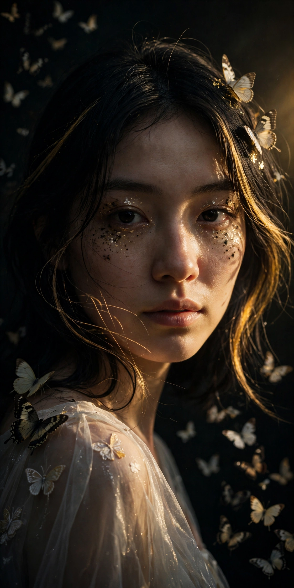
- v2 提示词原文：`Film photography style portrait, close-up of a black-haired woman looking directly at the camera, golden-highlighted strands mixed in her hair, butterflies resting on her shoulder and in her hair, only a thin line of butterfly-wing glitter around her eyes, not heavy specks on her cheeks, fair skin with visible pores and slight imperfections, pale pink lips, calm expression, a few flyaway hair strands on her cheek, deeper Rembrandt lighting, the left side of her face sinking into darkness, strong side light, high contrast, highlights on hair and butterfly edges, dark background, black, gold, white and pale butterfly colours, high saturation and low brightness, elegant palette, smooth hair with golden highlights, butterfly wings with scale texture, thin sheer dress with butterfly patterns on the shoulders and sheen, clear catchlights in her eyes, subtle film grain, vertical close-up, background strongly blurred, realistic skin texture, no retouching look`
- v2 对比：暗侧真正沉入暗调、亮片收为眼周一线金粉、皮肤出现可见毛孔与小痣，更接近原描述的伦勃朗光与真实皮肤；代价是背景蝴蝶变少、鎏金发丝不如 v1 明显，v1 的“蝴蝶斜向分布 + 鎏金发丝高光”反而在画面密度上更贴合。
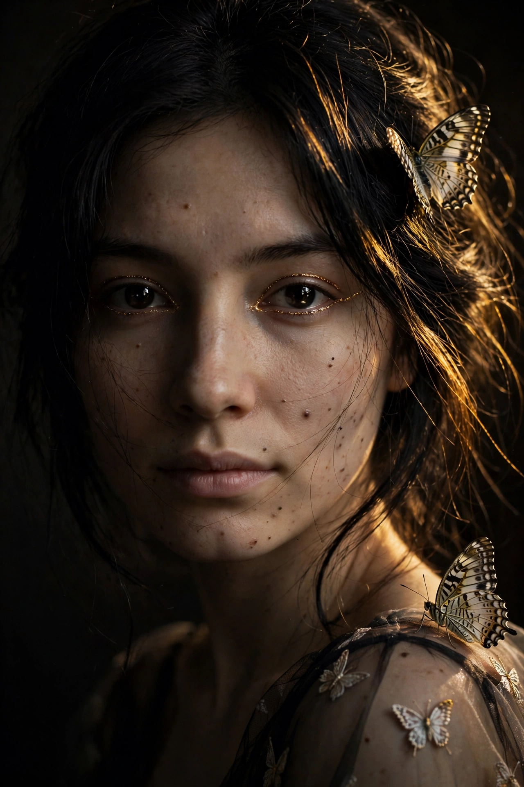
- 可复用规律：伦勃朗光要写“the left side of her face sinking into darkness + deeper Rembrandt lighting”，只写“强侧光”生成器会把暗侧也照亮；眼周亮片要写“only a thin line of glitter around her eyes, not heavy specks on her cheeks”，否则亮片会糊满脸颊。

## 15 · Tensor.art · 狼女肖像

- 原链接：https://tensor.art/images/1063311185878770619?post_id=1063311163330175944
- 热度：Trending Today 首帖：点赞 16、评论 0；发布 2026-11-05 09:50；该帖为 2 图轮播，只取第 1 张
- 原图拆解：拟人狼女极近景三-quarter 肖像，全身覆盖浓密黑毛，额头与脸颊有发光的青色神圣纹路，青色长发垂落，穿浅色衣物；背景为深绿夜色。构图为方形 1536x1536、头部充满画面、双耳完整入镜，顶部留白极小。光影为青色纹路自发光，面部有冷色轮廓光，毛发边缘透光，背景深暗。色彩为黑、青、深绿、米白，冷调为主。材质为毛发浓密蓬松、皮肤与毛发交界处有细腻纹理、纹路如发光刺青。风格为高度写实渲染、奇幻拟人角色，提示词注明 highly realistic、lifelike 等，模型 VXP Krea2。非真人；狼吻与兽耳为刻意设定，未见人类手部。
- v1 提示词原文：`Highly realistic fantasy rendering, extreme close-up three-quarter portrait of an anthropomorphic wolf woman, her whole face covered in dense black fur, glowing cyan sacred patterns on her forehead and cheeks, long cyan hair falling down, wearing light-coloured clothing, dark green night background, square composition, her head filling the frame, both ears fully in frame, tiny margin at the top, the cyan patterns glowing by themselves, cold rim light on her face, light shining through the edges of her fur, dark background, black, cyan, dark green and cream white palette, cold tones, dense fluffy fur, fine texture where skin meets fur, glowing tattoo-like patterns, lifelike detail`
  - 中文解析：高度写实奇幻渲染 + 拟人狼女极近景三-quarter 肖像 + 全脸浓密黑毛 + 额头脸颊发光青色神圣纹路 + 青色长发垂落 + 浅色衣物 + 深绿夜色背景 + 方形 + 头部充满画面 + 双耳完整入镜 + 顶部留白极小 + 青色纹路自发光 + 面部冷色轮廓光 + 毛发边缘透光 + 黑青深绿米白冷调 + 浓密蓬松毛发 + 皮肤毛发交界细腻纹理 + 发光刺青纹路 + 逼真细节。
- v1 对比：像在拟人狼女极近景、浓密黑毛、发光青色纹路、青色长发、浅色衣物、深绿夜色、双耳完整入镜、冷色轮廓光、毛发边缘透光；偏在纹路为松散的线条涂鸦感、不够“神圣几何”，狼吻偏短偏人脸；丢了“纹路如发光刺青、几何神圣感”与“狼吻长度”。
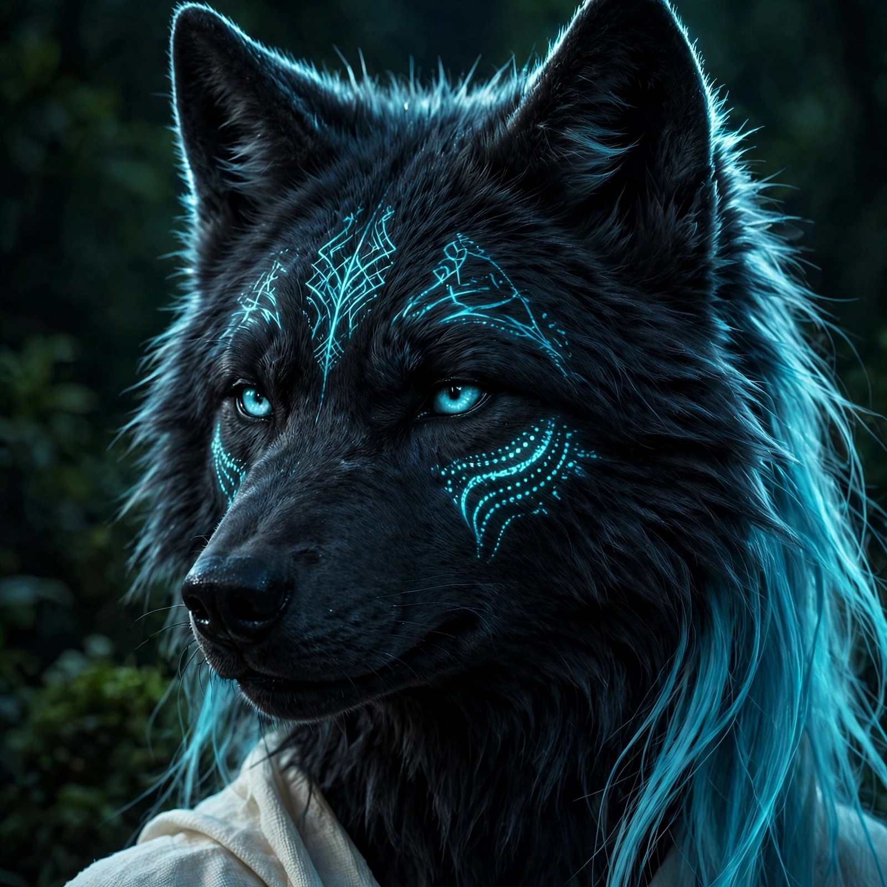
- v2 提示词原文：`Highly realistic fantasy rendering, extreme close-up three-quarter portrait of an anthropomorphic wolf woman, her whole face covered in dense black fur, finer symmetrical sacred-geometry glowing cyan patterns on her forehead and cheeks, a longer wolf muzzle, long cyan hair falling down, wearing light-coloured clothing, dark green night background, square composition, her head filling the frame, both ears fully in frame, tiny margin at the top, the cyan patterns glowing by themselves, cold rim light on her face, light shining through the edges of her fur, dark background, black, cyan, dark green and cream white palette, cold tones, dense fluffy fur, fine texture where skin meets fur, glowing tattoo-like patterns, lifelike detail`
- v2 对比：纹路变为更细密对称的神圣几何线条、狼吻拉长更像狼，头部充满画面、双耳完整，更接近原描述；代价是纹路覆盖面更大、眼睛由青色变为灰蓝，v1 的“青色眼睛 + 纹路点缀”反而在色彩上更贴合。
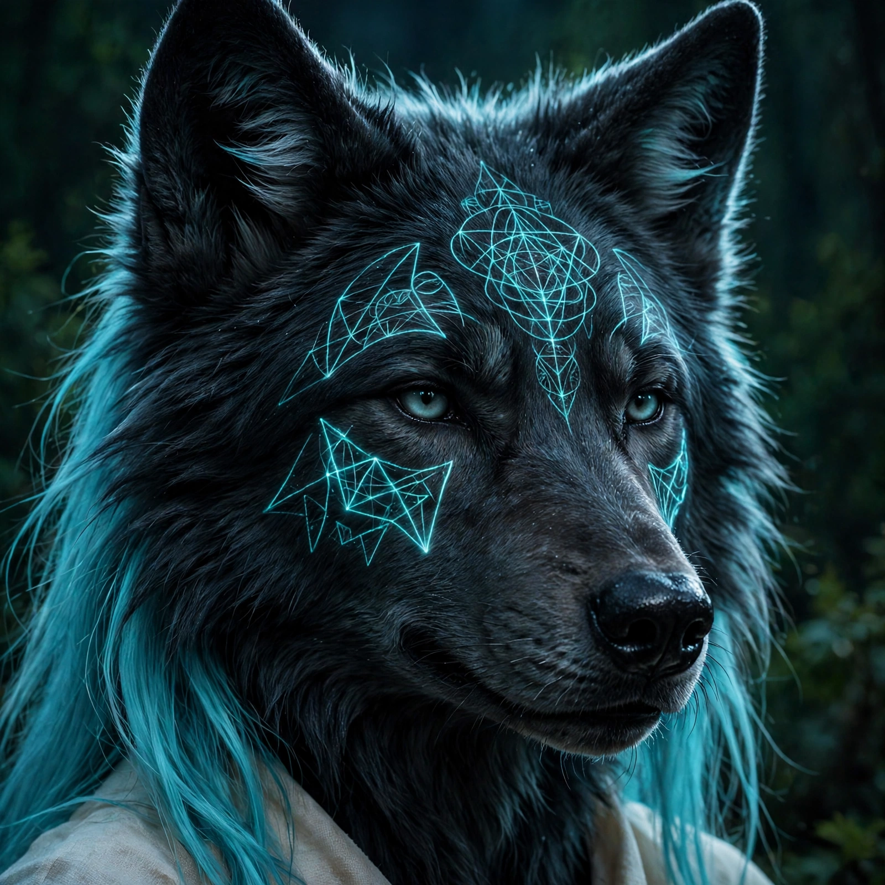
- 可复用规律：神圣纹路要写“finer symmetrical sacred-geometry glowing patterns”，只写“神圣纹路”生成器会画成松散涂鸦；狼吻长度要写“a longer wolf muzzle”，否则它会按人脸比例画短吻。

---

## 共性结论

1. **方位词必须写死左右**：本期 6 号（翅膀方向、岩柱位置）与 1 号（龙身画框）证明，只写“展开”“在后方”生成器会自己决定方位，十有八九与原图相反；“向左上方”“在右侧”这类绝对方位词是反推提示词里最有效的修正手段。
2. **大小关系要写数量级**：2 号月亮、3 号月亮、11 号高架公路、5 号双花，凡是“大/小/远”都必须写成“约三分之一画幅宽”“SMALLER and farther away”这种可执行的数量级，只写“大/远”会被生成器按默认比例画。
3. **“不要”要写全称否定**：9 号乘客上色、3 号花边、1 号露脸，凡是不要的东西必须写“NO colour at all”“no decorative border”“only chin and lips visible”，半句否定会被忽略。
4. **v2 修正常带代价**：本期 15 张中，v2 在目标点上更接近原描述的有 13 张，其中 10 号未更接近（碎片仍是两块），另有多张 v2 在修好目标点的同时丢了 v1 的优点（4 号兜帽落下、5 号留白变多、7 号抓拍感减弱、11 号路牌多字、12 号笑容过开）。一轮修正不是单调变好，须逐张说明代价，不能只报“更接近”。
5. **文字类主体最难一次写准**：10 号碎片数量、11 号路牌文字、13 号乱码文字三张都与文字有关，生成器对“一张/单道裂口/乱码”的服从度明显低于对构图与色彩的服从度；文字准确性必须逐版目视核对。
6. **风格词会整体漂移**：4 号 v2 由电影感漂向水彩故事书、6 号 v2 由近景人像拉成中景，说明加“medium-wide shot”“storybook”等词会连带改变整体风格；只改一个变量时，风格词要保持不动。

## 写实人物小结（7、8、12、14 号）

- **为什么看起来逼真**：四张的共同点是“不完美细节 + 具体光线 + 抓拍姿态”三件套。7 号靠皱纹老年斑、灰白稀疏发丝、暖黄室内灯与家人放松姿态；8 号靠雀斑、眼角纹、飞散发丝与托腮手部的戒指手链；12 号靠笑纹、贴脸颊的发丝、自然排列的牙齿与扶楼的弯曲手指；14 号靠眼周亮片、眼神光、飞散发丝与伦勃朗光。单写“真实皮肤”不够，必须把皱纹、雀斑、笑纹、发丝、牙齿、手部这些可定位的细节逐个写进提示词。
- **破绽对照**：7 号未见明显破绽（仅个别家人面部模糊）；8 号五官过对称、皮肤过滑、异色瞳孔过亮；12 号皮肤偏光滑、毛孔不明显、裙摆与街道衔接略不自然；14 号皮肤过滑、毛孔瑕疵不可见、五官过对称、亮片过工整。四张都没有手部变形（7 号手部细节不清、14 号手未入镜），说明“手未入镜”本身就是规避破绽的常用办法。
- **去塑料感的提示词**：本期验证有效的三句是 `realistic skin texture with pores and slight imperfections`（8、14 号 v2 皮肤出现毛孔与小痣）、`slight facial asymmetry`（8 号 v2 对称感减弱）、`no retouching look`（7、14 号配合胶片颗粒使用）。反例：只写“细腻皮肤”“光滑皮肤”会直接出磨皮脸（8 号 v1、14 号 v1）。
- **光线比磨皮更重要**：14 号 v2 只改了伦勃朗光深度与亮片范围，真实感提升幅度大于 8 号 v2 只改皮肤纹理；侧光 + 一侧沉入暗调 + 眼神光，是写实人像里性价比最高的三个词。
- **85mm 与胶片颗粒是年代感的锚**：7 号 v2 的 `visible film grain, softer focus, slightly faded colours` 与 12 号的 `shot on 85mm lens`，是两张照片感最强的锚点；没有这两个词，生成器默认出高清现代数码感。
