# 每日 AI 图片反推学习 · 2026-11-07

## 选图说明与缺口

- 选图时间：2026-11-07 上午（北京时间），浏览器选图任务 08:58–09:35 完成，全程未登录、未注册、未购买、未下载原图文件。本报告的原图拆解以浏览器任务回传的文字描述为准，未逐像素下载核对原图，因此 v1、v2 对比是“重生成图 vs 浏览器描述的原图特征”，不是与原图文件的逐像素对照；凡描述中未确认的细节，报告里不作推断。
- 本期 15 张构成：SeaArt 4 张 + NightCafe 3 张 + Civitai 3 张 + Reddit 2 张 + PixAI 1 张 + PromptHero 1 张 + LiblibAI 1 张，共 7 个渠道；写实人物照片 3 张（第 5、6、7 张，均为面部可见）。
- **去重说明：当天共跳过 12 张已核实的重复图，未入选、未反推、未生成，见下表。** 选图前已核对以往全部报告（2026-10-29 至 2026-11-06）的平台加图片 ID / 原链接（去重基线 135 条）；本机 grep 复核：本期 15 张全部不在基线中，跳过的 12 张中有 10 张精确在基线内；另有 2 张 PromptHero（红底紫手撕纸人眼海报、34 岁意大利肌肉纹身男）按 12 位 ID 前缀加 slug 关键词确认与基线为同一图——浏览器抄录的 slug 缺了一段“flux”，与基线 slug 逐字不完全一致，已在表中注明；NightCafe 沙尘暴图按标题 slug“caught-in-a-heavy-sand-storm”确认重复，浏览器抄录的链接路径（/artwork/）与 ID 字符与基线（/creation/xlZxiCRB0MU2o4buJy7z/）略有出入；Gucci 图按 slug 关键词“gucci-vintage-luxury”确认重复，浏览器抄录的 12 位前缀 65844a7a57a8 与基线 658447a57a8 有一字之差。首次出现日期为本机在以往报告中 grep 到的最早日期。跨平台视觉上明显同一张图的转载，本批未发现可确认的此类重帖；第 5 张与第 8 张标题都含“Peekaboo/Peek-a-Boo”，但分别是 SeaArt 温室写实照片与 PixAI 动漫猫耳女仆，作者、平台、画面完全不同，不按重复处理。

| 平台 | 图（作者） | 原链接 | 当日热度 | 首次出现日期 |
|---|---|---|---|---|
| PixAI | memento mori 💀（(^ aricat ^)） | https://pixai.art/artwork/2073338548770559862 | 1.28k 赞、13 评论 | 2026-11-03 报告 |
| PixAI | PLAY WITH ME?（リオ） | https://pixai.art/artwork/2072756675267802567 | 1.94k 赞、25 评论 | 2026-11-03 报告 |
| PixAI | Halloween Miku（𝕿𝖃𝕷） | https://pixai.art/artwork/2073334480740312561 | 864 赞、2 评论 | 2026-11-05 报告 |
| NightCafe | Caught in a heavy sand Storm（Jarka Carta） | https://creator.nightcafe.studio/creation/xlZxiCRB0MU2o4buJy7z/caught-in-a-heavy-sand-storm | 541 赞、164 评论 | 2026-11-06 报告 |
| PromptHero | 红底紫手撕纸人眼海报 | https://prompthero.com/prompt/fd2cb38309c-flux-3-a-flat-bright-red-poster-background-with-nothing-else-in-it-from-the-bottom-of-the-frame-a-violet-purple | 17 收藏、5122 浏览 | 2026-11-06 报告 |
| PromptHero | 34 岁意大利肌肉纹身男 | https://prompthero.com/prompt/869df0f4100-flux-3-a-masterpiece-cinematic-color-photo-of-a-34-year-old-muscular-italian-man-with-gritty-masculine-gaze-sharp | 7 收藏、1906 浏览 | 2026-11-03 报告 |
| PromptHero | 未来风东亚女子浅灰背景 | https://prompthero.com/prompt/b765d8da5ca-seedream-5-seedream-5-pro-a-young-east-asian-woman-posing-in-futuristic-attire-against-a-solid-light-gray-background-she-is-equipped-with-a | 9 收藏、1504 浏览 | 2026-11-04 报告 |
| PromptHero | Gucci 复古奢华时尚大片 | https://prompthero.com/prompt/658447a57a8-chatgpt-image-gpt-image-25-scene-type-fashion-editorial-theme-gucci-vintage-luxury-setting-environment-interior-fashion-set-background-wallpaper-pattern-ornate-looped-gold-and | 11 收藏、1411 浏览 | 2026-11-05 报告 |
| PromptHero | 索尼 A7III 时尚模特特写 | https://prompthero.com/prompt/0b7b879ba91-hero-10-close-up-of-a-stunning-fashion-model-ultra-realistic-portrait-shot-on-a-sony-a7iii-high-quality-ar-3564-stylize | 5 收藏、1096 浏览 | 2026-11-03 报告 |
| PromptHero | 巨人女子俯视小人 | https://prompthero.com/prompt/72bfc9c1849-hero-10-a-giant-attractive-woman-looking-down-on-a-tiny-man | 10 收藏、1094 浏览 | 2026-11-06 报告 |
| PromptHero | 雨林夜路汽车与 UFO（Nano Banana 2） | https://prompthero.com/prompt/e8e092684c5-nano-banana-nano-banana-2 | 4 收藏、2851 浏览 | 2026-11-06 报告 |
| LiblibAI | 发现灵感页最高赞作品（魔绘工坊，1.3k 赞） | https://www.liblib.art/imageinfo/54da3993fc70497faaeb0bb674cfb98a?from=feed | 1.3k 赞 | 2026-11-06 报告 |

- **其他缺口（按实测，不硬编）**：SeaArt /explore 会重定向回首页，实际用的是社区图库 https://www.seaart.ai/post（Recommended 排序）；详情页主图初次加载常为黑屏，需点击图片区域才会加载；本次入选的 4 张 SeaArt 作品多为旧作在今日推荐流中复现（温室 2026-05-06、苹果园 2026-05-17、唐美人 2026-07-13、万圣节精灵 2026-10-23），热度与排名为当日所见，作品本身并非当日新发。NightCafe nightcafe.studio/explore 为 404，正确地址为 creator.nightcafe.studio/explore，Hot 排序为 ?q=hottest；瀑布流卡片与标题的对应需以作品页核对（曾出现一次图文错配，已纠正）；《Hold Your Horses》另有 Kling 视频版本，入选的是其 GPT Image 原图静帧。PixAI Trending 榜首多为往日旧作（当日榜首 1.94k 的 PLAY WITH ME?、1.28k 的 memento mori、864 的 Halloween Miku 均在基线内），最终仅找到 1 张全新高热作品（Peek-a-Boo!，11 月 4 日发布）。Reddit r/midjourney Hot 可直接访问，未遇网络安全封锁，故无需换浏览器环境；r/StableDiffusion 与 r/aiArt 今日未查看（15 张已凑满），为缺口；热榜帖子多为发布数小时的新帖，顶贴数相对较低（64、161）。Civitai 公开图片接口（limit=20、sort=Most Reactions、period=Week、nsfw=None）正常返回，游客图库卡片会模糊，但图片详情页画面清晰，已逐张以详情页核对，未仅凭模糊卡片判断。PromptHero Hot 页滚动后弹出可关闭的注册墙，已关闭；Hot 榜前列大量为基线旧作（本日即遇 7 张重复），仅 Shintaro Kago 一张入选；榜上另有 2 张视频作品（肌肉男、机械翅膀女子）因只有视频而跳过。LiblibAI 发现灵感页正常打开，登录弹窗可关闭；“推荐”排序可见点赞数，最高赞作品为基线旧作，顺延取太上老君的马年海报（318 赞）入选。ArtStation Trending、Midjourney Explore Top day、Tensor.art、DeviantArt、Lexica、PromeAI 今日未查看（15 张已从上述 7 个渠道凑满）。OpenArt、Ideogram、Leonardo、Pinterest 全程未作为选图来源。
- 本报告的 v1、v2 均为反推重写，不是照抄原帖提示词。
- 重生成图片保存在本任务目标工作区 `hidden_files/2026-11-07/images/` 下，报告内以图片文件名对应；GitHub 版见 ai-image-learning/2026-11-07.md，图片在 ai-image-learning/images/ 下。
- **生成完成情况：15 张的 v1 共 15 张次全部生成成功；v2 共 14 张次成功、1 张次未完成（第 13 张，见该节说明）；合计 29 张次成功，1 张次未完成。**

## 一览表

| # | 平台 | 作者 | 原链接 | 热度（快照） |
|---|---|---|---|---|
| 1 | NightCafe | Mormookiee | https://creator.nightcafe.studio/creation/Rg6XITQaieBFrNkySjrt/hold-your-horses | 847 赞、558 评论、17 收藏；Daily Runner-up |
| 2 | NightCafe | David Brumit | https://creator.nightcafe.studio/creation/TwjwCcHpU4vpCj6AroxM/nothing-is-written-in-stone | 657 赞、182 评论、12 收藏、31 打赏；Daily Winner |
| 3 | NightCafe | Nikko P | https://creator.nightcafe.studio/creation/szCw8TiouBIqUPKFmnLU/the-lake | 382 赞、65 评论；Epic 亚军，评分 4.03/5 |
| 4 | SeaArt | N.G. | https://www.seaart.ai/postDetail/dbd9uite878c73a2cmj0 | 1.3K 赞、1.7K 收藏、691 浏览、22 评论 |
| 5 | SeaArt（写实人物） | Mixz | https://www.seaart.ai/postDetail/d7t8ajde878c73ekvpu0 | 805 赞、261 收藏、174 浏览、4 评论 |
| 6 | SeaArt（写实人物） | Smile Minty | https://www.seaart.ai/postDetail/d84gbpde878c73ahbmug | 528 赞、153 收藏、315 浏览、8 评论 |
| 7 | SeaArt（写实人物） | stevenp | https://www.seaart.ai/postDetail/d9a2note878c738n45pg | 155 赞、28 收藏、104 浏览、2 评论 |
| 8 | PixAI | AURA✨️💡 | https://pixai.art/artwork/2074639409355095989 | 795 赞、38 评论；万圣节主题赛参赛作 |
| 9 | Reddit r/midjourney | u/Zenchilada | https://www.reddit.com/r/midjourney/comments/1xpjy7b/autumn_scifi/ | 顶贴 64、评论 0；9 图组帖，取首图 |
| 10 | Reddit r/midjourney | u/Dropdeadlegs84 | https://www.reddit.com/r/midjourney/comments/1xpbrtd/mechhead/ | 顶贴 161、评论 1；8 图组帖，取首图 |
| 11 | Civitai | keibael | https://civitai.com/images/147404090 | 👍1312、❤️462、😂179、😢65、评论 9；近一周最多反应第 1 名 |
| 12 | Civitai | Cinnadust | https://civitai.com/images/147420348 | 👍1215、❤️452、😂177、😢66、评论 4；近一周最多反应第 2 名 |
| 13 | Civitai | FLESK | https://civitai.com/images/147478410 | 👍1151、❤️451、😂123、😢70、评论 4；近一周最多反应第 3 名 |
| 14 | PromptHero | @userp4kc3 | https://prompthero.com/prompt/9edeba9d1b3-stable-diffusion-35-large-masterpiece-award-winning-best-quality12-art-by-shintaro-kago-solo-menhera-yamikawa-punk-jirai-kei-jirai-kei-fashion11-detailed-face | 收藏 9、浏览 1.1k、评论 0 |
| 15 | LiblibAI | 太上老君 | https://www.liblib.art/imageinfo/8ffd845d3dbf473b9bebf782a717d0d7?from=feed | 赞 318、评论 2 |

类别分布：写实人物照片 3 张（5、6、7），动漫/插画 4 张（4、8、12、14），风景 1 张（3），暗黑奇幻/海报 3 张（11、13、15），科幻机甲 2 张（9、10），超现实卡通 1 张（2），3D 奇趣 1 张（1）。

---

## 1 · NightCafe · Hold Your Horses

- 原链接：https://creator.nightcafe.studio/creation/Rg6XITQaieBFrNkySjrt/hold-your-horses
- 热度：847 赞、558 评论、17 收藏；Daily Runner-up
- 原图拆解：一位白发老妇站在画面中央偏下，双臂张开各搂一匹巨马的脖颈，仿佛怀抱两只巨型宠物狗。老妇戴圆眼镜、穿粉色开衫与碎花长裙，神态安详慈爱。左右两匹马体型夸张巨大：左侧栗色马、右侧灰白斑驳马，均咧嘴露齿大笑，前腿悬空下垂。构图为对称式三分构图，老妇居中，左右巨马形成拱形框架，人物仅占画面高度约四分之一，以体量反差制造幽默。背景为右侧石砌谷仓、白色木栅栏、绿色树木与蓝天白云的农场，纵深自然。光影为明亮日光，柔和阴影落在草地，色彩饱和、暖调为主。材质为 3D 渲染质感，皮毛光滑、马毛有细腻纹理，衣服布料柔软。风格为皮克斯式夸张卡通 3D。该作品页同时挂有 Kling 视频版本，入选的是 GPT Image 2.5 Sunburst 生成的原始静帧。
- v1 提示词原文：`Whimsical Pixar-style 3D render, an elderly woman with white hair and round glasses, wearing a pink cardigan and floral long skirt, standing in the centre of a farmyard with her arms spread wide, cradling the necks of two giant horses like lapdogs, a chestnut horse on the left and a dappled grey-white horse on the right, both horses grinning with teeth showing, front legs dangling, the woman only about a quarter of the frame height, symmetrical composition with the two horses forming an arch frame around her, stone barn and white wooden fence on the right, green trees and blue sky with white clouds, bright daylight, soft shadows on grass, saturated warm colours, smooth 3D render fur texture with fine detail, soft fabric clothing`
  - 中文解析：俏皮皮克斯风 3D 渲染 + 白发圆眼镜老妇、粉色开衫碎花长裙 + 站在农场中央、双臂张开搂两匹巨马脖颈如抱巨型宠物狗 + 左栗色马右灰白斑驳马 + 两马均咧嘴露齿大笑、前腿悬空下垂 + 人物仅占画面高度约四分之一 + 对称构图、两马成拱形框架 + 右侧石砌谷仓白色木栅栏 + 绿树蓝天白云 + 明亮日光、草地柔和阴影 + 饱和暖调 + 光滑 3D 皮毛细腻纹理 + 柔软布料。
- v1 对比：像在白发圆眼镜老妇、粉色开衫碎花长裙、左栗色马右灰白斑驳马、两马咧嘴露齿大笑、前腿悬空、拱形框架、右侧石谷仓白栅栏、蓝天白云、明亮日光；偏在两马马头低垂凑到老妇头顶、呈“低头亲昵”状而非站立姿态，老妇约占画面高度三分之一、比原描述的四分之一大，双臂是向上托住马嘴而非环搂脖颈；丢了“两马站立、老妇双臂环搂马颈、人物更小”的体量感。

- v2 提示词原文：`Whimsical Pixar-style 3D render, an elderly woman with white hair and round glasses, wearing a pink cardigan and floral long skirt, standing in the centre of a farmyard, SMALL in the frame at only a quarter of the frame height, her arms wrapped around the necks of two giant horses standing upright on all four legs like giant lapdogs, a chestnut horse on the left and a dappled grey-white horse on the right, both horses with heads raised and grinning with teeth showing, symmetrical composition with the two horses forming an arch frame around her, stone barn and white wooden fence on the right, green trees and blue sky with white clouds, bright daylight, soft shadows on grass, saturated warm colours, smooth 3D render fur texture with fine detail, soft fabric clothing`
- v2 对比：两马改为四腿站立、马头抬起、老妇缩小到约四分之一画幅高、双臂张开，更接近“站立巨马 + 渺小老妇”的原描述体量感；代价是老妇双手只够到马胸、仍够不着马颈（马实在太高），拱形框架感比 v1 弱，v1 的“马头低垂凑近老妇、拱形亲昵感”反而更有爱。
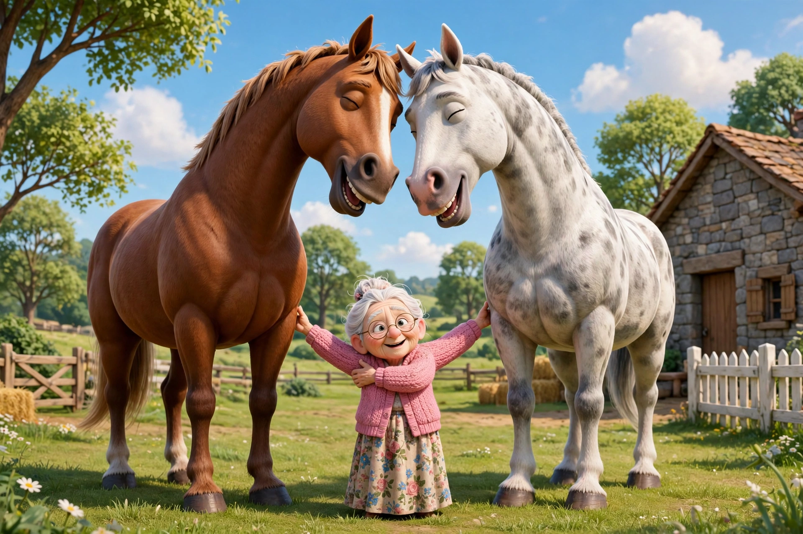
- 可复用规律：巨物与渺小人物的体量反差要写死人物占比（“only a quarter of the frame height”），只写“人物很小”生成器仍会把人画到三分之一高；“环搂脖颈”对超大体型差基本画不出来，要写“arms wrapped around”也要接受手只够到胸口的结果。

## 2 · NightCafe · Nothing is Written in Stone

- 原链接：https://creator.nightcafe.studio/creation/TwjwCcHpU4vpCj6AroxM/nothing-is-written-in-stone
- 热度：657 赞、182 评论、12 收藏、31 打赏；Daily Winner
- 原图拆解：瘦削老石匠立于巨石前，举起石锤正要落下；巨石上刻着醒目的“NOTHING”大字。老者头发蓬乱、鹰钩鼻、长须，表情专注执拗。构图为竖构图 4:3，老者位于左下三分之一处，巨石占据右上大半画面，形成对角线张力。光影为明亮日光，石面有粗糙阴影与高光，人物投影落在石面。色彩为石头的灰褐、老者衣物的土黄与蓝灰、天空的淡蓝与白云，天上两只翼龙剪影点缀。材质为水彩加卡通线条的扁平质感，笔触松散。风格为幽默漫画插画，呼应“Taking Things Literally”挑战主题（把“nothing is written in stone”这句习语字面化）。模型：GPT Image 2 Medium，2026-11-04 生成、11 月 6 日发布。
- v1 提示词原文：`Humorous watercolour cartoon illustration, a skinny old stonemason with messy hair, hooked nose and long beard, standing at the lower left of the frame, raising a stone hammer about to strike a giant boulder, the word NOTHING carved in large letters on the boulder, the boulder filling the upper right of the frame, diagonal tension, grey-brown stone with rough shadows and highlights, the old man in earthy yellow and blue-grey clothes, pale blue sky with white clouds, two pterodactyl silhouettes in the sky, loose watercolour brush strokes with cartoon outlines, flat painterly texture, vertical composition`
  - 中文解析：幽默水彩卡通插画 + 瘦削老石匠、蓬乱头发鹰钩鼻长须 + 站左下、举石锤正要落下 + 巨石上刻大字 NOTHING + 巨石占右上 + 对角线张力 + 灰褐石头粗糙阴影高光 + 老者土黄蓝灰衣物 + 淡蓝天空白云 + 天上两只翼龙剪影 + 松散水彩笔触卡通线条 + 扁平质感 + 竖构图。
- v1 对比：像在瘦削老石匠左下举锤、NOTHING 大字刻在巨石上、灰褐石面粗糙阴影、土黄蓝灰衣物、两只翼龙剪影、水彩卡通扁平质感；偏在巨石几乎占满右上三分之二、左侧天空只剩一条缝，老者身体前倾幅度大、近乎爬在石面上；丢了“巨石只占右上大半、左侧留出淡蓝天空”的呼吸感。
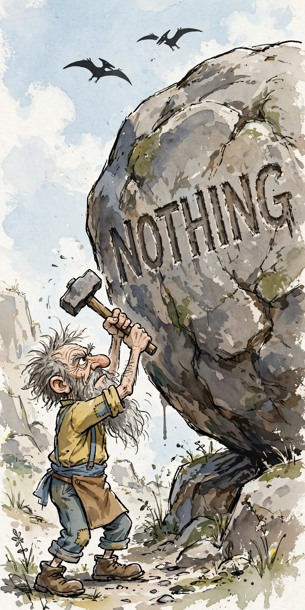
- v2 提示词原文：`Humorous watercolour cartoon illustration, a skinny old stonemason with messy hair, hooked nose and long beard, standing upright at the lower left of the frame facing a giant boulder, raising a stone hammer about to strike, the word NOTHING carved in large letters on the boulder, the boulder occupying only the upper right half of the frame with more pale blue sky visible on the left, diagonal tension, grey-brown stone with rough shadows and highlights, the old man in earthy yellow and blue-grey clothes, pale blue sky with white clouds, two pterodactyl silhouettes in the sky, loose watercolour brush strokes with cartoon outlines, flat painterly texture, vertical composition`
- v2 对比：老者改为直立站姿正对巨石、左侧淡蓝天空明显变多、翼龙更清晰，NOTHING 拼写仍正确，更接近“老者左下、巨石右上、左侧留天”的原描述；代价是石锤挥击的动势变弱，v1 的“举锤将落、石屑飞溅”反而更有动作感。
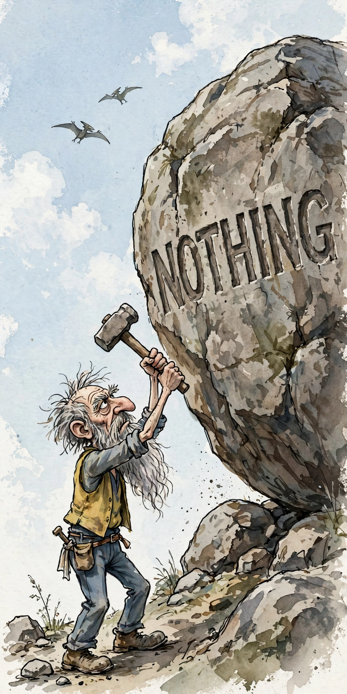
- 可复用规律：巨石占幅要写死“occupying only the upper right half”，只写“占据右上”生成器会让它吃掉三分之二画面；画面里的文字要写“the word NOTHING carved in large letters”，大写单词拼写基本能一次写对。

## 3 · NightCafe · The Lake!

- 原链接：https://creator.nightcafe.studio/creation/szCw8TiouBIqUPKFmnLU/the-lake
- 热度：382 赞、65 评论；Epic 亚军，评分 4.03/5
- 原图拆解：巨大金色满月占据画面左上约三分之二，月面环形山纹理清晰；一棵平顶金合欢树剪影横在月前，枝条向四方舒展；右下角几棵细瘦枯树。构图为方形 1:1，月亮与树剪影构成主视觉，下方一条横带为湖面与岸边草地。光影为深蓝黑夜空布满细小金色四角星，月光在湖面拖出一条闪烁的金色光带，湖面与草地为暗调。色彩为金、深蓝、黑三色主导，对比强烈而宁静。材质为油画感笔触，月面与星空有颗粒质感。风格为浪漫主义夜景风景画。模型：GPT Image 2 Low，模板 Sad Poet。
- v1 提示词原文：`Romantic painterly night landscape, an enormous golden full moon filling the upper left two-thirds of the frame, clear crater texture on the moon, a flat-topped acacia tree silhouette stretched across the moon with branches spreading in all directions, a few thin dead trees at the lower right, dark blue-black night sky filled with small golden four-pointed stars, a calm lake below with a shimmering golden band of moonlight reflected on the water, grassy shore in dark tones, gold, deep blue and black palette, oil painting brushwork with grainy texture, square composition`
  - 中文解析：浪漫主义油画夜景 + 巨大金色满月占左上三分之二 + 月面环形山纹理清晰 + 平顶金合欢树剪影横在月前、枝条四方舒展 + 右下角细瘦枯树 + 深蓝黑夜空细小金色四角星 + 下方平静湖面、月光拖出金色闪烁光带 + 岸边草地暗调 + 金深蓝黑三色 + 油画笔触颗粒质感 + 方形构图。
- v1 对比：像在巨大金色满月、环形山纹理、金合欢树剪影横在月前、右下角枯树、深蓝黑夜空金色四角星、湖面金色光带、油画颗粒质感；偏在月亮居中偏右、几乎占满上半幅，金合欢树过大、枝条盖住大半个月面；丢了“月亮在左上、右侧留出更多夜空”的偏置感。
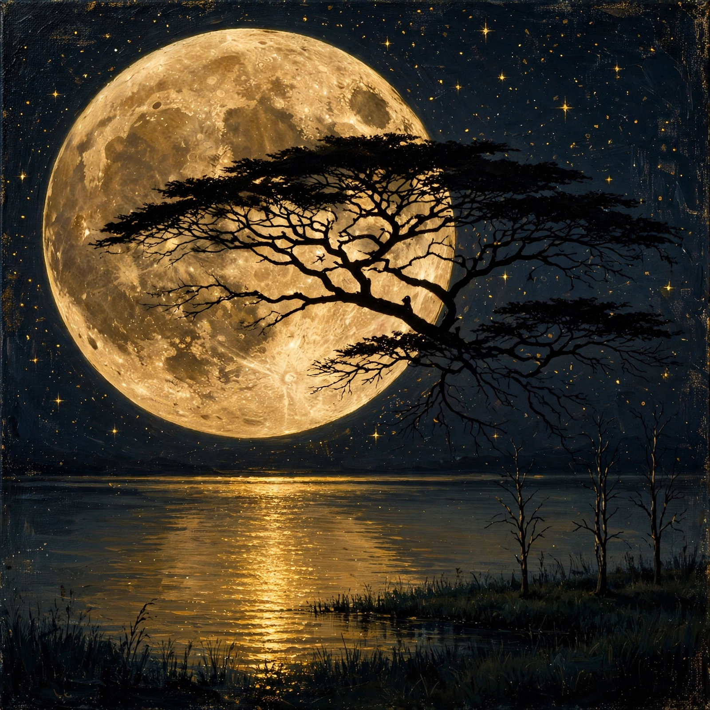
- v2 提示词原文：`Romantic painterly night landscape, an enormous golden full moon in the UPPER LEFT of the frame filling about two-thirds of the upper area, clear crater texture on the moon, a flat-topped acacia tree silhouette stretched across the moon with branches spreading in all directions, a few thin dead trees at the lower right, dark blue-black night sky with small golden four-pointed stars and more empty sky visible on the right side, a calm lake in a horizontal band below with a shimmering golden band of moonlight reflected on the water, grassy shore in dark tones, gold, deep blue and black palette, oil painting brushwork with grainy texture, square composition`
- v2 对比：月亮移到左上、右侧留出大片夜空、金合欢树改为自左下斜伸横贯月面，湖面横带与枯树位置都更接近原描述；代价是月光光带变窄、闪烁感减弱，v1 的“宽阔金色光带”反而更贴合原描述的湖面。
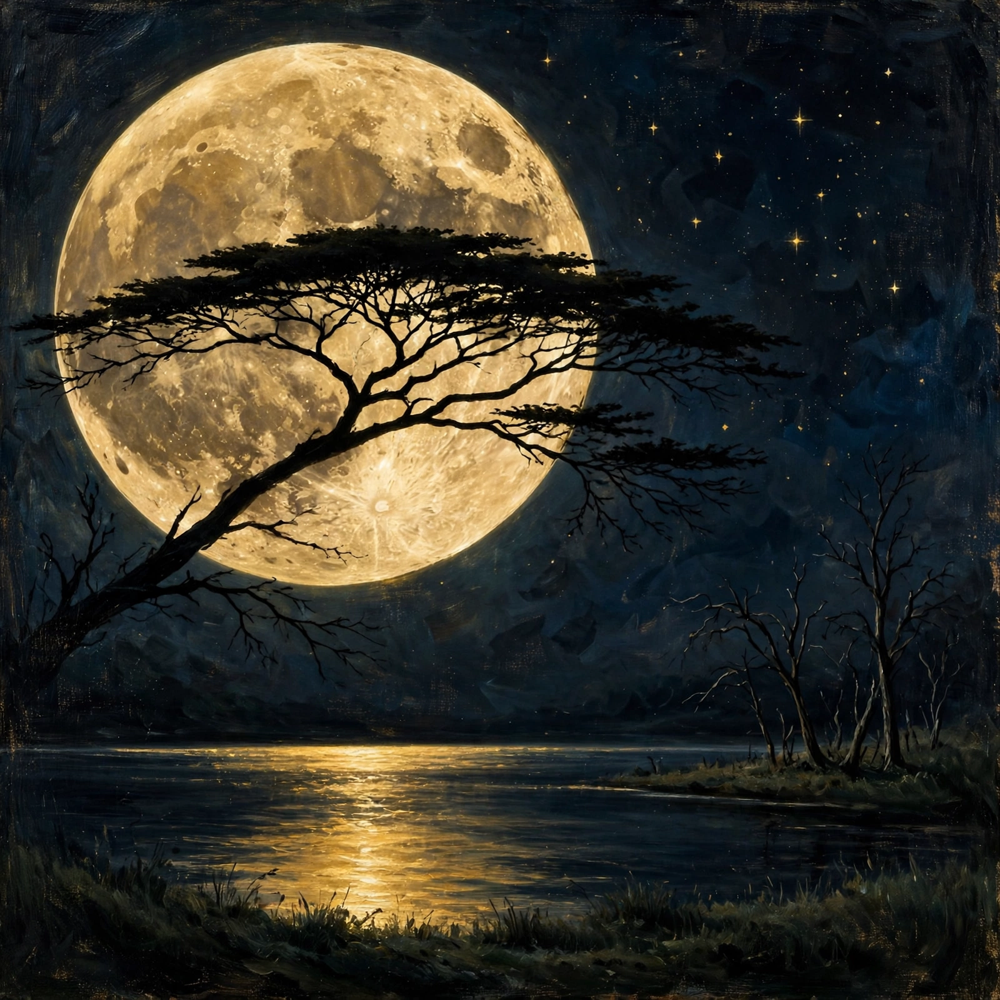
- 可复用规律：月亮偏置要写“in the UPPER LEFT”，只写“左上三分之二”生成器仍会把它居中放大；湖面光带要写“shimmering golden band”，只写“月光倒影”光带会缩成一条细线。

## 4 · SeaArt · Halloween Fairies

- 原链接：https://www.seaart.ai/postDetail/dbd9uite878c73a2cmj0
- 热度：1.3K 赞、1.7K 收藏、691 浏览、22 评论
- 原图拆解：四只万圣节精灵。前景左：银白长发、尖耳、蓝眼少女，戴南瓜发箍，穿橙黑南瓜裙、白毛边、黑裤袜、南瓜鞋，双臂张开喜悦飞舞；前景右：棕发戴女巫帽的少女，穿橙色落叶纹裙，半透明精灵翅膀；中景两只粉发与绿发 Q 版小精灵，穿同款南瓜裙；左上高枝坐着一位银发紫裙的成年精灵女子。构图为竖构图，人物呈 Z 字形由近及远分布，纵深由南瓜灯与秋叶引导。光影为夜林中暖黄南瓜灯光与冷蓝月光交织，地面湿润反光，人物边缘有暖色轮廓光。色彩为橙、金、紫、蓝绿相间，暖冷对比。材质为京阿尼风格干净线条、赛璐璐阴影、细腻发丝与布料褶皱。风格为京都动画风日式动漫插画。模型：GPT Image 2.5 Sunburst，2026-10-23 发布。
- v1 提示词原文：`Kyoto Animation style Japanese anime illustration, four Halloween fairies in a night forest: in the foreground left, a girl with long silver-white hair, pointed ears and blue eyes, wearing a pumpkin hairband, orange and black pumpkin dress with white fur trim, black tights and pumpkin shoes, arms spread joyfully as she dances; in the foreground right, a brown-haired girl in a witch hat and orange autumn-leaf dress with translucent fairy wings; in the middle ground, two small chibi fairies with pink and green hair in matching pumpkin dresses; an adult silver-haired fairy woman in a purple dress sitting on a high branch at the upper left, figures arranged in a Z shape from near to far, warm yellow jack-o'-lantern light mixed with cold blue moonlight, wet ground with reflections, warm rim light on the figures, orange, gold, purple and blue-green palette, clean line art, cel shading, fine hair strands and fabric folds, vertical composition`
  - 中文解析：京阿尼风日式动漫插画 + 夜林四只万圣节精灵 + 前景左银白长发尖耳蓝眼少女、南瓜发箍橙黑南瓜裙白毛边黑裤袜南瓜鞋、双臂张开喜悦飞舞 + 前景右棕发女巫帽少女、橙色落叶纹裙半透明翅膀 + 中景粉发绿发 Q 版小精灵同款南瓜裙 + 左上高枝银发紫裙成年精灵女子 + 人物 Z 字形由近及远 + 暖黄南瓜灯光与冷蓝月光交织 + 地面湿润反光 + 人物暖色轮廓光 + 橙金紫蓝绿 + 干净线条赛璐璐阴影 + 细腻发丝布料褶皱 + 竖构图。
- v1 对比：像在前景左银发南瓜裙少女双臂张开、前景右棕发女巫帽落叶裙、两只粉绿 Q 版小精灵、左上高枝银发紫裙成年精灵、南瓜灯与秋叶、暖黄灯光冷蓝月光、湿润地面反光；偏在成年精灵坐在画面左侧中部偏低的枝上、不够“高枝”，月亮未画出（只有冷蓝夜色），前景略显拥挤；丢了“左上高枝 + 月亮在天”的纵深层次。

- v2 提示词原文：`Kyoto Animation style Japanese anime illustration, four Halloween fairies in a night forest under a full moon in the upper left sky: in the foreground left, a girl with long silver-white hair, pointed ears and blue eyes, wearing a pumpkin hairband, orange and black pumpkin dress with white fur trim, black tights and pumpkin shoes, arms spread joyfully as she dances; in the foreground right, a brown-haired girl in a witch hat and orange autumn-leaf dress with translucent fairy wings; in the middle ground, two small chibi fairies with pink and green hair in matching pumpkin dresses; an adult silver-haired fairy woman in a purple dress sitting HIGH on a branch at the upper left, figures arranged in a Z shape from near to far, warm yellow jack-o'-lantern light mixed with cold blue moonlight, wet ground with reflections, warm rim light on the figures, orange, gold, purple and blue-green palette, clean line art, cel shading, fine hair strands and fabric folds, vertical composition`
- v2 对比：左上天空出现满月、成年精灵坐到更高的枝上、沿路多了灯笼，Z 字形由近及远更清晰，更接近原描述的纵深；代价是前景左的银发少女自加了一对精灵翅膀（原描述未提她有翅膀），v1 的“无翼南瓜裙少女”反而更贴合。

- 可复用规律：多人物 Z 字形纵深要写“figures arranged in a Z shape from near to far”并给每个人定死前景/中景/远景位置，只写“四只精灵”生成器会把人挤在同一层；没提翅膀的人物要写“no wings”，否则它会给每个人都加上翅膀。

## 5 · SeaArt · Peekaboo in the greenhouse 🌿（写实人物①）

- 原链接：https://www.seaart.ai/postDetail/d7t8ajde878c73ekvpu0
- 热度：805 赞、261 收藏、174 浏览、4 评论
- 原图拆解：年轻东亚女子从画面左侧的白色轻纱帘后探头，脸呈四分之三侧面，唇角微抿、带俏皮微笑，直视镜头；深棕长发垂落肩头。构图为竖构图，人物居右，左侧纱帘与垂吊的气生植物（空气凤梨）形成天然画框，视线由植物引向人脸。光影为温室玻璃顶洒下的柔和漫射日光，面部光线均匀明亮，无生硬阴影；背景植物虚化成柔和绿调。色彩为白、浅灰、绿为主，点缀右侧红色/粉色凤梨花。材质为皮肤细腻但保留自然质感，纱帘半透明轻盈，植物卷须清晰。风格为电影感写实照片，浅景深。逼真要素：眼中有清晰眼神光，睫毛与眉毛自然；发丝根根分明、脸颊旁有几根飞散碎发；右手手指自然弯曲捏住帘边，指甲短而干净、无多指变形；皮肤有轻微红晕与毛孔感，面部左右略不对称；背景虚化自然，无光影矛盾。破绽：面部偏光滑理想化、对称度略高，但整体极具说服力。该帖含 2 张图，此处描述为封面首图。模型：NiwaStyle Z Image fp16 + NiwaStyle Asian girl III LoRA。
- v1 提示词原文：`Cinematic photorealistic photo, a young East Asian woman peeking out from behind a white sheer curtain on the left side of the frame, her face in three-quarter profile, lips slightly pressed with a playful smile, looking directly at the camera, long dark brown hair falling over her shoulders, air plants and hanging tillandsia forming a natural frame on the left, soft diffused daylight from a greenhouse glass roof, even bright light on her face with no harsh shadows, background plants blurred into soft green tones, white, light grey and green palette with small red and pink bromeliad flowers on the right, realistic skin texture with pores and slight imperfections, no retouching look, visible catchlights in her eyes, natural eyelashes and eyebrows, a few flyaway hairs beside her cheek, her right hand fingers naturally curved pinching the curtain edge, short clean nails, candid, 85mm lens, shallow depth of field, vertical composition`
  - 中文解析：电影感写实照片 + 年轻东亚女子自左侧白纱帘后探头 + 四分之三侧面、唇角微抿俏皮微笑、直视镜头 + 深棕长发垂肩 + 左侧空气凤梨形成天然画框 + 温室玻璃顶柔和漫射日光、面部光线均匀无生硬阴影 + 背景植物虚化柔和绿调 + 白浅灰绿配右侧红粉凤梨花 + 真实皮肤纹理带毛孔与轻微瑕疵、无修图感 + 眼神光清晰 + 睫毛眉毛自然 + 脸颊旁飞散碎发 + 右手手指自然弯曲捏帘边、指甲短干净 + 抓拍感 + 85mm 镜头 + 浅景深 + 竖构图。
- v1 对比：像在白纱帘后探头、四分之三侧面、直视镜头、空气凤梨画框、右侧红粉凤梨花、柔和漫射日光、背景虚化绿调、眼神光、飞散碎发、右手自然捏帘边、皮肤带毛孔感；偏在面部更接近正面、微笑幅度偏大（露出较多牙齿感的笑意），皮肤仍偏光滑；丢了“唇角微抿、脸再侧一点、皮肤再糙一点”的克制感。
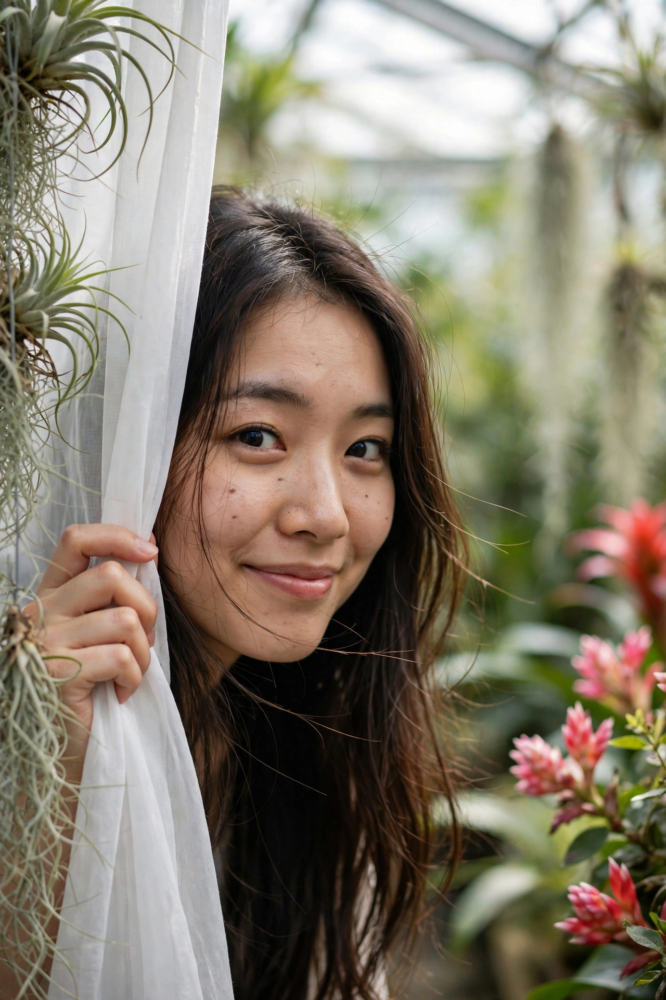
- v2 提示词原文：`Cinematic photorealistic photo, a young East Asian woman peeking out from behind a white sheer curtain on the left side of the frame, her face turned slightly more to the side in three-quarter profile, lips gently pressed together in a subtle playful smile, looking at the camera, long dark brown hair falling over her shoulders, air plants and hanging tillandsia forming a natural frame on the left, soft diffused daylight from a greenhouse glass roof, even bright light on her face with no harsh shadows, background plants blurred into soft green tones, white, light grey and green palette with small red and pink bromeliad flowers on the right, realistic skin texture with clearly visible pores, fine lines and slight imperfections, no retouching look, visible catchlights in her eyes, natural eyelashes and eyebrows, a few flyaway hairs beside her cheek, her right hand fingers naturally curved pinching the curtain edge, short clean nails, candid, 85mm lens, shallow depth of field, vertical composition`
- v2 对比：脸转得更侧、唇角抿住成含蓄微笑、皮肤毛孔与细小瑕疵更明显，更接近原描述的“微抿 + 自然肤质”；代价是表情变得更中性、俏皮感减弱，眼神光比 v1 弱，v1 的“直视镜头的俏皮笑意”反而更有 peekaboo 的神气。

- 可复用规律：写实人像的微笑要写“lips gently pressed together in a subtle smile”，只写“playful smile”生成器会画成露齿大笑；皮肤真实感要写“clearly visible pores, fine lines and slight imperfections”，只写“realistic skin texture”它仍会磨皮。

## 6 · SeaArt · Sunny apple orchard day 🍎（写实人物②）

- 原链接：https://www.seaart.ai/postDetail/d84gbpde878c73ahbmug
- 热度：528 赞、153 收藏、315 浏览、8 评论
- 原图拆解：年轻女子身着白色无袖长裙，侧身仰头、右手伸向枝头摘一颗红苹果，左手抬至胸前、手指自然微曲。构图为竖构图，人物居中偏右，苹果树枝从上方斜入画面，视线沿手臂与枝条向上。光影为强烈晨光穿透树冠，在她脸、颈、肩与裙摆投下斑驳树影，苹果表皮有明亮高光，叶片逆光透绿，画面有阳光眩光感。色彩为红苹果、绿叶、白裙、暖金阳光，饱和明快。材质为皮肤在阳光下可见毛孔与细腻纹理，苹果表皮有轻微瑕疵与水珠感，叶脉清晰。风格为超写实户外摄影，浅景深，背景果园虚化。逼真要素：脸颊与嘴唇有自然血色，耳后与颈部有细碎发丝被阳光照亮；右手抓握苹果的指节受力自然、指甲形状正常；树影与阳光方向一致（左上入射），人物与环境的阴影衔接合理；裙摆褶皱受光面与背光面过渡自然。破绽：皮肤略偏完美，个别发丝边缘过干净，但无手部变形、五官对称度在正常范围。模型未在详情页明示（提示词为 hyper-realistic photo）。
- v1 提示词原文：`Hyper-realistic outdoor photograph, a young woman in a white sleeveless long dress standing in an apple orchard, her body turned sideways, head tilted up, right hand reaching up to pick a red apple from a branch, left hand raised to her chest with fingers naturally curled, apple tree branches entering from the top of the frame, strong morning sunlight filtering through the canopy casting dappled tree shadows across her face, neck, shoulders and dress, bright highlights on the apple skin, leaves glowing green in backlight, warm golden sunlight, lens flare, red apples, green leaves, white dress, realistic skin texture with visible pores, natural blush on cheeks and lips, fine flyaway hairs behind her ear and neck lit by the sun, fingers gripping the apple with natural knuckle tension, normal nail shapes, dappled shadows consistent with light from the upper left, shallow depth of field, blurred orchard background, candid, 85mm lens, vertical composition`
  - 中文解析：超写实户外摄影 + 年轻女子白无袖长裙、侧身仰头、右手伸向枝头摘红苹果、左手抬至胸前手指自然微曲 + 树枝自上方斜入 + 强烈晨光穿透树冠、脸颈肩裙摆斑驳树影 + 苹果表皮明亮高光 + 叶片逆光透绿 + 暖金阳光眩光 + 红苹果绿叶白裙 + 皮肤阳光下可见毛孔 + 脸颊嘴唇自然血色 + 耳后颈部细碎发丝被阳光照亮 + 抓握苹果指节受力自然、指甲正常 + 树影与阳光方向一致（左上入射） + 浅景深背景果园虚化 + 抓拍感 + 85mm 镜头 + 竖构图。
- v1 对比：像在侧身仰头、白无袖裙、右手伸向红苹果、左手抬至胸前、树枝自上方入画、斑驳树影落在脸颈肩与裙摆、叶片逆光透绿、耳后飞散发丝被阳光照亮、抓握指节受力自然；偏在取景偏近（头肩特写为主、长裙只露上半截），树枝自正上方而非斜入；丢了“全身长裙 + 树枝斜入”的完整感。
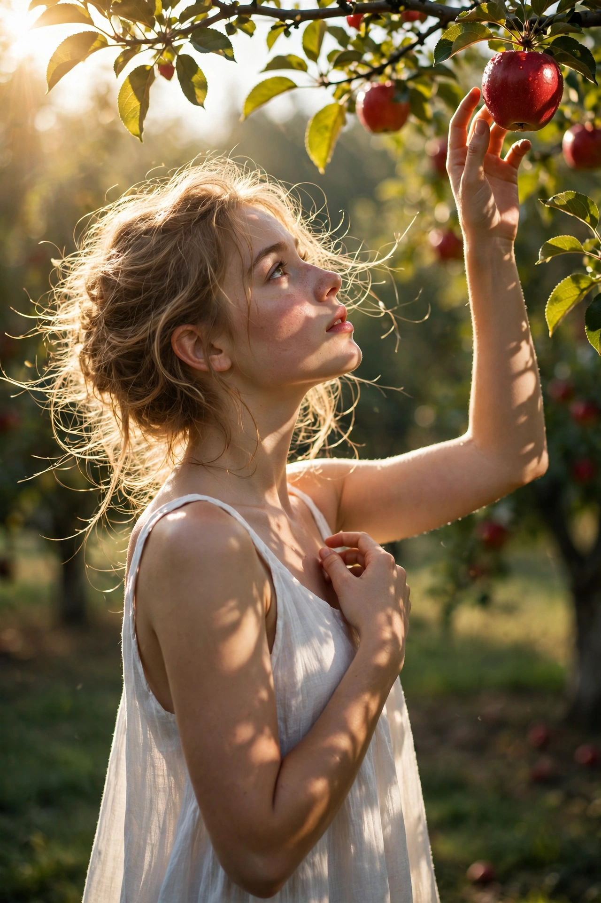
- v2 提示词原文：`Hyper-realistic outdoor photograph, a young woman in a white sleeveless LONG dress shown FULL BODY standing in an apple orchard, her body turned sideways, head tilted up, right hand reaching up to pick a red apple from a branch, left hand raised to her chest with fingers naturally curled, apple tree branches entering diagonally from the upper left of the frame, strong morning sunlight filtering through the canopy casting dappled tree shadows across her face, neck, shoulders and dress, bright highlights on the apple skin, leaves glowing green in backlight, warm golden sunlight, lens flare, red apples, green leaves, white dress, realistic skin texture with visible pores, natural blush on cheeks and lips, fine flyaway hairs behind her ear and neck lit by the sun, fingers gripping the apple with natural knuckle tension, normal nail shapes, dappled shadows consistent with light from the upper left, shallow depth of field, blurred orchard background, candid, 85mm lens, vertical composition`
- v2 对比：改为全身长裙、树枝自左上斜入、人物居中偏右，更接近原描述的构图；代价是斑驳树影变弱（阳光变柔和）、飞散发丝的逆光感减弱，v1 的“强光 + 斑驳树影 + 发丝透光”反而更贴合原描述的光影。
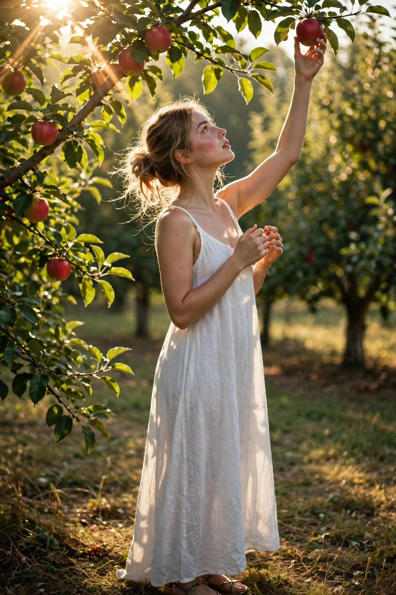
- 可复用规律：全身长裙要写死“shown FULL BODY”，只写“long dress”生成器仍会裁成半身；树枝斜入要写“entering diagonally from the upper left”，只写“从上方入画”它会画成正上方垂枝；但拉远全身会弱化斑驳树影，构图与光影不可兼得时要先定优先级。

## 7 · SeaArt · Tang beauty Exam, so stunning 🥹（写实人物③）

- 原链接：https://www.seaart.ai/postDetail/d9a2note878c738n45pg
- 热度：155 赞、28 收藏、104 浏览、2 评论
- 原图拆解：唐代女子俯身书案，右手执长毫毛笔、笔尖触纸，左手平按纸面；身穿青绿纱质外袍（金线刺绣）配珊瑚橙内裙，香肩微露。发髻高挽，插金红花簪与青绿花饰，几缕碎发贴面。构图为竖构图，人物居中，书案在下三分之一，右侧灯笼与格窗形成纵深。光影为暖黄室内光，格窗透入的光在墙面投下网格影，右侧纸灯笼呈柔和光晕，面部受光均匀。色彩为青绿、橙红、暖金、木色，冷暖相映。材质为纱袍轻透有垂感，砚台与瓷墨壶有釉面反光，宣纸纹理细腻。风格为电影感古风写实人像，浅景深。逼真要素：眼中有眼神光，眉毛淡而根根可见，唇色自然、嘴唇微张；皮肤光滑带柔光，但颧骨与鼻尖有自然高光；执笔手指环绕笔杆姿势合理，左手五指伸展、指甲与指节正常，戴一枚细戒；耳坠为细长金坠，耳廓结构自然。破绽：皮肤偏瓷质光滑、面部对称度偏高，属典型 AI 写实特征，但无手部变形、牙齿未露出、光影一致。该帖含 4 张图，此处描述为封面首图。模型：Z-Image-Base-Realistic + Z image Boost Detail / NiwaStyle girl LoRA。
- v1 提示词原文：`Cinematic photorealistic portrait, a Tang dynasty woman leaning over a writing desk, holding a long-haired calligraphy brush in her right hand with the tip touching the paper, left hand flat on the paper, wearing a sheer teal-green outer robe with gold embroidery over a coral-orange inner dress, shoulders slightly bare, hair in a high bun with gold and red flower hairpins and teal floral ornaments, a few loose strands against her face, the desk in the lower third of the frame, a paper lantern and lattice window on the right, warm yellow indoor light, lattice window light casting a grid shadow on the wall, soft glow from the paper lantern, even light on her face, teal, coral-orange, warm gold and wood tones, sheer robe fabric with soft drape, glazed inkstone and porcelain ink pot with reflections, fine rice paper texture, realistic skin texture with pores, natural highlights on cheekbones and nose tip, catchlights in her eyes, fine individual eyebrow hairs, natural lip colour with lips slightly parted, fingers wrapped around the brush handle in a natural grip, left hand fingers extended with normal nails and joints, a thin ring on one finger, long thin gold earrings, natural ear structure, shallow depth of field, vertical composition`
  - 中文解析：电影感古风写实人像 + 唐代女子俯身书案、右手执长毫毛笔笔尖触纸、左手平按纸面 + 青绿纱质外袍金线刺绣配珊瑚橙内裙、香肩微露 + 发髻高挽、金红花簪青绿花饰、碎发贴面 + 书案在下三分之一 + 右侧纸灯笼格窗 + 暖黄室内光、格窗网格影、灯笼柔和光晕、面部受光均匀 + 青绿橙红暖金木色 + 纱袍轻透垂感 + 砚台瓷墨壶釉面反光 + 宣纸纹理细腻 + 真实皮肤纹理带毛孔 + 颧骨鼻尖自然高光 + 眼神光 + 眉毛淡而根根可见 + 唇色自然微张 + 执笔手指环绕笔杆姿势合理 + 左手五指伸展指甲指节正常、戴细戒 + 细长金坠耳环、耳廓自然 + 浅景深 + 竖构图。
- v1 对比：像在俯身书案、右手执笔笔尖触纸、左手平按纸面、青绿纱袍金线刺绣配珊瑚橙内裙、高挽发髻金红花簪、格窗网格影、纸灯笼光晕、砚台瓷墨壶宣纸、眼神光、细戒、细长金坠；偏在香肩未露（纱袍把肩膀包住了），笔尖虽触纸但笔杆竖得过直；丢了“香肩微露”这一处。
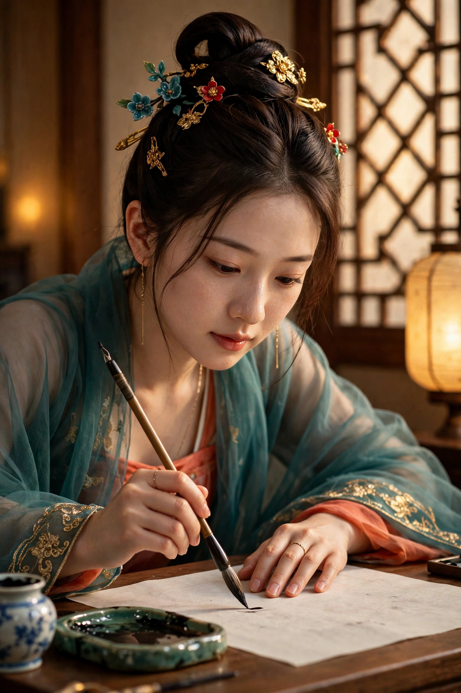
- v2 提示词原文：`Cinematic photorealistic portrait, a Tang dynasty woman leaning over a writing desk, holding a long-haired calligraphy brush in her right hand with the tip just touching the paper, left hand flat on the paper, wearing a sheer teal-green outer robe with gold embroidery over a coral-orange inner dress, ONE shoulder bare under the sheer robe, hair in a high bun with gold and red flower hairpins and teal floral ornaments, a few loose strands against her face, the desk in the lower third of the frame, a paper lantern and lattice window on the right, warm yellow indoor light, lattice window light casting a grid shadow on the wall, soft glow from the paper lantern, even light on her face, teal, coral-orange, warm gold and wood tones, sheer robe fabric with soft drape, glazed inkstone and porcelain ink pot with reflections, fine rice paper texture, realistic skin texture with pores, natural highlights on cheekbones and nose tip, catchlights in her eyes, fine individual eyebrow hairs, natural lip colour with lips slightly parted, fingers wrapped around the brush handle in a natural grip, left hand fingers extended with normal nails and joints, a thin ring on one finger, long thin gold earrings, natural ear structure, shallow depth of field, vertical composition`
- v2 对比：左侧香肩在纱袍下露出、珊瑚橙内裙可见，更接近原描述的“香肩微露”；代价是毛笔改为悬在纸面上方、笔尖未触纸，v1 的“笔尖触纸”反而更贴合。
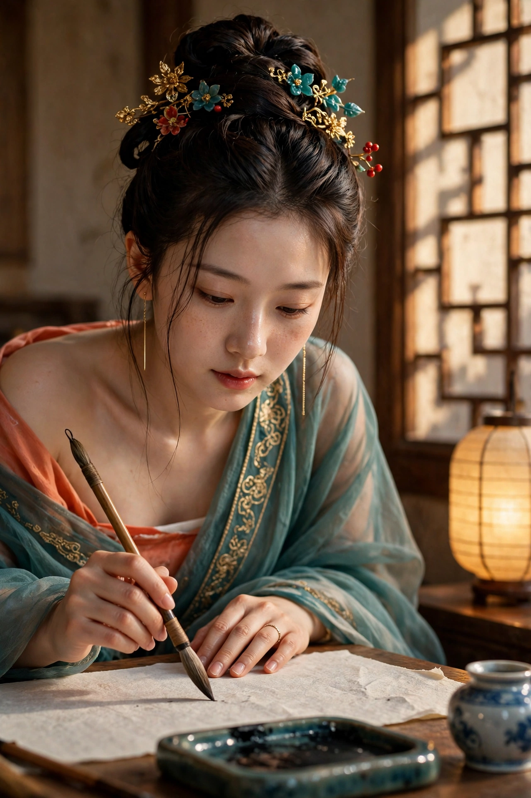
- 可复用规律：“香肩微露”要写“ONE shoulder bare under the sheer robe”，只写“shoulders slightly bare”生成器会把肩膀包严实；执笔动作要写“tip just touching the paper”，但“bare shoulder”和“tip touching”同时改容易顾此失彼，一次只改一个变量更稳。

## 8 · PixAI · 🐱🎃Peek-a-Boo! Look Who's at the Party!

- 原链接：https://pixai.art/artwork/2074639409355095989
- 热度：795 赞、38 评论；万圣节主题赛参赛作
- 原图拆解：银灰中长发少女从画面左侧探身贴近镜头，占据左半幅；棕色大眼、脸颊腮红，戴黑色猫耳与黑蝴蝶结，穿黑色女仆装与颈链。构图为竖构图、近景特写，人物面部贴近镜头边缘，右侧留出万圣节房间纵深。背景为架子上的南瓜灯、小幽灵与猫咪玩偶、白色椅子、地上戴蓝帽的小人偶、墙面闪烁星光，暖木地板。光影为室内暖光，人物面部柔和，背景南瓜灯呈暖黄光晕。色彩为黑、橙、深绿为主，点缀粉色闪光。材质为动漫水彩质感，笔触带颗粒，发丝细腻。风格为可爱风动漫插画，万圣节主题。模型：PixAI DiT.3 Tsubaki.3 + 多个用户 LoRA，提示词作者隐藏，2026-11-04 发布。
- v1 提示词原文：`Cute anime illustration with watercolour texture, a girl with medium-length silver-grey hair leaning in close to the camera from the left side of the frame, filling the left half, large brown eyes, blushing cheeks, black cat ears and a black bow, black maid outfit with a choker, close-up portrait with her face near the edge of the lens, a Halloween room receding on the right: jack-o'-lanterns on shelves, small ghosts and cat plushies, a white chair, a small doll in a blue hat on the floor, twinkling stars on the wall, warm wooden floor, warm indoor light, soft light on her face, warm yellow glow from the jack-o'-lanterns, black, orange and dark green palette with pink sparkles, grainy watercolour brush strokes, fine hair strands, vertical composition`
  - 中文解析：可爱风动漫水彩插画 + 银灰中长发少女自左侧探身贴近镜头、占左半幅 + 棕色大眼、脸颊腮红 + 黑色猫耳黑蝴蝶结 + 黑色女仆装颈链 + 近景特写、面部贴近镜头边缘 + 右侧万圣节房间纵深 + 架上南瓜灯小幽灵猫咪玩偶 + 白色椅子 + 地上戴蓝帽小人偶 + 墙面闪烁星光 + 暖木地板 + 室内暖光、面部柔和、南瓜灯暖黄光晕 + 黑橙深绿配粉色闪光 + 水彩颗粒笔触 + 细腻发丝 + 竖构图。
- v1 对比：像在银灰中长发少女左侧贴近镜头、棕色大眼腮红、黑色猫耳黑蝴蝶结、黑女仆装颈链、右侧万圣节房间纵深、南瓜灯小幽灵猫咪玩偶、白色椅子、地上蓝帽小人偶、闪烁星光、暖木地板、水彩颗粒笔触；偏在人物贴镜头太近、左眼被画面边缘裁掉一半；丢了“双眼完整可见”的特写底线。
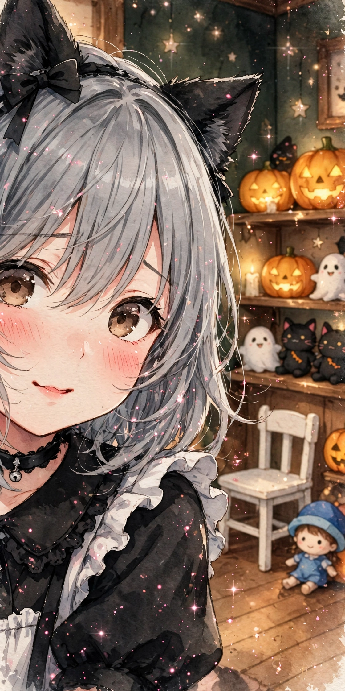
- v2 提示词原文：`Cute anime illustration with watercolour texture, a girl with medium-length silver-grey hair leaning in close to the camera from the left side of the frame, filling the left half, her whole face fully visible with BOTH eyes inside the frame, large brown eyes, blushing cheeks, black cat ears and a black bow, black maid outfit with a choker, close-up portrait with her face near the edge of the lens, a Halloween room receding on the right: jack-o'-lanterns on shelves, small ghosts and cat plushies, a white chair, a small doll in a blue hat on the floor, twinkling stars on the wall, warm wooden floor, warm indoor light, soft light on her face, warm yellow glow from the jack-o'-lanterns, black, orange and dark green palette with pink sparkles, grainy watercolour brush strokes, fine hair strands, vertical composition`
- v2 对比：双眼完整入画、整张脸可见，猫耳蝴蝶结、女仆装颈链、右侧房间纵深与蓝帽小人偶都在，更接近原描述的特写；代价是取景稍拉远、人物略小，v1 的“贴近镜头、占满左半幅”的压迫感反而更强。

- 可复用规律：贴近镜头的特写要写“her whole face fully visible with BOTH eyes inside the frame”，只写“面部贴近镜头边缘”生成器会把一只眼裁出画面；“贴近镜头”和“双眼完整”是一对矛盾要求，写全脸就要接受人物略小。

## 9 · Reddit r/midjourney · Autumn Sci-Fi

- 原链接：https://www.reddit.com/r/midjourney/comments/1xpjy7b/autumn_scifi/
- 热度：顶贴 64、评论 0；9 图组帖，取首图
- 原图拆解：悬崖上的未来城市，建筑层叠、白墙与玻璃幕墙，高处一座巨大环形结构横跨天际；一道瀑布自崖顶倾泻而下。构图为宽幅风景，城市居中，瀑布与环形结构形成垂直与水平两条主线，前景为金黄秋树与岩石。光影为金色落日余晖，建筑受光面暖黄、背光面蓝灰，水面反射落日。色彩为金、橙、蓝灰、深绿，秋意浓烈。材质为建筑细节丰富，玻璃反光、岩石纹理、树叶簇团分明。风格为电影感科幻概念艺术。
- v1 提示词原文：`Cinematic sci-fi concept art, a futuristic city built on a cliff, layered buildings with white walls and glass curtain walls, a giant ring structure spanning the sky above, a waterfall cascading down from the top of the cliff, wide landscape composition, the city in the centre, the waterfall and the ring forming one vertical and one horizontal axis, golden autumn trees and rocks in the foreground, golden sunset light, warm yellow lit building faces against blue-grey shaded sides, sunset reflected on the water, gold, orange, blue-grey and deep green palette, rich architectural detail, glass reflections, rock texture, distinct clusters of autumn leaves, film-like atmosphere`
  - 中文解析：电影感科幻概念艺术 + 悬崖未来城市、层叠建筑白墙玻璃幕墙 + 高处巨大环形结构横跨天际 + 一道瀑布自崖顶倾泻 + 宽幅风景、城市居中 + 瀑布与环形结构一竖一横两条主线 + 前景金黄秋树岩石 + 金色落日余晖 + 建筑受光面暖黄背光面蓝灰 + 水面反射落日 + 金橙蓝灰深绿 + 建筑细节丰富、玻璃反光、岩石纹理、树叶簇团分明。
- v1 对比：像在悬崖未来城市、白墙玻璃幕墙、巨大环形结构横跨天际、瀑布自崖顶倾泻、城市居中、金黄秋树岩石前景、金色落日、水面反射落日；偏在瀑布画了两道（崖顶一道、城下一道），环形结构画成一座粗壮的环形空间站、压得过低；丢了“一道瀑布 + 环形结构高悬天际”的简洁主线。
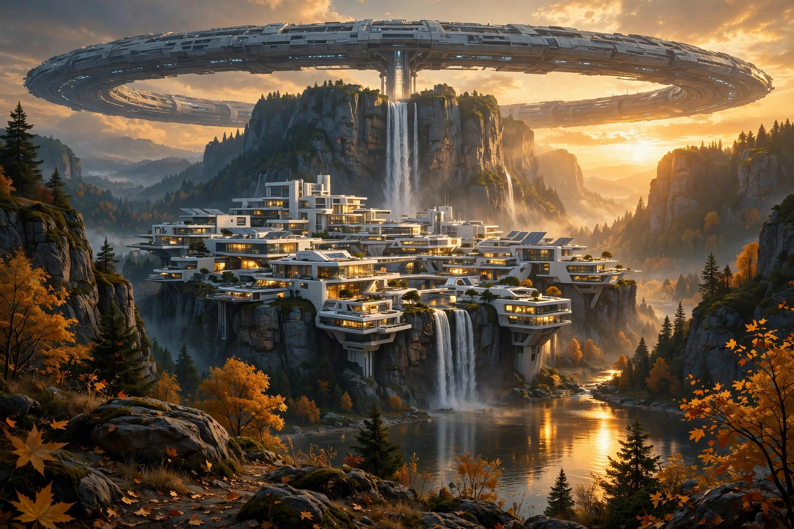
- v2 提示词原文：`Cinematic sci-fi concept art, a futuristic city built on a cliff, layered buildings with white walls and glass curtain walls, compact city in the centre, a giant thin ring structure HIGH in the sky above, only ONE waterfall cascading down from the top of the cliff behind the city, wide landscape composition, the waterfall and the ring forming one vertical and one horizontal axis, golden autumn trees and rocks in the foreground, golden sunset light, warm yellow lit building faces against blue-grey shaded sides, sunset reflected on the water, gold, orange, blue-grey and deep green palette, rich architectural detail, glass reflections, rock texture, distinct clusters of autumn leaves, film-like atmosphere`
- v2 对比：瀑布只剩崖顶一道、环形结构变细变薄、高悬天际、城市收紧，更接近原描述的“一竖一横”主线；代价是环形结构细得像一圈光晕、存在感减弱，落日暖金感也不如 v1，v1 的“粗壮环形站 + 浓烈落日”反而更有视觉冲击。
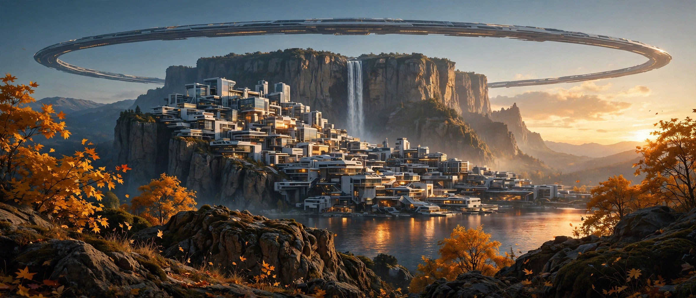
- 可复用规律：瀑布数量要写死“only ONE waterfall”，只写“一道瀑布”生成器会自己再加一道；环形结构要写“thin ring HIGH in the sky”，只写“巨大环形结构”它会画成压顶的空间站。

## 10 · Reddit r/midjourney · MechHead

- 原链接：https://www.reddit.com/r/midjourney/comments/1xpbrtd/mechhead/
- 热度：顶贴 161、评论 1；8 图组帖，取首图
- 原图拆解：一颗巨型机械头颅嵌在山崖城市之中：灰白金属板、裸露线缆、红色小灯，正中一只发绿光的圆形大眼，头顶与崖面长满橙红秋树。下方岸边，一位红斗篷、宽檐帽的小人物站在自行车旁，仰望巨首；平静河面上有高桅帆船与小船，远山雾气。构图为竖构图，巨首占上三分之二，渺小人物在下三分之一处，以体量对比制造震撼。光影为右侧暖金落日，金属面有冷暖交错的反光，河面倒影柔和。色彩为灰白金属、橙红秋叶、暖金天空、深绿河水。材质为金属锈蚀、剥落油漆、树叶与雾气层次丰富。风格为吉卜力式奇幻与废土机甲结合的电影感插画。帖子 2026-11-06 20:38（北京时间）发布。
- v1 提示词原文：`Ghibli-style fantasy illustration mixed with post-apocalyptic mecha, a colossal mechanical head built into a cliffside city, grey-white metal plates, exposed cables, small red lights, one large round glowing green eye in the centre, orange-red autumn trees growing on top of the head and across the cliff face, the giant head filling the upper two-thirds of the frame, in the lower third a tiny figure in a red cloak and wide-brimmed hat standing beside a bicycle on the shore, looking up at the giant head, a calm river with a tall-masted sailing ship and small boats, distant misty mountains, warm golden sunset light from the right, cold and warm reflections alternating on the metal surface, soft reflections on the river, grey-white metal, orange-red autumn leaves, warm gold sky, deep green river, rusted metal, peeling paint, layered leaves and mist, vertical composition`
  - 中文解析：吉卜力式奇幻混废土机甲 + 巨型机械头颅嵌在山崖城市中 + 灰白金属板、裸露线缆、红色小灯 + 正中发绿光的圆形大眼 + 头顶与崖面长满橙红秋树 + 巨首占上三分之二 + 下三分之一处红斗篷宽檐帽小人物站在自行车旁仰望巨首 + 平静河面高桅帆船与小船 + 远山雾气 + 右侧暖金落日 + 金属面冷暖交错反光 + 河面倒影柔和 + 灰白金属橙红秋叶暖金天空深绿河水 + 金属锈蚀剥落油漆 + 树叶雾气层次丰富 + 竖构图。
- v1 对比：像在巨型机械头颅占上三分之二、灰白金属板裸露线缆红色小灯、发绿光圆形大眼、头顶橙红秋树、岸边红斗篷宽檐帽小人物与自行车、河面高桅帆船与小船、远山雾气、右侧暖金落日、锈蚀剥落油漆；偏在巨首悬浮在崖面上方、未真正“嵌进”山崖城市，头颅为纯侧面；丢了“头颅嵌在崖壁里、崖边有城市”的结合感。
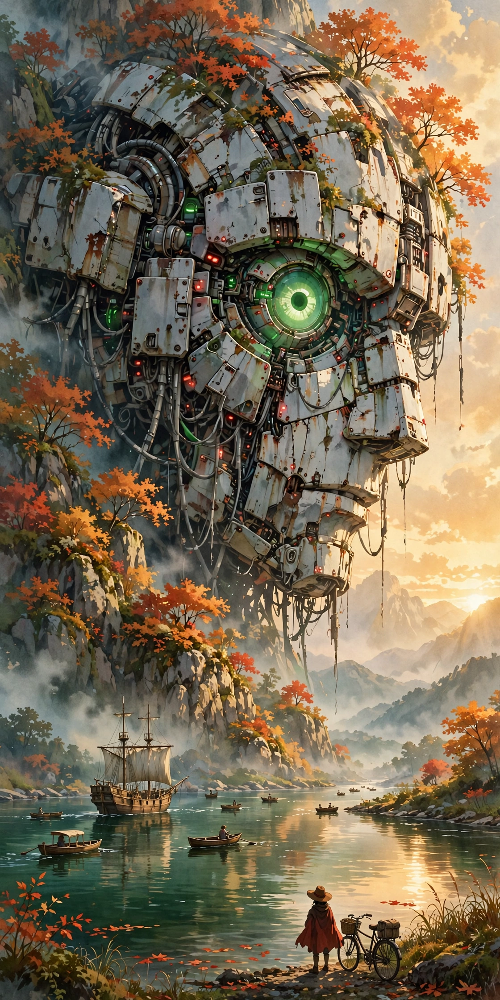
- v2 提示词原文：`Ghibli-style fantasy illustration mixed with post-apocalyptic mecha, a colossal mechanical head EMBEDDED INTO the cliff face of a cliffside city, seen in three-quarter view FACING the viewer, grey-white metal plates, exposed cables, small red lights, one large round glowing green eye in the centre, orange-red autumn trees growing on top of the head and across the cliff face, cliffside buildings around the base of the head, the giant head filling the upper two-thirds of the frame, in the lower third a tiny figure in a red cloak and wide-brimmed hat standing beside a bicycle on the shore, looking up at the giant head, a calm river with a tall-masted sailing ship and small boats, distant misty mountains, warm golden sunset light from the right, cold and warm reflections alternating on the metal surface, soft reflections on the river, grey-white metal, orange-red autumn leaves, warm gold sky, deep green river, rusted metal, peeling paint, layered leaves and mist, vertical composition`
- v2 对比：巨首嵌进崖壁、崖边长出带屋顶的山崖小城、头颅略转正，岸边红斗篷小人物与自行车、帆船小船都在，更接近“嵌在山崖城市之中”的原描述；代价是头颅仍偏侧面、未完全转正，v1 的“巨首特写 + 绿眼”反而更震撼。
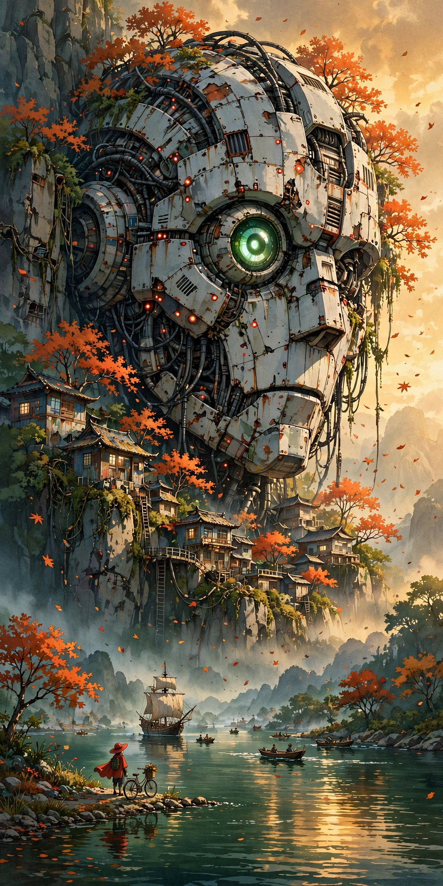
- 可复用规律：“嵌在山崖里”要写“EMBEDDED INTO the cliff face”并补一句“cliffside buildings around the base”，只写“built into a cliffside city”生成器会把头颅画成悬浮在崖面前的独立雕像。

## 11 · Civitai · 角魔君主

- 原链接：https://civitai.com/images/147404090
- 热度：👍1312、❤️462、😂179、😢65、评论 9；近一周最多反应第 1 名
- 原图拆解：高大角魔男性立于废墟岩石上，双角向后弯曲，背生蝠翼，身着黑甲，甲面有熔岩般的红色裂纹发光。构图为竖构图，人物居中偏下，背后一颗巨大的环形行星/月亮占据上半幅，星空深邃，左右为哥特式残破建筑残垣，形成画框。光影为行星冷光与甲面红光对冲，人物边缘有红 rim light，地面阴影厚重。色彩为黑、红、冷蓝、灰，红黑主导。材质为金属甲面粗糙有磨损，岩石嶙峋，星空有噪点颗粒。风格为黑暗奇幻油画，笔触粗粝。模型：Krea 2 Turbo，768×1376，2026-10-31 上传。作者称这是其首张 Featured Image。
- v1 提示词原文：`Dark fantasy oil painting, a tall horned demon lord standing on ruined rocks, horns curving backwards, bat wings on his back, black armour with glowing red cracks like lava, vertical composition, the figure in the lower centre, a huge ringed planet or moon filling the upper half of the frame, deep starry sky, broken gothic ruins on both sides forming a frame, cold light from the planet against the red glow of the armour, red rim light on the figure's edges, heavy shadows on the ground, black, red, cold blue and grey palette with red and black dominant, rough worn metal armour, jagged rocks, grainy starry sky with noise, coarse painterly brushwork`
  - 中文解析：黑暗奇幻油画 + 高大角魔男性立于废墟岩石 + 双角向后弯曲 + 背生蝠翼 + 黑甲、甲面熔岩般红色裂纹发光 + 竖构图、人物居中偏下 + 背后巨大环形行星/月亮占上半幅 + 星空深邃 + 左右哥特式残破建筑残垣成画框 + 行星冷光与甲面红光对冲 + 人物边缘红 rim light + 地面阴影厚重 + 黑红冷蓝灰、红黑主导 + 金属甲面粗糙磨损 + 岩石嶙峋 + 星空噪点颗粒 + 笔触粗粝。
- v1 对比：像在高大角魔黑甲、熔岩红裂纹、蝠翼、环形行星占上半幅、哥特残垣左右成框、冷光红光对冲、红 rim light、粗粝笔触；偏在双角向上弯曲（非向后弯曲），行星虽大但人物占比偏大；丢了“双角向后弯曲 + 行星更大”的细节。
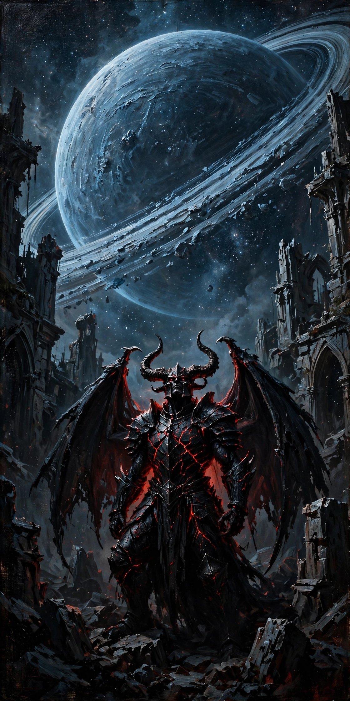
- v2 提示词原文：`Dark fantasy oil painting, a tall horned demon lord standing on ruined rocks, his two horns SWEPT BACKWARDS over his head, bat wings on his back, black armour with glowing red cracks like lava, vertical composition, the figure SMALLER in the lower centre so the planet reads larger, a huge ringed planet or moon filling the upper half of the frame, deep starry sky, broken gothic ruins on both sides forming a frame, cold light from the planet against the red glow of the armour, red rim light on the figure's edges, heavy shadows on the ground, black, red, cold blue and grey palette with red and black dominant, rough worn metal armour, jagged rocks, grainy starry sky with noise, coarse painterly brushwork`
- v2 对比：双角改为向后弯曲、人物缩小、环形行星更大更显眼，目标点都达成了；代价是人物改为背影、看不到正脸与甲面细节，v1 的“正面角魔君主、红裂纹黑甲”反而更贴合原描述的正面气势。**本张 v2 未更接近**，v1 更好。
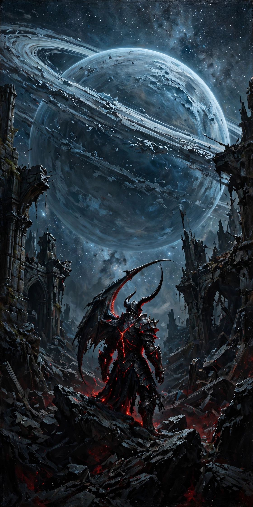
- 可复用规律：角的方向要写“SWEPT BACKWARDS over his head”，只写“curving backwards”生成器会画成向上弯的常规恶魔角；但改角向不能以牺牲正面视角为代价，正面人物一旦转成背影，细节全丢。

## 12 · Civitai · 女巫黑猫

- 原链接：https://civitai.com/images/147420348
- 热度：👍1215、❤️452、😂177、😢66、评论 4；近一周最多反应第 2 名
- 原图拆解：一只穿紫色女巫袍、戴尖顶女巫帽的黑猫，站在大坩埚后搅动冒泡的绿色药水，药水气泡中浮现小老鼠骷髅脸；猫耳竖立、绿眼专注。构图为竖构图，坩埚与黑猫居中，顶部横幅写着“SMALL MICE BIG SCREAMS”，四周环绕蜡烛、骷髅、魔法书（书名：CURSES、PAWTIONS、FAMILIARS、FORBIDDEN MICE、SHADOWS、NINE LIVES）。背景为窗外一轮满月，洒入冷光。光影为绿色药水为主要光源，照亮猫脸与坩埚边缘，蜡烛暖光点缀。色彩为黑、紫、绿、橙，万圣节配色。材质为扁平可爱风插画，线条干净，色彩块面分明。风格为 kawaii 暗黑童话。模型：ChatGPT Images v2.5 Sunburst，3456×6144，2026-11-01 上传。
- v1 提示词原文：`Cute dark fairy-tale flat illustration, a black cat wearing a purple witch robe and a pointed witch hat, standing behind a large cauldron stirring bubbling glowing green potion, small mouse skull faces floating in the potion bubbles, the cat's ears upright, green eyes focused, vertical composition, cauldron and black cat centred, a banner at the top reading SMALL MICE BIG SCREAMS, candles, skulls and magic books around with titles CURSES, PAWTIONS, FAMILIARS, FORBIDDEN MICE, SHADOWS, NINE LIVES, a full moon in the window behind casting cold light, the green potion as the main light source illuminating the cat's face and the cauldron edge, warm candle light accents, black, purple, green and orange Halloween palette, clean lines, flat colour blocks, kawaii style`
  - 中文解析：可爱暗黑童话扁平插画 + 黑猫穿紫色女巫袍戴尖顶女巫帽 + 站在大坩埚后搅动冒泡绿色药水 + 药水气泡中浮现小老鼠骷髅脸 + 猫耳竖立绿眼专注 + 竖构图、坩埚黑猫居中 + 顶部横幅 SMALL MICE BIG SCREAMS + 蜡烛骷髅魔法书环绕（书名 CURSES、PAWTIONS、FAMILIARS、FORBIDDEN MICE、SHADOWS、NINE LIVES） + 窗外满月洒入冷光 + 绿色药水为主要光源照亮猫脸与坩埚边缘 + 蜡烛暖光点缀 + 黑紫绿橙万圣节配色 + 线条干净色彩块面分明。
- v1 对比：像在黑猫紫袍尖顶女巫帽、大坩埚居中、绿色药水冒泡、老鼠骷髅脸气泡、顶部横幅 SMALL MICE BIG SCREAMS 拼写正确、六本魔法书书名齐全、窗外满月、绿色药水主光源、蜡烛暖光；偏在黑猫占幅过大、几乎与坩埚等高，满月窗被猫头挡住大半；丢了“猫在坩埚后偏小、满月窗完整可见”的层次。
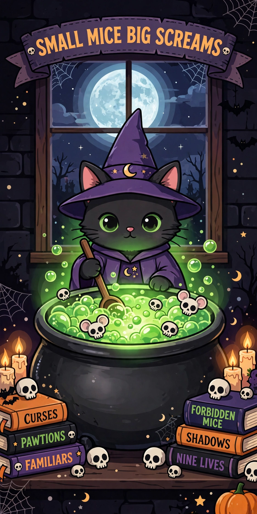
- v2 提示词原文：`Cute dark fairy-tale flat illustration, a black cat wearing a purple witch robe and a pointed witch hat, SMALLER behind a large cauldron, stirring bubbling glowing green potion with a wooden ladle, small mouse skull faces floating in the potion bubbles, the cat's ears upright, green eyes focused, vertical composition, cauldron and black cat centred, a banner at the top reading SMALL MICE BIG SCREAMS, a full moon window FULLY VISIBLE above the cat casting cold light, candles, skulls and magic books around with titles CURSES, PAWTIONS, FAMILIARS, FORBIDDEN MICE, SHADOWS, NINE LIVES, the green potion as the main light source illuminating the cat's face and the cauldron edge, warm candle light accents, black, purple, green and orange Halloween palette, clean lines, flat colour blocks, kawaii style`
- v2 对比：黑猫变小、躲在坩埚后用木勺搅动、圆形石窗满月完整可见、六本书名仍齐全，更接近原描述的层次；代价是魔法书被挤到底部两角、不如 v1 显眼，v1 的“书本环绕坩埚”反而更贴合原描述的环绕感。
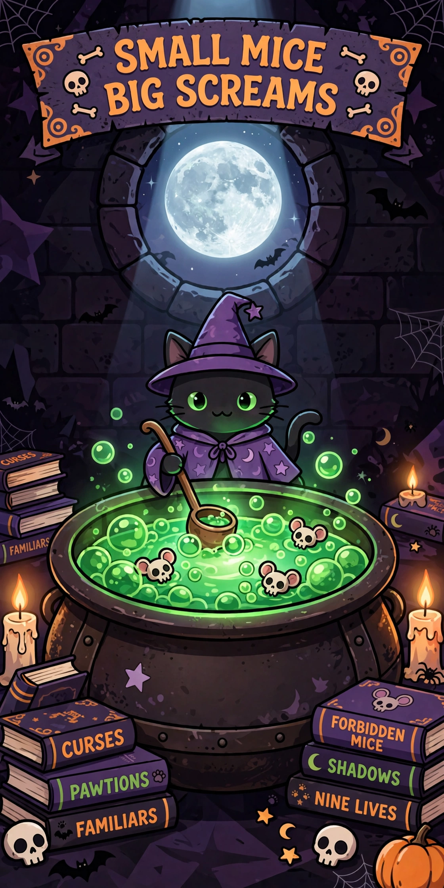
- 可复用规律：画面里的多处文字（横幅 + 六本书名）要把每个词都写进提示词并加引号式大写，生成器对短词拼写很稳；人物占比要写“SMALLER behind a large cauldron”，只写“站在坩埚后”它会把猫画得和坩埚一样大。

## 13 · Civitai · 格斯（剑风传奇）

- 原链接：https://civitai.com/images/147478410
- 热度：👍1151、❤️451、😂123、😢70、评论 4；近一周最多反应第 3 名
- 原图拆解：《剑风传奇》格斯全身像：黑甲战士斜扛巨剑“斩龙剑”，剑身宽大、边缘锯齿状，黑色披风破烂飘动。构图为斜对角动态构图，人物由左下向右上倾斜，剑身横贯画面，背景为纯红与黑的抽象泼墨。光影为强烈红色背光，人物多为黑色剪影，甲面与剑刃有白色高光勾边。色彩为红、黑、白三色，冲击力极强。材质为粗粝笔触、泼墨与刮擦质感，铠甲有磨损划痕。风格为暗黑漫画/插画，极简背景衬托人物。模型：Krea 2 Turbo，864×2048，2026-11-01 上传。
- v1 提示词原文：`Dark manga illustration, Guts from Berserk, full body, a black-armoured warrior carrying a huge jagged Dragonslayer sword diagonally across his back, the sword blade wide with serrated edges, a tattered black cape flowing, dynamic diagonal composition with the figure leaning from the lower left to the upper right, the sword crossing the whole frame, abstract background of pure red and black with ink splashes, strong red backlight, the figure mostly a black silhouette, white highlights outlining the armour and the sword edge, red, black and white palette, coarse brush strokes, ink splash and scratch texture, worn scratched armour`
  - 中文解析：暗黑漫画插画 + 剑风传奇格斯全身 + 黑甲战士斜扛巨大锯齿斩龙剑 + 剑身宽大边缘锯齿状 + 破烂黑色披风飘动 + 斜对角动态构图、人物左下向右上倾斜、剑身横贯画面 + 纯红与黑抽象泼墨背景 + 强烈红色背光 + 人物多为黑色剪影 + 甲面剑刃白色高光勾边 + 红黑白三色 + 粗粝笔触泼墨刮擦质感 + 铠甲磨损划痕。
- v1 对比：像在黑甲战士全身、巨大锯齿斩龙剑斜扛、剑身横贯画面、破烂黑披风、红黑抽象泼墨背景、强烈红色背光、黑色剪影配白色高光勾边、红黑白三色、粗粝笔触；偏在人物为背面四分之三视角、看不到正脸，剑身斜扛在背后而非横贯身前；丢了“正面斜对角动态构图”的人物朝向。
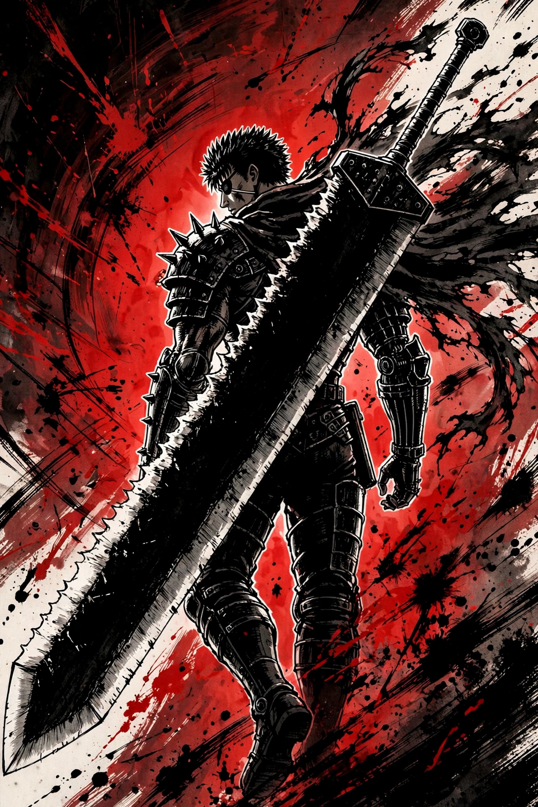
- v2 提示词原文：`Dark manga illustration, Guts from Berserk, full body, a black-armoured warrior seen in FRONT three-quarter view facing the viewer, carrying a huge jagged Dragonslayer sword diagonally across his body, the sword blade wide with serrated edges, the sword crossing the whole frame from lower left to upper right, a tattered black cape flowing behind him, dynamic diagonal composition with the figure leaning from the lower left to the upper right, abstract background of pure red and black with ink splashes, strong red backlight, the figure mostly a black silhouette, white highlights outlining the armour and the sword edge, red, black and white palette, coarse brush strokes, ink splash and scratch texture, worn scratched armour`
- v2 对比：**v2 未生成。** 生成调用被拒，未产出图片，按任务要求不再重试（不换说法重提、不换工具绕过）。本张只有 v1 可供对照，v2 对比无从写起，记为未完成项。
- v2 图：（未生成）
- 可复用规律：斜扛巨剑要写“carrying diagonally across his back”还是“across his body”决定剑在背后还是身前，v1 写了 back、结果剑在背后；人物朝向要写“FRONT three-quarter view facing the viewer”，只写“全身像”生成器会默认画背影。

## 14 · PromptHero · Shintaro Kago 地雷系少女

- 原链接：https://prompthero.com/prompt/9edeba9d1b3-stable-diffusion-35-large-masterpiece-award-winning-best-quality12-art-by-shintaro-kago-solo-menhera-yamikawa-punk-jirai-kei-jirai-kei-fashion11-detailed-face
- 热度：收藏 9、浏览 1.1k、评论 0
- 原图拆解：黑发齐刘海少女近景，粉色眼睛带明显黑眼圈，耳部多处穿孔、鼻环、颈链，一手轻触耳边；穿白衬衫荷叶边、地雷系裙装。构图为竖构图，面部特写占上半幅，背景为秋叶原街景的粉色招牌与人流虚影。光影为明亮日光，面部柔和，背景霓虹粉调。色彩为粉、黑、白为主，地雷系标志性粉色主题。材质为动漫线条干净，皮肤光滑，饰品金属反光细腻。风格为新海诚式细腻动漫 + 地雷系（jirai kei）亚文化。提示词要点：art by Shintaro Kago, solo, menhera, Yamikawa Punk, jirai kei fashion, detailed face, pink eyes, ear piercing, Akihabara, dark circles, pink theme。模型：Stable Diffusion 3.5-large，种子 2195055898，2026-10-06 发布。
- v1 提示词原文：`Detailed anime illustration in Makoto Shinkai style, a close-up portrait of a young woman with black hair and straight bangs, pink eyes with obvious dark circles under them, multiple ear piercings, a nose ring and a choker necklace, one hand lightly touching her ear, wearing a white frilled blouse and jirai kei skirt, her face filling the upper half of the frame, the background a blurred Akihabara street scene with pink shop signs and crowds, bright daylight, soft light on her face, pink neon tones in the background, pink, black and white palette, jirai kei fashion, menhera, Yamikawa Punk, art by Shintaro Kago, clean anime line art, smooth skin, fine metallic reflections on the jewellery, vertical composition`
  - 中文解析：新海诚式细腻动漫插画 + 黑发齐刘海少女近景 + 粉色眼睛明显黑眼圈 + 耳部多处穿孔、鼻环、颈链 + 一手轻触耳边 + 白衬衫荷叶边、地雷系裙装 + 面部特写占上半幅 + 背景秋叶原街景粉色招牌人流虚影 + 明亮日光、面部柔和、背景霓虹粉调 + 粉黑白为主 + 地雷系、menhera、Yamikawa Punk、Shintaro Kago 画风 + 干净动漫线条、皮肤光滑、饰品金属反光细腻 + 竖构图。
- v1 对比：像在黑发齐刘海、粉色眼睛明显黑眼圈、耳部多处穿孔、鼻环、颈链、一手轻触耳边、白衬衫荷叶边、地雷系裙装、秋叶原粉色招牌与人流虚影、粉黑白配色；偏在面部占了上半幅还多、裙装只露一点，背景街景被压到只剩顶部一条；丢了“面部只占上半幅、下半幅留给服装与街景”的分层。
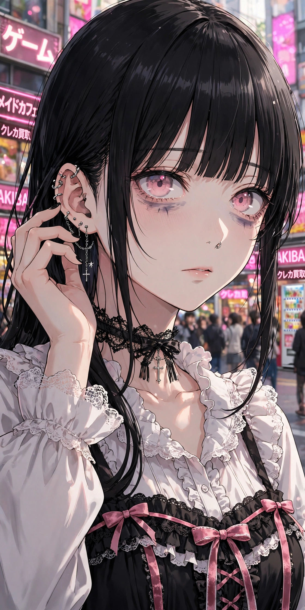
- v2 提示词原文：`Detailed anime illustration in Makoto Shinkai style, a close-up portrait of a young woman with black hair and straight bangs, pink eyes with obvious dark circles under them, multiple ear piercings, a nose ring and a choker necklace, one hand lightly touching her ear, wearing a white frilled blouse and jirai kei skirt, her face occupying only the UPPER HALF of the frame with more of her outfit and the street visible below, the background a blurred Akihabara street scene with pink shop signs and crowds, bright daylight, soft light on her face, pink neon tones in the background, pink, black and white palette, jirai kei fashion, menhera, Yamikawa Punk, art by Shintaro Kago, clean anime line art, smooth skin, fine metallic reflections on the jewellery, vertical composition`
- v2 对比：面部确实只占上半幅、下方露出地雷系裙装与秋叶原街景，目标点达成了；代价是画面断成三截拼贴感（上半张脸、中段街景、下半截裙子互不衔接），黑眼圈也画得过重。**本张 v2 未更接近**，v1 的单一连贯特写更贴合原图。
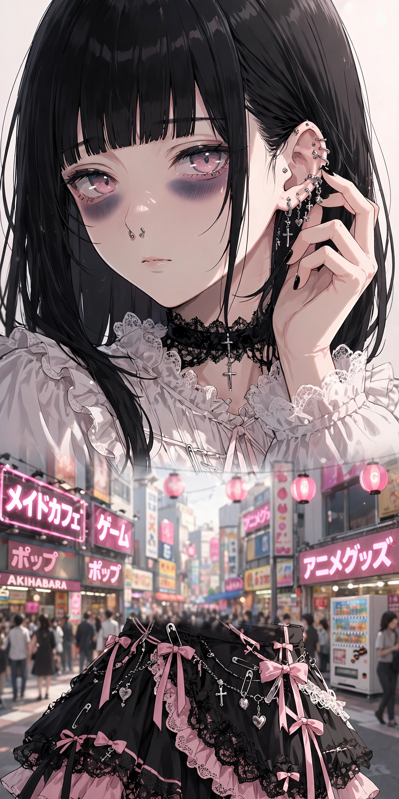
- 可复用规律：面部占比要写“occupying only the UPPER HALF”，只写“占上半幅”生成器仍会把脸画满；但“上半张脸 + 下半身服装街景”这种分层要求容易画成拼贴，亚文化符号（黑眼圈、穿孔、颈链）要一个一个点名写，漏一个就少一个。

## 15 · LiblibAI · 马年春联海报

- 原链接：https://www.liblib.art/imageinfo/8ffd845d3dbf473b9bebf782a717d0d7?from=feed
- 热度：赞 318、评论 2
- 原图拆解：竖版海报，顶部为大面积珊瑚红圆（日/月），白字“SPRING FESTIVAL”与红色“马到成功”“2026”；中央一匹粉红渐变骏马侧身向左，白色长鬃向右飘动，青绿马具配金色铃铛，鞍具红青金三色华丽。周围：多盏大红灯笼（右中、左下、右下）配金色流苏，背景米白底上有淡淡云纹与同心圆纹理。构图为上下分层——标题区、马匹主体区、灯笼前景区，层次分明。色彩为珊瑚粉、朱红、米白、青绿、金，喜庆明快。材质为 2D 扁平插画，色块干净，线条流畅。风格为现代国潮新春海报。模型：Qwen-Image_1.0，928×1664，Euler a、30 步、CFG 4，2025-12-17 发布，2 条评论。
- v1 提示词原文：`Modern Chinese trendy Spring Festival poster, vertical layout in three layers: the top area a large coral-red circle like a sun or moon with white text SPRING FESTIVAL and red text 2026, the centre a pink gradient horse in side profile facing left, white mane flowing to the right, teal horse tack with golden bells, ornate saddle in red, teal and gold, red lanterns with golden tassels in the middle right, lower left and lower right, cream-white background with faint cloud patterns and concentric circle textures, coral pink, vermilion red, cream white, teal green and gold palette, festive and bright, flat 2D illustration, clean colour blocks, smooth flowing lines, the horse in the middle layer, lanterns in the foreground layer`
  - 中文解析：现代国潮新春海报 + 竖版三层布局 + 顶部大面积珊瑚红圆（日/月）、白字 SPRING FESTIVAL、红字 2026 + 中央粉红渐变骏马侧身向左、白色长鬃向右飘动 + 青绿马具金色铃铛 + 红青金三色华丽鞍具 + 大红灯笼金色流苏（右中、左下、右下） + 米白底淡淡云纹同心圆纹理 + 珊瑚粉朱红米白青绿金 + 喜庆明快 + 2D 扁平插画、色块干净、线条流畅 + 马在中层、灯笼在前景层。
- v1 对比：像在珊瑚红圆顶部、白字 SPRING FESTIVAL、红字 2026、粉红骏马侧身向左、白鬃向右飘、青绿马具金铃铛、红青金鞍具、三盏红灯笼金流苏、米白底云纹同心圆、三层布局；偏在缺了红色“马到成功”四个字，马匹呈行走姿态（一条前腿抬起）；丢了“马到成功”这组中文标题字。
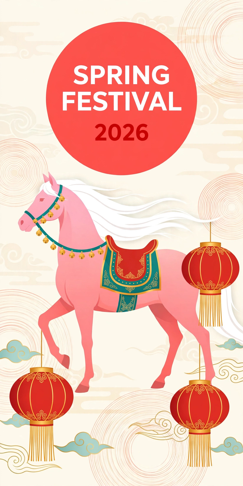
- v2 提示词原文：`Modern Chinese trendy Spring Festival poster, vertical layout in three layers: the top area a large coral-red circle like a sun or moon with white text SPRING FESTIVAL and red text 2026, red Chinese characters 马到成功 written vertically in bold calligraphy beside the horse, the centre a pink gradient horse in side profile facing left, white mane flowing to the right, teal horse tack with golden bells, ornate saddle in red, teal and gold, red lanterns with golden tassels in the middle right, lower left and lower right, cream-white background with faint cloud patterns and concentric circle textures, coral pink, vermilion red, cream white, teal green and gold palette, festive and bright, flat 2D illustration, clean colour blocks, smooth flowing lines, the horse in the middle layer, lanterns in the foreground layer`
- v2 对比：“马到成功”四个字竖排写在马身右侧、字形正确，红圆、英文标题、粉马、灯笼都在，更接近原描述；代价是马匹改为四腿站立、行走感消失，v1 的“抬腿行走姿态”反而更生动。
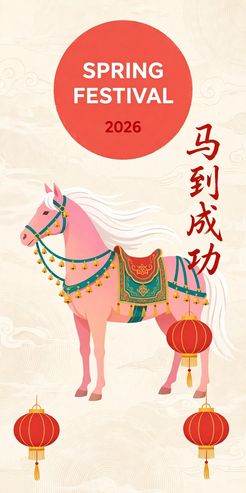
- 可复用规律：海报里的中文要把字本身写进提示词（“red Chinese characters 马到成功 written vertically”），只写“中文标题”生成器会画乱码或直接省略；英文大写单词（SPRING FESTIVAL）拼写基本一次写对，中文四个字也能一次写对，但每加一组字就要接受其他元素被挤占的风险。

---

## 共性结论

1. **占比数字要写死，不要写感觉**：本期 12 张 v2 更接近、2 张未更接近（11、14 号）、1 张 v2 未生成。更接近的 12 张里，几乎每一张的 v2 改动都是把一个模糊描述换成带数字或方位的死规定——人物占画幅四分之一（1 号）、巨石只占右上半幅（2 号）、月亮在左上（3 号）、瀑布只有一道（9 号）、黑猫比坩埚小（12 号）。反过来，v1 丢的东西也全是同一类：没写死的占比、数量、方位，生成器就按自己的习惯画满、画多、画居中。
2. **一次只改一个变量**：7 号同时改“香肩微露 + 笔尖触纸”，结果肩露了、笔尖却悬空了；6 号同时改“全身长裙 + 树枝斜入”，结果构图对了、斑驳树影却弱了。v2 的目标点达成率很高，但每改一处几乎都以另一处为代价，说明多变量同改时生成器会顾此失彼。
3. **画面里的文字拼写比想象中稳**：NOTHING（2 号）、SMALL MICE BIG SCREAMS + 六本书名（12 号）、SPRING FESTIVAL 2026 + 马到成功（15 号）全部一次写对。短词、大写、逐字写进提示词是关键；中文四个字也能一次写对，但要把字本身写出来，不能只写“中文标题”。
4. **“更接近”不等于“更好看”**：1 号 v2 姿态更准但拱形亲昵感弱了，3 号 v2 布局更准但光带变窄，9 号 v2 主线更简洁但环形结构存在感减弱。反推的目标是还原原图，不是优化画面，v2 对比必须按原描述打分，不能按个人喜好打分。
5. **体量反差是本期最难的一类**：1 号（巨马与老妇）、10 号（巨首与小人物）、11 号（角魔与行星）三张都涉及大小对比，生成器要么把小人物画大、要么把大物画小、要么把两者分开画。写死小人物的画幅占比（a quarter of the frame height）+ 写死大物的画幅占比（filling the upper two-thirds）双管齐下才压得住。
6. **多人物分层要给每个人定死位置**：4 号四只精灵、12 号猫与坩埚与书本，凡是写清“前景左 / 前景右 / 中景 / 左上高枝”的都一次到位，没写死的就挤在同一层。Z 字形、上下分层这类词要配具体位置才生效。

## 写实人物小结（5、6、7 号）

- **三张的共同点**：逼真感都来自“光的方向一致 + 手部解剖正确 + 皮肤有瑕疵”三件事。5 号温室漫射光均匀、右手捏帘边指节自然；6 号左上入射的晨光与树影方向一致、抓握苹果的指节受力自然；7 号格窗网格影与灯笼光晕方向一致、执笔与按纸的双手五指齐全。反推时这三点都要逐字写进提示词，缺一不可。
- **三张的共同破绽**：皮肤都偏光滑、面部对称度都偏高，是三张原图共有的典型 AI 写实特征。v2 在 5 号上把“clearly visible pores, fine lines and slight imperfections”写死后皮肤质感明显改善，说明“no retouching look”这类词要配具体的瑕疵词（毛孔、细纹、小瑕疵）才生效，只写“真实皮肤纹理”仍会被磨皮。
- **表情是写实人物最难的一点**：5 号“唇角微抿的俏皮微笑”写成“playful smile”会变成露齿笑，写成“lips gently pressed together in a subtle smile”才抿住；但抿住之后俏皮感又减弱。微笑幅度是写实人像里最敏感的变量，半级之差就是“自然”与“僵笑”的区别。
- **能避免塑料感的提示词**：`realistic skin texture with pores and slight imperfections`、`no retouching look`、`candid`、`85mm lens`、`shallow depth of field`、`natural blush`、`flyaway hairs`、`catchlights`——本期三张都用了这组词，皮肤与眼神的说服力明显好于只写“photorealistic”的时候。另有一条：**手部要写动作不要只写位置**（捏帘边、抓握苹果、执笔按纸），写清“手指怎么用力”比写“手在哪里”更能避免多指与变形。
- **本期写实人物 v2 结论**：三张 v2 全部更接近原描述（5 号抿唇与肤质、6 号全身长裙与斜入树枝、7 号香肩微露），但每张都有代价（5 号俏皮感减弱、6 号斑驳树影减弱、7 号笔尖悬空）。写实人像的 v2 改进空间比插画小，因为原图本身已经很“正确”，改动越细、代价越明显。
